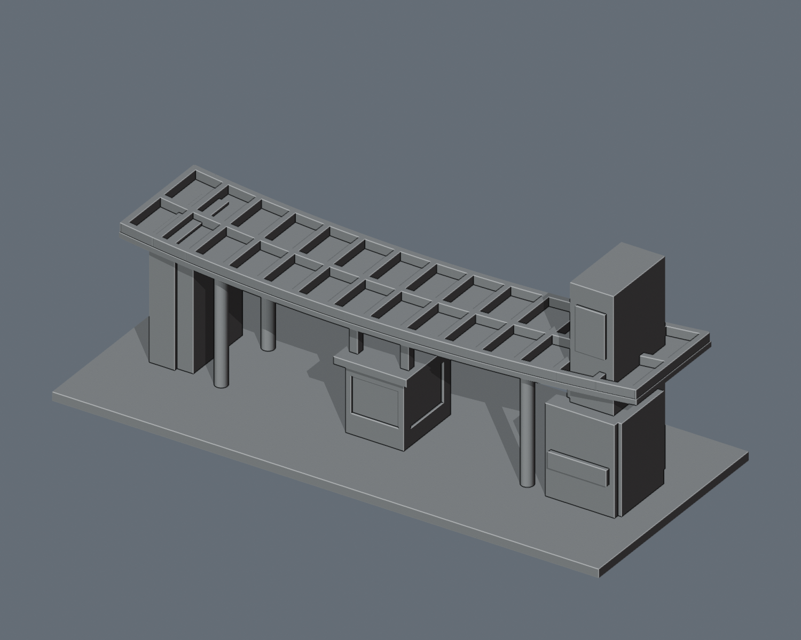

# 臺灣建築物 3D 模型

依地點整理的臺灣建築外觀模型集，收錄 **172 組模型／列印包**：原有國立聯合大學 38 組、國家衛生研究院竹南院區 9 組、臺灣各地地標 24 組，另新增下列大專校院 101 組。模型套件數不等於獨立建築棟數，也不表示全校或全國完成。

每個地點資料夾保留模型、可編輯原始檔、Blender 場景、實際模型預覽、來源說明與既有驗證資料。點選下方圖片，進入該地點的三欄建築圖鑑；個別模型的詳細資訊可展開查看。

## 依地點瀏覽

| 國立聯合大學 | 國家衛生研究院竹南院區 | 臺灣各地地標 |
| :---: | :---: | :---: |
|  **[聯合大學｜38 組](聯合大學/README.md)** 八甲、二坪山校區；北大門與中央警衛室置於圖鑑首位 |  **[國衛院竹南院區｜9 組](國家衛生研究院竹南院區/README.md)** 行政、圖書資訊、研究大樓等公開外觀近似模型 |  **[臺灣地標｜24 組](臺灣地標/README.md)** 各地建築再以獨立模型資料夾區分 |

## 新增大專校院圖鑑

| 校園模型 | 校園模型 | 校園模型 |
| :---: | :---: | :---: |
|  **[國立臺灣大學｜40 組](國立臺灣大學/README.md)** 部分建築／量體的外觀研究模型，非全校完成 |  **[國立成功大學｜30 組](國立成功大學/README.md)** 部分建築／量體的外觀研究模型，非全校完成 |  **[國立臺東大學｜11 組](國立臺東大學/README.md)** 部分建築／量體的外觀研究模型，非全校完成 |
|  **[國立中央大學｜20 組](國立中央大學/README.md)** 部分建築／量體的外觀研究模型，非全校完成 |  |  |

## 全國大專校院擴充進度

[全國大專校院清冊與工作範圍](全國大專院校/README.md)依教育部 115 學年度官方名錄列出 **158 所機構**，並保留 114 學年度手冊 **231 筆校區地址**（其中 2 筆附屬中小學排除）。校區地址筆數不等於獨立校園或建築數；軍警校區、共用校地及最新異動仍待逐項核對。

清冊分別記錄院校列冊、逐棟建築盤點、建模、驗證及發布狀態。**列入清冊不代表模型已完成；每校一件也不代表全校完成。** 已發布數以本頁圖鑑及[發布模型套件計數](model-packages.json)為準。聯大及東海路思義教堂沿用既有檔案，不重複建模。

## 資料夾與使用方式

- [聯合大學/](聯合大學/)：38 組校園模型位於 buildings/；研究目錄位於 docs/。
- [國家衛生研究院竹南院區/](國家衛生研究院竹南院區/)：9 組列印包位於 buildings/；範圍與證據限制位於 docs/。
- [臺灣地標/](臺灣地標/)：24 組地標各有自己的資料夾，保留原本模型名稱與目錄結構。
- 先進入地點資料夾，再依該資料夾 README 與個別模型說明操作。原說明中的相對路徑以其所在的地點／模型資料夾為準。
- 下載 STL 後，請自行使用切片軟體檢查；需要修改幾何或重新渲染時，使用各模型附帶的原始檔與 scene.blend。

### 龍虎塔 STL 另行下載

龍虎塔的 STL（36,412,062 bytes）保留在既有 [Release v1.0.0](https://github.com/root50643/taiwan-buildings-3d/releases/tag/v1.0.0)，不包含在 GitHub 自動產生的原始碼 ZIP 中。

[下載 dragon_tiger_pagodas_150mm.stl](https://github.com/root50643/taiwan-buildings-3d/releases/download/v1.0.0/dragon_tiger_pagodas_150mm.stl)，將檔名改為 model.stl，放入 **臺灣地標/dragon-tiger-pagodas/**，再依該模型說明操作。SHA-256：6e1c338abc56367db05ceb285e223071e96eb950f847d7895347387233de68b7。

## 模型範圍與限制

- 172 組是模型／列印包數量，並不等於 172 棟已核實且彼此獨立的建築。聯大尚未涵蓋全校；國衛院 R1／R2 合為一件，部分量體仍有身分或外觀證據限制。
- 均為依公開資料建立的外觀近似模型，不是官方模型、測繪成果、BIM 或工程圖；背面、屋頂與細節可能含推估、簡化或加粗。
- 各件採獨立展示尺寸，沒有共同校園／院區比例尺。STL 不含預覽材質或色彩。
- 既有數位網格檢查不等於切片或實體試印成功；尚未實體試印，請檢查薄壁、懸挑、支撐及列印設備限制。
- 本庫不另行分發第三方參考照片。建築、照片、雕塑與商標的相關權利不因模型公開而自動取得；各模型的來源、限制與權利說明仍適用。

## 整合與版本追溯

本庫由原臺灣地標模型庫原地改名，保留提交歷史與 Release；聯合大學、國衛院的原儲存庫仍保留。整合僅增加地點層級與本頁導航，不改動原模型、原始檔、預覽、說明或驗證檔案的內容。

整合來源版本、全部檔案的原路徑／新路徑與 Git blob SHA 記錄於 [整合清單](consolidation-manifest.json)。原儲存庫之後若有更新，不會自動同步至本庫。
