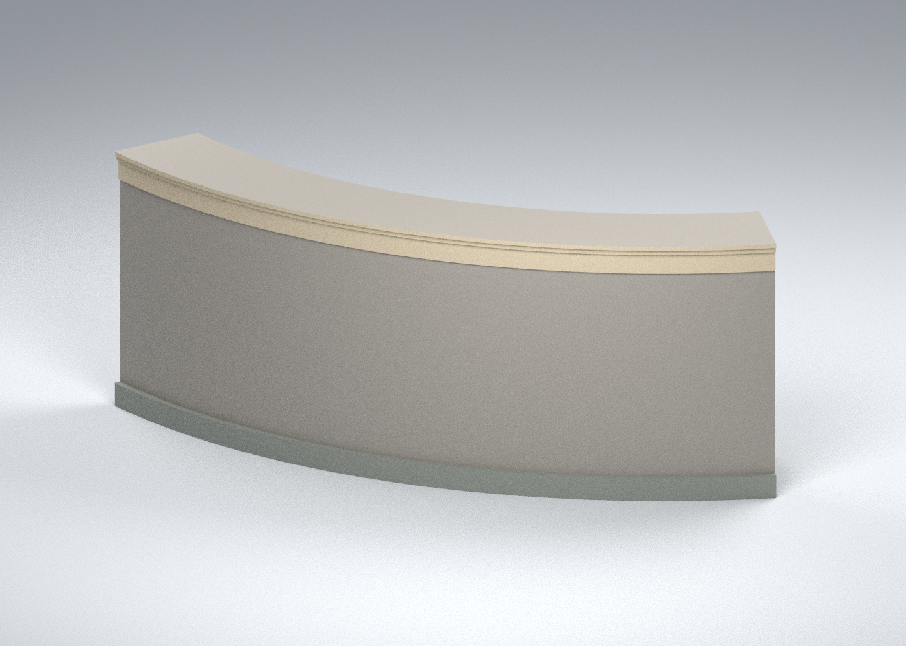
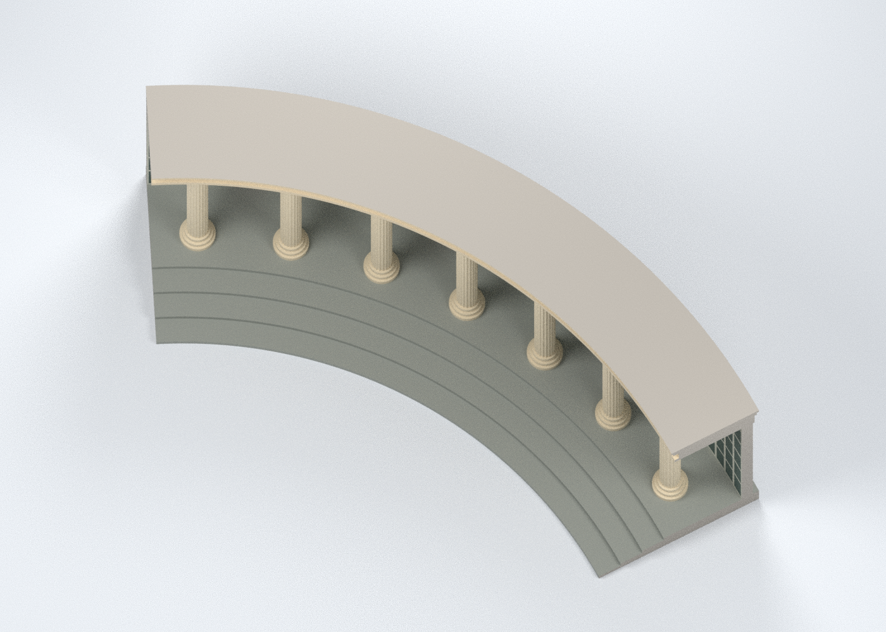
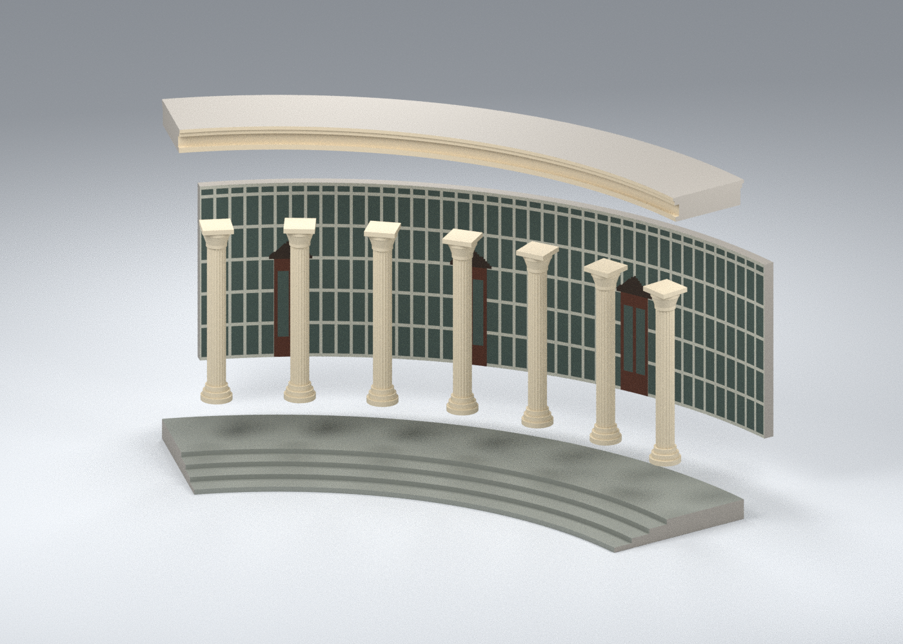

# 一貫道崇德學院：教學樓曲線列柱入口中央局部

## 模型預覽

| 模型預覽 | 模型預覽 | 模型預覽 |
| :---: | :---: | :---: |
| 八材質中央局部外觀  | 背部與側向裁切界面  | 俯視：估計曲率與段落範圍  |
| 四種零件／十實件，非列印排版  |  |  |

依兩張互補實景照片製作的**中央局部外觀模型**，選取連續七柱、六柱間與三處入口，含弧簷及近前低階平台。左右、背部與頂部均為明示裁切面；不是完整柱廊、整棟教學樓或全校模型。外觀、幾何與八材質配色完成，**尚未 FFF 切片、實體試印或試合，不能視為已驗證可印檔**。

## 下載與編輯

- [通用八材質 3MF 組裝外觀母版](appearance/chongde-entrance-section-ASSEMBLED.3mf)：四種網格原型、十個實例；七柱重用同一原型。沒有噴頭映射。
- [可編輯 Blender 場景](scene.blend)：相同網格、材質與裝配；攝影棚地面只用於渲染。
- [幾何與材質資料](geometry.json)、[建模源碼](source/build_model.py)、[3MF 匯出源碼](source/build_exchange.py)、[預覽源碼](source/render_preview.py)。
- [來源與界線](sources.json)、[有界假設](CONSTRAINTS.json)、[製造待驗事項](MANUFACTURING.md)、[數位檢查](qa/README.md)。

| 零件原型 | 數量 | 無色 STL | 通用表面色 3MF |
|---|---:|---|---|
| 弧形低階平台 | 1 | [01](parts/01-curved-stepped-platform.stl) | [01 彩色](appearance/parts/01-curved-stepped-platform.3mf) |
| 簡化凹槽柱與柱頭 | 7 | [02](parts/02-column-prototype.stl) | [02 彩色](appearance/parts/02-column-prototype.3mf) |
| 曲面展示背板及三處門窗色區 | 1 | [03](parts/03-curved-glazing-and-three-portals.stl) | [03 彩色](appearance/parts/03-curved-glazing-and-three-portals.3mf) |
| 弧形簷帶局部 | 1 | [04](parts/04-curved-entablature-section.stl) | [04 彩色](appearance/parts/04-curved-entablature-section.3mf) |

四種零件、十個實體件合計一套局部建築模型。組裝包絡約 **143.704 × 52.214 × 53.8 mm**；尺寸、柱距、弧度與厚度均按照片估計，沒有實測或精確 1:N。

## 來源與簡化

[學院官方頁](https://www.iktcds.edu.tw/Chong-De-School/index.htm)用於身份對照；[豪門工程作品頁](https://kchien9.wixsite.com/hungmeng/chong-de-school)的近景與廣角照片用於入口形態及可見色區。照片拍攝年未知，存取日期不是拍攝日期，也不保證 2026 現況。

七柱是本模型選取段的數量，不是整座柱廊的總柱數。柱頭、凹槽與簷口保留低細節輪廓，沒有精確雕花或文字。三組門、門頂與窗格只用表面顏色表達，玻璃為不透明灰綠近似；後板是約 2.6 mm 徑向厚度的封閉展示面，並非真實建築背牆或可穿透入口。低階平台採四層顯示近似，不宣稱實際階數。

上方五層翼樓、圓鼓與帽頂、後翼、完整平面、周圍佛院建築、欄杆、水景、設備及未知背面細節都未納入。頂部平面代表裁切，不是教學樓屋頂。

八個具名表面材質為柱米白、弧簷米白、平台灰、玻璃灰綠、窗格淺色、門木褐、門頂深褐及裁切面中性灰。色值為人工近似，未經現場色卡或照明校正，不強制合併成四色。Core 3MF 保存面色，沒有封閉多材料體、擦料塔或機台設定；切片器可能忽略通用面色而須重新指定。

## 驗證狀態

四 STL 為單一閉合水密、法向一致、正體積且無零面積三角形。五個 3MF 已用 lib3mf 嚴格讀取，座標／面序／面色與 canonical STL 一致；單材質編輯重存、十實例裝配與乾淨重建均另附報告。Blender 場景重開與四張預覽亦有紀錄。

解析承托篩檢仍保留**柱原型 2 個、弧簷 2 個旗標**；同一柱原型使用七次，不能把四個原型旗標當成十實件全部風險數。此為截面面積篩檢，不是 FFF 切片或無支撐保證。底座、柱與背板及簷帶的名義接觸不等於膠合強度、公差、支撐清除或實物組裝驗證。

[SHA256SUMS](SHA256SUMS)／[檔案雜湊清單](PACKAGE-SHA256.json)。原圖只作私人研究參考，不隨模型散布；公開內容僅含原創模型、預覽、源碼與來源事實／連結。
