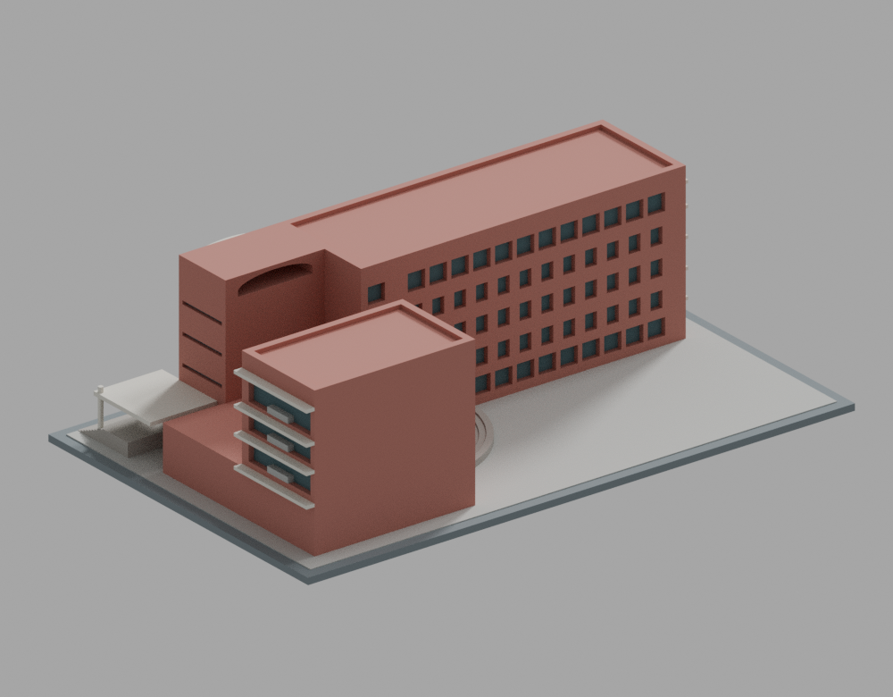

# 中信金融管理學院原女生宿舍暨演講廳

## 模型預覽

| 模型預覽 | 模型預覽 | 模型預覽 |
| :---: | :---: | :---: |
| 正面（東南）  | 背面（東北）  |  |

早期完工外觀有限細節模型。學校識別：教育部 115 學年度代碼 **1125**。建築師作品所記為原興國管理學院女生宿舍暨演講廳，設計 2000 年、完工 2001 年。照片拍攝日期未明，不能稱為「攝於 2001 年」。設計來源為張景堯建築師事務所，合作王東奎建築師事務所，攝影依作品頁標示為張景堯；本模型不宣稱獲原建築師或攝影師授權、認可。

**版本與未知：採早期完工外觀；北短翼北面開窗未核實，刻意簡化留白。未加入當代光電或 2022 年整修渲染棚架。**

## 模型範圍

以南側長高翼、北側短高翼、東側較低演講廳及開放院落為核心。保留南立面十二跨、中央八窄跨與兩端寬跨分組、八道頂部豎槽、大扁拱洞、獨立六跨前拱列、外露連梁、西端挑出部分、東入口挑棚及弧形階梯。

南面與東西端依建築師實景照片取捨；主長翼北面依第二張設計立面推定。北短翼北面沒有足夠開窗證據，明示簡化留白。沒有重建內部房間、隱蔽構造或地下室。屋面以保守輪廓處理，不加入當代光電或 2022 年整修渲染的棚架。

## 尺度與製造選擇

- STL 格式不內建單位，匯入切片器時採 mm；底座 200 × 125 × 2.4 mm，總高約 58.25 mm。
- 名義比例約 1:400。南高翼約 62 m 長、22.3 m 高，房間帶深約 16 m；後退界約距西端 47.5 m。北短翼估計 X 47.5–71 m，東伸約 9 m。
- 所有模型尺寸皆為照片、低清圖面與正射回配估計或製造選擇，並非實測。原約 68 m 長度起點混用了不同屋面端點，已修正；初始 ±2 m 提示不是誤差保證。
- 窗洞大多為實體上的凹窗；大拱洞與前拱列是真空洞。底座、拱牆、梁及建築合成相連實體。
- 小尺度窗外框加厚至約 0.91 mm；西端底框與北短翼東南薄根加厚。前拱列約 0.5 mm 平面外擴／圓角，入口支柱、內拱柱與弧階端角約 0.5 mm 圓角。窗挑檐從洞頂實牆起根，弧階端延入南牆形成可靠重疊。這些是製造替代，不能視為原建築細節復原。
- 白拱上緣加厚；未核實的東端屋頂淺凹取消，以避免拱上薄皮。來源控制的黑口比例及雙翼軸線保留。

## 預覽與檔案

- 原 STL：`models/v11/model.stl`，16,096 個三角面。
- SHA-256：`fa05503ab8ea54036a9312d4a2d263545c7b01bd61bbe07108558b4ea5974db6`。
- Blender：`models/v11/scene.blend`，單一網格，直接保存原 STL 有向三角面與程序色材質，沒有替代幾何或原圖貼圖。
- `previews/v11/` 有七張主圖（front、rear、top、south、north、east、west）與入口、屋頂／西南兩張局部。方位由圖面、實照及正射回配推定，不是測量放樣。
- 正式渲染採 CPU Cycles 64 samples、固定 seed 0、單執行緒、1000 × 780。現有 Blender 不支援 OpenImageDenoise，未使用去噪。
- 公開 PNG 僅去除 File 及時間／性能文字 metadata；原 IDAT、RGBA 像素、色彩資訊及所有保留 chunk 不變。公開圖 hash 與原圖不同，綁定見 `render-manifest.json` 和 `metadata-cleanup-binding.json`。原圖時間文字會變，不能聲稱原始 PNG 整檔可重現。

原碼為 `source/build_model.py`、`source/render_preview.py`，參數為 `parameters.json`；模型資料夾有當時源碼／參數快照。需 Python、`requirements.txt` 套件及 Blender 4.3.2；選定軟體版本見 `toolchain.json`。從本套件根目錄，以全新輸出目錄重建：

    OMP_NUM_THREADS=1 OPENBLAS_NUM_THREADS=1 python source/build_model.py --output-dir models/rebuilt
    OMP_NUM_THREADS=1 OPENBLAS_NUM_THREADS=1 blender -b -t 1 --python source/render_preview.py -- rebuilt

這會產生原始 PNG；公開 metadata 清理及數值重現方式見 `qa/README.md`。位元級重現僅限實際驗過的工具鏈，不保證不同軟體版本或硬體相同。

## QA 與列印

作者的 v11 正常及 `-O` 原始數值檢查均完成：原網格法線／單一表面、874 個切層中的 3,273 個 Polygon，以及 179,377 組含鄰面／共面的精確閉 AABB 候選通過。160,960 條原面法線射線沒有短於 0.8 mm 者，受測最短約 0.911758 mm；這不是全域最小壁厚。

原數值檢查各有 9 個旗標，**strict false 保留**。正常與 `-O` 均另用完整原 run 十六進位描述逐事件精確分類，全部旗標的第一實體區間達 0.8 mm；沒有重建理想射線、移動樣本或套用其他模型豁免。完整原 CSV、旗標、報告和精確分類保留。最終有限範圍的獨立結論以 `qa/independent/QA-RESULT.json` 為準；尚未完成時不以作者自檢代替放行。

檢查針對未修補原 STL 的法線、單一表面、閉 AABB 全原面相交（含鄰面／共面）、每原面十射線，以及各層每個 Polygon 的窄根。有限檢查不能保證所有方向厚度或實際列印結果。

**尚未試印。** 大扁拱、前拱列、入口挑棚、西端挑板及其他懸挑可能需要支撐，不宣稱免支撐或可直接成功列印。底座平放；縮小後需重新檢查。材料、噴嘴、層高、樹脂脆性、切片器與支撐策略會改變結果。見 [列印限制](PRINTING-LIMITS.md)。

## 來源與限制

- [建築師作品頁](https://jyca.com.tw/?section=project&category=7&item=32)
- [建築師中文作品資料](https://jyca.com.tw/load.php?section=project&item=32&lang=zh-tw)
- [教育部開放學校名錄](https://stats.moe.gov.tw/files/opendata/u1_new.json)，本件研究保留其中 115 年度代碼 1125 的 row；[學校沿革／識別頁](https://udb.moe.edu.tw/ulist/Institution?id=000021E83E68) 網頁名冊欄為 114 學年，不冒充 115 年名錄。
- 研究使用建築師平面／兩張立面／六張實景，以及國土測繪正射的相對幾何回配。照片、圖面、正射與衍生裁圖均為私人研究資料，不隨公開模型提供，也不是貼圖。

完整估計與未知處見 [證據與簡化](ESTIMATES-AND-SIMPLIFICATIONS.md)、[幾何計畫](CORE-GEOMETRY-PLAN.md)。原始參考圖與歷史失敗模型只留私人追溯；本套件不含原照片、圖面或正射。公開使用的數位檢查範圍以本件實際綁定的 QA 結果及限制為準。
