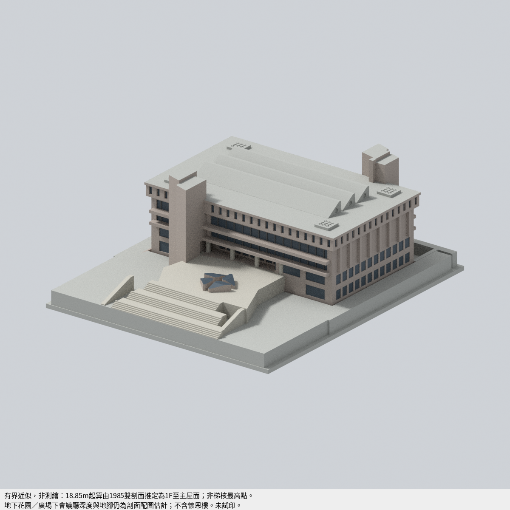

# 中原大學

目前本校合計 **4 套**，套件數不等於建築棟數，非全校完成。

## [中壢校區](中壢校區/README.md)

歷史首件交付：懷恩樓（約2021外觀近似，未含2024光電）。本頁不是全校建築清單，也不代表全校完成。

| 建築模型 | 建築模型 | 建築模型 |
| :---: | :---: | :---: |
|  **[懷恩樓（約2021外觀近似，未含2024光電）](中壢校區/buildings/cycu-huai-en-hall-2021/README.md)** 南面實際模型 |  **[中原大學 張靜愚紀念圖書館（1985）有界近似列印模型](中壢校區/buildings/cycu-chang-ching-yu-library-1985/README.md)** |  **[中原大學 M 字舊校門（2011 遷移後外觀近似）](中壢校區/buildings/cycu-m-gate-relocated/README.md)** |
|  **[體育館｜約1989–1991歷史整棟外觀近似版](中壢校區/buildings/cycu-gymnasium/README.md)** |  |  |

[模型、來源與驗證](中壢校區/buildings/cycu-huai-en-hall-2021/README.md)

歷史發布註記：加入張靜愚紀念圖書館時累計 2 套；不增加學校數，也不表示全校完成。

[懷恩樓約2021歷史主屋面暗色限定研究外觀與來源界線](中壢校區/buildings/cycu-huai-en-hall-2021/appearance/README.md)

## 體育館歷史外觀近似

[體育館｜約1989–1991歷史整棟外觀近似版](中壢校區/buildings/cycu-gymnasium/README.md)：體育館：歷史設計圖與實照支持的約1989–1991整棟比例化彩色近似，含南北高廳/北端小館、階退低西翼、凹入口、圓弧端部、外梯、4組成對屋頂（共8剖形）及連續高西屋緣；高端玻璃朝南，不稱北向採光。排除獨立泳池與跨棟連橋，非2026現況/測繪/精確竣工復原。159×194×約44.59mm為展示尺寸，公尺尺度未建立；北/東立面按設計圖有界簡化，未知室內/屋面/接縫中性收束。STL、7材質3MF、可編輯Blend、Python重建及9張實際渲染；細窗框、門廊、階梯與屋緣支撐/色帶限制明列，未實體試印。
