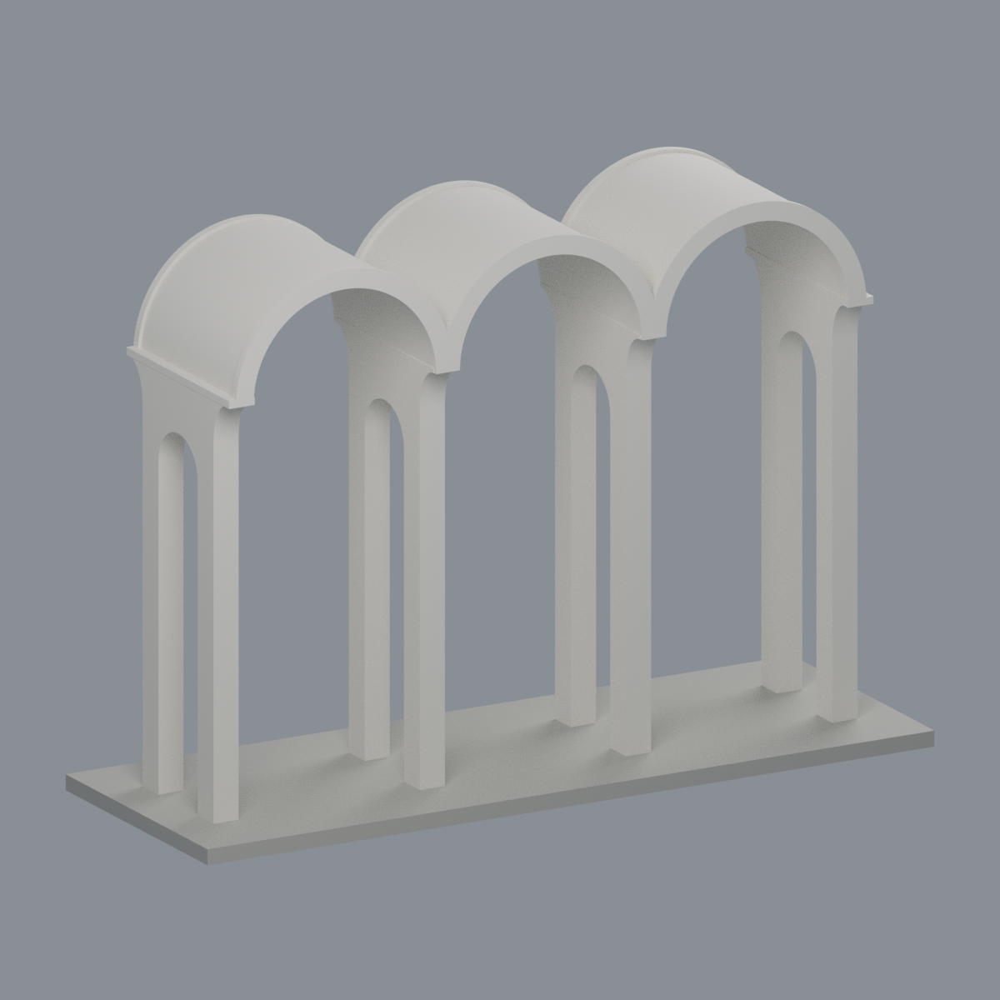
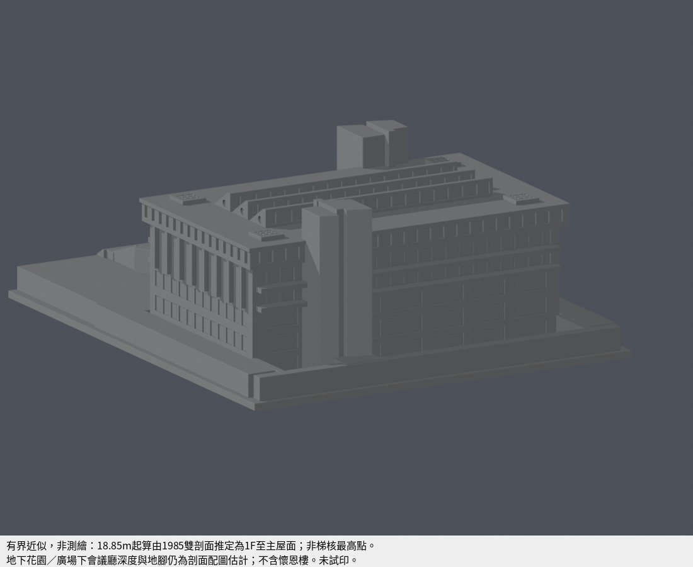

# 中原大學・中壢校區

歷史首件為懷恩樓外觀近似模型；不是全校完成清冊。

## [懷恩樓（約2021外觀近似，未含2024光電）](buildings/cycu-huai-en-hall-2021/README.md)

| 南面實際模型 | 北面實際模型 |
| :---: | :---: |
|  |  |

| 建築模型 | 建築模型 | 建築模型 |
| :---: | :---: | :---: |
|  **[中原大學 張靜愚紀念圖書館（1985）有界近似列印模型](buildings/cycu-chang-ching-yu-library-1985/README.md)** |  **[中原大學 M 字舊校門（2011 遷移後外觀近似）](buildings/cycu-m-gate-relocated/README.md)** |  |

1983圖說補形、2023屋頂外廓、2021屋面／北面資料與2018南面照片交叉核對。完整量體近似，並非2021精密復原或2026現況。來源、限制、STL、Blend與QA詳見建物頁。

## 補建：張靜愚紀念圖書館（1985，有界近似）

加入此館時累計2套；不增加學校數，不表示全校完成。18.85m由兩剖面交叉推定1F至普通屋面，最高梯核另高。前後地腳／平台有界，未試印。

| 同件南正面 | 同件北背面 |
|---|---|
|  |  |

[模型、來源、限制與QA](buildings/cycu-chang-ching-yu-library-1985/README.md)

## 新增：M 字舊校門（2011 遷移後外觀近似）

目前本校合計 **3 套**，套件數不等於建築棟數，非全校完成。

2018 官方文章所刊遷移後照片約束，歷史側照補三桶拱／四穿孔深墩與八腳；3 色 3MF／Blend／STL。無實測尺度，背頂平滑延續與後緣同構為限定推估；521 層分量核心存活但極頂切片局部圓角損失 6.7933%，非全體積損失；未實印。獨立門體不在既有懷恩樓模型中。

[模型、來源與 QA](buildings/cycu-m-gate-relocated/README.md)
