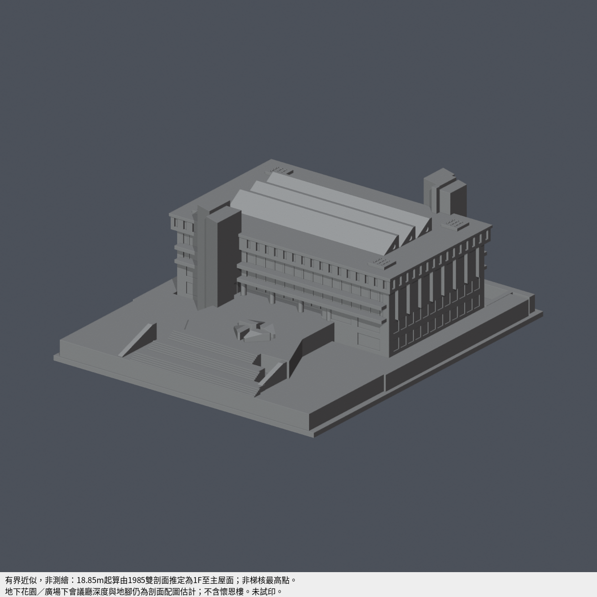

# 中原大學 張靜愚紀念圖書館（1985）有界近似列印模型

## 模型預覽

| 模型預覽 | 模型預覽 | 模型預覽 |
| :---: | :---: | :---: |
| 南正面與入口<br> | 北背面與下沉庭<br> |  |

本工作只新增已覆蓋學校中原大學的另一棟建物；不增加學校數，不改懷恩樓。作者完整幾何QA完成；限定角損及背接浮雕待獨立審核，未試印。


## 首頁與圖鑑代表角度



首頁、校級與校區圖鑑仍選用**同一座張靜愚紀念圖書館**；不改成懷恩樓或其他建物，不增加模型件數。沿用聯大八甲北大門代表圖的立面相對角度：相對南入口正面偏轉 **36.87°**、俯視 **23.43°**、正交投影、1200 × 1200 畫布及完整底座。本模型共同座標為 X 東、Y 北，主入口大梯位於 −Y；保留原 `front.png` 所見的南入口與東側，以相對視線 `(180, -240, 130)` 換算，不以相機絕對高度代替俯角。

原 `previews/front.png` 的相對俯角約14.09°，仍保留為原始建築檢視，不覆寫。新增代表圖只改相機、置中與取景，**原八張預覽、STL、原生 Blender、幾何、單一灰色材質、照明與背景均保持不變**；兩行有界近似／未試印字幕照原文保留在底部50px區域，不遮住底座。本輪沒有補色、改材質或新增現況測繪、全向最薄壁及實體列印聲明。

```sh
blender --disable-autoexec --background --factory-startup --python-exit-code 1 --python render_homepage_preview.py
```

可在命令末尾加 `-- --out /path/to/output`，另存單張代表圖。腳本精確比對原場景與 STL 的 float32 三角座標，核對渲染前後幾何、材質索引、材質色彩、照明背景簽章，且不儲存原 `.blend`。若輸出目錄已有原八圖及其 `render-manifest.json`，會先驗證原圖雜湊再加入新圖；不改原圖。相機、完整入框、來源與簽章見 [`qa/homepage-camera-validation.json`](qa/homepage-camera-validation.json)。

[`qa/homepage-cover-verification.json`](qa/homepage-cover-verification.json) 記錄兩次獨立載入原場景與一次從原始程式新建場景的封面一致性、來源負向控制及本輪驗證範圍。`validate_model.py` 保留既有檢查，新增獨立封面重渲染與九圖名稱／manifest完整性檢查；本輪核心重建結果見 [`validation.json`](validation.json)。原 `QA-SUMMARY.json` 的八圖結果、獨立薄特徵／角損／密點／根接審查是歷史幾何證據，保留原警示與有限例外；本次換相機未重跑這些完整幾何套件，也不新增製造保證。

## 共同座標及高度口徑
北上，X向東、Y向北，南入口在負Y。校方5F示意圖8柱心為7跨，7×7.8m=54.6m；柱心約112px一跨。外牆按同圖約59.8×36.7m，與雙期正射主屋簷約60–63×37–40m一致。不是把原印刷1/600直接套渲圖DPI。

1985文字高度18.85m未明定datum。東西剖面1F地線約y516、普通主屋面y205，南北剖面對應約y1077/y766，同為311px；柱格約130px/7.8m換算約18.66m，支持將18.85名義作1F到主屋面。這是剖面交叉推定，非原文標高。

相對1F：B1底約−4m、2F入口廣場約+4.2m（剖面量圖約4.0–4.8m界）、主屋面+18.85m、鋸齒峰約+22.2m、服務核約+25.2m。原文『懷恩樓基地高2m』不是1F→2F層高。模型以B1底z0作幾何基準，所有值相應加4m。

## 保存主要拓撲
- 三條東西向單坡鋸齒採光，上坡朝北、北側直立採光面。中央挑空有屋頂，不挖露天空洞。
- 南偏西、北偏東兩風車狀梯核依校方圖描，分片高差；不是中央對稱雙塔。
- 四角低方格蓋有頂，不挖穿。
- 南2F入口廣場、分段大梯及其下會議廳實體；北有底下沉花園及橋。只取圖書館自身平台，不含懷恩樓。
- 南北窄頂窗／水平窗帶／下部柱梁與東西中段大實牆分開，不四向複製窗陣。

## 仍為有界近似
平台各邊、下沉花園露出地腳及會議廳深度以舊剖面和現況照片共同配合，非測繪；小設備、護欄和室內樓梯不完整復原。南端四片三角採光件以局部截角/截頂避免尖楔，局部外觀已核。原照片與PDF只留來源研究夾，不納公開包。

## 外觀核後列印化簡（原參數單位m，輸出mm）
縮尺150/83.5=1.796407mm/m，含底座最大150mm。前主窗帶是實STL淺凹，細框退至背牆融合；框寬0.38m→0.682635mm屬背接浮雕，不能當獨立可印薄牆。四角蓋淺刻線保留實底。南平台為正射可辨四片風車式三角採光組，角端沿兩邊各退0.7m→1.257485mm，頂局部截平；不宣稱真建物有此平端。斜欄頂局部從8.5降至8.0m，改成有限端面；格蓋、斜欄、採光件仍須依原面首段/後空氣和根查核，未試印。

前地層名義1F=4m，平台2F=8.2m，地表外露名義4.2m；下方會議廳其餘部分埋入1F地層，北庭仍取B1實底。寬梯三段、兩深平台和斜欄/花台為可列印抽象，沒有復原全部園景與欄杆。層間淺刻窗和細格不能作人流/結構分析。

## 可攜驗證
原STL以process=False讀入；結構QA只允許完全相同座標去重，不修補、改法向或吞掉退化面。逐原Polygon 0.2mm層切、0.4mm erosion/opening，逐構件高損保留原WKT與包含內環的真角mask。原面7點密採包括底座，保留首段與其後空氣，另含根接控制。

密點/逐構件明細以gzip直接寫出，不先落巨大JSON；Python標準庫讀法：json.load(gzip.open('dense-first-chords.json.gz','rt',encoding='utf-8'))。所有數值完整保留，壓縮不降低取樣密度。作者原送審數值與嚴格警示保留；本輪已完成獨立核驗及指定有限例外裁定，詳[獨立補充](INDEPENDENT-AUDIT.md)，不能由整層低損推論全過。

## 交付與驗證
[原創參數源](build_model.py) · [實際STL](model.stl) · [可編輯Blend](scene.blend) · [來源與界線](sources.json) · [QA摘要](QA-SUMMARY.json) · [重建與原mesh](validation.json)

輸出127.544907×150×54.610779mm，單殼水密、原頂點link單圈、原法向／繞序一致、零退化與零重面。三角面9110；273層逐原Polygon零分裂消失。共面候選41936對無正面積重疊，非全面自交證明。獨立重建STL／Blend幾何與8張PNG bytes一致。

47個跨層高損樣本：16個屋頂淺刻格32筆、4外環8筆、西斜欄7筆；最高6.689108533%損失、保留93.310891467%，全在原真角（含洞角）0.41mm範圍。原面XY邊中首弦≥1.0778427mm，向下首出口均到z0；不能代替斜面法向。

全部9110原面各7點（含底座）63770密點，255080個內／外／首段中點／出口後空氣控制零失敗。1852個短首段未隱藏：1792是背接細窗框，原側向約0.682632mm；向背牆另方向實根首出口≥61.1794316mm。另60筆輪廓角在同原面內移≤0.4mm皆回到≥0.8mm。最短原首段0.0268744mm仍保留，禁止把背根數字當全模型最薄。以上為作者7點法及其原容差的送審結果；獨立15點與不同原面容差判定、失敗替代方法詳[獨立補充](INDEPENDENT-AUDIT.md)，不稱零警告。

南採光四片的XY退角1.257485mm與局部截頂、斜欄頂末0.898204mm截平、鋸齒側圓凹下移0.718563mm、端窗縮窄以及風車核裝飾槽省略均屬列印處理，非真建物測繪細節。

## 可攜重建環境與預覽修訂
[固定依賴](requirements.txt)與[安裝、字型及完整重建命令](REPRODUCE.md)。v2字幕在原畫面外加50px底邊，原相機和1100×850渲染區不變；不再遮住頂視南前緣。


## 本輪獨立覆核

[指定47角損、3926短段、18後沿面及來源／支撐限制](INDEPENDENT-AUDIT.md)。原STL與Blend不變；8預覽只在原完整畫布外加字幕。公開原面驗證與未round截面程式可在副本重跑，保留原警示，沒有實際試印。
