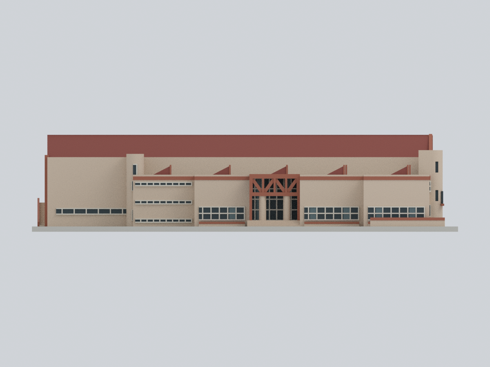
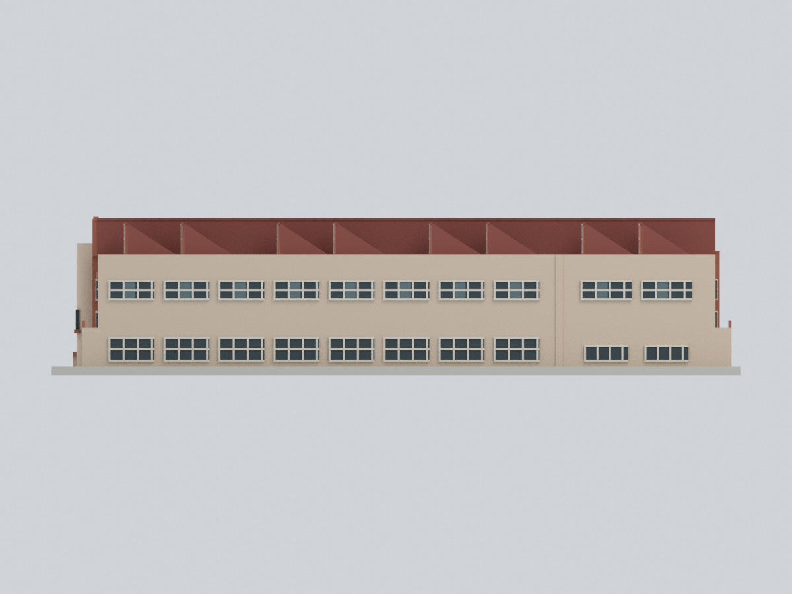
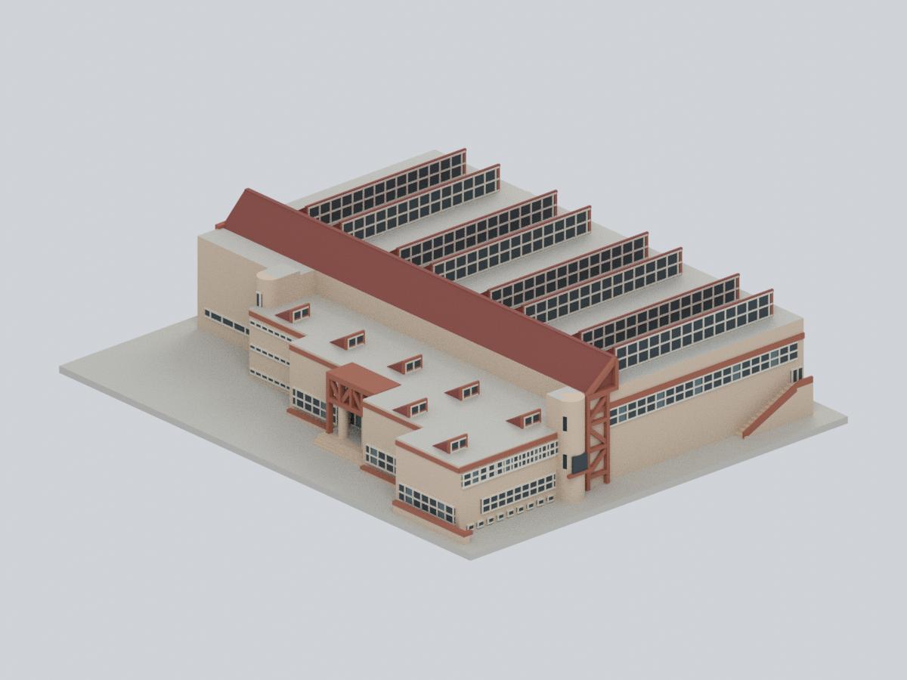
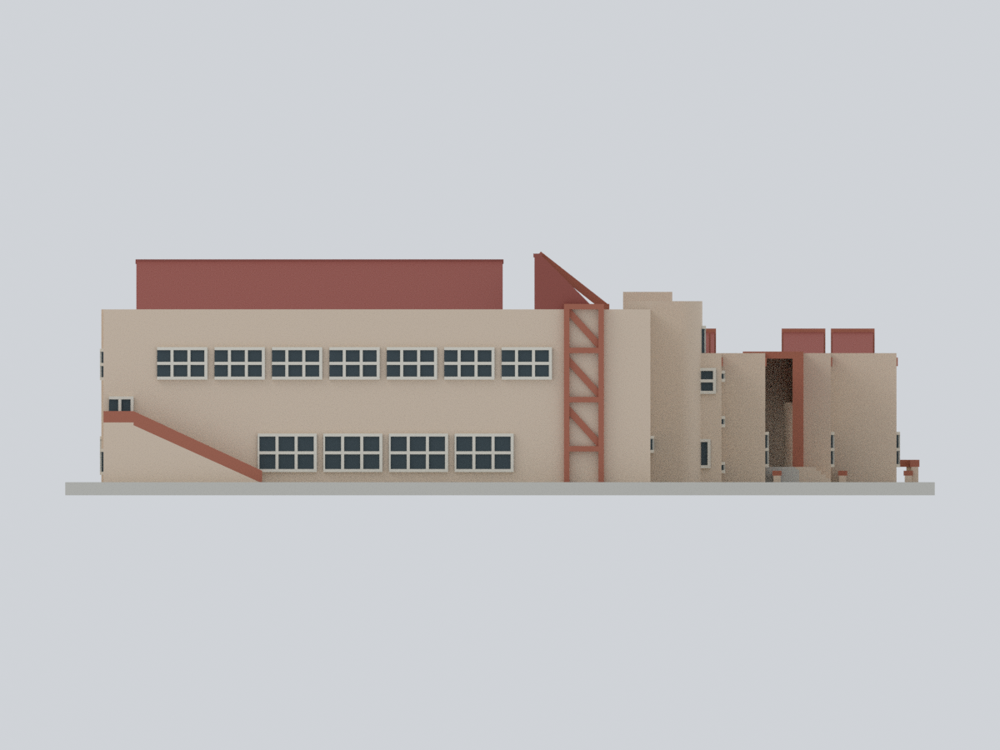
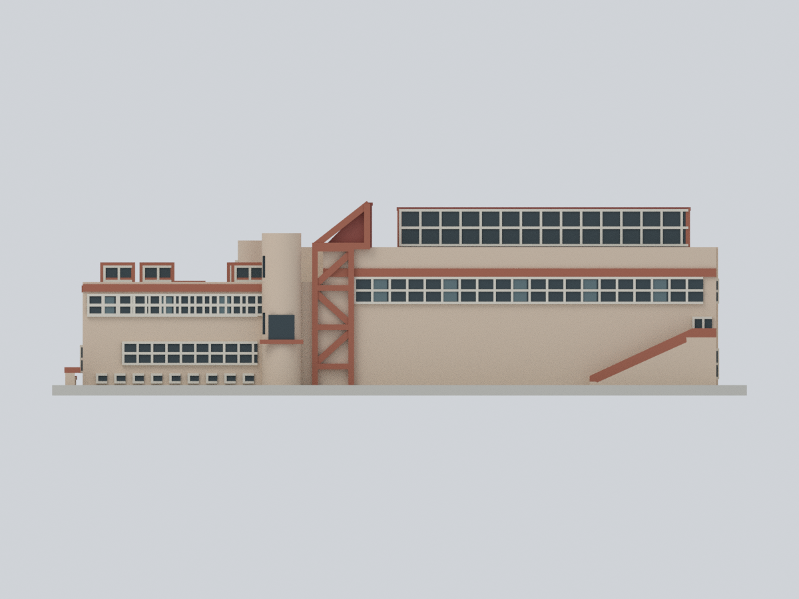
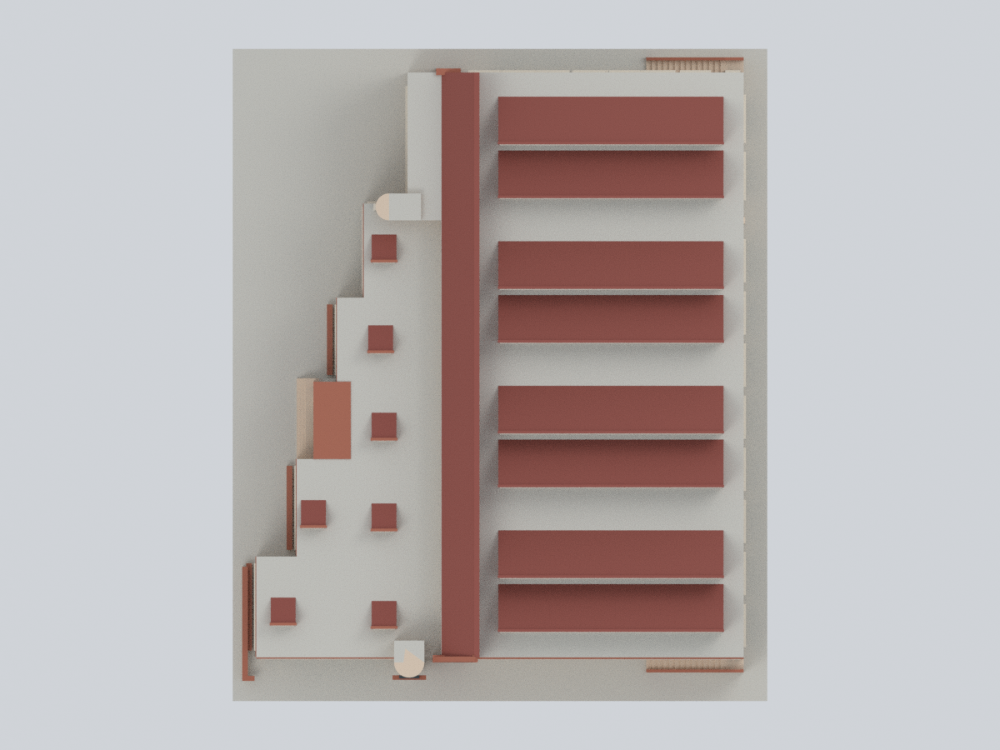
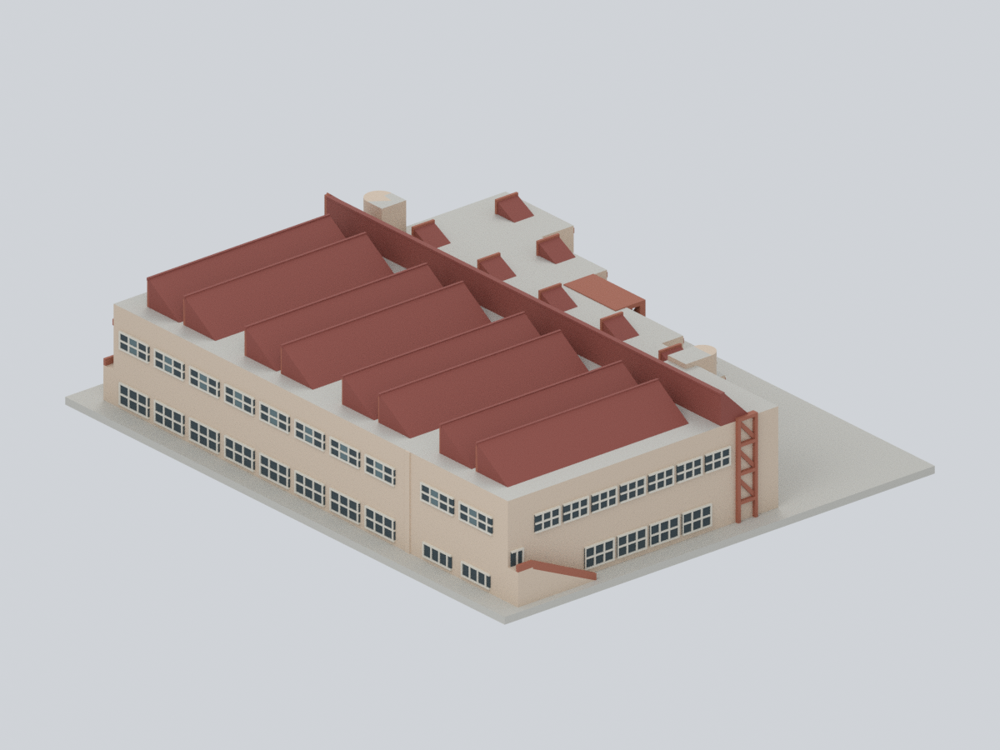
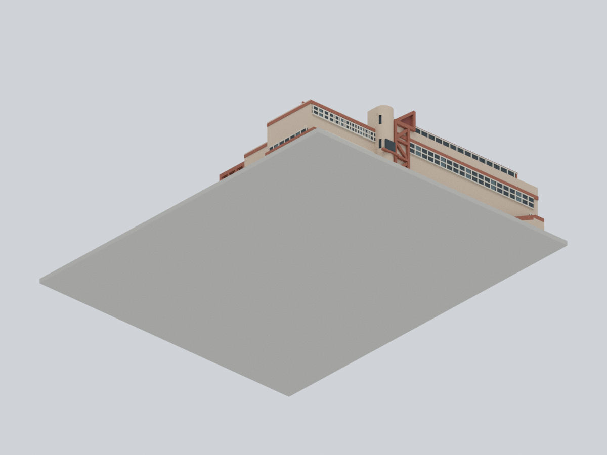
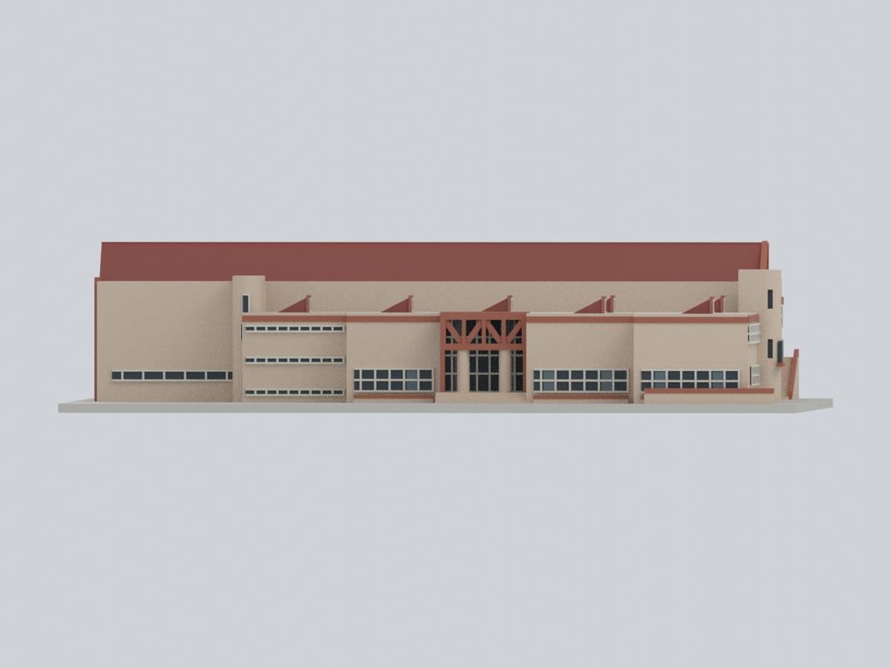

# 中原大學｜體育館

**完整整棟、約 1989–1991 年歷史外觀的彩色有界近似**。包含南北向高廳及北端較小球場、由北向南逐步伸向西側的低翼、凹入入口、圓弧端部、外梯、四組成對採光屋頂與連續高西側屋緣；不是只做入口門架。

這是歷史設計圖與照片的比例化綜合，**不是實測、精確竣工復原或 2026 現況模型**。泳池及跨棟連橋位於南側，屬另一棟及其附屬界面，本包排除；體育館自己的南塔及短附著界面仍保留，沒有懸空半橋。

## 實際模型九視角

九圖直接渲染同一實際交付網格，沒有來源照片貼圖、示意替身或 AI 畫圖。座標 **+X 東、+Y 北、+Z 上**，入口向西；正向圖用水平正投影，斜視顯示屋面拓撲。方位由有文字的歷史立面圖及實照交叉建立，不是測得方位角。

| 西立面／入口 | 東立面／圖面支持 | 西南斜視 |
|---|---|---|
|  |  |  |
| 北立面／圖面支持 | 南立面／低西翼在左 | 俯視／四組成對採光頂 |
|  |  |  |
| 東北斜視 | 底面／原創展示底座 | 低角度西入口 |
|  |  |  |

## 檔案與尺度

- [STL](model.stl)：單一相連、封閉、正體積網格，**159 × 194 × 約 44.59 mm**，含 2.4 mm 原創展示底座。STL 本身無色。
- [可編輯 Blend](cycu-gymnasium.blend)：真實頂點／三角面與 7 個逐面材質，保留原三角面索引及證據規則；沒有隱藏補件、材質貼圖或外部圖片。
- [彩色 3MF](cycu-gymnasium.3mf)：實際 base-material 與逐三角面屬性，不是改副檔名的 STL。
- [驅動參數](parameters.json)、[色盤](palette.json)、[來源與權利](sources.json)、[證據規則](mapping-rules.json)、[逐面映射](face-materials.csv)、[權威網格陣列](mesh-data.npz)。

**公尺尺度尚未建立。** 本包 mm 全是為展示／列印選定的比例化數字，不能反稱真實長寬高，也沒有名義 1:N 的測繪保證。圖面紙張 59.3 × 84.2 cm 不是建築尺寸，微小不可讀的比例尺未拿來校準。主廳南北長／東西寬約 1.93、牆檐高／寬約 0.35、北端小館長約占四分之一，僅為資料支持的視覺比例級距。

## 來源、年代與判斷

| 可回查來源 | 實際用途 | 不能誇大的部分 |
|---|---|---|
| [M+ 幻燈片案卷 CA39/4/8/3/1](https://www.mplus.org.hk/tc/collection/objects/slides-gymnasium-and-swimming-pool-19871991-chung-yuan-christian-university-chung-li-zhongli-taiwan-ca39-4-8-3-1/) | 3–7、10、23 西／南外觀；9、11、12、15 屋架與採光；31 模型、32 配置、33–34 平面、35–36 立剖面 | 案卷約 1987–1991，不等於每張照片日期；設計模型／圖面不是現況測量 |
| [M+ 北／東立面與剖面 CA39/4/8/2/10](https://www.mplus.org.hk/tc/collection/objects/elevations-and-section-gymnasium-19871989-chung-yuan-christian-university-chung-li-zhongli-taiwan-ca39-4-8-2-10/) | 北、東立面差異、八剖形／四組成對採光頂 | 北／東實照覆蓋較弱，細節按設計圖有界簡化，非逐窗竣工證實 |
| [M+ 西／南立剖面編目 CA39/4/8/2/11](https://www.mplus.org.hk/tc/collection/objects/elevations-and-section-gymnasium-19871989-chung-yuan-christian-university-chung-li-zhongli-taiwan-ca39-4-8-2-11/) | 編目交叉查證；實際立剖面像素來自幻燈片 36 | 不宣稱另取得此頁的大尺寸圖紙 |
| [校方 2020 回顧](https://www.cycu.edu.tw/?p=10497) | 體育館 1989、室內泳池 1991，王秋華／潘冀聯合建築師事務所合作作品身份 | 兩棟是不同作品，不將泳池屋頂、巨型斜玻璃或露梁牆套到體育館 |

### 屋頂、方位與設計／實建差異

- 四條長組沿東西向伸展、沿南北向重複；每組含兩個鋸齒剖形，**總共八剖形**。最北一對在較小北館，其餘三對在主廳；不是八個任意小塔，也不是四個無差別方盒。
- 高端玻璃面**向南**：由平面北端小館固定剖面方向，再與南面實照 7 的寬玻璃採光面核對。這是交叉圖像推論，**不稱 north-light／北向採光**。
- 西側保留高且連續的紅褐斜屋緣，正西水平投影不露出整排八齒；東側及高斜視才讀出成對剖形。精確坡度、建成接縫、端帽及全部屋面高差仍未知。
- 南立面低西翼在左、高東廳在右，圓弧塔／三角框位於接縫，外梯在最東端。北、東立面沒有鏡射西入口或南面。
- 26–28 是南側泳池／體育館界面資訊，不拿泳池露梁立面補東面。1、22、29、30 不作體育館幾何依據；24／25 與既有影像疑為左右鏡像重掃，排除方向證明用途。
- 33／34 的平面只依實際案卷影像使用，沒有套用另一件未取得的 A-4 施工平面日期。來源設計與實照的差異保留為不確定性，沒有拼成一個虛構精確竣工瞬間。

## 保留、簡化與色彩

西翼凹入口具有實際深度與兩根圓柱；紅褐三角門楣、淺色玻璃網格、階梯狀窗牆與窗帶保留。南端圓弧塔與北端向西伸出的膠囊端部有不同方向，沒有任意改為四角方盒。南梯、北側設計支持的簡化梯、低翼小屋頂構件、下沉邊緣及可見地下層窗帶保留位置關係。

內部實心、玻璃不透明；窗框為厚化幾何與逐面色塊，重複窗數／框距是模型慣例。地下層深度、地坪標高、隱蔽屋面、施工接縫、設備及全部室內未知。**N00 中性面**只表示未知閉合、實心內部或製造底座，不宣稱現場材料或「沒有窗」。基座與低 retaining 邊緣是可列印展示處理，不是地形測量。

暖米／淡桃牆、磚紅門架／檐帶、紅褐金屬屋面、淺色框和暗玻璃依多張歷史照片的材料大類近似。RGB 是未校準展示色，不是精確塗料色票；舊幻燈片曝光／偏色不可當成牆體本色，也沒有把室內黃色鋼桁架塗到外牆。沒有來源像素貼圖。

## 已做的實際驗證

[網格／逐層交線](qa/geometry-validation.json) · [實際開口與屋頂射線](qa/feature-validation.json) · [3MF strict／實際改色重開](qa/3mf-validation.json) · [Blend 實際頂點與材質編輯重開](qa/blend-validation.json) · [乾淨輸入重建比較](qa/rebuild-validation.json) · [完整路徑 buffer 檢查](qa/path-buffer-audit.json) · [九視角作者自檢](qa/visual-review.json)

重新讀取實際 STL，驗證邊／頂點流形、朝向、單連通、退化／重複三角面及 **0.2 mm 情境每層封閉交線**。射線對實際 STL 檢驗入口淨空、未放跨棟半橋、八個屋頂高南低北剖形／四組間隔、連續西屋緣；不是只信建模參數。3MF strict 讀取、round-trip、實際改材質存檔重開；Blend 實際改頂點及材質另存重開，原檔不變。只用公開 Python＋參數＋色盤在全新空輸出重建，再比對網格／STL 位元組及九張 PNG 像素／位元組。

**未實體試印，也不是切片器擠出路徑驗證。** 0.2 mm 只是數值交線檢查情境。門架與小構架約 1 mm、入口柱直徑 3.3 mm；窗框寬約 0.55 mm、表面浮凸更薄，不保證 0.4 mm 噴嘴保留全部細色帶。請先檢查成型區及材質／多色支援；勿盲目縮小。門廊頂、框架、細窗框、外梯及小附著唇緣需要支撐／拆除評估，可先放大或做局部試印。不得用於施工、結構、抗震、消防、疏散或任何安全評估。

## 僅由公開包重建

依 [requirements-model.txt](source/requirements-model.txt) 安裝已驗證版本後：

```sh
python source/rebuild.py --out NEW_OUTPUT --geometry-python GEOMETRY_PYTHON --three-mf-python LIB3MF_PYTHON --blender blender --threads 4
```

輸入只需 `source/*.py`、`parameters.json`、`palette.json`；不需要來源照片、既有 STL／NPZ／Blend／3MF／預覽、私人封存、登入或網路。參數列出高階驅動欄位，詳細窗格／階梯／框架座標仍可直接改 Python。[比對程式](source/compare_rebuild.py)檢查權威陣列、STL bytes 與九圖像素；Blend／3MF 包裝時間不冒充幾何差異。

原始照片、圖面、HTML／DOM、接觸表及來源像素留在私人研究封存，**不隨此公開包散布**；M+ 圖像未確立開放重散布授權，權利仍屬各來源權利人。本原創程序模型不授予原照片、圖紙或建築設計的額外權利。
