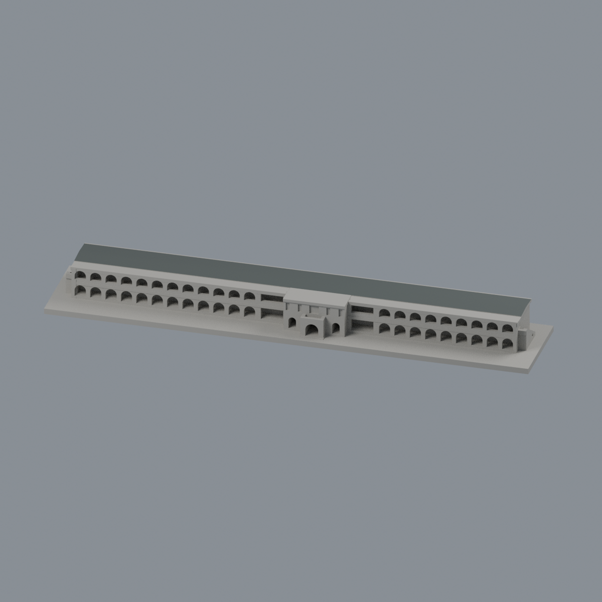
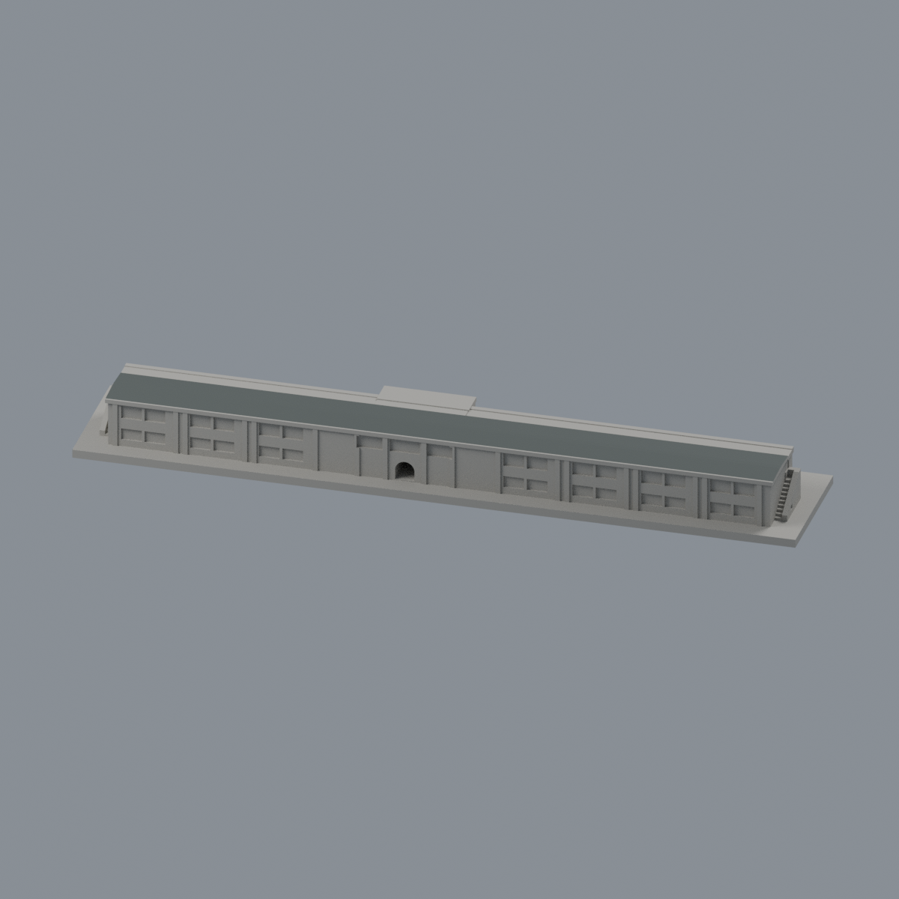
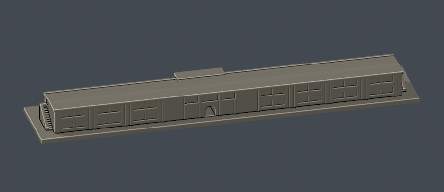

# 懷恩樓（約2021外觀近似，未含2024光電）

## 2 材質外觀版（2026-10-21）

| 正面與來源支持區域 | 歷史主屋面同系統／牆面中性 |
|---|---|
|  |  |

[來源界線與四視角](appearance/README.md) · [表面色 3MF](appearance/cycuhuaien-appearance.3mf) · [可編輯場景](appearance/scene.blend)

僅8個原主屋坡與扁脊面採2021文章空照支持的暗灰屋面代理，遮樹端部明示同系統有界延伸；所有牆窗、低屋面、門廊及簷邊中性。維持原約2021歷史模型，不增2024光電、不宣稱2026現況。 原 STL 與歷史 QA 不變；這是外觀改善，不是新增幾何。[原單色正面](previews/front.png)／[原單色背面](previews/rear.png)

中原大學・中壢校區。完整長條建築量體的歷史外觀近似；1983整修圖補形，與2023屋頂圖、2021屋面及背面實照交叉核對。不是2021精密復原，也不是2026現況。這是一棟模型，不代表全校完成。

## 檔案

- [model.stl](model.stl)：單一連通可列印網格
- [scene.blend](scene.blend)：由交付STL匯入的可編修網格，毫米單位
- [build_model.py](build_model.py)：原創參數幾何的重建來源
- [render_preview.py](render_preview.py)：只讀實際STL渲染預覽
- [sources.json](sources.json)：逐來源URL、年代、支持的形體與限制
- [qa-summary.json](qa-summary.json)、[validation.json](validation.json)：完整數位QA
- [SHA256SUMS](SHA256SUMS)：逐檔雜湊

尺寸含底座為150 × 29 × 12.44 mm。建築部分約1:769.23；屋面外廓依2023圖106.52 × 12.09m。此為屋頂外緣尺寸，不是占地面積。1983軸線尺寸鏈總105.50m，門廊中心距第一軸58.25m，較軸線幾何中點偏5.50m。模型單位為毫米，南面為-Y，底座朝下。

## 保存的外觀

- 二層長矩形、偏置凸門廊及前方單層拱門小廊
- 南面兩層廊道：1983圖左翼各12拱、右翼各9拱；入口旁另有矩形段，門廊另三拱
- 拱廊實際深度及中央南北貫通門洞，並非只刻黑色平面
- 低緩雙坡主屋面、南側廊頂降階、外側簷帶
- 北面簡化窗組、中央通口及兩端鏡像外梯

## 年代與證據分級

1. 1983 A-37：國立臺灣博物館典藏，王秋華、潘冀。含完整平面、四立面與剖面，用於補齊量體、前廊拱數、端梯及屋面。圖上層高約4m、上層至簷約3.5m，微縮幾何另有加厚，不作實測宣稱。
2. 2023中原大學總務處屋頂圖：提供外廓106.52 × 12.09m與偏置門廊。
3. 2021-02-23屋面空拍：萌芽網頁原作者第一手照片，非官方來源；端部有裁切／樹遮。
4. 2021官方泉源之谷報導的北面照片：窗帶已與1983圖不同，模型以可見形類簡化為較寬凹面，不照抄舊細框。第一層被景觀牆遮，不能聲稱全部2021窗格已確認。
5. 南面官方照片來自2018校門報導，並非2021同日。樹和布條遮擋，12／9拱數及中央上層細形由1983圖補足，不冒稱2021逐拱核實。
6. 2024-06-25增設180.12峰瓩光電已併聯；本歷史版不含光電。

原始照片、來源圖說與私有對照圖不隨本包發布。來源材料仍受其原授權約束；A-37館藏標示CC BY-NC，本包不變更來源授權。模型為自行建立的近似幾何，沒有擷取第三方3D網格。

## 微縮與列印限制

- 端梯採10個較粗階段及實心斜欄，取代細扶手；上層門口與小窗採淺凹面。
- 屋脊留約1.17mm寬扁平頂以避免尖脊消失；廊柱、簷帶、窗間連接加厚。它們不是精密測量細節。
- 省略樹木、泉源之谷景觀牆、圖書館、空調與細管線，亦未補想像光電板。
- 建議先在切片軟體檢查拱頂、門廊頂、樓梯和屋簷的懸空區及支撐設定；長而薄底座可能翹曲，請按設備決定附著方式。
- 0.8mm形態篩檢只檢查XY截層，不等同全方向最小壁厚、實際Cura/Prusa工具路徑或實體試印。未宣稱保證可印或不需支撐。

## 驗證與重建

使用Python 3.12與[requirements.txt](requirements.txt)，以及PATH上的Blender 4.3.2以上：

    python build_model.py
    blender -b -t 2 -P render_preview.py
    python run_all_checks.py

正式包的PNG均無文字metadata；重建後可按check_render_reproduction.py比較像素內容。請在另外工作目錄重建，避免改寫已核定包。

已通過：原始法向與繞序、正體積、水密、每邊兩面、vertex-link單環、單一表面殼、獨立STL重建SHA、Blend/STL三角幾何一致、七張PNG獨立重渲染像素一致；0.2mm逐層輪廓degree2閉合、各別／合成Polygon有效，逐原Polygon erosion/opening零消失、零分裂。門廊、廊道、外梯空氣區與低坡屋面另有原STL射線測試。

- 切層：z=0.071mm起，每0.2mm，共62層、751個原始Polygon
- 參考opening寬度：0.8mm；最大面積損失0.4569035460940378%，無超過1%的層
- 單一表面殼、7906個三角面；無非流形邊或壞vertex link

細節報告：[逐層](layer-opening-check.json)、[逐原Polygon](layer-component-check.json)、[canonical薄特徵](thin-feature-check.json)、[開放空間射線](open-space-check.json)、[渲染重現](render-reproduction-check.json)。

## 版本

v1，2026-10-14：四向來源／actual-STL外觀覆核通過，數位自測全部通過。供後續獨立驗收；任何修訂另立版本，不覆寫本包。本包未操作GitHub、未發布遠端。
