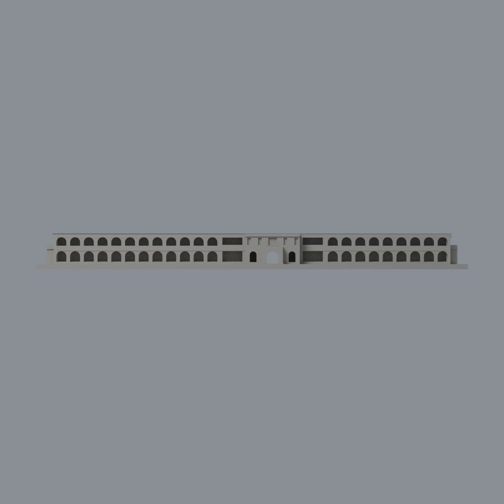
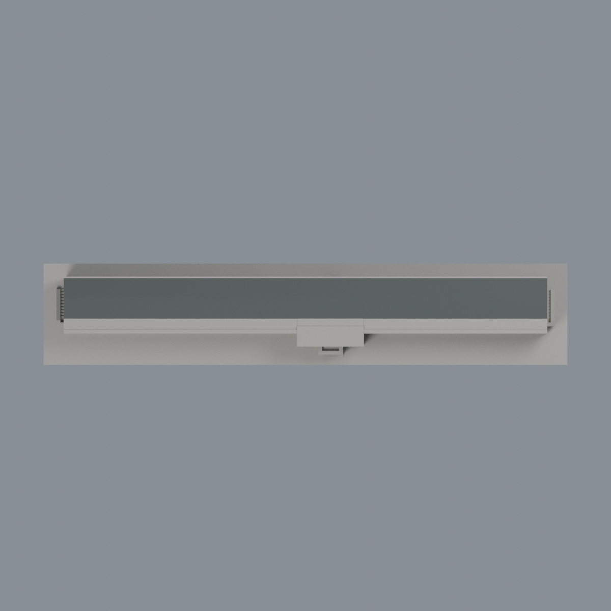

# 中原懷恩樓約2021歷史主屋面暗色限定研究：二材質外觀版

沿用原 **7,906 三角面／3,869 頂點**，不改原 STL 位元、座標、面序或幾何；這是既有模型外觀改版，不增加模型包數。

| 正面 | 歷史主屋面同系統／牆面中性 |
|---|---|
|  |  |
|  |  |

[表面色 3MF](cycuhuaien-appearance.3mf) · [可編輯 Blender](scene.blend) · [材質色表](palette.json) · [逐面指派與依據](face-materials.json) · [原 STL](../model.stl)

## 來源與配色邊界

這是**約 2021 年歷史主屋面暗色限定研究**，不是 2026 現況、不是全立面還原。沿用原模型標明的 2024 光電增設前歷史形體，不補光電板。親看攝影者萌芽網頁 2021-02-23 文章完整空照、中原官方兩張完整前／後照片、原預覽與生成器。[精確 URL、SHA 與日期](qa/source-review.json)。文章發布日不當精確拍攝日；官方 2018 文章前照相機 Original 實為 2015-06-06，另官方 2021 文章後照無 EXIF 拍攝日。前後照只幫助判定遮擋限制，不把跨年差異當 2021 精確牆色。

- 僅主北坡 2 面、南坡 4 面、原扁平屋脊 2 面，合計 **8 個原三角面**採低飽和暗灰屋面代理。空照可見同一連續暗色屋頂；被樹遮的端部採同系統有界延伸，不稱每一處都有直接照片證據。不由照片顏色判定屋面化學成分，不畫細接縫、白管線或斑駁。
- 使用原生成器座標系：STL 除以 1.30 前先扣 z 偏移 1.78 mm，再以原斜面方程、每面三頂點範圍核對；不改真實檔案座標。扁平屋脊是既有簡化，未聲稱精確實測寬度。
- 低走廊屋面、垂直簷邊、入口門廊、所有牆與窗、基座全部中性。前牆多被樹／布條擋，後牆下層被景觀牆擋，大面沒有可靠上下色界；不選部分跨界三角硬染造成假對角界。
- 不是把中性色說成實景灰色還原。未增光電板、文字、植栽、廣場景觀牆或未知構件。第三方原照僅私有研究，不隨公開包散布。
- 原模型使用 1983 圖面補入部分節奏、2023 屋頂尺寸等歷史來源限制仍完整保留；不改 STL、面序、外形或歷史 QA，未做實體列印測試。

[原幾何與歷史來源限制](../README.md)

## 重建與核驗

安裝 [依賴](source/requirements.txt)，Blender 使用 4.3.2。由本資料夾上層提供原 model.stl：

1. `python appearance/source/build_appearance.py`
2. `python appearance/source/verify_exchange.py`
3. `blender -b -t 3 --python-exit-code 1 -P appearance/source/render_appearance.py`
4. `blender -b -t 3 --python-exit-code 1 -P appearance/source/verify_scene.py`

[獨立重建 ZIP](rebuild-source.zip)含原 STL、四支程式及依賴，不含第三方照片；不取代原建模腳本。[逐檔 SHA256](SHA256SUMS)

[交換／拓撲 QA](qa/exchange-validation.json)核對原座標與面序、全部面材質、單連通、有向水密邊、頂點 link 單環、正體積與零退化／重複面；lib3mf 嚴格讀取零警告，實際編輯單材質再存讀，其他材質及面指派不變。SDK 六位小數量化誤差另列。

[Blender 存讀與編輯](qa/scene-validation.json) · [渲染記錄](qa/render-manifest.json) · [獨立重建](qa/rebuild-validation.json)

## 製造限制照舊

尺寸仍為 150 × 29 × 12.44 mm；原 STL、建模程式、場景及歷史 QA 保留。原層檢與薄特徵檢查本次未重跑，不能由材質 QA 代替。

3MF 是同一網格的表面色，不是各材質各自封閉的分色實體、切片專案、噴頭映射或 G-code。切片 GUI、多材料路徑與實體列印未測；柱頭、屋簷、窗框及薄邊仍須評估材料、支撐及拆除風險，沒有保證可印或免支撐。
