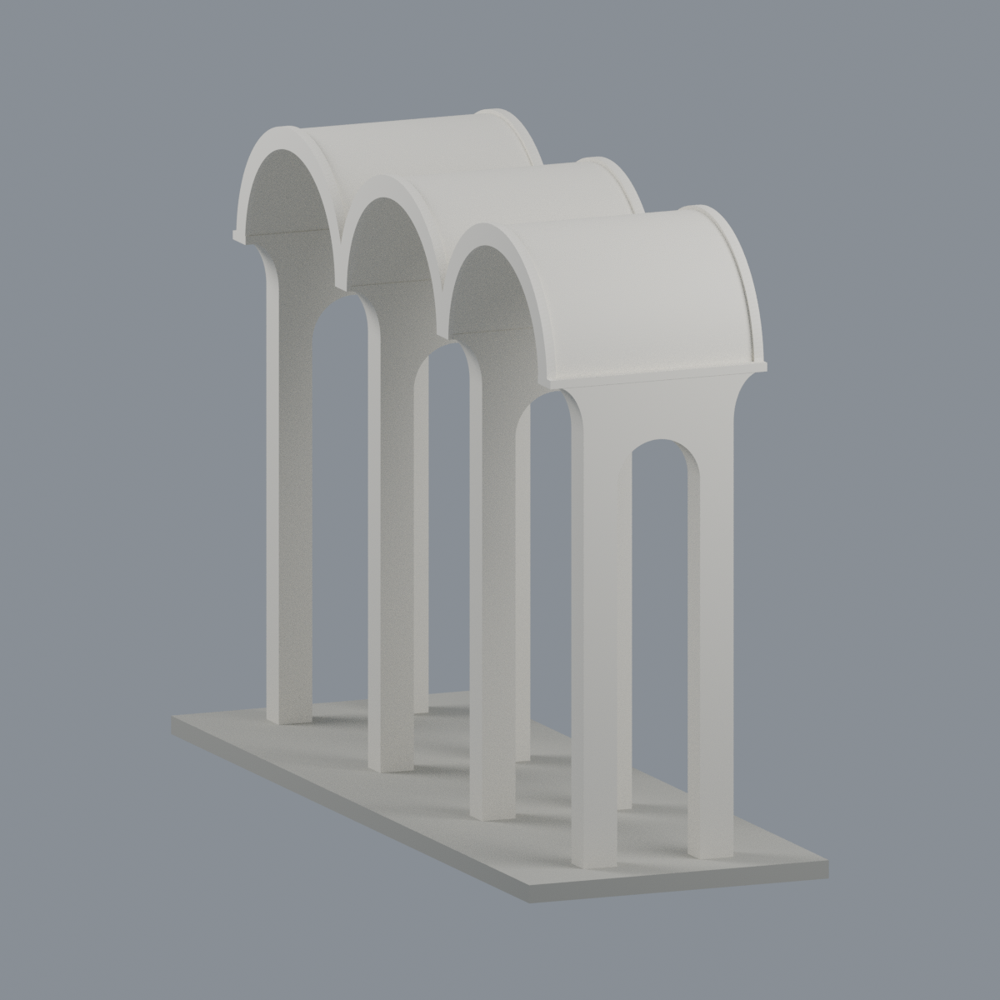

# 中原大學 M 字舊校門（2011 遷移後外觀近似）

中原大學・中壢校區・懷恩樓旁的獨立三拱舊校門。依 **2018 年官方文章所刊照片**建立完整門體的照片比例模型；不是實測復原，也不是經確認的 2026 現況。1967 興建、2011-10-14 遷移；**不含舊址紅色門扇**，不與 2012「信望愛」新入口立柱混合。

## 下載與編修
- [model.3mf](model.3mf)：三種可獨立修改的顯示材質；不是多色列印分料／擠出機配置。
- [scene.blend](scene.blend)：原始交付三角網格、材質與五視角渲染設定，可在 Blender 修改。
- [model.stl](model.stl)：單一封閉連通網格，STL 本身沒有顏色。
- [build_model.py](build_model.py)：照片相對比例參數生成器；[mesh.json](mesh.json)、[palette.json](palette.json) 保存精確面與色彩對應。
- [SOURCES.md](SOURCES.md)、[QA.md](QA.md)、[qa/](qa/)：來源、驗證與限制。

## 保留的形體
三個有厚度的半圓筒拱頂，前後加厚拱緣、四道有真實橫向小拱洞的深墩、八隻落地腳、側面曲肩及端部簷緣。不是一片開三孔的薄牆。門洞沒有塗黑代替挖空。日間照片支持米白／象牙白混凝土表面；夜照的黃色光照不作漆色證據。

## 必須知道的近似
- 含展示底座 **148 × 52 × 104.192 mm**；只是模型毫米，沒有可靠實際尺寸與比例尺。三開間寬高、深度、曲率與墩厚皆為透視照片近似並作微縮加厚。
- 最高屋頂上表面、背面細節未經近距離測繪；模型以已見桶拱輪廓平滑延續。正半圓主拱／側拱、相等三跨、肩部曲率是照片近似；後緣同構是未直接完整觀測的限定推估。左右對稱／等跨不能當作施工圖。
- 1.2 mm 寬拱頂微平面僅為微縮穩定性處理，理論圓頂降低不到 0.009 mm；不是實際建築可辨識細節。
- 米白表面與略亮的拱緣採相近中性色，不宣稱色票精準。展示底座的灰色和矩形邊界不是現場鋪面測繪。
- 不添加照片無法證實的燈具、排水、機電、字樣、雕紋、樹木、人像、周邊建築或歷史紅門扇。
- 所有預覽是此交付模型的 Blender 渲染，不是照片或 AI 美化圖。

## 製作與列印限制
原始 STL 拓樸和切片通過數位檢查，但**不等於已實機列印**。局部幾何開運算仍有非零圓角／拱緣損失，詳見 QA；不能用整個分量存活來宣稱細節毫無損失。拱頂懸空與側向開口需要由切片者決定支撐、方向與材料，沒有產生 FFF 工具路徑。

重建：Python 3.12 安裝 requirements.txt 後，執行 `python build_model.py`、`python qa_model.py --out .`、`python check_features.py`、`python verify_exchange.py`；再用 Blender `blender -b --python render_model.py` 與 `blender -b --python verify_scene.py`。在模型目錄執行；lib3mf 需對應原生庫。五張預覽為 front / rear / elevation / top / side。

此獨立門體與既有 `cycu-huai-en-hall-2021` 不重複；後者只有懷恩樓本體與附屬小門廊。原始照片未隨包重散布。
