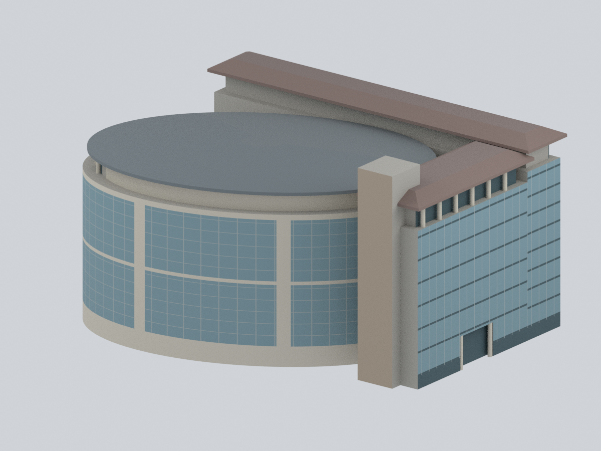

# 中國文化大學・陽明山校本部

目前收錄大成館有界外觀研究，以及大孝館暨體育館歷史照片近似量體，共2個模型包。中國文化大學為私立大學；不代表全校建築完成。

| 模型預覽 | 模型預覽 | 模型預覽 |
| :---: | :---: | :---: |
| 正面  |  |  **[大孝館暨體育館｜歷史照片近似量體](buildings/pccu-daxiao-sports-massing/README.md)** |

[大成館模型與說明](buildings/pccu-dacheng/README.md)。2003側背及較新正面、正射跨年來源；高度、背部未見細節與地景有界推估。細翹簷／欄柱有列印簡化，未實體試印，不保證無支撐可印。數位審核紀錄見模型隨附報告。

[大孝館暨體育館｜歷史照片近似量體](buildings/pccu-daxiao-sports-massing/README.md)：L型教學棟與旋轉橢圓體育館合為一包，依歷史照片保留主要量體與可見代表色；不是測量復原或2026現況。未見背面、內側銜接與部分屋面簡化；屋面修繕紀錄不代表已知最新外觀。模型尺寸非實測比例；柱廊、簷口與凹口需評估支撐，尚未實體試印。
