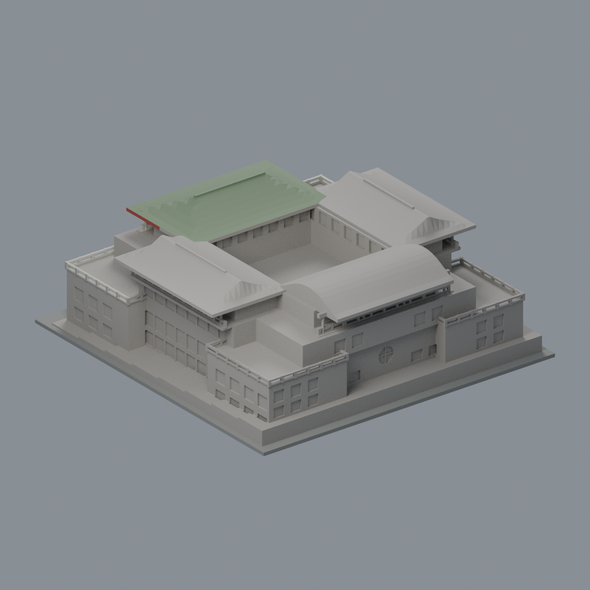
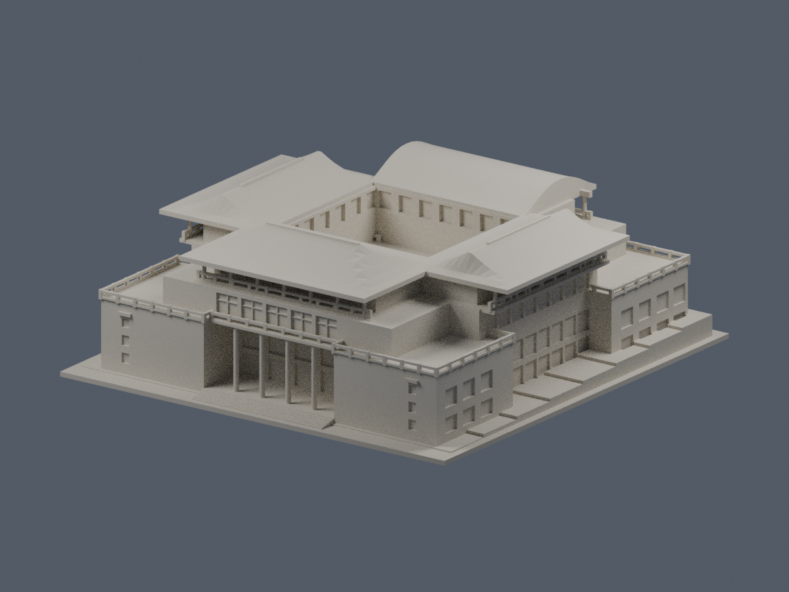
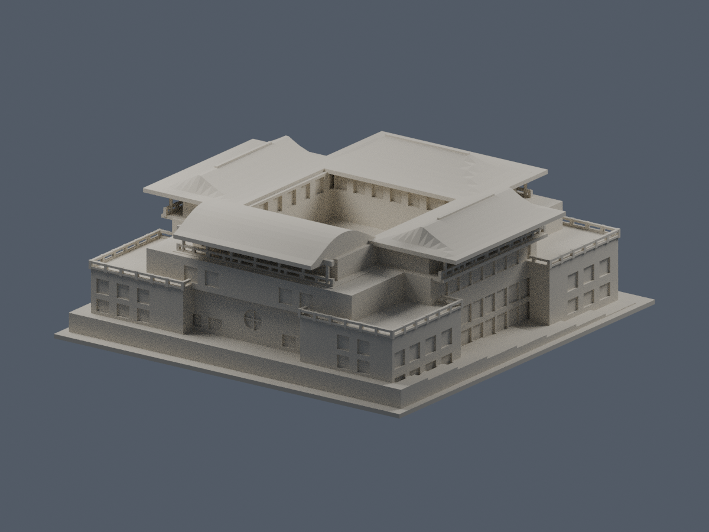
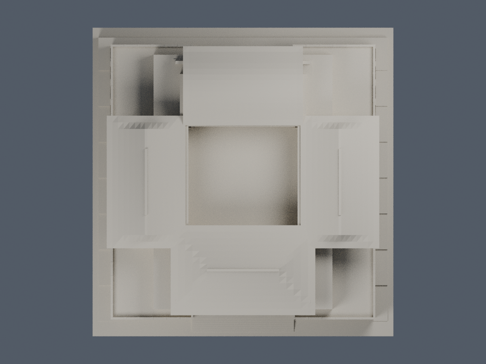
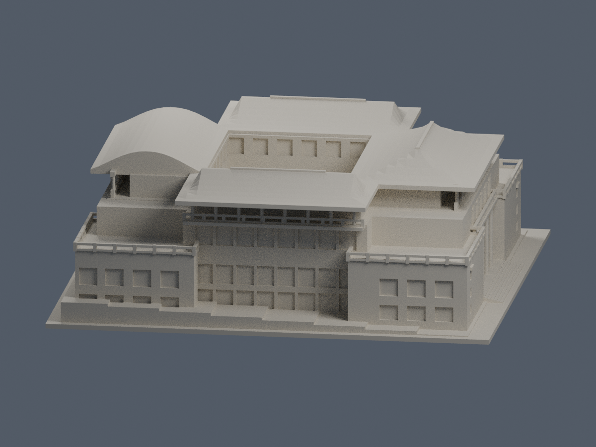
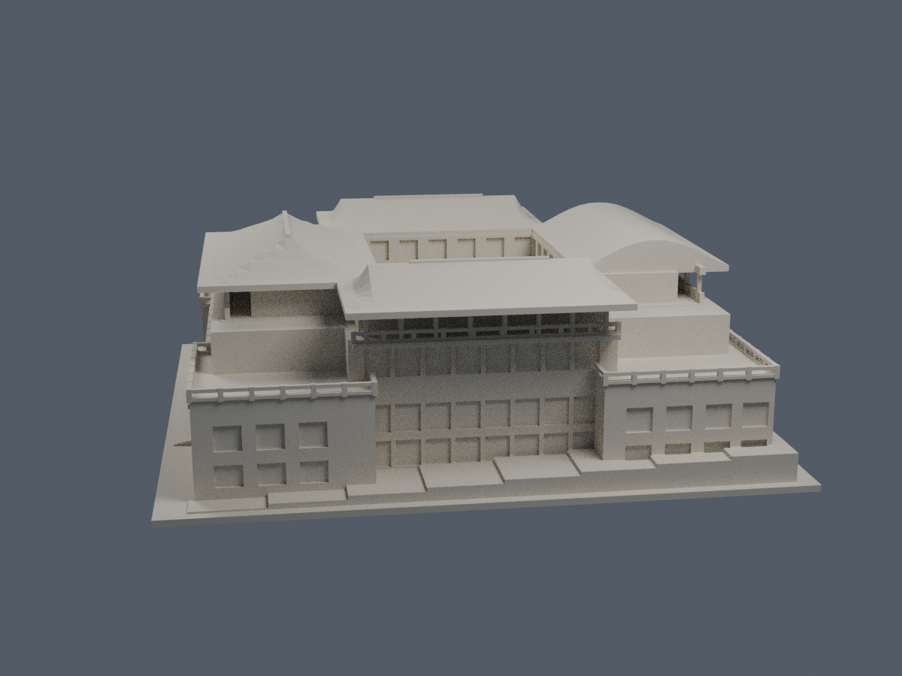
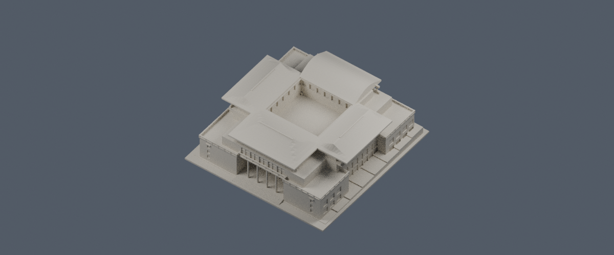
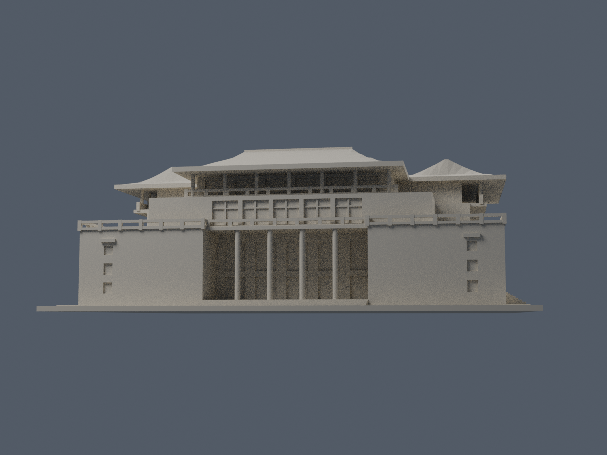
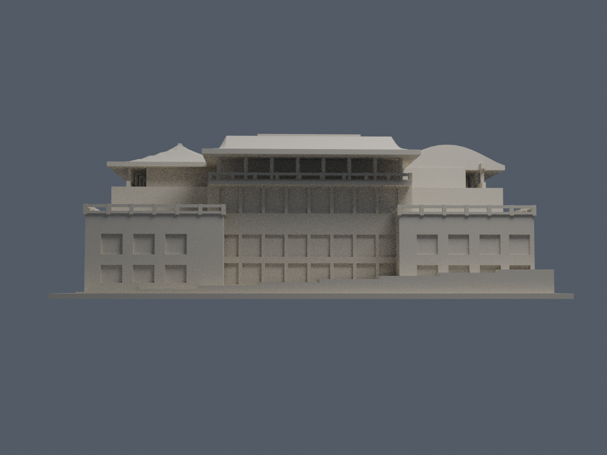
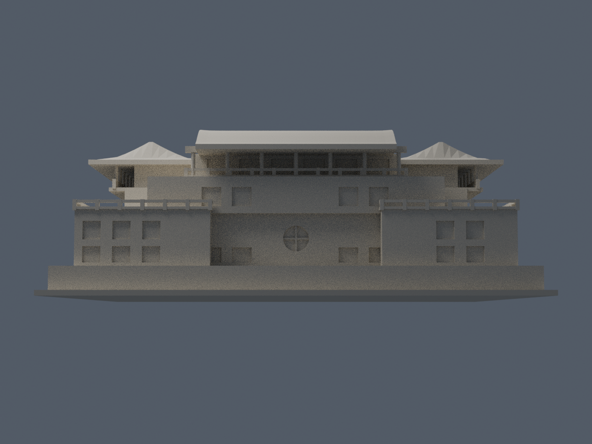

# 大成館：公開影像有界外觀模型

中國文化大學・陽明山校本部。1963年3月啟用，盧毓駿設計；本件僅大成館，不代表全校完成。

| 模型預覽 | 模型預覽 | 模型預覽 |
| :---: | :---: | :---: |
| 正面  | 背面  |  |

## 最新正面八材質外觀版（2026-10-20）

[材質、四視角與來源界線](appearance/README.md) · [表面色 3MF](appearance/pccu-appearance.3mf) · [可編輯材質場景](appearance/scene.blend)

只改善可辨識的前屋頂與前立面配色；其他三屋頂與未知側背保持中性。原 STL、建模程式、原場景與歷史 QA 未改，不是新增幾何。[原單色正面](previews/front.png) · [原單色背面](previews/rear.png)

| 模型預覽 | 模型預覽 | 模型預覽 |
| :---: | :---: | :---: |
| 原單色正面  | 原單色背面  |  |

## 版本與限制

以2003校典藏研究的側背分面、原平剖軸測、校內1–4F樓牌、較新正面實照及NLSC屋頂投影交叉建構。這是跨年來源限定近似，不是1963原貌精密復刻、2026完整現況或測繪點雲模型。2024水印不等於拍攝日期。2022電梯位置未證實，未猜測外掛井。

保留四高柱五開間、背接大窗與最高退廊、四角低翼露台、左右歇山／前廡殿／後卷棚、封底中央院坪及背圓窗。另側細窗未逐一確證，按主要分面有限推估；未照搬歷史研究的第三方3D模型。

## 尺寸與列印

- 單位毫米，含底座146×150×52.560001mm；底座厚1.6mm、底面朝下。1m轉2.6mm；49×51m低翼和最高19.6m均為有界尺寸，見[尺度](scale-and-trace.md)。
- 柱、欄與屋頂已按本尺寸簡化。屋角翹升由試稿0.44m減至0.10m，保留有限脊頂平幅；細翹簷、瓦當、斗拱、細欄雕刻及小窗框減略，不能稱原貌完全一致，也不宜任意縮小。
- 欄柱短邊1.144mm、上廊圓柱直徑1.248mm、前高柱直徑1.716mm。細玻璃框是背牆融合浮雕，非自由懸空細棒。
- 懸簷、陽台、廊頂及階梯可能需要支撐；底座地形為台階示意。未做實體試印、切片工具路徑或全方向最小厚度認證，不能保證無支撐可印。

## 檔案與重建

[STL](model.stl)、[Blender場景](scene.blend)、[參數來源](build_model.py)、[渲染來源](render_preview.py)、[來源](sources.md)、[QA](QA.md)。Blender是實際交付STL的可編修網格，參數Python為主要重建來源。

在Python環境安裝requirements.txt後執行build_model.py，再以Blender4.3.2執行render_preview.py；run_all_checks.py重跑全部作者檢查。未使用repair修補錯誤原輪廓；每個原Polygon及每層結果留在JSON，逾1%構件另有CSV。

[頂視](previews/top.png)、[左側](previews/left.png)、[右側](previews/right.png)、[屋頂](previews/roof-detail.png)、[正低角](previews/porch-detail.png)、[側低角](previews/south-detail.png)、[背低角](previews/rear-detail.png)。公開預覽均含完整底座；來源對照圖及原照片/PDF只私下研究，不隨包散布。

| 模型預覽 | 模型預覽 | 模型預覽 |
| :---: | :---: | :---: |
| 頂視  | 左側  | 右側  |
| 屋頂  | 正低角  | 側低角  |
| 背低角  |  |  |

作者數位檢查見隨附報告；是否正式發布以統一發布清單及獨立審核為準。

## 獨立原面與角區口徑補充
263層2342原Polygon侵蝕與opening後均單核心、不消失分裂；692個跨層高損樣本仍分620／28／28／14／2五族，前四族108局部直立區域，最後2筆是同一卷棚屋頂兩端，不能當692實體。最大構件損失10.919401694636%、保留89.080598305364%，整層最大0.344052279756%。
作者角外最大5.25986e−12mm²使用切點推導adaptive區，最大半徑0.767387mm，並非0.41mm。獨立去共線辨識真轉角後，同0.41mm區外：方欄柱0.001345503485mm²／原構件0.1028092092%；卷棚端0.006024023476mm²／0.0546336822%。不能把不同角區口徑混稱純角零損；原WKT及正式opening數值完整保留，未用理想形狀或repair替代。
692樣本雙方向1384筆原三角面法向最小1.1439972mm，全部起點位於實體內；895根／淨空控制重現，四高柱到底座平台及柱頂板、後陽台實接。卷棚指定側面有限厚度2.6781235mm，兩端代表點向下連到z0；沒有以放大角區代替厚度及根證據。這些為指定位置而非全域最小壁厚；背接0.52mm直框與0.39mm橫框是另項浮雕，不是自由細棒。薄欄、簷、懸挑需實際切片、支撐及拆除評估，不得任意縮小，尚未試印；跨年影像、未知電梯與有界高度限制維持。
