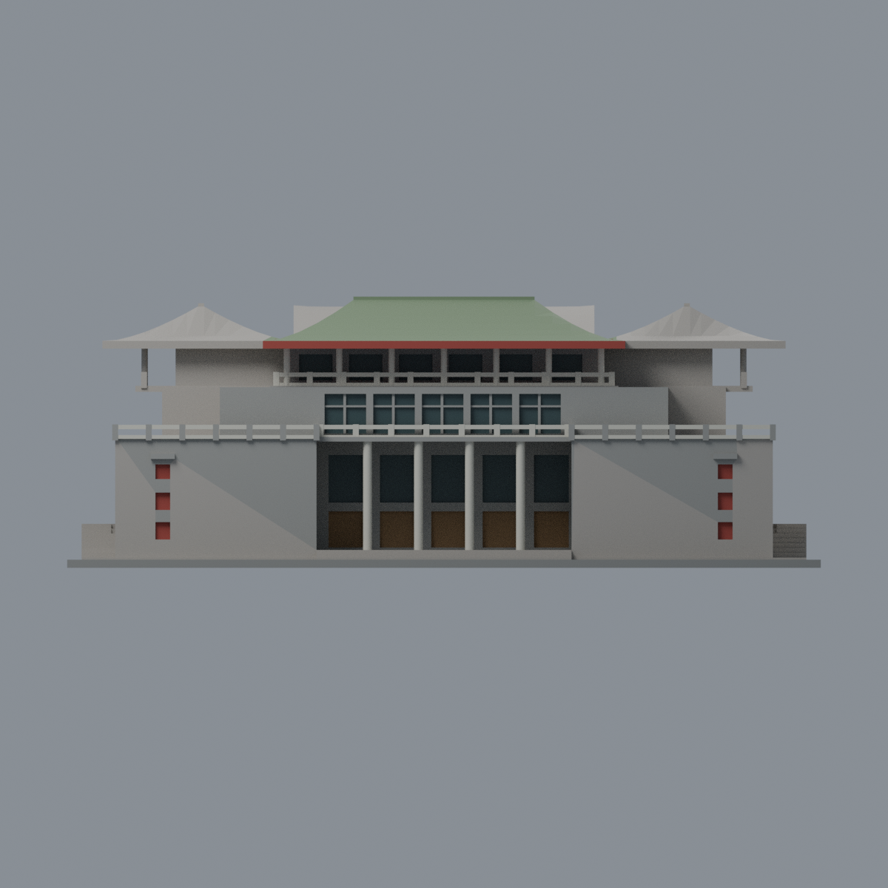
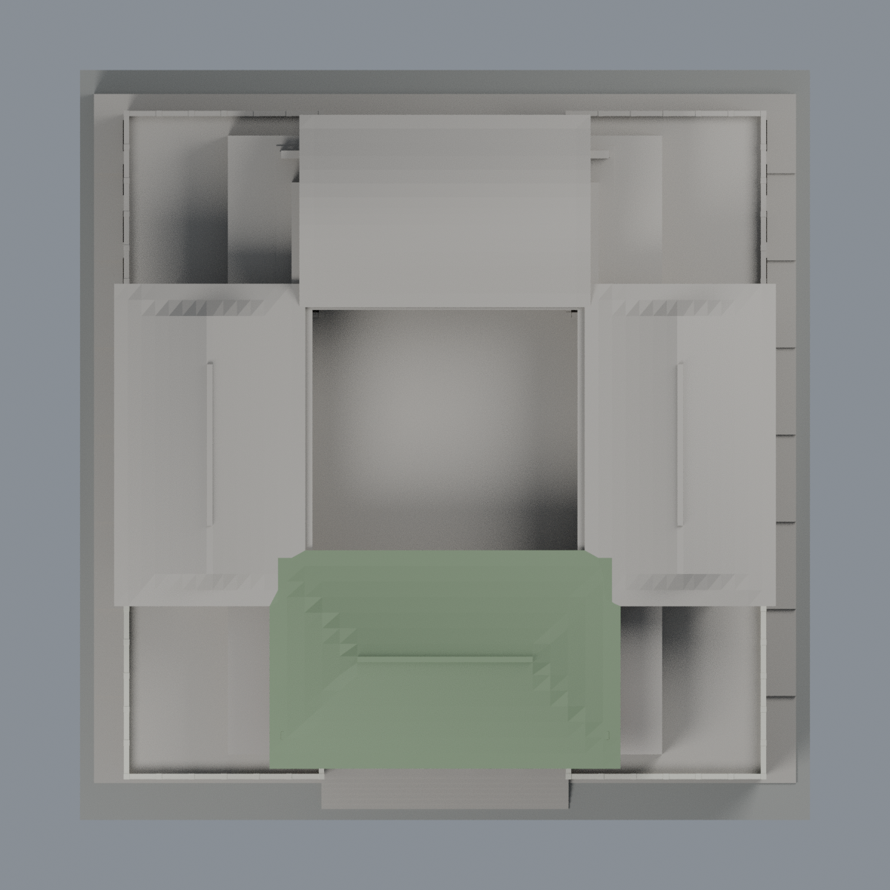

# 大成館：正面有界八材質外觀版

由原有 STL 的 **21,848 個三角面／10,608 個頂點**直接分配材質，面序與座標不變、不細分、不增建。這是外觀改版，不是新增建築或完整實景重建；尺寸仍為 146 × 150 × 約 52.56 mm。

| 正面：僅一座屋頂與前立面配色 | 背面：未知處保留中性 |
|---|---|
|  |  |
|  |  |

[表面色 3MF](pccu-appearance.3mf) · [可編輯 Blender](scene.blend) · [色表](palette.json) · [逐面指派與理由](face-materials.json) · [原 STL](../model.stl)

## 來源與有限配色範圍

本次實際閱讀[國立故宮博物院「現代台灣的古典建築」](https://theme.npm.edu.tw/exh112/QingArchitectural/ch/page-4.html)，並查看頁面所列[大成館正面照片](https://theme.npm.edu.tw/exh112/QingArchitectural/common/images/selection/first/3/3-4/3-4-1/3-4-1-S.jpg)。展頁的「1963」是建物完工年份，不當作照片拍攝年；照片拍攝日期未確認，亦不宣稱為 2026 現況。原照片未隨包散布。

- 可辨識綠瓦前屋頂、紅檐、灰牆、淺色柱欄、深色窗及暖褐入口。色票取視覺近似，未經校色，不是實測建材值。
- 與原腳本對應：正面為模型 -Y；只將 **前方一座屋面**配綠。其背坡沿同屋頂材料連續性有限外推，不表示有另一張背坡照片。左右與後方三座屋頂、內院、未知側背立面仍中性。
- 淺石色限原有正面圓柱及欄杆；前角露臺欄杆短段沿同一構造有限外推，不擴及後半棟。正面灰牆不擴成整棟「已確認」灰色。
- 深色限原已封實窗凹口背面；不新增透明玻璃、窗櫺或採光內部。入口凹口整體以暖褐色代理，原網格沒有照片的細門框，不能誤認為已重建框格。
- 既有裝飾凹面僅用素紅色，不創作鏤空花紋。照片的金色館名、白色回紋、細瓦及其他原網格沒有的細節均不添加；也不把缺少的中層綠瓦簷硬塗成現有石欄。
- 原模型包含不同年份來源推估的屋型／地勢，其誤差與限制照舊。這張正面照片不足以重新校正全棟幾何；原 sources.json 中其他來源未在本次全部重新覆核。

八材質為：未知中性色、正面灰牆、前屋頂綠瓦、紅檐與素紅凹面、淺石柱欄、深色玻璃代理、暖褐入口代理、展示底板。底板不代表實地鋪面。

[本次來源覆核](qa/source-review.json) · [原來源](../sources.json) · [原模型說明](../README.md)

## 重建與 QA

安裝 [Python 依賴](source/requirements.txt)，Blender 使用 4.3.2。由本資料夾上層執行，需有原 model.stl：

1. `python appearance/source/build_appearance.py`
2. `python appearance/source/verify_exchange.py`
3. `blender -b -t 4 --python-exit-code 1 -P appearance/source/render_appearance.py`
4. `blender -b -t 4 --python-exit-code 1 -P appearance/source/verify_scene.py`

[獨立重建 ZIP](rebuild-source.zip)包含原 STL、此四支腳本、依賴與操作說明；不取代原幾何建模程式。[逐檔 SHA256](SHA256SUMS)

[交換／拓撲 QA](qa/exchange-validation.json)逐面確認原座標與面序、完整材質指派、正體積、有向水密邊、頂點單環及單連通，零退化／重複面。lib3mf 嚴格讀取零警告並實際編輯一個材質、寫出再讀回；其他材質與指派保持，SDK 六位小數存檔誤差另列。

[Blender 存讀與編輯](qa/scene-validation.json) · [渲染記錄](qa/render-manifest.json) · [獨立重建核對](qa/rebuild-validation.json)

3MF 是單網格表面色，不是拆分封閉色塊、切片工程、噴頭映射或 G-code；切片軟體 GUI 匯入及多材料工具路徑未測。原 STL／建模程式／原場景／歷史 QA 保持，不重跑或冒充原歷史層檢結果。懸檐與細欄仍需自行評估支撐、材料及搬取，沒有實體試印或保證可印。
