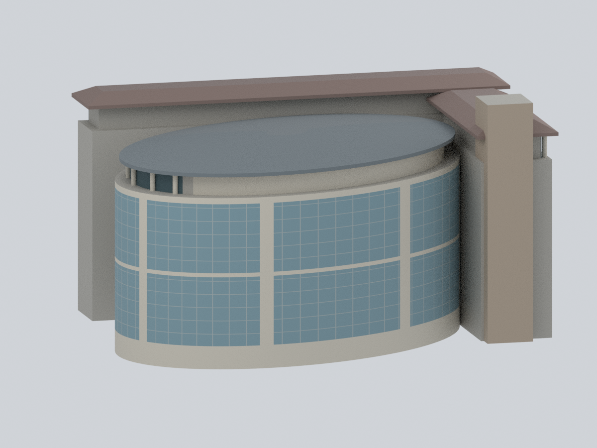
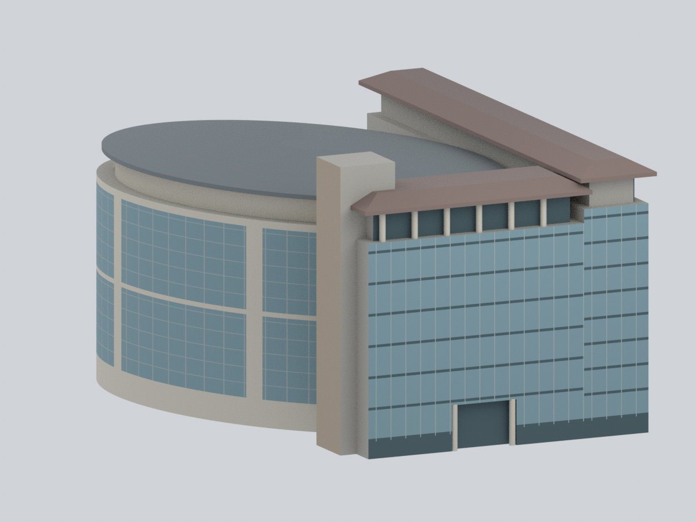
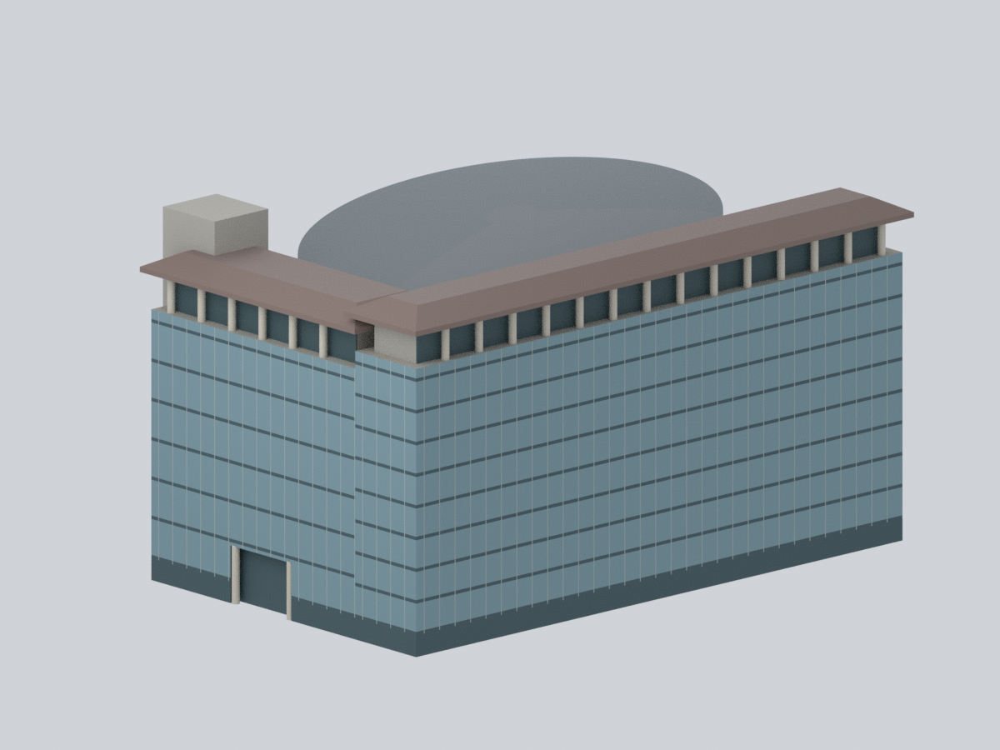
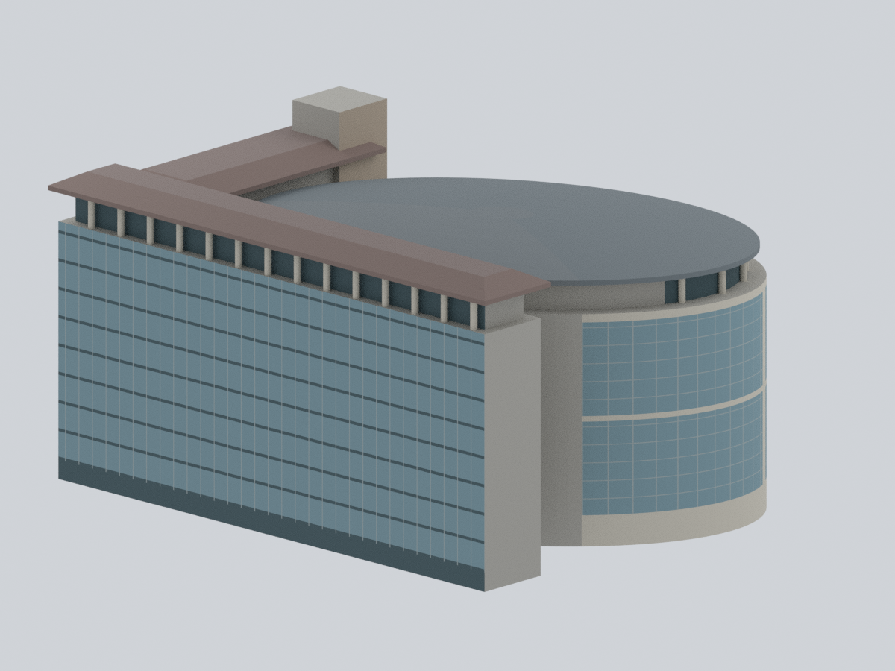
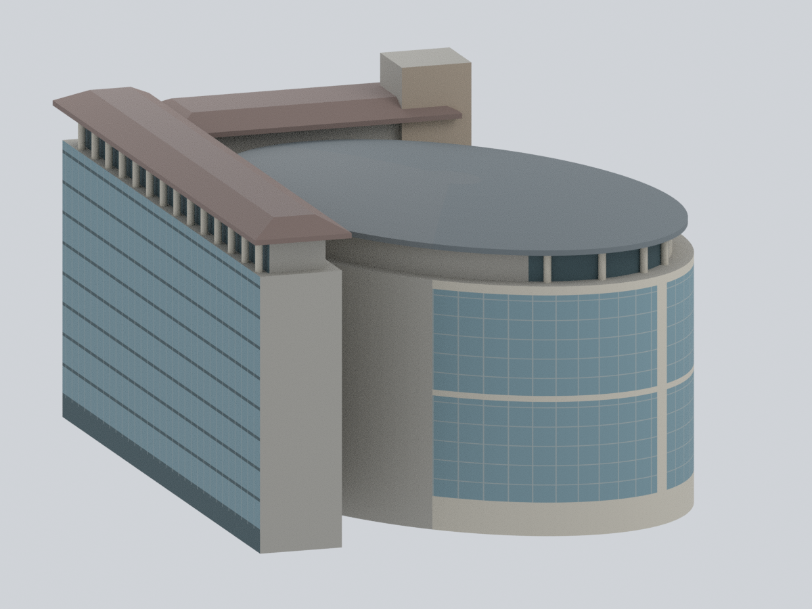
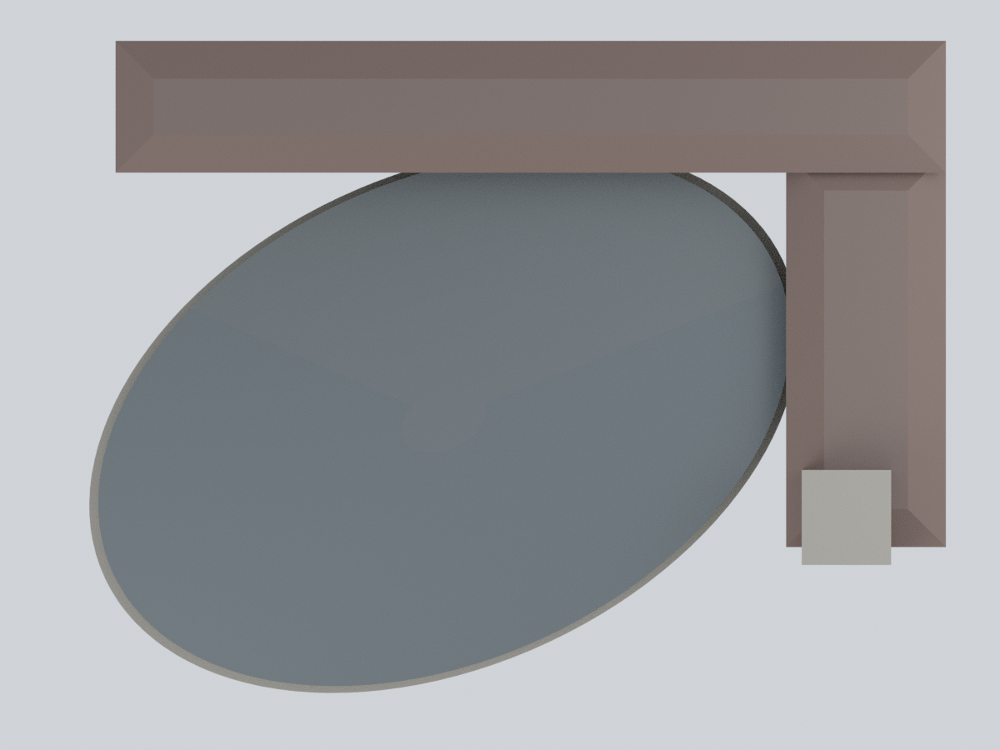
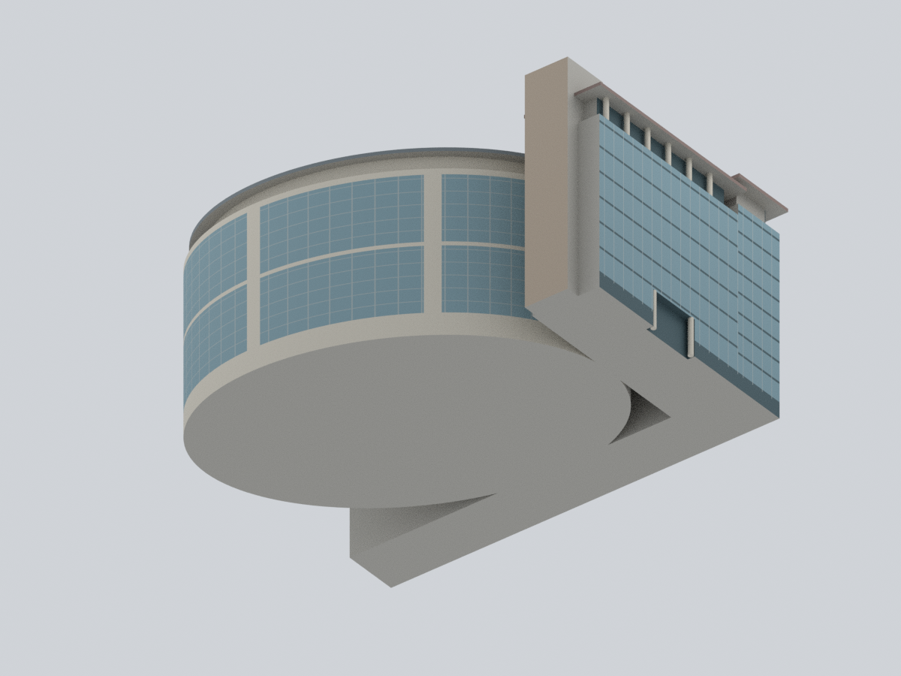
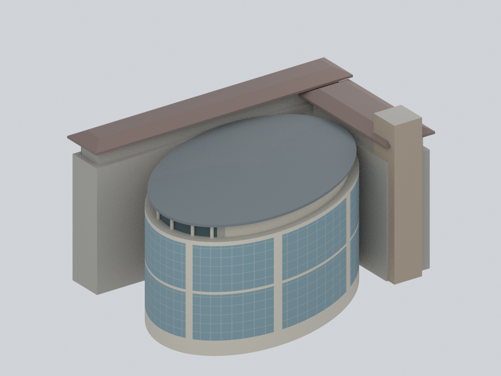

# 中國文化大學｜大孝館暨體育館

**歷史照片支持的近似量體與可見外觀研究。** 本件是 2005 年新建的「L 型教學棟＋旋轉橢圓體育館」複合體，作為**一個模型包**，不是兩棟新增計數。不是被拆除的 1985 年舊館，也不是大成館。

依 2005、2017、2019 年照片及未定拍攝年份的建築師照片，保留主要量體、較高的淡褐色核心、兩個高挑體育空間、內縮頂層及淺弧金屬屋蓋。**不是測繪、竣工精準復原或 2026 現況模型**；背面、內側銜接、部分屋面以簡單外殼封閉。不代表全校建物已完成。

## 九視角

以下均由交付網格、逐面材料及相機實際渲染；沒有來源照片貼圖、補畫立面或 AI 示意圖。視角名稱只便於辨識，並非測量的羅盤方位。

| 體育館／入口斜視 | 體育館長面 | 教學棟入口側 |
| :---: | :---: | :---: |
|  |  |  |
| 校園側轉角 | 相反斜視 | 內側銜接與端部 |
|  |  |  |
| 頂視 | 底視 | 頂層露台斜視 |
|  |  |  |

## 模型檔與編輯

- [STL 無色幾何](model.stl)：一個封閉連通網格；可供切片試作，但不是列印保證。
- [可編輯 Blender](pccu-daxiao-sports-massing.blend)：單一實際網格、逐面材料、相機及燈光；可改頂點、面與材料 Base Color，沒有隱藏替代模型或外部影像依賴。
- [真正逐面材料 3MF](pccu-daxiao-sports-massing.3mf)：一個 build item，逐三角面 base-material 指派；不是彩色縮圖或只加容器顏色。各切片器的材料／工具對應仍需確認。
- [參數](parameters.json)、[調色盤](palette.json)、[面材質對照](face-materials.csv)、[證據規則](mapping-rules.json)、[完整來源網址](sources.json)。CSV 面序從 0 開始，與 STL、NPZ 及 Blender 三角面順序一致。

輸出外框約 **153.30 × 116.71 × 83.00 mm**。這是選定的展示模型尺寸，**沒有宣稱對應實際建築的縮尺比**。橢圓長短軸、旋轉角、L 臂長寬、總高度、退縮與屋頂曲率均為照片擬合／推定，不是來源中的量測值。所有數值用途及分類見參數檔。

## 來源支持與未知範圍

| 項目 | 本件保留 | 不作的推論 |
| --- | --- | --- |
| L 型教學棟 | 正交雙翼、可見藍灰帷幕與暗帶、上層內縮柱廊、淺褐灰斜屋頂 | 建築師記載 10／8 層；哪一臂對應哪個層數及精確高度仍推定，不把照片窗格當測量樓層 |
| 橢圓體育館 | 淡色基部、兩個高挑玻璃區及中間帶、少量寬直向分隔 | 建築師記載 8 層，其中 2–4、5–7 樓各為 15 m 高空間；**不是八條等高辦公室樓層** |
| 頂部 | 淺弧屋蓋、外挑簷、內縮頂層、有限範圍的淡色柱與玻璃／實牆 | 不複製整圈設備、燈具、欄杆、屋面接縫或未見結構；上層材質分區位置並非測繪登錄 |
| 核心與入口 | 一座主要淡褐核心、簡化入口凹口 | 次要塔體、狹縫窗、招牌及門框省略；核心與教學轉角關係是量體近似 |
| 不可見部分 | 簡單平面／曲面封閉；來源規則保留「未知」 | 不鏡射照片立面、不補造後窗或機電設備，不建地下四層、地形或室內 |

招生資料的 **50 × 70 m 是體育空間描述，不是外橢圓尺寸**；本件也不把約 50 × 75 m 的文字線索當成測量外框。校園圖只用於 L／橢圓拓樸與相對旋轉，比例尺不使示意輪廓變成測繪平面。

### 代表色，而非校色材料規格

淡褐 `#AA9B89`、暖淺灰 `#C6C0B2`、藍灰玻璃 `#78959E`、暗玻璃 `#40575D`、灰框 `#9BA7A7`、金屬屋蓋灰 `#6C7579`、教學棟屋頂褐灰 `#806D66` 來自多張歷史照片的人工概括；不是校色取樣、油漆色號或透明玻璃光學模擬。

`N00` 暖灰表示一般未知封閉面，不是現場後牆材質。未知屋頂另用 `N01`／`N02`，採接近周邊屋蓋的低對比展示色，避免製造不存在的雙色屋面；**這仍是未知，不因顏色相近而變成來源已知**。完整未知遮罩可由 `evidence_rule_index = 0` 選出，也可按三個 `N` 材質選取。

## 主要資料

- [建築師 JJP：文化大學體育館](https://www.jjpan.com/project/recreation/gymnasium-for-CCU)：複合體身分、10／8 層教學棟、8 層體育館、旋轉關係及兩個高挑體育空間。頁面發表於 2023 年，並非照片拍攝年份。
- [校方典藏 2019 斜視照片](https://csh.pccu.edu.tw/archive/Files/502/WEBDESC/23/1145/WDESC_0000.jpg)、[2017 校園側照片](https://csh.pccu.edu.tw/archive/Files/502/WEBDESC/23/1145/WDESC_0001.jpg)、[2005 體育館長面照片](https://csh.pccu.edu.tw/archive/Files/502/WEBDESC/23/1145/WDESC_0002.jpg)：年份為 EXIF 日期，未獨立驗證且缺時區；2017 照片載有 billy dai 署名／著作權。
- [校方體育館簡介](https://cufb.pccu.edu.tw/p/412-1015-12709.php?Lang=zh-tw)、[招生簡介](https://futurestudent.pccu.edu.tw/p/16-1312-138319.php?Lang=zh-tw)、[校園示意圖](https://w3.pccu.edu.tw/doc/intro_buildingintro_Map.pdf)。
- [2015 校務會議紀錄](https://secretariat.pccu.edu.tw/var/file/10/1010/img/399/1715.pdf)及 `sources.json` 的 2024–25 屋面修繕採購紀錄，提醒舊照片不能證明 2026 屋頂現況；修繕文件本身也不證明完工或形狀已變更。

來源照片、PDF 圖頁及衍生貼圖**不隨包提供**。未建立來源影像的再散布授權；公開可瀏覽不等於可再散布。模型只提供獨立撰寫的簡化幾何、代表色與資料連結。

## 重建

`source/rebuild.py` 從 **Python 程式＋parameters.json＋palette.json** 產生 STL、NPZ、逐面對照、3MF、Blender、九張預覽及數值驗證，無需原照片或既有模型檔。

```bash
python source/rebuild.py --out rebuilt \
  --geometry-python python --three-mf-python python3 --blender blender --threads 4
```

幾何 Python 需 NumPy、trimesh、manifold3d、Shapely、SciPy；3MF Python 需 lib3mf 2.5.0。可使用不同的 Python 環境並透過參數指定，腳本不會自動下載套件。驗證組合為 Blender 4.3.2、Cycles CPU 32 samples／seed 0；版本清單見 [requirements-model.txt](source/requirements-model.txt)。`--out` 可指向全新位置。改參數後需重跑全部檢查，不沿用舊驗證。

## 數位檢查與列印限制

本件重新載入 STL 檢查封閉性、法向、邊與頂點流形、連通性、退化／重複面；另檢查 0.2 mm 間距的 415 個截面。3MF 做 strict 讀取、材料編輯／儲存／重開及往返座標誤差檢查；Blender 做真正頂點及材料編輯／儲存／重開。詳見 [幾何驗證](qa/geometry-validation.json)、[3MF 驗證](qa/3mf-validation.json)、[Blender 驗證](qa/blend-validation.json)、[從零重建比對](qa/rebuild-validation.json)。

**尚未實體試印。** 閉合網格和有效截面不是無支撐列印保證。上層柱廊、簷口與入口凹口頂部可能需要支撐；請依材料、方向和切片器調整。選定展示尺寸下，獨立柱直徑 1.8 mm、簷緣厚度約 1.2–1.3 mm；細框線僅為逐面顏色，不是薄立體牆，有些 0.22 mm 色帶低於 0.4 mm 噴嘴寬。多色可列印性、色彩轉換、強度與黏著均未實測。模型為實心量體，沒有可用室內空間或結構分析用途。
