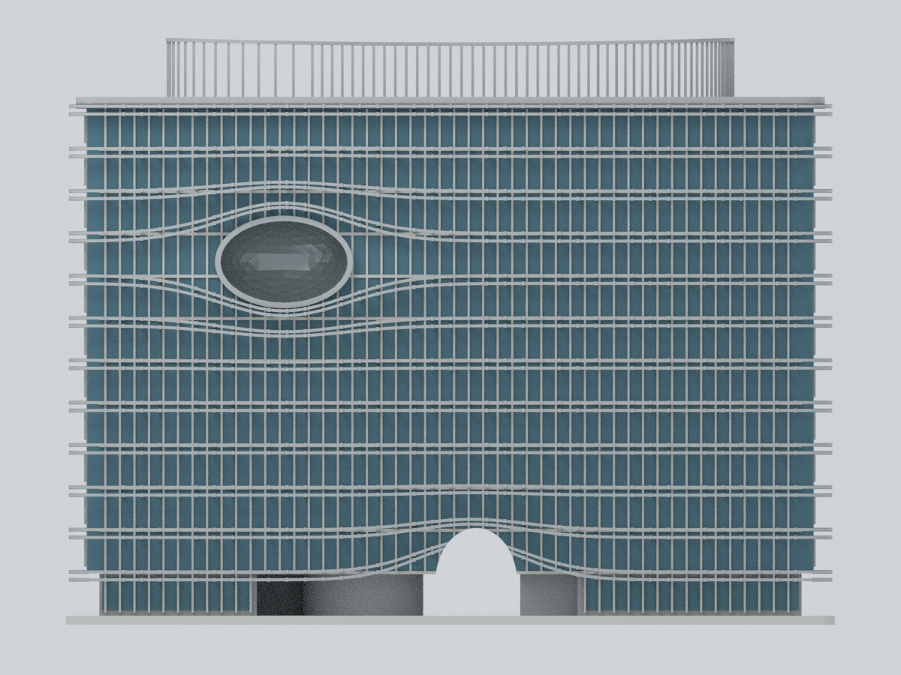

# 水湳校區

現收錄2套：關懷大樓A3既有有界外觀模型，以及創研大樓A2整棟地上外觀有限細節近似；不代表全校全部建物已完成。關懷大樓原有範圍與限制維持不變。

| 模型預覽 | 模型預覽 | 模型預覽 |
| :---: | :---: | :---: |
| 西側正面  |  **[水湳創研大樓 A2｜整棟地上外觀有限細節近似版](buildings/cmu-chuangyan-a2/README.md)** |  |

[關懷大樓：模型、範圍及限制](buildings/cmu-guanhuai/README.md)

[水湳創研大樓 A2｜整棟地上外觀有限細節近似版](buildings/cmu-chuangyan-a2/README.md)：創研大樓A2：2020完工後公開資料結合2022屋頂狀態的整棟地上外觀有限細節近似；十二個編號樓層不等於全部已使用，非2026現況/測繪/精密竣工或工程模型。南街側偏西眼部為有封閉背壁的凹腔與反射展示面，不是藍圓貼片或穿棟孔；成對波浪遮陽帶、北院側垂直屏條/弧帶、不同短端、不同地層/上層/屋面及連續雙葉高罩體、2022光電區均保留。未知北側高層細格與遮擋部位有界簡化，不鏡射南眼；排除A1/A3/完整庭院/室內地下層。254×85×194.1mm為展示尺寸、無實測比例尺；STL、8材質3MF、可編輯Blend、Python重建與9圖。0.2mm數值切層在11個取樣高度共偵測80個未承接截面起始成分，需支撐評估；細帶/眼部/低拱/高罩體與縮放風險保留，未實體試印。
