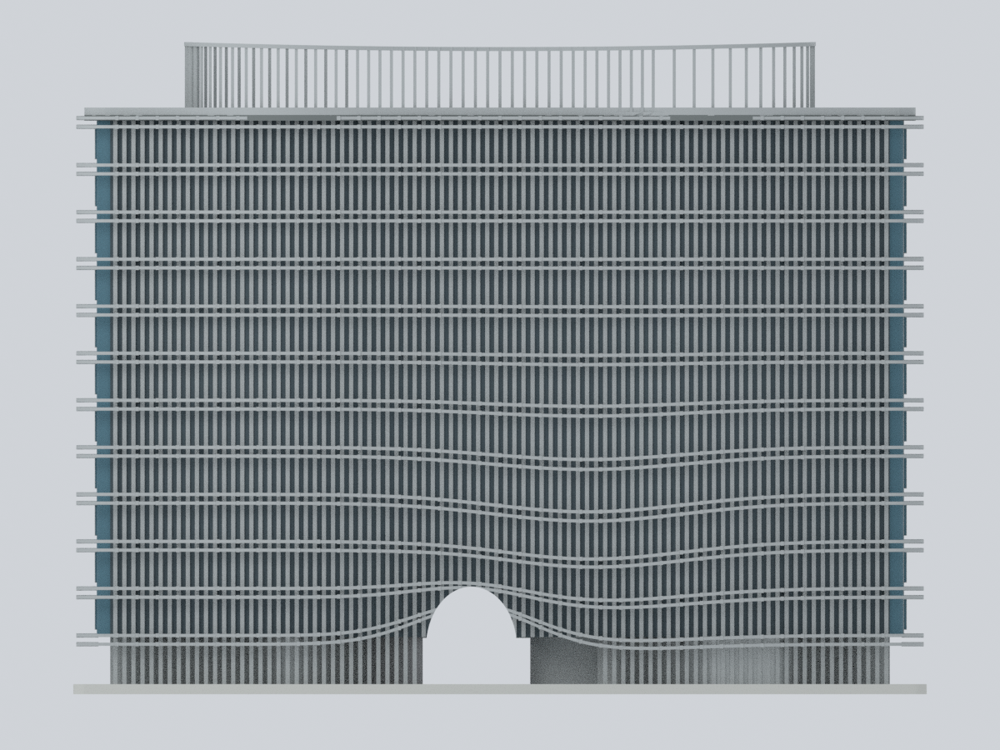
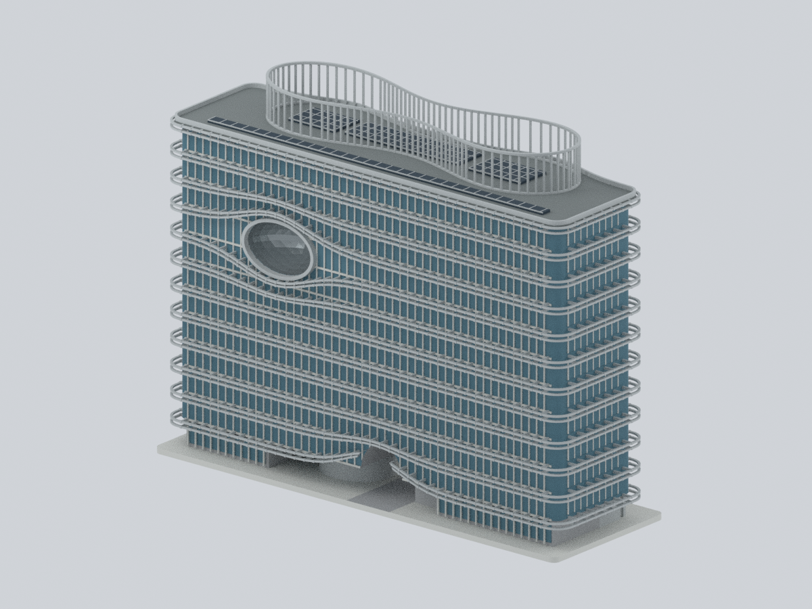
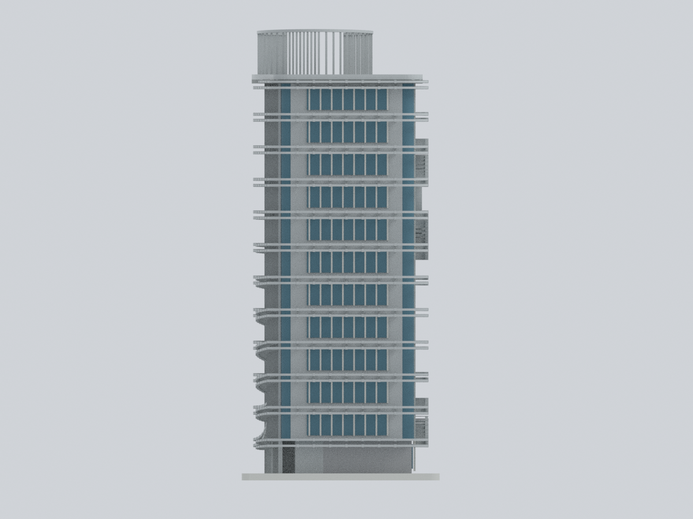
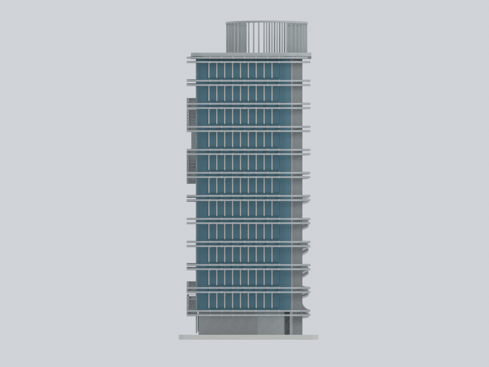
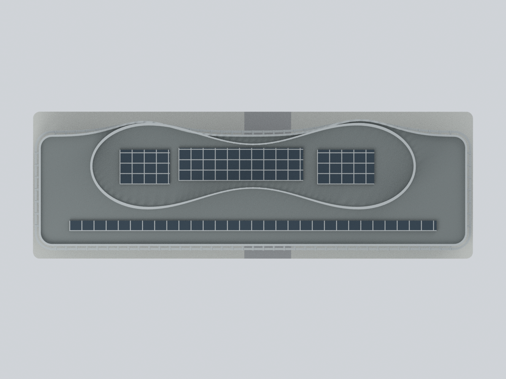
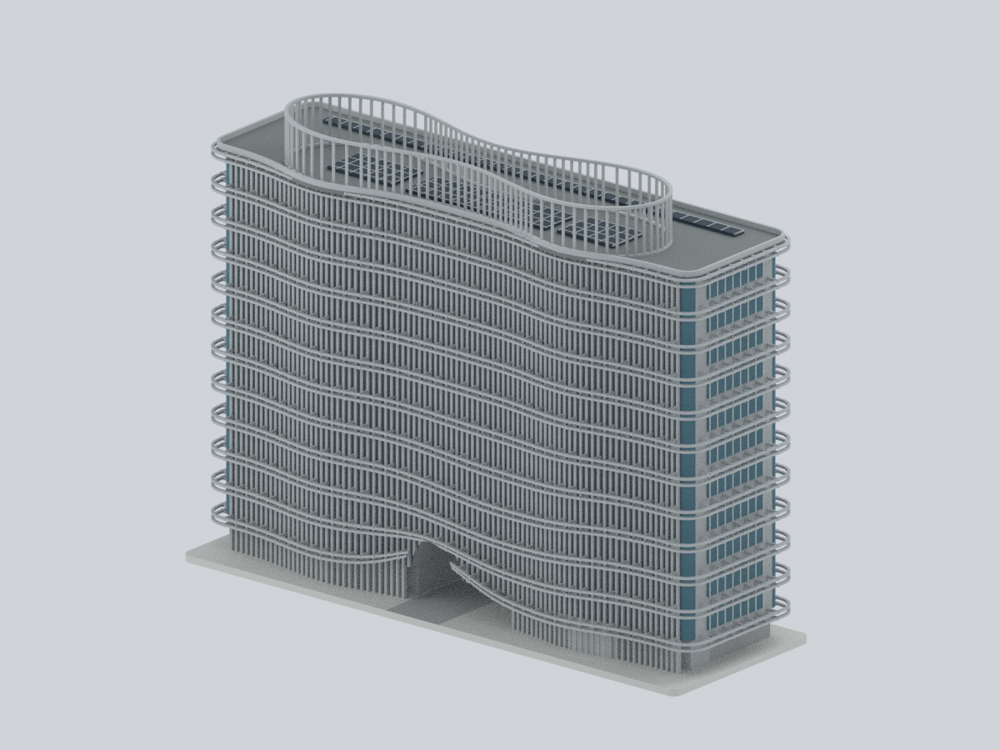
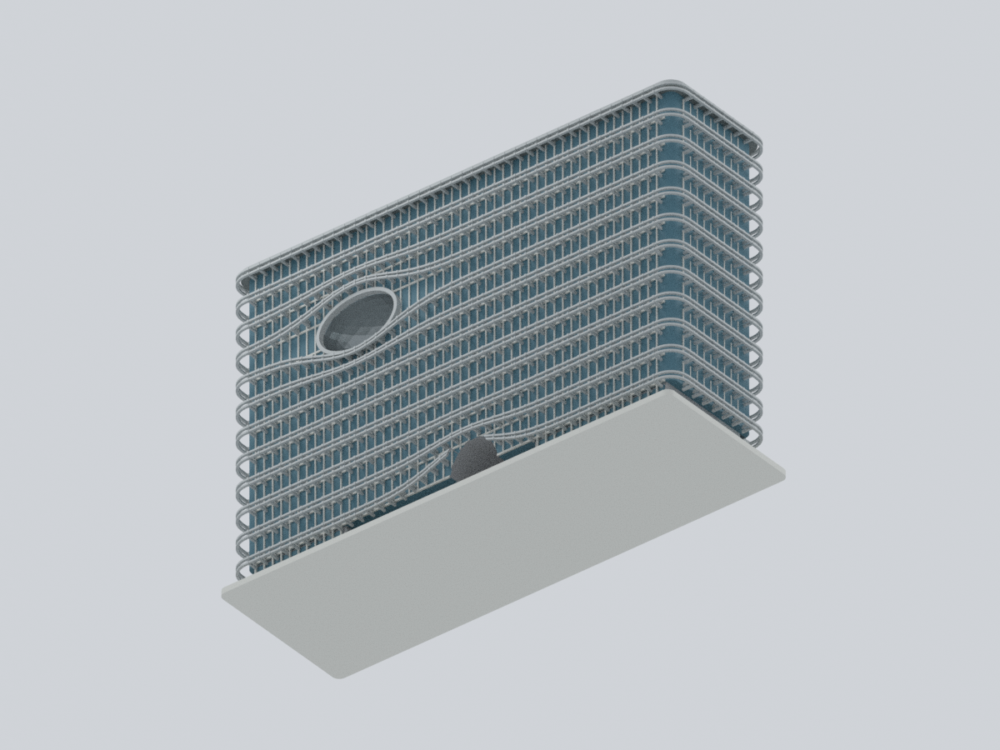
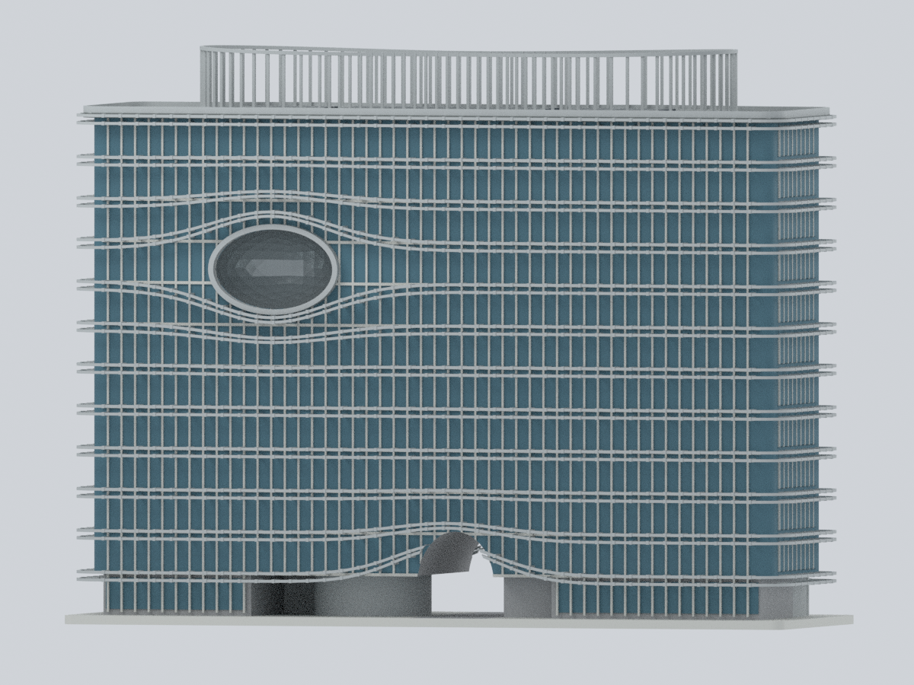

# 中國醫藥大學｜水湳創研大樓 A2

## 模型預覽

| 南街側／偏西眼部 | 北院側／服務屏條 | 東南斜視 |
|---|---|---|
|  |  |  |
| 西短端／中性窗組 | 東短端／帶狀回折 | 屋頂／雙葉與光電 |
|  |  |  |
| 西北斜視 | 自身小底座／底面 | 低角度入口與眼部 |
|  |  |  |

**整棟地上外觀、有限細節彩色近似**：十二個地上編號樓層、南街側偏西眼部凹腔與成對波浪遮陽帶、北院側垂直屏條、不同短端、各自不同的地層／屋面／連續雙葉高罩體，以及 2022 可見的光電區。不是只有正面，也沒有加入 A1、A3 或整個庭院。

採 **2020 完工後公開資料，含 2022 屋頂狀態**。部分照片拍攝日期未知；這是混合日期證據下的外觀代表，**不是 2026 現況、精密竣工復原、測繪或工程模型**。12F 編號不等於全部樓層已使用。

## 同一真實網格的九個視角

全部由交付 STL／Blend／3MF 共用的實際幾何與逐面材質渲染，無來源照片貼圖、生成式示意圖或隱藏補件。正面＝南街側，背面＝北院側。


## 檔案與實際編輯

- [STL](model.stl)：單一連通的封閉網格；STL 本身不帶顏色。外框約 **254 × 85 × 194.1 mm**。
- [Blend](cmu-chuangyan-a2.blend)：可編輯頂點與逐面材質，八個材質槽；沒有外部圖片、修改器或隱藏模型物件。
- [彩色 3MF](cmu-chuangyan-a2.3mf)：真正 base-material 資源及逐三角面指派，不是重新命名的 STL。
- [數值參數](parameters.json) · [色盤](palette.json) · [幾何／證據分類](mapping-rules.json) · [逐面材質](face-materials.csv) · [來源與權利](sources.json) · [完整重建](source/rebuild.py)。

以上毫米是**展示尺寸，不是實際建築尺度**。主體長度正規化為 240 mm、樓層節距為 14 mm，比例由照片及圖面近似；沒有把未核實的提案高度當竣工尺寸。+X 東、+Y 北／院側、+Z 上；方位依一樓平面北箭頭理解，不宣稱測繪方位角。底座厚 3 mm 是模型製造選擇。

## 證據支持與明確簡化

| 來源 | 支持的部分 | 不可據此推論 |
|---|---|---|
| [營建署建築師獎專輯](https://www.nlma.gov.tw/uploads/files/7eab1d40262d32c63372beb55cfc7937.pdf)，PDF 59–62、129；2022-01 出版 | A2 身分、2020-05 完工、南／短端外觀、眼部細節、一樓平面與剖面 | 圖面尺寸數字不足以可靠讀取；不是全層竣工圖，單張照片日期未知 |
| [里卡豆 Ricardo 航照](https://www.flickr.com/photos/songmatin/52407441182)，2022-07-10 拍攝 | A2 屋面、連續收腰雙葉罩體、三個主要中央光電區及南長邊帶 | 航照投影不是一樓外牆；不能將高罩體描線原樣拉成十二層 |
| [校方 2022 永續報告](https://cmuusr.cmu.edu.tw/sites/default/files/中國醫藥大學2022永續報告書.pdf)，PDF 102 | 可辨 A2 的眼部、短端、屋頂與光電旁證 | 照片捕捉日未定；不把附近無法指認的屋面近照拿來補 A2 |
| [上森景觀原頁](https://upon-forest.com/p1.html)，01／03／06／09 等照片 | 北院側屏條、暗槽、彎曲帶與低層通道；西端、南面和接地 | 上部北立面遭裁切，無法核實精確高層窗格。該頁不是 A2 建築設計歸屬證明 |
| [校方學生會 A2 頁](https://cmusa.cmu.edu.tw/shuinan/a2/) | 名稱及 1–12F 編號 | 不代表十二層都已使用；未將未取得的全層示意圖列為幾何輸入 |

### 有保留的整棟，而非錯誤盒體

- **不同水平切片**：一樓支承依平面保留左右不對稱房間、院側突出、偏置核心與橢圓形低層量體；上層使用有界的外皮銜接。屋面北緣有兩處外鼓與收腰，另立一組連續雙葉高罩體。三者不是同一輪廓沿高度拉伸；未宣稱每層北緣相同或精確。
- **南眼部是真凹腔**：橢圓口緣後方有凹入、分面的反光表面與封閉背壁，保留深退關係；不是平貼藍圓片，也不是南北貫穿大洞。腔深、曲率及細格只作近似。
- **北側不是南側鏡像**：保留觀察到的灰色垂直屏條、暗槽、弧形水平帶和低拱；沒有第二隻眼。照片未涵蓋的上部採明確揭露的連續服務屏條推定，並非逐窗復原。
- **兩短端有差異**：遮陽帶圓角回折；東端較寬窗組、西端較窄窗組與中性面不同。遮擋或未核實的小開口不虛構成精密立面。
- **通道與支承**：地層偏置通道真正穿空；旁側核心及支承實體保留。室內房間採實心不透明簡化，沒有重建旋梯、教室、地下室或完整院落。
- **屋頂**：雙葉罩體的環帶及立條與主屋面分開。三個中央 PV 區和一條南長帶依 2022 分布；片數、分格、低矮安裝高度屬展示簡化，不是設備清單。省略未確認 HVAC、管線、欄杆及精細植栽；沒有複製 A1 的三個風機。
- **顏色**：中性銀灰、低彩度藍灰玻璃、深色 PV；RGB 未經色卡校正。眼部藍／金／紫來自反射與光照，不固定烘焙為油漆。玻璃為可列印的不透明實體，並非光學或室內復原。

## 實際驗證及列印限制

[網格／切層](qa/geometry-validation.json) · [通道／凹腔射線與不同切片](qa/feature-validation.json) · [自交預檢](qa/self-intersection-validation.json) · [3MF 讀回與編輯重開](qa/3mf-validation.json) · [Blend 編輯重開](qa/blend-validation.json) · [完整重建比較](qa/rebuild-validation.json) · [路徑緩衝區](qa/path-buffer-audit.json) · [九視角檢視](qa/visual-review.json)

重新讀取實際 STL 檢查邊與頂點流形、單一連通、朝向、重複／退化面，以及 **0.2 mm 間距、首平面 0.113 mm** 的閉合切層交線。略偏移的首平面避免解析幾何頂點恰與切面相切；不是實際擠出工具路徑。另用三角面交線驗證眼部入口無阻、背壁存在、地層通道留空與偏置核心仍在，並分別檢查地層、上層、屋面與高罩體切片。自交檢查為有明確容差的數值預檢，不是精確謂詞證明。

**不是免支撐模型，未實體試印。** 水平帶、眼部、低拱及高罩體細條都有懸挑或脆弱風險；此切層情境在 11 個高度偵測到新出現的未承接截面小島，位置逐項列入 JSON，不以單一連通掩蓋。陰影或渲染顯示通透，不代表可以直接無支撐列印。

成對帶邊厚約 0.95 mm、窗框寬 0.7 mm、高罩體立條約 0.9 mm；交會處可能產生更小色區，這些不是所有可見彩色面的保證下限。外框長 254 mm，先確認成型範圍；縮小會損失細格。請評估支撐、樹脂或多材料設定並先局部試印。3MF 顯色取決於軟體支援；格式座標轉換容差不是來源精度。不能用於結構、消防、疏散、施工或其他安全評估。

## 僅以公開輸入完整重建

依 [版本需求](source/requirements-model.txt) 安裝後：

```sh
python source/rebuild.py --out NEW_OUTPUT --geometry-python GEOMETRY_PYTHON --three-mf-python LIB3MF_PYTHON --blender blender --threads 4
```

只需 `source/*.py`、`parameters.json`、`palette.json`；不需既有模型／NPZ／PNG、照片、登入或網路。腳本重建真實網格、STL、彩色 3MF、Blend 及全部九張 PNG，並重新執行網格及編輯重開驗證。[比對程式](source/compare_rebuild.py)比對權威陣列、STL 位元組與九張影像像素；Blend 和 ZIP 的存檔時間不當成幾何差異。

主要數值、平面控制點、厚度與重複節奏可在 JSON 修改；推導輪廓、布林構成、拓樸處理與分類是程式內固定演算法。這不是每個構件皆可獨立改動的 BIM；預設驗證座標針對隨包比例，修改參數後須重新評估特徵測試與列印限制。

來源照片、PDF、建築圖面與設計權利仍屬各權利人。公開可閱讀不等於可再散布；本包只含新製程序幾何、文字、程式及模型渲染，不附來源像素，也不授予原作額外權利。
