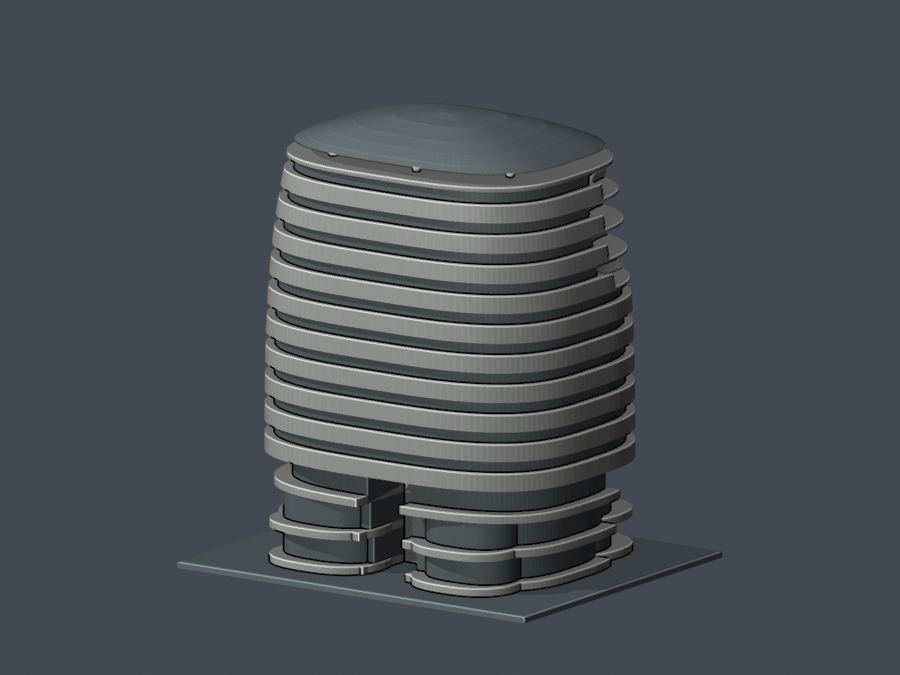

# 中國醫藥大學水湳校區 關懷大樓

## 模型預覽

| 模型預覽 | 模型預覽 | 模型預覽 |
| :---: | :---: | :---: |
| 西側正面  | 東側背面  |  |

有界外觀近似，非測繪、施工圖或實體試印成果。已完成獨立數位核驗，主審接受本次限定短首段及實板側接證據；原結果與使用限制保留。

## 範圍與依據
關懷大樓亦稱 A3 學生宿舍，2020 年完工進駐。地上13層，4–13F為宿舍；學生會舊頁記B3、校方2024防災計畫與建築師發表記B4，地下口徑差異保留，本模型不描出地下室。不是旁側卓越或創研大樓的合併模型。

依學生會1–13F分區示意平面、校方多面完工照片、建築師公開照片及2024正射交叉構成。平面有7.4m比例尺，4F外包絡約42.2×33.5m，只是示意比例診斷。名義主體南北43.4×東西33.4m、高55.2m；總高50–58m為照片試配界，非官方量測或統計置信界。正射高程視差未閉環，不把屋帽投影位移當實體偏心。

## 主形與簡化
- 圓角長方／卵形主體、西側4–6／7–9／10–13F三組外凹露台分層建造；保留曲線護牆、實底與深退玻璃，不挖穿中央天井。
- 東背條帶與兩低曲量體／中央深入口、前側不等低廊與寬斜柱保留。完整道路、地下入口地景及植栽不包含。
- 覆蓋屋帽保留真通氣空隙與實根支柱／矩形機房；隱藏柱位採少量非等距有界近似，不宣稱完整柱網。
- 屋帽名義36.4×28m，中央格架／玻璃細格在列印實體省略，因減法細格曾使水平截面出現不可保留小島。主要預覽不假畫已雕刻格線。
- 露台平滑弧形包絡、樓層實底端線與粗護牆為可印尺度近似；原細欄杆、窗框與植栽省略。各層輪廓並非逐點竣工還原。

## 檔案、比例與列印注意
model.stl 單位毫米，含2mm底座最長150mm，底座朝下。參數源 build_model.py 以公尺建形後縮放；scene.blend 從實際STL匯入可編修網格，previews的9圖來自同份STL。

屋帽、外廊與深凹露台可能需要支撐；未實體試印、未驗證Cura/Prusa工具路徑，不保證無支撐或任意縮小。0.8mm opening僅XY形態參考，原法向首段、後air與另向實根分開報告，不能稱全方向最小壁厚。

來源只列公開URL：[sources.json](sources.json)。原照片、平面、PDF均不隨包散布。

## 作者驗證結果與使用限制
- 原STL 70,600三角面，單一連通表面、逐邊兩面、vertex links單環、原法向／繞序／正體積通過；不做repair。重建STL SHA、Blend幾何及9PNG bytes一致。
- 0.2mm共750層、1,191個未round原Polygon，erosion/opening零消失、零分裂，沒有單構件loss>1%。最大單構件loss約0.01514436%，仍非全方向壁厚。canonical版本另保留原6位座標口徑。
- 全70,600×7＝494,200原面點；22,415個短法向首段全部原值／後續air保留。作者按實際入口面與首出口面建立22,254個兩面內向根；另外161個用該方向的實際首出口第三面建立三面共同內向根，保留原兩面短根及控制，不以後方厚體抹掉第一段。
- 來源區域：低層／斜柱14點根最小62.653379mm；上層條帶／露台兩面20,543點最小0.853545mm；上層三面161點最小21.731326mm；屋帽／支承兩面1,697點最小33.199206mm。這些是指定內向連續根，絕非原法向最小厚度或全域wall；兩原面不一定共享有限邊，shared-vertex數與平面交線距離另明列。
- 3個原parity控制flags未刪，另用全原三角solid-angle與嚴格barycentric命中重核；12個控制點距最近原表面至少0.000008894mm，均非恰落表面。原screen與解釋報告分開，不把所有短air一律稱數值問題。
- 2個斜柱、6支帽柱與3處最低露台，以原網格實際首命中／首段連續路徑驗根；薄底名義0.38m、頂板整合為連續主體，避免接縫近共面反面。
- 獨立加密及限定交面根裁定詳見補充，原失敗嘗試如實保留。不要自行縮小，不宣稱無支撐或試印保證。

重跑：安裝requirements.txt後執行 python run_all_checks.py。需要Blender及g++；完整密採樣和預覽重現會耗時。--bind-existing只核已完成且綁當前SHA的報告。short-root-classification.csv的raw_air=-1表示原CSV的inf（之後沒有再入）；原dense-samples.csv.gz保留原字串。

## 獨立審核補充

[完整獨立數字、限定根與露台失敗控制](independent-review.md)。沒有opening例外，原29073短段與210失敗pair不抹除，不保證全域壁厚或實印。
