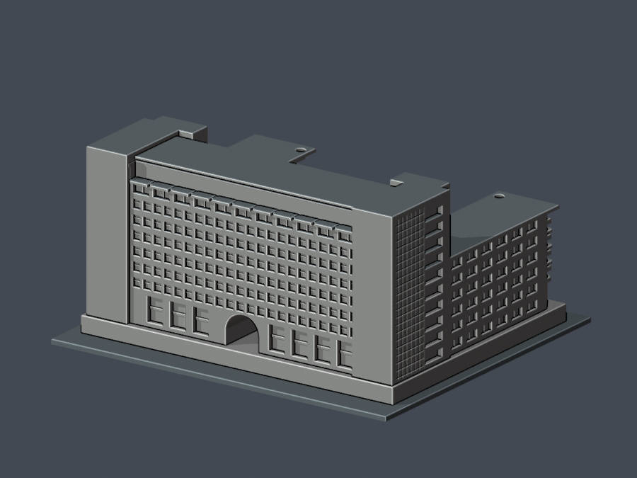

# 中臺科技大學天機教學大樓

2004 年完工建築的原創、有界外觀模型。本件只涵蓋天機教學大樓，並非全校完成。原名亦見「綜合教學大樓」；不含鄰棟耕書樓、勤學樓或保健大樓。

| 模型預覽 | 模型預覽 | 模型預覽 |
| :---: | :---: | :---: |
| 正面：兩翼及下沉庭院  | 背面：高樓與穿堂大拱  |  |

[模型與列印限制](buildings/ctust-tianji/README.md) · [STL](buildings/ctust-tianji/model.stl) · [來源](buildings/ctust-tianji/sources.json)
