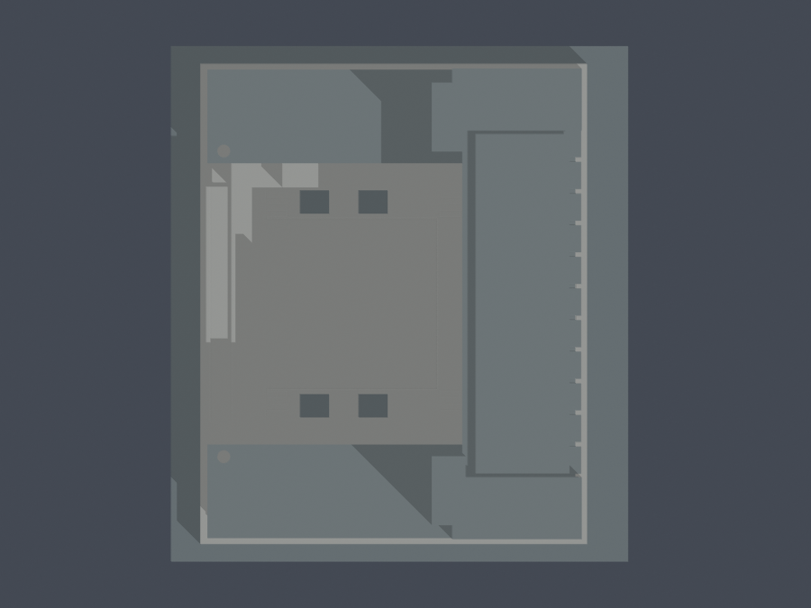

# 中臺科技大學天機教學大樓

## 模型預覽

| 模型預覽 | 模型預覽 | 模型預覽 |
| :---: | :---: | :---: |
| 正面：兩翼及下沉庭院  | 背面：高樓與穿堂大拱  |  |

2004 年完工建築的原創、有界外觀模型。本件只涵蓋天機教學大樓，並非全校完成。原名亦見「綜合教學大樓」；不含鄰棟耕書樓、勤學樓或保健大樓。

## 形體及資料界線
- 東側十層高樓、南北六層兩翼、西側雙層柱廊、逐層階梯退台、下沉庭院實底與四小採光井、東背真穿通大拱，採同一連體外觀模型。
- 校方逐層平面與建築師完工照片互核。1F +0.30m、10F +32.95m、B1天井 -3.40m 為原圖標註；中間層界依這些控制點分配，並非所有樓層都有官方標高。指定高樓尺寸鏈78.92m亦不是所有屋簷/凸核的外包測量。
- 1F洞投影約39.7×33.8m，B1中央實底約29.1×29.2m，由各頁梯核對位推估；樓梯、步道與採光井占用兩者差額。細尺寸仍有原圖像素/版本誤差。
- 最高處相對1F名義38.4m，37–40m為照片配景界；含底座尺寸132.955×150×74.784mm。2024正射支持屋頂拓撲，無立面測繪或最新完整剖面。
- 西翼端外梯四個主要外平台按2→3、3→4、4→5、5→6的半層折返工作假說；最低圓弧、上三折角。半層高度為推估，整層入口後退。細金屬欄杆省略，改成背接厚實護牆與落地斜撐；院內樓梯以四級較粗階面簡化。
- 背面3–8F六排一般窗、9F較寬庇窗、10F內退；前塔四寬窗與頂四窄窗、前廊柱保留主要節奏。照片日期未標，不能宣稱2024逐窗與所有改造如實復原。
- 地形僅局部有界底座，地下B2禮堂未展示室內；不含完整外部景觀、鄰棟長連廊、機電細件。第三方原圖留私人核對，不在此公開包重散布。

## 檔案與重建
- [STL](model.stl)、[可編輯Blend](scene.blend)、[原創參數](build_model.py)、[參數摘要](parameters.json)、[來源](sources.json)
- [頂視](previews/top.png)、[全部渲染SHA](render-manifest.json)、[硬QA](validation.json)、[逐Polygon](detailed-component-check.json)、[原面厚度/根](surface-ray-check.json)、[密採樣綁定](dense-sampling-binding.json)
- Python環境依requirements.txt；執行build_model.py後，以Blender執行render_preview.py。scene.blend匯入同一STL三角網格；所有預覽直接渲染交付STL，無代理形體。

| 模型預覽 | 模型預覽 | 模型預覽 |
| :---: | :---: | :---: |
| 頂視  |  |  |

## 列印與檢驗限制
- 單位毫米，含底座最長150mm，底座平面朝下。未實體試印，未以Cura/Prusa驗實際工具路徑。大拱、長柱廊、屋頂庇與外梯可能需要支撐；不得宣稱免支撐。任意縮小未驗證。
- 原始網格無repair，檢查原法向/繞序、每邊2面、vertex link、單殼、重建STL/Blend與9PNG重現；0.2mm切層逐個原Polygon檢查erosion/opening無消失分裂。這不等於全方向壁厚或強度保證。
- 局部>1%形態損失與全原面短首段完整保留，不能拿整層低損失免審。原法向第一段、後續空隙與另一方向背根分別記錄；不把後厚牆累加為第一段。頂棚支柱下根到屋面，不宣稱所有細件都直達底座。
- 目前狀態：已完成獨立數位審核，專案主審核可下列特定有限例外；遠端發布狀態另由發布紀錄確認。

## 局部數值警告與指定例外裁定

- 院內粗階：32個跨層原Polygon樣本 >1%；最大損失1.2233783283%，最少保留98.7766216717%。真矩形四角0.41mm鄰域外最大0.00171382642544mm²（最大相對比例0.0148954782%）。原矩形caliper最小1.875000000mm；原面法向首連續實體最小1.875000000mm。
- 西柱廊柱：224個跨層原Polygon樣本 >1%；最大損失3.3251017404%，最少保留96.6748982596%。真矩形四角0.41mm鄰域外最大0.00000000000000mm²（最大相對比例0.0000000000%）。原矩形caliper最小1.875000000mm；原面法向首連續實體最小1.874999762mm。
- 高屋頂支柱：60個跨層原Polygon樣本 >1%；最大損失3.9296637586%，最少保留96.0703362414%。真矩形四角0.41mm鄰域外最大0.00000000000000mm²（最大相對比例0.0000000000%）。原矩形caliper最小1.875000000mm；原面法向首連續實體最小1.875000000mm。
院階真角外損失非零，不稱全部純角。前兩族原垂直根到基底；屋頂柱部分根止於屋面z69.755683899mm，不能概稱全都到底。上述caliper僅這批原矩形，非全域或任意方向壁厚。逐樣本/真角/射線完整值見 [警告摘要](warning-summary.json)、[原Polygon細查](detailed-component-check.json)、[原面首段與根](surface-ray-check.json)。

全161350個原三角面7點法向密採樣含10364個小於0.8mm首段，並保留後air與內外控制；[密點原CSV](dense-samples.csv.gz)。其中9912個為來源指定淺浮雕背接帶，以另一個直接內根方向驗證；其餘452個均以實際entry/exit兩真面內法向和驗得直接連續根，最小2.640249010mm；本候選不需要第三/第四面方向。所有失敗中間方向仍保留，不把背根當原法向厚度，也不把全模型短弦一概說數值誤差。[背接證據](local-back-roots.json)、[交角證據](corner-root-check.json)、[完整有限樣本分族覆蓋](family-coverage.json)。

數位檢查中發現的10F外簷薄唇、塔窗間薄帶、翼頂圓孔覆帽與四採光井薄唇已由參數源修正；舊候選不隨本包提供。採光井內側邊有約0.4m有界讓位以保留厚根，保留四開口及實底。此處不代表完成實體列印。

[整包硬檢查綁定](qa-summary.json) · [逐檔SHA](SHA256SUMS.txt)。以 `python run_all_checks.py` 完整重驗；`--bind-existing` 僅綁定當前SHA且較新的已完成報告，不能跳過失敗或使用舊SHA。

## 獨立核驗補充（2026-10-15）
[獨立摘要](independent-audit-summary.json)與[未round原WKT警告](independent-unrounded-warnings.json)與[作者round6口徑的獨立WKT重算](independent-rounded-warnings.json)保留原開運算，沒有用理想矩形替換結果。作者原報告與原檢查狀態不改。316為跨層截面樣本，不是316支實體構件。
- 院階32筆：未round原交點最大損失1.245536544757698%，最低保留98.7544634552423%；真角0.41mm外0.0038252558857198122mm²（原面積0.03324666655994551%），全部在原邊0.005mm帶內，不稱純角或零。作者XY round6原值1.2233783282964317%與0.0017138264254378556mm²另列，兩種原WKT與數值不混淆、不覆寫。
- 前柱224筆：未round最大3.325102087363394%，保留96.67489791263661%；真角外6.199077031863692e−16mm²是數值殘差。頂柱60筆：最大3.9296637585820053%，保留96.07033624141799%，真角外本次計算0。
- 指定原面法向最小1.8749998mm。院階／前柱原垂直根到底座；部分頂柱接z69.7556839mm屋板，不能說所有柱直達地面。這些值不代表全域最小壁厚。
- 獨立加密全部23050原三角各10點，共230500點及922000內外／首段中點／第一出口後空氣控制，全部一致。14760個首段小於0.8mm，最小0.000855685157344mm，原短首段與其後空氣保留，不能以後段厚牆累加。
- 14160點位於指定淺刻背接帶，真連續首背根最小5.6048403190011475mm；600點由原入口與實際出口面合成內向交角方向，從表面偏入0.00001mm起連續第一出口最小2.640239010296137mm。若把起點到表面的0.00001mm也計入，對應作者2.640249010mm口徑；不混稱兩個不同厚度。
- 作者每面7點161350／10364短段／9912背接與452二面角子集已重現；獨立新增樣本不以作者挑選範圍代替。2個原指定背向失敗樣本仍保留，再以實際原入／出面角根檢驗，不能隱藏失敗或任選穿過空氣的長方向。
- 另772首實段、373根及9穿堂射線／4井實底覆核通過。穿堂6條全射線清空，另3條先行100.56818355mm空氣才碰到遠面；不是9條向無限遠都無遮擋。
- 核可只限此STL的原截面數值損失與指定有限根接證據，不等於每個方向法向厚度≥0.8mm或已實印。保留半層階梯、來源高度／後側未知的近似說明；棚、外簷與廊下仍需試切片及支撐，不宜任意縮小。
