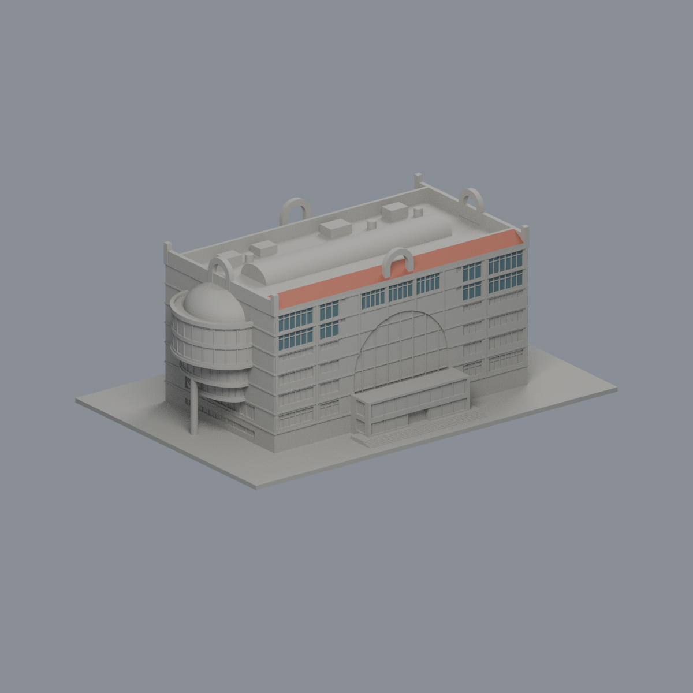

# 中華大學

本目錄目前只有行政暨圖資大樓單棟的來源限定有界版，主體／屋頂拓撲、南窗、北側未知處簡化及半穹冠三向外觀比較已覆核、已完成獨立原STL重驗並獲主審特定例外接受；不代表全校或全校區完成。未納入鄰接國際會議廳的紅斜屋頂。

| 建築模型 | 建築模型 | 建築模型 |
| :---: | :---: | :---: |
|  **[中華大學｜香山校本部｜行政暨圖資大樓](香山校本部/buildings/chu-administration-library/README.md)** 正面：南側入口 |  |  |

圖為模型渲染。[建築說明與列印限制](香山校本部/buildings/chu-administration-library/README.md) · [原面有限彩色外觀](香山校本部/buildings/chu-administration-library/appearance/README.md) · [STL](香山校本部/buildings/chu-administration-library/model.stl) · [來源與證據](香山校本部/buildings/chu-administration-library/sources.md)

主矩形採 60 × 34.5 m，每端半圓另突出約 8.7 m。尺寸以 7F 房間錨與 NLSC 屋面投影雙證估配，並非牆基測量；主屋面 28 m、拱耳 34.4 m、半穹冠最高 28.7 m 皆為照片推估。版本跨 2021 年 8 月環景、帶 2024 水印正射與未標年官方照片，水印不是拍攝日期。竣工日期及設計者未確證。

最大水平尺寸 150 mm。5/6F 雙層弧凸、3/4F 小半徑及單柱、四向真透空拱耳均保留；筒頂封實、細框背接浮雕、半穹有限截頂、北面僅留照片確認大窗帶與中央弧區，樹遮低腳窗與未知細跨略去，未鏡像南面細跨。原始來源圖不隨包分發。尚未試印，不保證無支撐。

南窗更正：7F 每翼外側 6 細跨、內側 3 細跨並帶上小窗，中間 3 寬組以紅色實牆間隔；6F 翼部高窗與 5F 短帶分開建模。筒形天窗與半穹玻璃細分框架全部省略，不加薄條。半穹冠採冠底 24 m、矢高 4.7 m、最高 28.7 m，東低角／南西高角／北東俯視三向比較已核。冠 rx 6.5／ry 8.0 m 相對大弧台 rx 8.7／ry 10.3 m 內退約 2.2–2.4 m，均為圖像推估；外環實女兒牆高約 0.65 m、厚 0.8 m（模型厚 1.4 mm）為列印化簡。

## 數位審核與發布狀態

外觀覆核已完成上述項目；數位檢查紀錄見隨附報告，10 個原矩形角外數值例外已經獨立重驗並由主審接受；原數值檢查仍保留 exit1／passed=false，不宣稱全部原檢查零退出。是否正式發布，應以本輪報告與統一清單的最終狀態為準。外觀通過不代表完成試印或保證無支撐。
