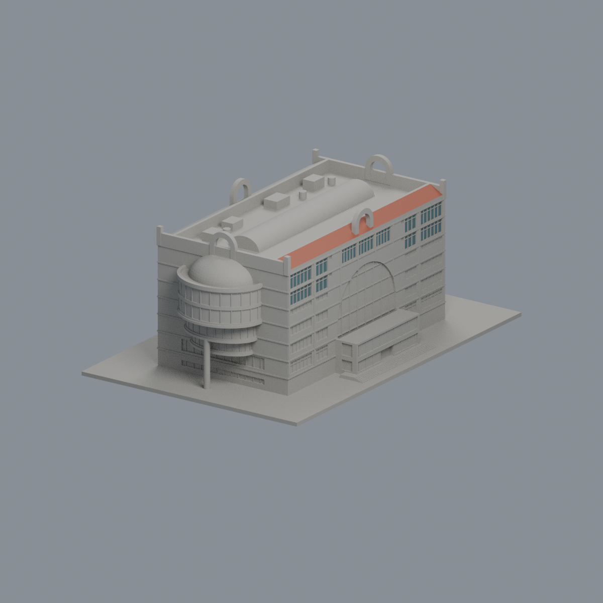
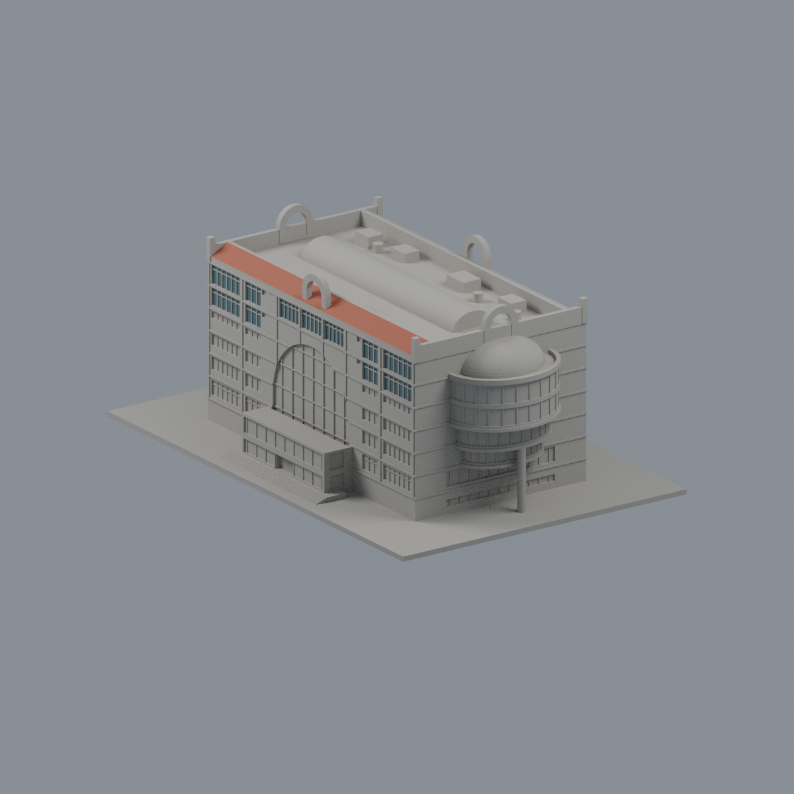
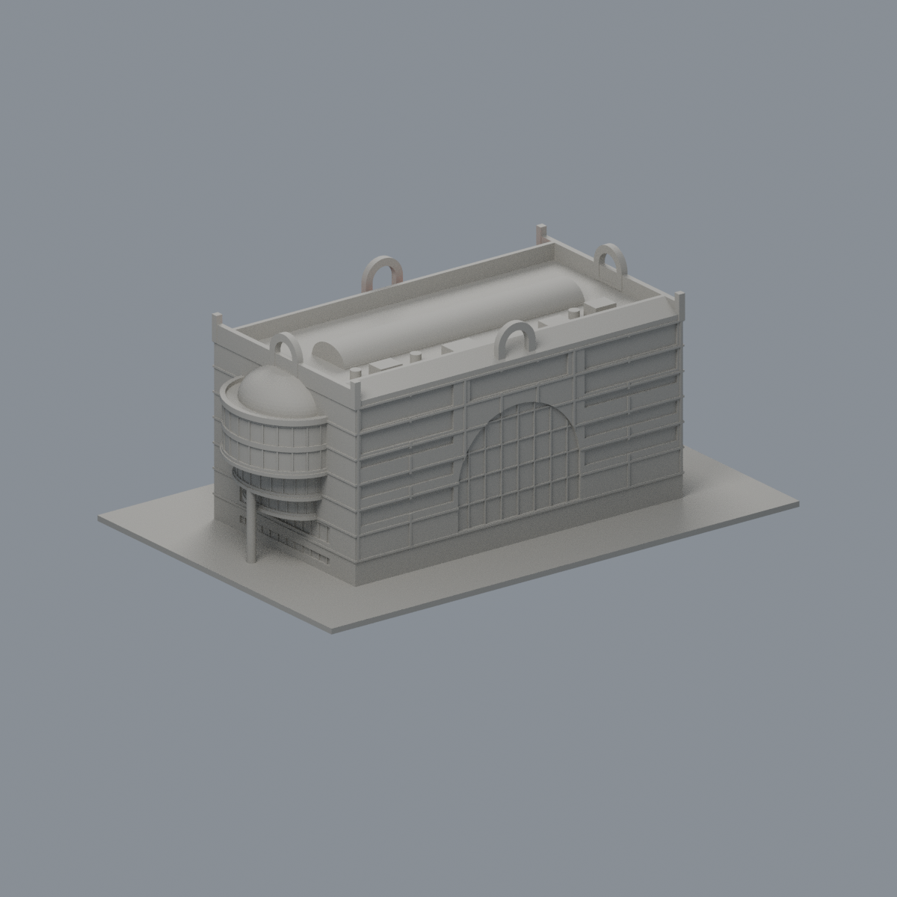
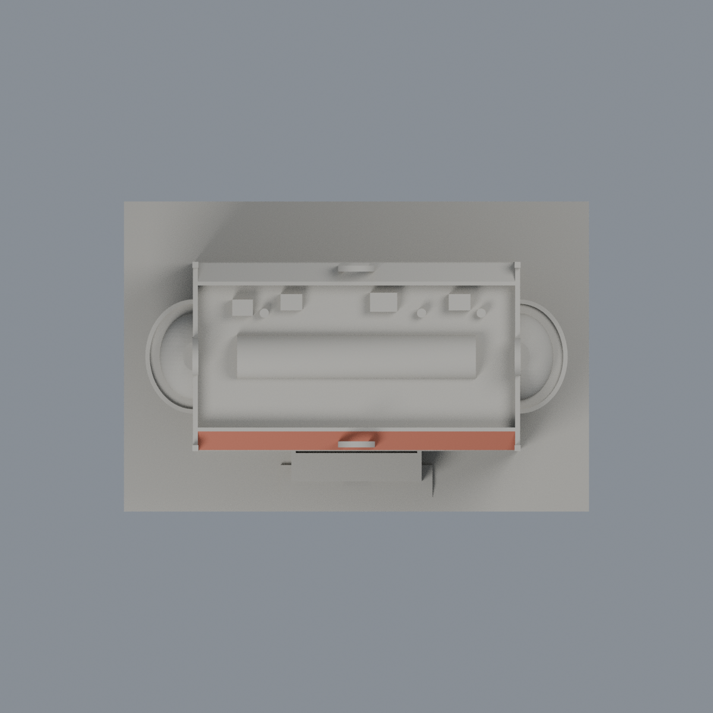

# 中華大學｜香山校本部｜行政暨圖資大樓

## 模型預覽

| 新版模型預覽 | 新版模型預覽 | 新版模型預覽 |
| :---: | :---: | :---: |
|  |  |  |
|  |  |  |

來源限定有界版，主體／屋頂拓撲、南窗、北側未知處簡化及半穹冠三向外觀比較已覆核，已完成獨立原STL重驗並獲主審特定例外接受。此版本只涵蓋行政暨圖資大樓單棟，不代表整個校園已完成，也不包含鄰接國際會議廳的紅斜屋頂。

## 正背同表

預覽是模型渲染，不是實景照片。左右側另見 西側（歷史檔案留存，不作本頁預覽）與東側（歷史檔案留存，不作本頁預覽）；方位以模型編製約定及實景判讀為準。

## 範圍與版本

- 官方說明圖書館位於本棟 5–7F；以官方 1、2、5、6、7F 平面、官方照片、公開環景及 NLSC 正射交叉建立量體。
- 版本混合 2021 年 8 月環景、帶 2024 水印的正射與未標拍攝年的官方照片；2024 水印不能當作影像拍攝日期。這不是單一時點的竣工復原。
- 未取得本棟竣工日期或設計者的確證，不以創校年替代竣工年。

## 尺度口徑與不確定性

| 項目 | 候選採用值 | 證據與界限 |
| --- | --- | --- |
| 主矩形 | 60 × 34.5 m | 7F 校史館房間 18.35 × 16.00 m 作比例錨，另以 NLSC 屋面四角投影交叉核對；不是牆基測量 |
| 東西半圓凸出 | 每端另突出約 8.7 m | 不包含在主矩形 60 m 長度內；按 5/6F 平面與外照估配 |
| 主屋面 | 28 m | 照片推估，非官方標高 |
| 拱耳最高處 | 34.4 m | 照片推估，非官方標高 |
| 半穹冠最高處 | 28.7 m | 冠底 24 m、矢高 4.7 m；三角度外觀比較已核，照片推估並有限截頂，非實測標高 |
| 模型比例 | 1.75 mm / m，約 1:571.4 | STL 使用 mm；底座 150 × 100 × 1.6 mm，整件最大水平尺寸 150 mm |

房間尺寸相乘為 293.6 m²，只是該房間面積。正射屋面四邊約 60.31、34.43、61.17、33.80 m，讀角約 ±5–8 原生像素，另有屋頂高程視差；不能稱作精密測繪或完整建築線。官方平面黑粗框可能僅圈單位使用區，須結合薄 CAD 線與外觀解讀。

## 外觀保留與列印化簡

- 保留 5/6F 兩層大半圓弧凸，7F 退回主矩形；3/4F 採較小半徑弧體，下面保留單根支柱。未把兩端做成全高同半徑圓筒。
- 主屋面以平頂為主，南北窄條斜面及中央長筒採光頂分開表達；四向拱耳為真透空，不是實心塔。
- 長筒採光頂採封實微縮；玻璃與細框採有實體背接的淺凹、浮雕，不模擬透明玻璃或自由懸空細桿。
- 半穹冠有限截頂以避免極細頂尖；屋面設備僅少量低幅量體，非精確設備清冊。
- 南窗更正依官方照片細跨判讀：7F 每翼外側 6 細跨、內側 3 細跨並有上小窗，中間為 3 寬組，組間保留紅色實牆；6F 翼部高窗與 5F 短窗帶分別建立，外觀已覆核。
- 北側只保留照片確認的大窗帶與中央弧區，不鏡像南面細跨；北低腳樹遮窗略去，未知細跨不加，附屬小棚及未知入口不補造。
- 筒形天窗與半穹玻璃細分框架全部省略，不以薄條補出；立面背接窗框不代表屋頂玻璃框架已還原。
- 半穹冠最終候選為冠底 24 m、矢高 4.7 m、最高 28.7 m；東側低角、南西高角及北東俯視三角度比較已核。冠半徑 rx 6.5／ry 8.0 m，相對大弧台 rx 8.7／ry 10.3 m 內退約 2.2–2.4 m，均屬圖像推估。外環實體女兒牆約高 0.65 m、厚 0.8 m（模型厚 1.4 mm），是列印化簡。

## 檔案與重建

- [model.stl](model.stl)：候選列印網格。
- [build_model.py](build_model.py)、[requirements.txt](requirements.txt)：原創參數化建模程式與依賴；安裝依賴後執行建模程式可重建。
- [sources.md](sources.md)、[sources.json](sources.json)：可公開查驗的來源網址、採用依據與限制。
- previews 只收模型渲染；原始照片、環景截圖、正射拼圖及裁切研究圖不隨候選包分發。

幾何、切層及重建檢查須以各自實際產生的報告為準，本文件不代替檢測結果。主體／屋頂拓撲、南窗、北側未知處簡化及半穹冠三向外觀比較已覆核，尚未試印；即使網格檢查通過，也不保證免支撐、細框可印或特定機台設定可用。列印前需自行檢查橋接、懸垂及細節解析度。

## 數位審核與發布狀態

外觀覆核已完成上述項目；數位檢查紀錄見隨附報告，10 個原矩形角外數值例外已經獨立重驗並由主審接受；原數值檢查仍保留 exit1／passed=false，不宣稱全部原檢查零退出。是否正式發布，應以本輪報告與統一清單的最終狀態為準。外觀通過不代表完成試印或保證無支撐。

## 原面有限彩色外觀層

[彩色3MF、可編輯Blend與五視角](appearance/README.md)：僅204上部南窗背面及18南側紅坡原面，共222面／1253.941750mm²，其餘19458面中性。皇冠、混材弧窗、磚牆、白結構帶與背面不染色；19680原面與STL bytes不變。官照拍攝日未知，2021 XMP僅編輯資訊。原strictfalse、10具體例外及有限接受、71.6256116386%環根支承全部保留，不新增列印保證。原CGU metadata殘字歷史保留，新scene更正CHU身分。

