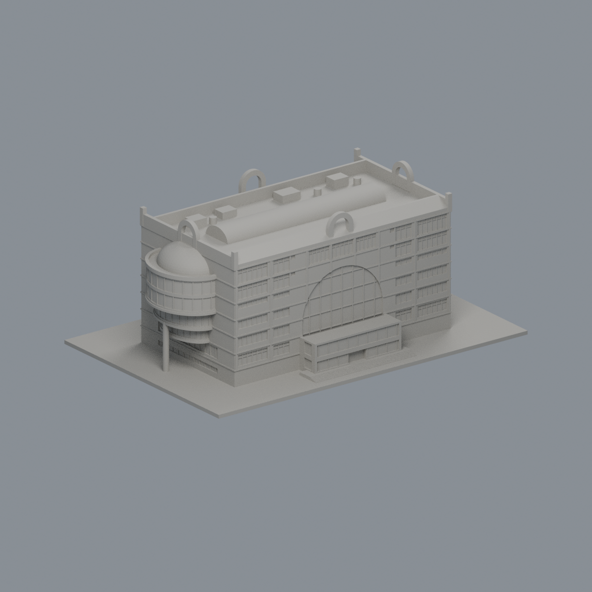

# 中華大學行政暨圖資大樓｜原面有限外觀層

這是既有模型的有限材質改善，不是新建築或完整立面復原。僅南向上部11個有限窗背區域204面、南側紅坡18面，共222個原面／1253.9417502698716mm²；其餘19458面保持中性代理。皇冠、混材大弧窗、側弧窗帶、磚牆、白色結構帶、下窗、背面、設備、樓梯及底座不染色。前後著色界線只是本輪證據界線，不宣稱實物存在材料接縫。色值為未經色卡校準的不透明展示代理，非精確反射率、透明玻璃或天空影像。

[彩色3MF](chu-administration-library-appearance.3mf) · [可編輯Blender](scene.blend) · [材質](palette.json) · [逐面索引](face-materials.json) · [重建包](rebuild-source.zip) · [校驗](SHA256SUMS.txt)

| 正面 | 左側 | 右側 |
|---|---|---|
|  |  |  |
| 背面 | 頂視 | 同角度單色 |
|  |  |  |

## 原幾何與歷史製造限制
原45檔完整保全。原STL bytes、19680三角面座標和順序完全不變；9830頂點、150×100×61.79999924mm。沒有切面、改網或為著色增加幾何。新QA驗證材質有限域、3MF嚴格讀入和實際修改存讀、Blend材質／頂點實改存讀、重開渲染及source ZIP解包重建；不是重跑或抹除原製造例外。

原 all-checks passed=false；check_layer_components.py 與 summarize_component_losses.py 原 exit1、10個具體局部proof failures保留。原README記載獨立複核與主審對這10個具體例外的有限接受，不等於所有嚴格測試全過。0.2mm步距、offset .071：309層／901原Polygon未消失或分裂；268筆逾1%損失含220拱耳樣本最大3.314017010267397%、48角柱樣本最大3.806060217503194%。10項角外原數值例外最大損失.001656514637mm²、深.00254911434mm；.005mm原邊帶外為0，不證明全域最小壁厚。

環根支承只有71.6256116386%（footprint70.2139305mm²、overlap50.2911571741mm²，cuts43.3625/42.9625mm）；0.4mm侵蝕後保留單一10.3833418866mm²核心。另一有限皇冠域224.791807mm²才有100%支承，不可混稱。1628原控制與有限皇冠／環根檢查未擴張重跑。背面近似、照片估高、不能任意縮小等原限制保留；未實體試印、未證明全方向壁厚或切片／收縮保證。

## 身分與年代
原 render_preview.py 及原saved Blend有舊CGU Activity Center metadata殘字；原檔原bytes保留，新scene已明確更正為CHU Administration Library。此為metadata更正，不是幾何修復。兩張官圖相機拍攝日期未知；2021 XMP為編輯／匯出事件，不是拍攝日期。2026-10-23是取閱日，非現況測繪日期；原跨年參考不因此獲得重新認證。

## 重建
解壓rebuild-source.zip，安裝source/requirements.txt，以Blender4.3.2依序執行 `python appearance/source/build_appearance.py`、`python appearance/source/verify_exchange.py`、`blender -b -t 4 --python appearance/source/render_appearance.py`、`blender -b -t 4 --python appearance/source/verify_scene.py`。選面使用實際有向叉積法向、三原頂點全在12有限域和支持平面、design容差0.0001（比例1.75），核對exact IDs，不用面中心。參閱[SOURCES](SOURCES.md)、[權利說明](LICENSE-NOTICE.md)及qa。
