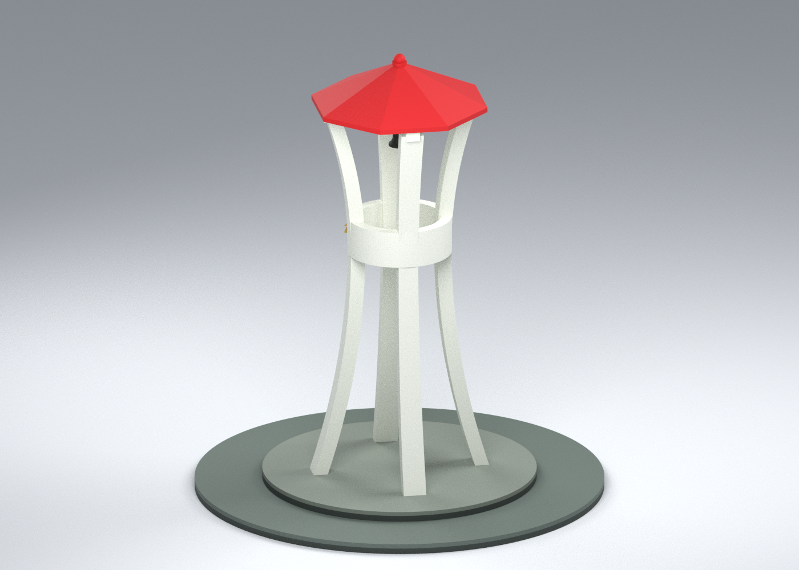
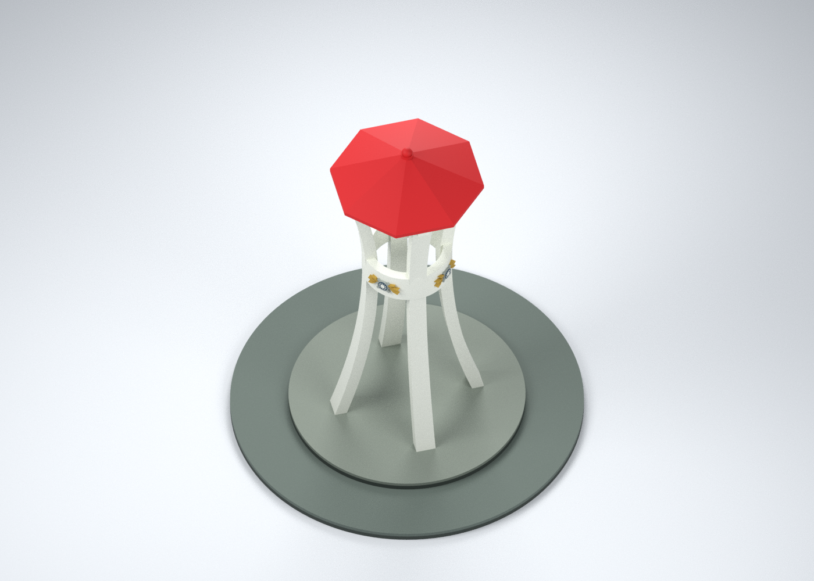
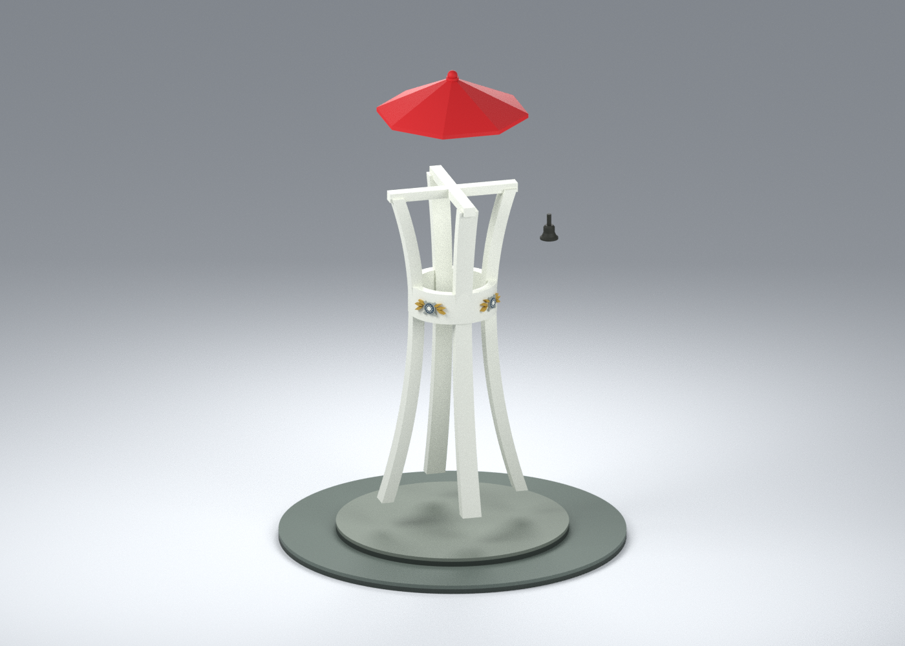

# 中華民國海軍官校：公共紀念鐘樓

依校方公開人文景物照片製作的有界外觀近似模型。只含雙層圓台、四根收腰白柱、通空圓環、紅色多邊帽頂、頂珠與吊鐘；不含周圍建築或校區配置。**外觀、幾何與九材質配色已完成，尚未進行 FFF 切片或實體試印，不能視為已驗證可印檔。**

| 模型預覽 | 模型預覽 | 模型預覽 |
| :---: | :---: | :---: |
| 彩色外觀  | 另一側外觀  | 俯視  |
| 四分件示意，非列印排版  |  |  |

## 下載與編輯

- [通用彩色 3MF 組裝外觀母版](appearance/rocna-memorial-bell-tower-ASSEMBLED.3mf)：4 個可分別編輯網格、9 個具名表面材質；沒有噴頭映射。
- [可編輯 Blender 場景](scene.blend)：同一組模型網格與顏色；攝影棚地面只用於渲染。
- [幾何與配色資料](geometry.json)、[參數化建模源碼](source/build_model.py)、[3MF 匯出源碼](source/build_exchange.py)、[預覽源碼](source/render_preview.py)。
- [製造待驗事項](MANUFACTURING.md)、[來源與年代線索](sources.json)、[有界假設](CONSTRAINTS.json)、[驗證索引](qa/README.md)。

| 分件 | 無色 STL | 通用表面色 3MF |
|---|---|---|
| 雙層圓形台座 | [01](parts/01-two-tier-circular-plinth.stl) | [01 彩色](appearance/parts/01-two-tier-circular-plinth.3mf) |
| 四曲柱、環梁與頂部橫梁 | [02](parts/02-four-curved-columns-ring-and-crossbeam.stl) | [02 彩色](appearance/parts/02-four-curved-columns-ring-and-crossbeam.3mf) |
| 八邊紅帽頂 | [03](parts/03-octagonal-red-cap.stl) | [03 彩色](appearance/parts/03-octagonal-red-cap.3mf) |
| 吊鐘 | [04](parts/04-suspended-bell.stl) | [04 彩色](appearance/parts/04-suspended-bell.3mf) |

4 種零件合計一套紀念構造物，不是四套建築。組裝包絡約 **100 × 100 × 111.95 mm**；全部尺寸為照片比例估計，沒有實測尺度或精準 1:N。

## 來源與解讀界線

使用[校方鐘樓介紹](https://www.rocna.edu.tw/tw/SchoolMapDetail.php?cms=cms_114&progId=SCH001)及三張官方照片。四根獨立收腰柱可從互補角度分辨，中央環梁孔洞與柱間保留通空。帽頂採八邊輪廓的照片解讀，並非有尺寸圖面或測繪確認；曲率、厚度、底座比例與吊鐘內部均有簡化。

來源敘事的 1982 年捐建與 1984 年冬題記分開保留，不據此推定完整施工年表。三圖 EXIF DateTimeOriginal 標示 2014-11-07，修改時間為 2014-12-12；這些 metadata 未另核實，檔名也不證明拍攝日期。本件不宣稱 2026 現況。

只在兩個照片可見位置保留低細節徽記：金色側葉、灰銀形狀與藍白中心是自行製作的近似幾何，不是完整官方徽章復刻。未知側面徽記、細文字、石板拼縫、電線、獨立小碑與環境植栽省略；沒有添加鐘面或指針。吊鐘懸吊件加粗為固定桿，無可動、敲鐘或承力功能。

九材質優先呈現可辨外觀，不按四噴頭強制合色：白漆、紅頂、上台灰綠石面、深灰立邊、下台灰綠鋪面、深色鐘體、徽記金色／灰銀／深藍。色值是人工近似，沒有色卡、現場材質或照明校正。3MF 為表面色，不是九組獨立閉合色體；切片器可能需要重新上色或指定工具。

## 驗證狀態

四 STL 均為單一閉合水密、法向一致、正體積且無零面積三角形。五個 3MF 以 lib3mf 2.5.0 嚴格匯入無警告，座標／面序／材質索引與 canonical STL 資料一致；已驗單一材質編輯可保留其餘色與分區。相同已安裝依賴的乾淨重建，幾何、4 STL 與5個3MF共10檔 SHA 一致。

承托解析篩檢仍有 **柱架 11 個、吊鐘 2 個旗標**，含環梁、頂部橫梁、微小徽記與鐘內部。篩檢面積不是自由橋接長度；未生成 G-code，也未驗無支撐列印、接合強度、公差或支撐移除。台座與帽頂在此粗解析中無旗標，仍不等於免支撐或可印保證。

[SHA256SUMS](SHA256SUMS)／[檔案雜湊清單](PACKAGE-SHA256.json)。原始參考照片僅作私人研究，不隨模型散布；公開檔案僅含自行製作的模型、預覽、源碼與來源事實／連結。
