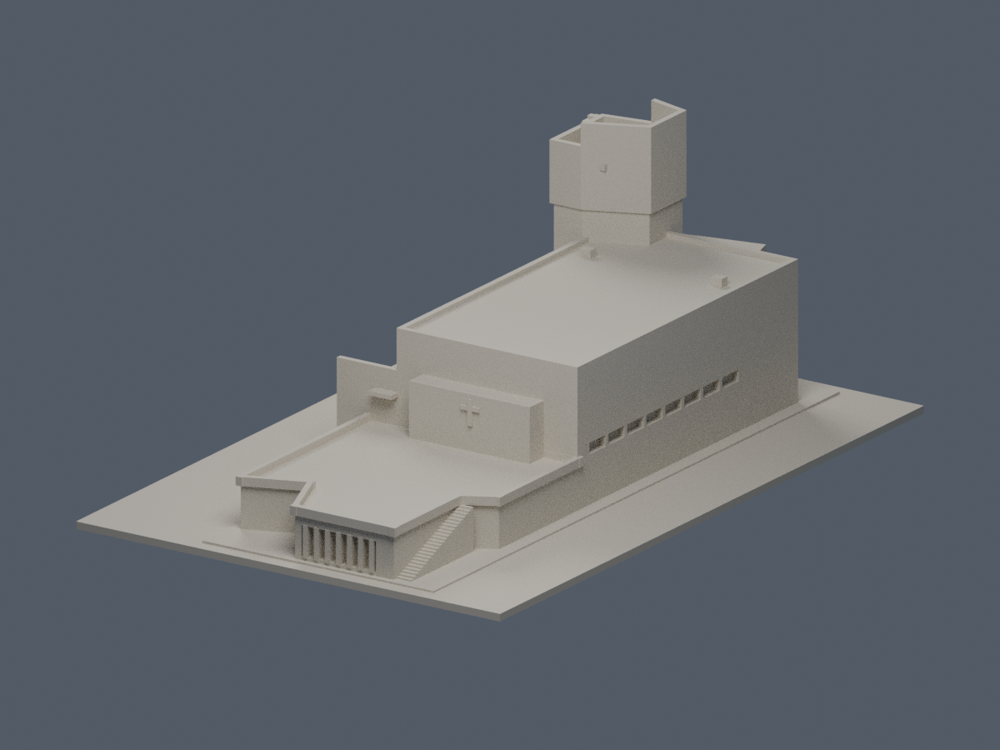
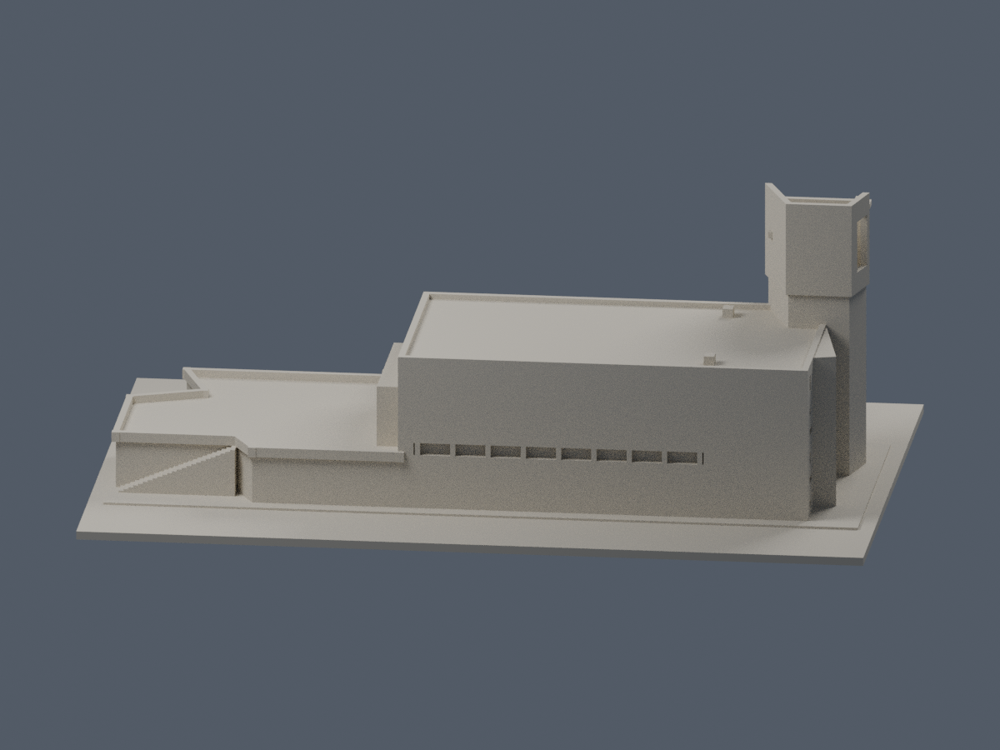
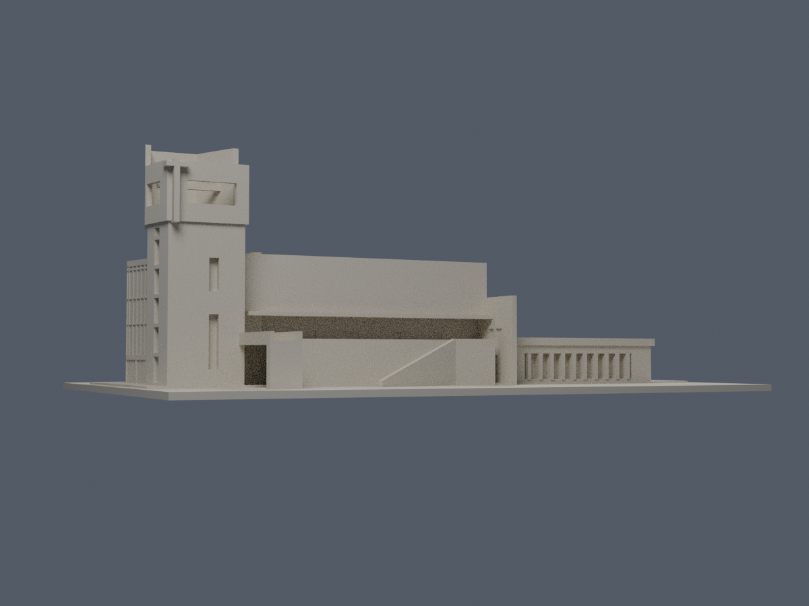
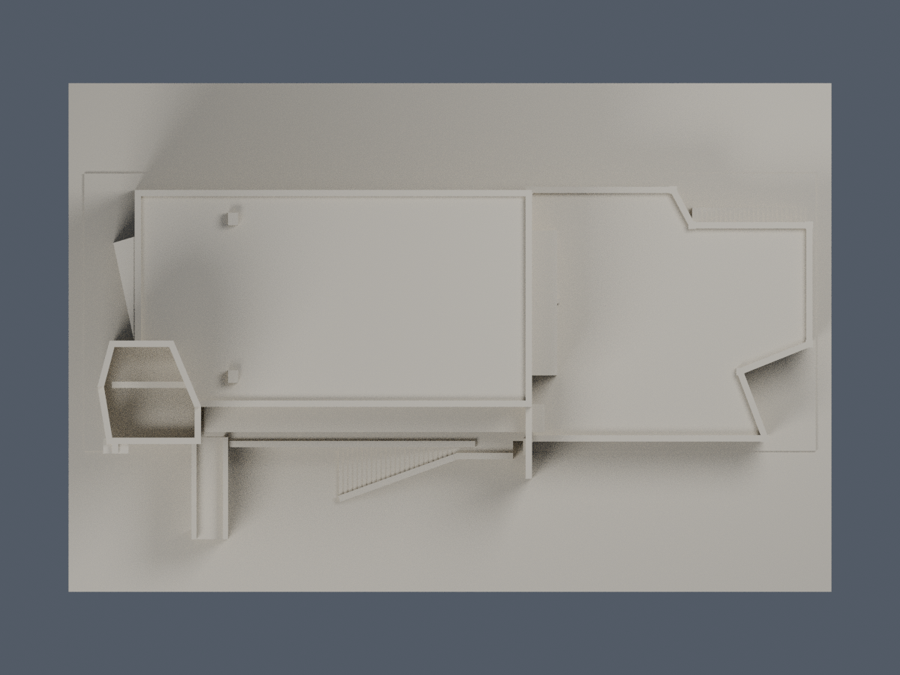
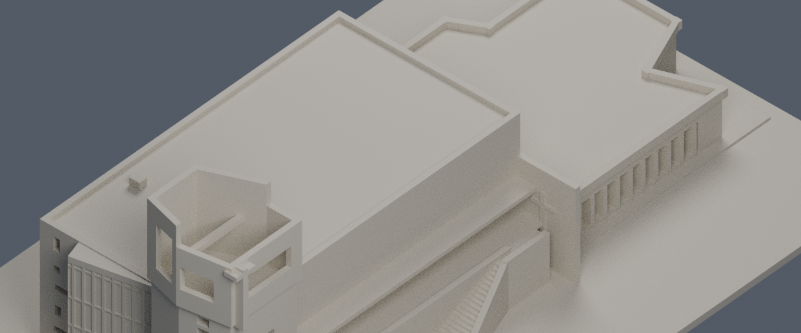
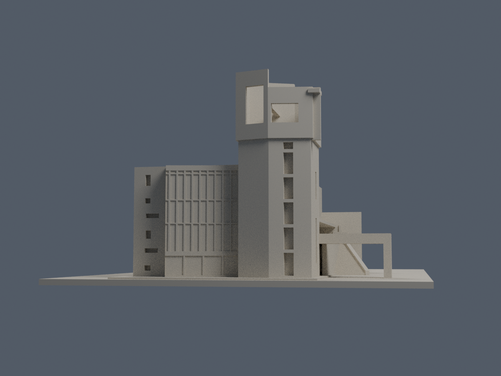
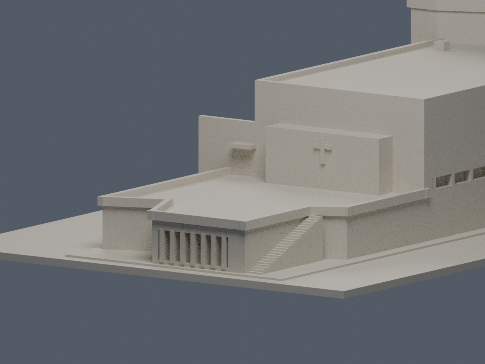
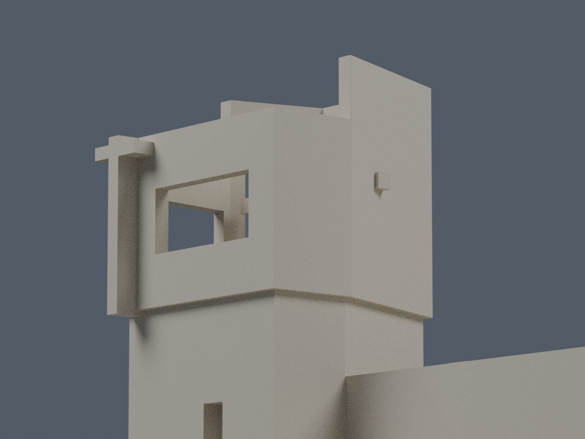
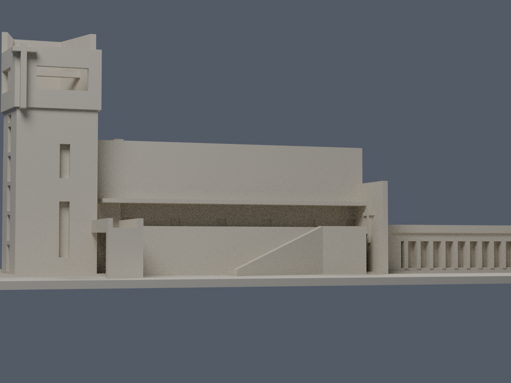

# 中華福音神學研究學院｜八德校區｜三一禮拜堂

來源限定外觀近似模型，含底座150×100×55.6 mm。範圍為平頂禮拜堂、分片開口鐘塔、東低翼露台、兩段外梯及一段短橋；不是全校完成或測繪復原。

| 模型預覽 | 模型預覽 | 模型預覽 |
| :---: | :---: | :---: |
| 正面六材質外觀  | 背面原幾何，未確認色區中性  |  |

## 最新外觀與下載

[六材質通用 3MF](appearance/ces-appearance.3mf) · [彩色 scene](appearance/scene.blend) · [配色來源、四視圖與限制](appearance/README.md)。依白天可見灰面、玻璃和框近似配色，不限四色；未知背面／屋頂／十字架飾面中性保留，夜燈不作建材色。原 STL、幾何與製造證據不變，尚未新的 FFF 切片或實體試印。

原「鐘塔」名稱有既有 S02 [ArchDaily 中文專案文](https://www.archdaily.cn/cn/987647/zhong-hua-fu-yin-shen-yan-jiu-xue-yuan-ba-de-xiao-qu-jiao-tang-pan-ji-lian-he-jian-zhu-shi-shi-wu-suo)的「十字架鐘塔」用語依據；本版「入口分片塔」為形態描述，不推定是否裝有或運作實鐘。

## 檔案與重現

- model.stl：原始單殼外觀模型；scene.blend為實際STL匯入的可編修網格。
- build_model.py：原創參數式幾何；requirements.txt記所需版本。
- render_preview.py及previews/：十張歷史單色 actual STL QA 視圖，包括南主牆與塔頂低角度細部。
- sources.md/json、scale-review.md、scale-measurements.json：來源、原像素尺度與局部推定。
- QA.md、驗證腳本、JSON/CSV及SHA256SUMS.txt：原始幾何與重現紀錄。

Python 3安裝requirements.txt後，依序執行python build_model.py、blender -b -t 5 --python render_preview.py、python run_all_checks.py。渲染/核對使用Blender 4.3.2。禁止以修補後網格替代原始STL檢查。

## 年代與尺度

建築師施工2017.12–2019.07；校方2019-09-02使照、2019年9月啟用八德。2020頁面標年、2022攝影、2026文章分開記，不混稱同年實測。

圖例存在比例衝突，已用300cm柱距、剖圖0→10m及NLSC原圖交叉校正。主屋面約39×21m；主女兒牆15.1±0.7m、塔牆27.0±1.2m為圖面估讀範圍。室內24×20m及9.6m淨高不等於整棟外框。詳細座標與誤差見尺度文件。

## 列印與簡化

底座朝下，依材料、機器及懸挑評估支撐。塔開口、橋、簷板與細節未試印，不保證免支撐。最小主要立牆/護欄約0.99–1.24mm；不適合任意再縮小。

西玻璃改完整淺凹背板，約0.496mm細直框與0.30mm高橫框退入背接，非脆弱獨立線條。南側長牆保持水平連續上緣，外梯與東端梯口分開；階級、局部地形、欄杆與十字浮雕均為列印簡化。塔薄牆用斜接平面相連，沒有以實心方柱代替塔洞。主外屋頂是平屋面，室內拱頂不外露。

原始基本體在布林前使用0.00001mm共同建構格以一致化跨軸座標，不修補輸出STL。公開包不含來源原照/PDF。數位審核紀錄見隨附報告；是否正式發布以統一發布清單為準。

本批只有三一禮拜堂。其他行政、教學、住宿棟尚未建模，後續應逐棟核官方圖與界線，不能以此宣稱全校完成。

## 歷史單色圖與製造紀錄

原 scene.blend／render_preview.py 與十張舊圖保留作幾何和製造 QA 證據，不是本版配色展示：[正面](previews/front.png)、[背面](previews/rear.png)、[左側](previews/left.png)、[右側](previews/right.png)、[頂視](previews/top.png)、[屋頂](previews/roof-detail.png)、[入口](previews/porch-detail.png)、[北側](previews/north-detail.png)、[塔頂](previews/tower-detail.png)、[南側](previews/south-detail.png)。舊 readme-view-check.json 記錄更新前的單色圖連結與雜湊，仍為歷史記錄；本次所有展示層與圖片由 appearance/ 的新驗證覆核。

| 模型預覽 | 模型預覽 | 模型預覽 |
| :---: | :---: | :---: |
| 正面  | 背面  | 左側  |
| 右側  | 頂視  | 屋頂  |
| 入口  | 北側  | 塔頂  |
| 南側  |  |  |

## 獨立薄損例外補充
278層460原Polygon均保持單一侵蝕／opening核心、零消失或分裂。72個跨層樣本分三族，並非72個實體構件。最大構件損失10.06010126136%、保留89.93989873864%；27整層超過1%，整層最大1.03166293445%。全部保留原WKT與正式opening，非凸折牆未用理想矩形替代。指定原面射線最薄1.23999269mm，最高折牆五處連續直達底座，沒有以角區mask代替實際厚度及根接證據。
獨立重跑固定0.6mm角區外損失最高1.4380505×10⁻⁸mm²，略高於作者原本<1×10⁻⁸的摘要，不能抹除；原報告留作作者運算記錄。去除共線細分點後的真正轉角0.41mm區外最大0.001828931911mm²／原構件0.1150003547%，不能概稱純0.41角損。此厚折牆與根接支持特定例外，非全域最小壁厚、免支撐或實際可印保證。薄片、階梯、懸挑仍須評估支撐及拆除，不得任意縮小，尚未實際試印。
