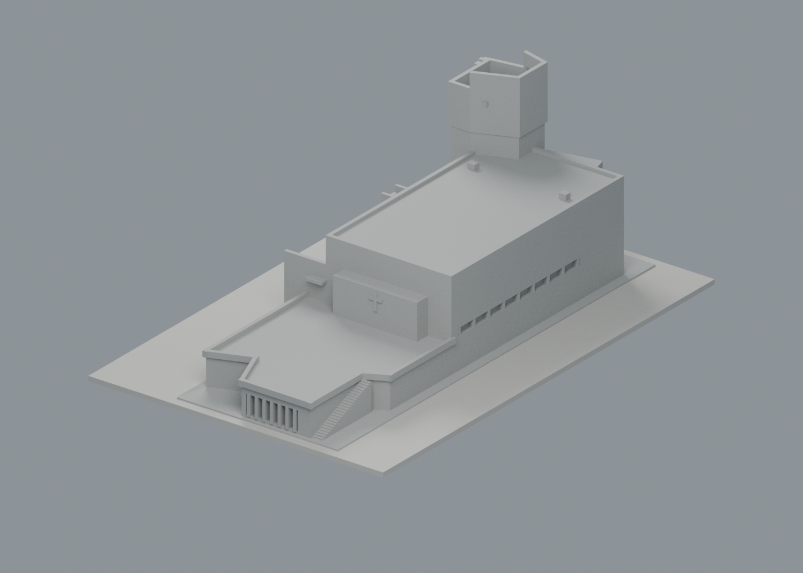
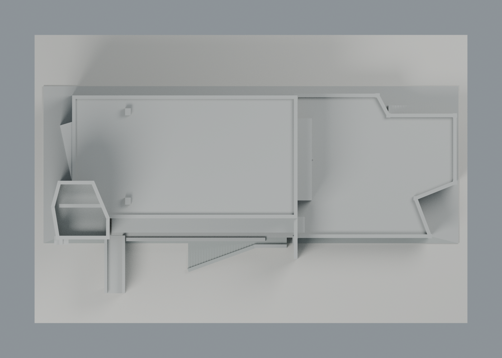
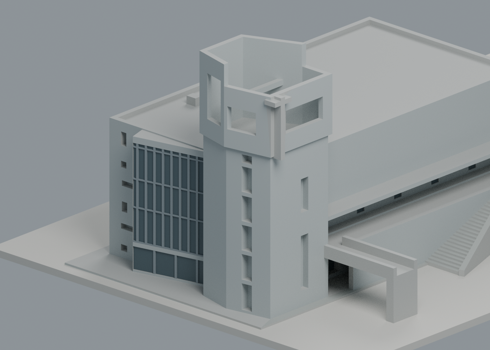

# 三一禮拜堂：六材質外觀交換版

沿用既有三一禮拜堂模型的 **1778 頂點、3576 三角面**，補上照片可辨表面的中性灰建築表面、玻璃和框。原預覽只有一種暖米色；本版有六個可編輯材質身份，**不限四色**。這次是既有模型外觀改善，沒有新增模型包、學校或幾何。

| 模型預覽 | 模型預覽 | 模型預覽 |
| :---: | :---: | :---: |
| 入口與南側可見表面近似色  | 背面原幾何，未確認色區保持中性  |  |

| 模型預覽 | 模型預覽 | 模型預覽 |
| :---: | :---: | :---: |
| 頂視，屋面飾面未確認  | 入口分片塔與玻璃帷幕局部  |  |

## 下載與編輯

- [通用表面色 3MF](ces-appearance.3mf)：單一原網格，毫米單位，原 STL float32 座標與三角面順序完全相同。
- [可編輯 Blender scene](scene.blend)、[六材質調色表](palette.json)、[逐面材質與角色](face-materials.json)。
- [原 STL](../model.stl)、[原 scene](../scene.blend)、原十張單色 QA 圖及製造驗證資料保留不變。STL SHA256：0cb993bbdbb9d3bdb84bd31f8b8da3a66b60263da47efb821e2989ff4760fade。

這是表面材質交換；色區沒有拆成封閉列印實體，沒有噴頭映射、機器設定或 G-code。不同軟體可能只顯示表面色，不直接轉成多材料工具。GUI 匯入、FFF 切片及實體試印都未驗證。玻璃採不透明灰藍表面代理，不代表真實透光率、反射率或測得色值。

## 照片與材料邊界

[建築師署名專案刊文](https://www.twarchitect.org.tw/works/中華福音神學研究學院八德校區/)（建築師雜誌 2023 年 2 月，潘冀聯合建築師事務所）列出外牆仿清水塗料、玻璃帷幕及塗裝鋁材等材料。它是全校專案材料表，不能證明每一片牆的施工材料；本版僅以它輔助辨別照片可見表面類別。攝影署名為鉉琉工作室、謝偉士，兩張照片拍攝日期未確認；刊期與圖片 URL 年月不作拍攝年。

- [白天全景 photo1](https://www.twarchitect.org.tw/web2015/wp-content/uploads/2023/01/202302a2-1.jpg)：支持主堂、塔與南側低翼的灰面、低層深色玻璃及南側平台灰色。色值為視覺近似，未校正白平衡、天空反射、日照或陰影。
- [傍晚入口 photo4](https://www.twarchitect.org.tw/web2015/wp-content/uploads/2023/02/202302a2-4.jpg)：僅補西側帷幕、框及塔構造的可見邊界；不拿冷暖燈光當建材色。西側玻璃選中性深灰藍代理，框選灰色近似，不模擬室內發光。
- 未確認北／東背面、屋頂飾面、十字架飾面保持中性。塔上十字架沒有發光材質；沒有依室內暖石照片把外牆塗成米黃。
- 深廊陰影由原幾何與渲染光線形成，沒有把走廊整塊塗黑。沒有新增窗孔、植栽、校名字體、設備、塔體或鄰棟。
- 原照片不隨包散布；[來源與外觀覆核](qa/source-appearance-review.json)僅保留公開連結、雜湊和判讀界線。照片不是 2026 年現況調查。

## 塔的名稱

既有 S02 [ArchDaily 中文專案文](https://www.archdaily.cn/cn/987647/zhong-hua-fu-yin-shen-yan-jiu-xue-yuan-ba-de-xiao-qu-jiao-tang-pan-ji-lian-he-jian-zhu-shi-shi-wu-suo)，2022-08-23，署名潘冀聯合建築師事務所的專案敘述使用「十字架鐘塔」。因此保留原包有來源的鐘塔稱呼；本版圖說「入口分片塔」只是其形態描述。此文字來源不證明鐘的存在、型式、運作或聲音，這些均未調查。

## 原製造限制仍適用

[原尺寸、簡化與限制](../README.md)、[原製造 QA](../QA.md)完整保留。原 278 層／460 Polygon 數位紀錄、72 個跨層薄損樣本與獨立角區外損失例外，沒有被本次配色重新驗證或推翻。塔洞、橋、簷板、薄框與階梯的支撐及拆除風險仍待 FFF／實印驗證，不保證免支撐，也不可任意縮小。

## 檢查與重建

[交換驗證](qa/exchange-validation.json)、[scene 重開驗證](qa/scene-validation.json)、[預覽資訊](qa/render-manifest.json)。lib3mf 2.5.0 嚴格讀取零警告；單一材質改色往返保留其餘材質和逐面指派。SDK 六位小數寫出的測試檔最大量化差 0.0000038147 mm、零退化面；該測試檔不交付，交付 3MF 與 STL 本身座標完全相同。

使用標準 Python 執行 source/build_appearance.py，由原 STL 與 palette.json 重建 3MF 和面材質清單；Blender 4.3.2 執行 source/render_appearance.py 產生四圖及 scene，之後執行 source/verify_scene.py。source/verify_exchange.py 使用 numpy/lib3mf，驗證原座標、材質編輯及兩個輸出逐位元重建一致。沒有重跑原 CSG 或歷史製造 QA。
