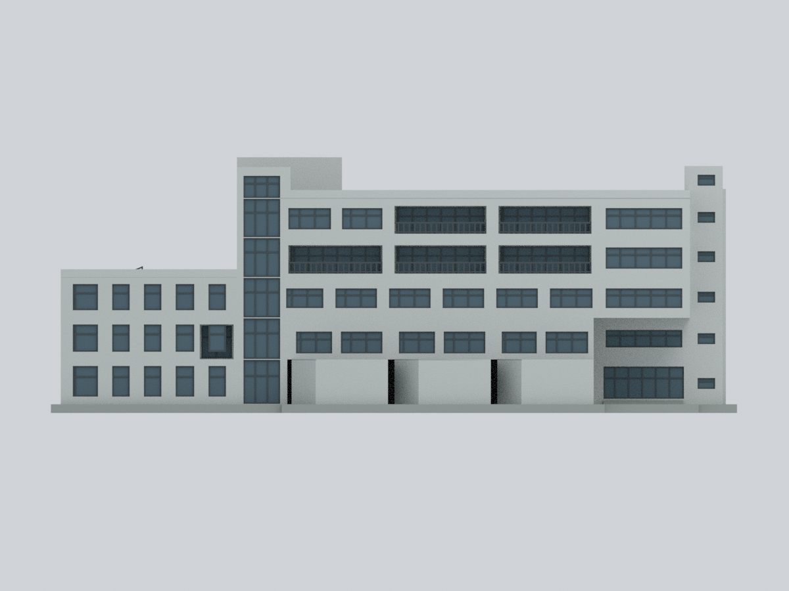
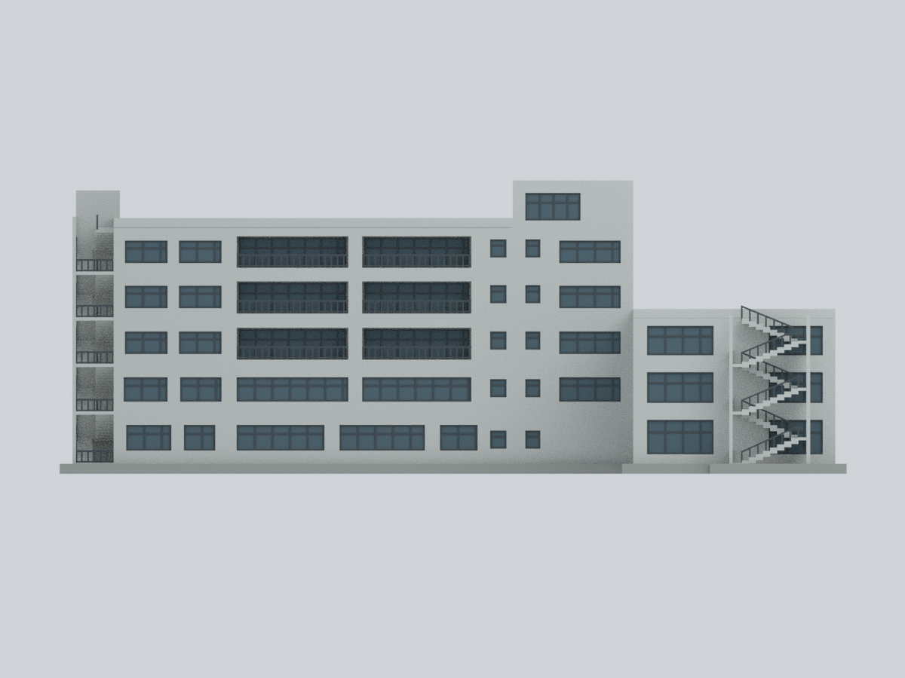
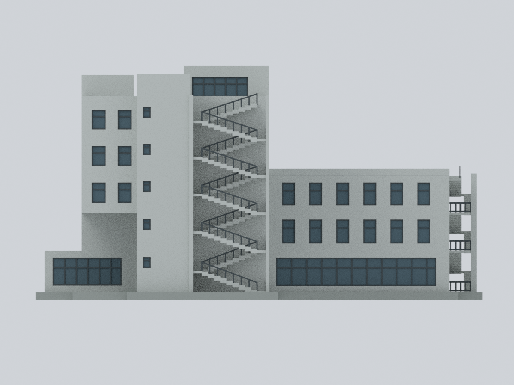
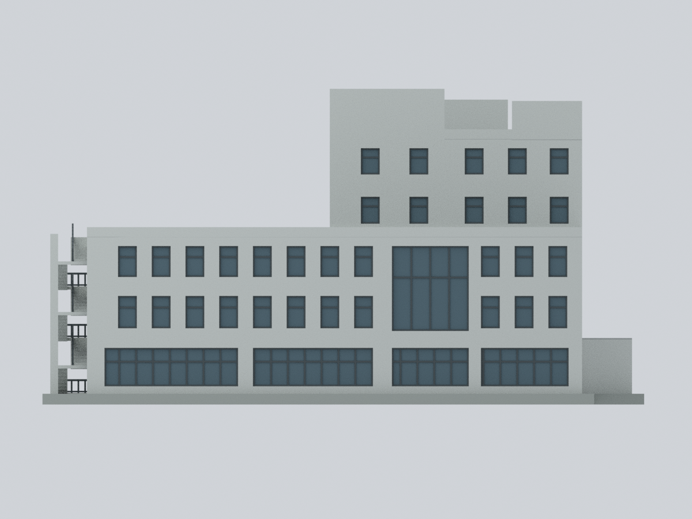
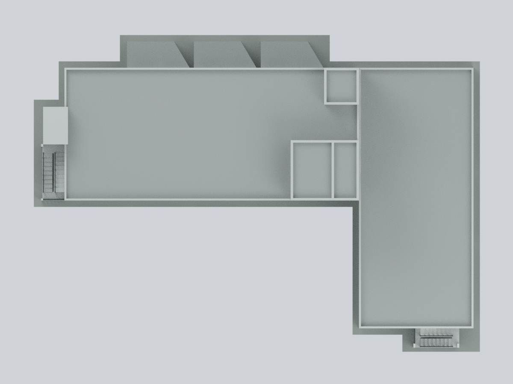
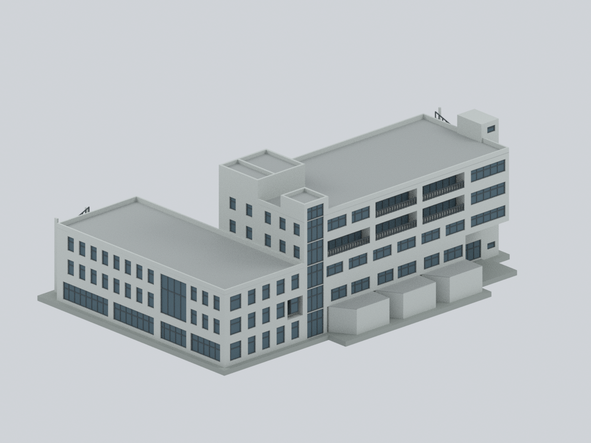
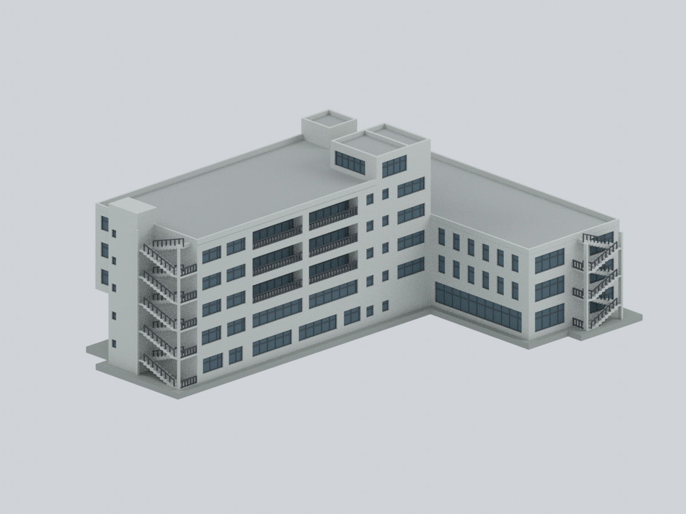
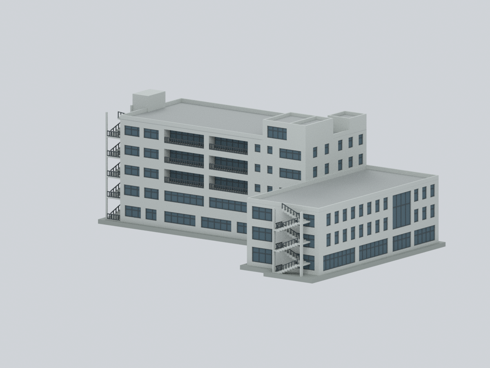
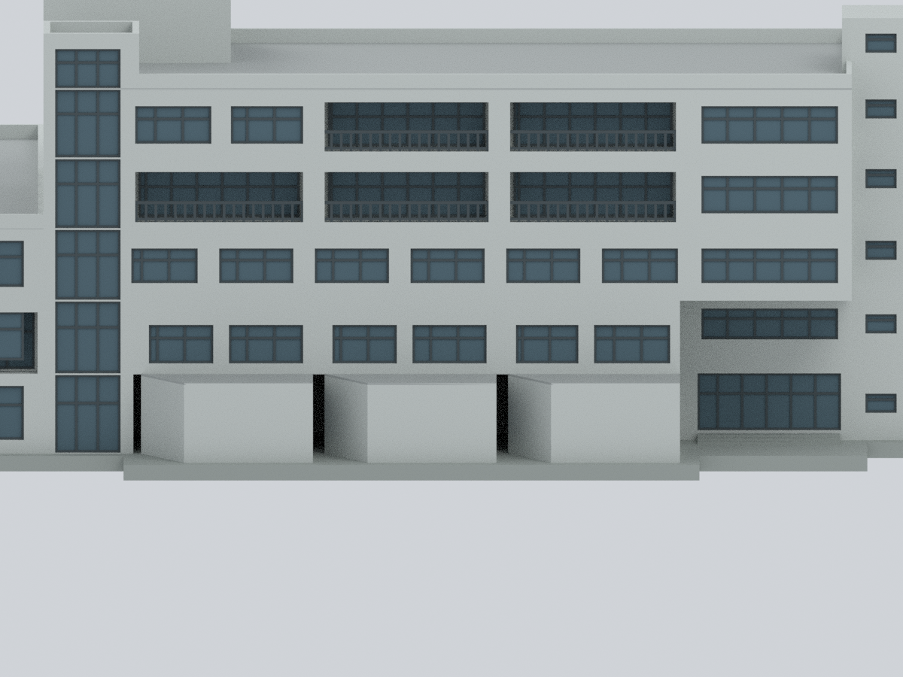

# 中華福音神學研究學院｜真理文教大樓與相連圖書館翼

## 模型預覽

| 廣場側正面 | 背面／L 形內側 | 高翼自由端外梯 |
| --- | --- | --- |
| [](previews/front.png) | [](previews/rear.png) | [](previews/left.png) |
| 圖書館草地側 | 正交屋頂 | 雙翼整體斜視 |
| [](previews/right.png) | [](previews/top.png) | [](previews/oblique.png) |
| 反向斜視／內側 | 圖書館端部外梯 | 一樓凸體／二樓退縮局部 |
| [](previews/rear-oblique.png) | [](previews/library-end.png) | [](previews/pods-detail.png) |

**一套完整相連的 A 棟主要外觀：五層教學／行政翼＋三層圖書館翼。** 本模型是依歷史照片與校方圖面建立的有界定近似，不是測繪、精確竣工復原或 2026 現況模型。

## 九個實際模型視角

下列均由交付網格與面材質實際渲染，沒有來源照片貼圖。方位只採相對立面，不代表已驗證的正北。局部圖刻意裁切以看清一樓凸體與二樓退縮。


## 檔案

- [可編輯 Blender](ces-truth-teaching-building.blend)：真實頂點、面及六個材質槽（其中中性未知槽保留未用），可進入 Edit Mode 修改；沒有僅供展示的隱藏替代模型。
- [彩色 3MF](ces-truth-teaching-building.3mf)：毫米單位，逐三角面 Base Materials；支援情況依切片器而異。
- [單色 STL](model.stl)：同一實體表面，STL 本身不保存顏色。
- [數值參數](parameters.json)、[調色盤](palette.json)、[面材質表](face-materials.csv)、[來源對應規則](mapping-rules.json)、[來源與權利](sources.json)。
- [重建腳本](source/rebuild.py) 與 [依賴版本](source/requirements-model.txt)。`mesh-data.npz` 是可重建的交付幾何陣列，不是重建的必要輸入。

## 範圍與形態

保留完整 L 形兩翼接合、逐層重新對位的輪廓、三個僅屬一樓的前凸教室、二樓退縮、接合端 A2 樓梯的直立玻璃帶、自由端兩層深入口、廣場側上層不對稱陽台、另一套背面長凹廊／小窗、圖書館寬跨層玻璃與窄直窗群、兩端自身外梯，以及不等大的屋頂核心群。較大的接合端屋頂群分成數個單元，不加完整第六層。

圖書館是三層而非另一套分離的建物。L 形內側缺口、教室間隙、入口凹處、陽台與外梯下方保持開放。玻璃用不透明灰藍材質與真實凹入表面表現，不是把整翼挖穿；室內則實心簡化。

跨棟橋廊在 A 外牆面終止，只留下 A 側凹入接口與自身樓板，不附懸空半橋，也不重複既有禮拜堂套件。排除禮拜堂、宿舍、警衛室、校園門架／橋廊系統、共享 A/B 地下停車場、室內與基礎。中性 L 形展示底座不是校園地形；未以地面抬高遮住門窗，也未填滿院落。

## 尺度、年代與不確定性

- 建築師資料列施工期間 **2017-12 至 2019-07**，教學建築高度 **19.6 m**；其高度起終點及是否包含屋頂突出物未明，沒有 A 棟剖面可核實。本模型**只為正規化**把 19.6 對應至主高屋頂女兒牆頂；較高核心分別約 21.8／22.6 設計單位，並非實測高度。
- 校園配置圖的圖示尺只能估讀：高翼屋面約 41.4 × 18.7 m、低翼約 16.1 × 36.7 m。每個設計單位以 4 mm 顯示；含有限底座約 **250.8 × 178.4 × 93.6 mm**。這不是保證的 1:250 測繪比例，像素線寬、各樓圖顯示尺度及陰影判讀都有誤差。未把斜航照當直尺。
- 校方表單日期 2023-09-27，PDF metadata 2024-08-05；建築師／ArchDaily 照片發表於 2023 年，個別拍攝日不明。這些混合證據不等於 2024 或 2026 全棟實測。
- 校方四樓圖有「屋頂花園」圖示，但發表航照是大片淺灰平屋面。因此採**中性灰平屋頂**，不複製花園、彎曲鋪面或植栽，也不推論曾建成或拆除。
- 立面配色是仿清水塗料、金屬框／欄杆、灰藍玻璃與灰屋面的材質家族近似；沒有校色 RGB 或漆碼。夜燈、陰影、反射不當作永久牆色。細小被遮擋的返回面、窗格數、薄框、樓板厚度、階數、設備及坡度不主張精確。

## 列印與實際驗證

交付網格為單一連通、封閉且正體積的面材質實體；各格式的實際座標、三角面與顏色另做讀回比較。Blend 與 3MF 均測試了另存副本、修改真實頂點與材質、重開確認；原件未被編輯測試改動。數值報告見 [網格／切層](qa/geometry-validation.json)、[開口檢查](qa/feature-validation.json)、[相交檢查](qa/self-intersection-validation.json)、[檢查器正反例](qa/self-intersection-controls.json)、[3MF](qa/3mf-validation.json)、[Blend](qa/blend-validation.json)、[乾淨輸入重建比較](qa/rebuild-validation.json)。

**這不是免支撐或已試印保證。** 已做 0.2 mm 層高情境的封閉剖面預檢，但未生成實際擠出路徑，也未實體試印。入口上方、上層懸挑、凹陽台、外梯與欄杆要評估支撐；約 0.48–0.52 mm 的薄框／細桿已為顯示與製作而增厚，仍可能需要放大、樹脂列印或另作製造調整。實心室內的約 1.47 L 幾何體積不是耗材估算。3MF 顏色可能需要在切片器重新指派耗材。

## 從公開輸入重建

只需本包的 `source/`、`parameters.json`、`palette.json`；無需照片、PDF、STL、3MF、Blend 或 NPZ 作輸入。先在自己的環境準備列出的依賴；腳本不自動下載依賴。

```bash
python source/rebuild.py --out rebuilt \
  --geometry-python /path/to/geometry/python \
  --three-mf-python /path/to/lib3mf/python \
  --blender blender --threads 4
python source/compare_rebuild.py --original . --fresh rebuilt \
  --report rebuilt/qa/rebuild-comparison.json
```

相同已驗證版本／CPU 渲染設定下，重建比較要求頂點／面／材質陣列及 STL bytes 一致，九張 PNG pixels 與 bytes 一致。Blend/3MF 容器時間資訊可不同，改以實際讀回的幾何及面材質驗證；不同軟體版本的渲染不保證 byte 相同。

## 主要來源與權利

1. [校方校園災害防救計畫](https://www.ces.edu.tw/wp-content/uploads/2024/08/%E6%A0%A1%E5%9C%92%E7%81%BD%E5%AE%B3%E9%98%B2%E6%95%91%E8%A8%88%E7%95%AB%E6%9B%B81121103%E8%A1%8C_113.8.5.pdf)，實體第 27–31 頁：名稱、樓層、各樓平面及日間正面照片。
2. [建築師雜誌：中華福音神學研究學院八德校區](https://www.twarchitect.org.tw/works/%e4%b8%ad%e8%8f%af%e7%a6%8f%e9%9f%b3%e7%a5%9e%e5%ad%b8%e7%a0%94%e7%a9%b6%e5%ad%b8%e9%99%a2%e5%85%ab%e5%be%b7%e6%a0%a1%e5%8d%80/)，潘冀聯合建築師事務所，2023-02。
3. [ArchDaily：CES Chapel / JJP Architects & Planners](https://www.archdaily.com/1000995/ces-chapel-jjp-architects-and-planners)，只採可辨識 A 棟的校園航照、配置圖與立面部分，**不把禮拜堂剖面移用到 A 棟**。攝影署名 Shawn Liu、Vesper W.S. Hsieh；各圖詳見來源表。

本包只有原創近似幾何、色彩、數值、程式與其渲染；沒有來源照片、PDF、衍生截圖或照片貼圖。來源照片、建築圖面及建築設計的權利仍歸各權利人；本包不授予其再散布授權，也不宣稱獲建築師或學校認可。
