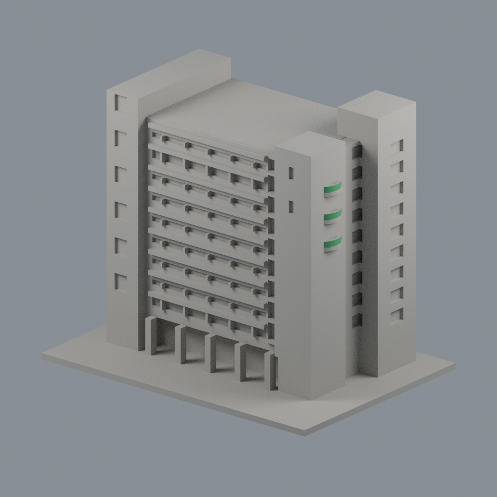
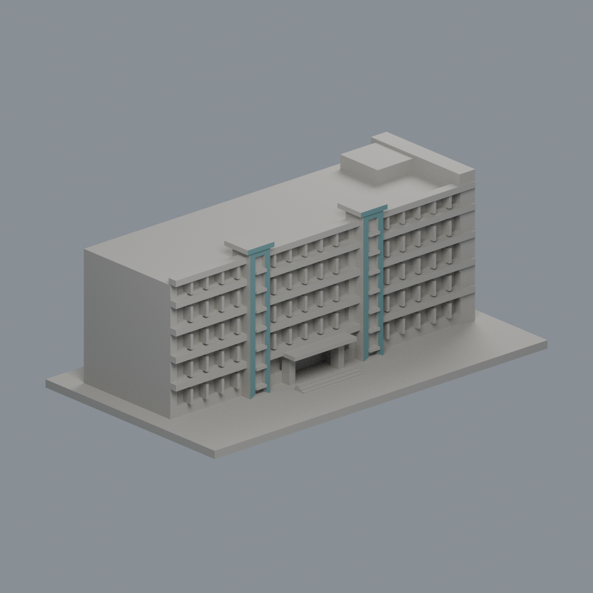
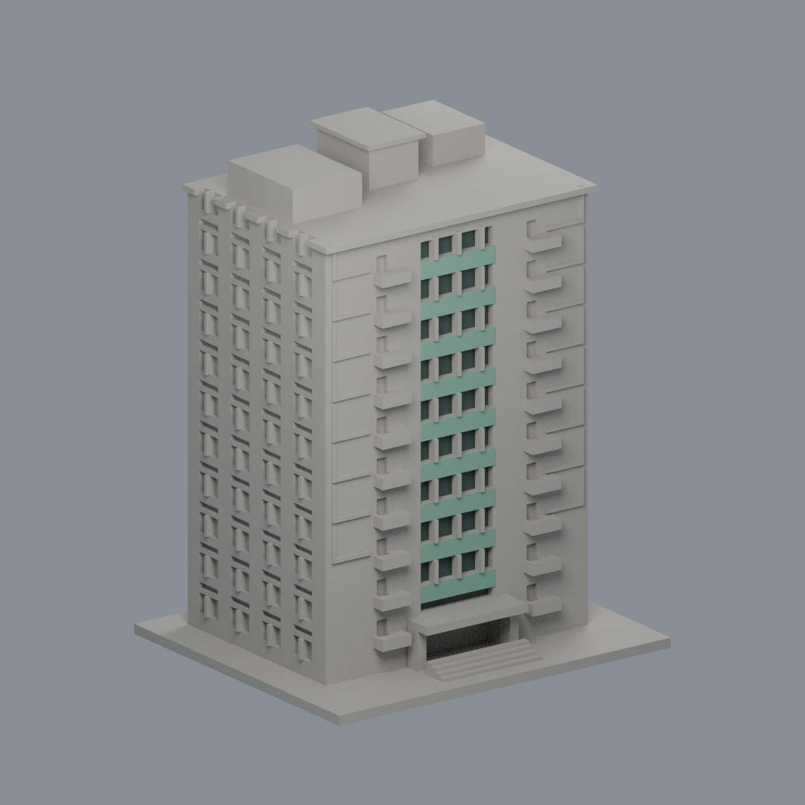
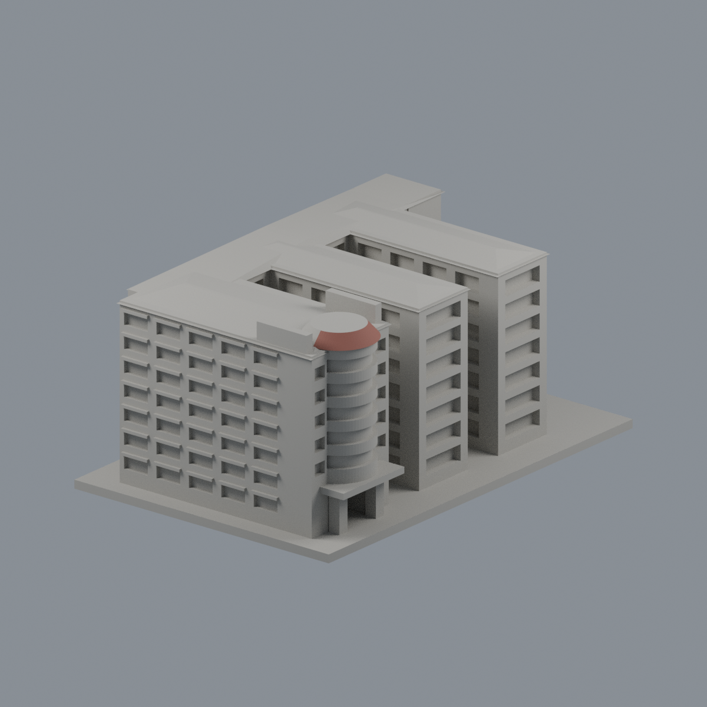

# 中華醫事科技大學｜校園建築公開外觀模型

本輪5件模型：4個單棟加1個F／F1–F4連體群，涵蓋9個官方代碼，不代表9棟獨立建物。18個官方候選代碼另有9項仍缺完整外觀；並非全校完成。H第一宿舍、J地下體育一館不另計棟。

| J 護理大樓 | K 民生大樓 | H 學生活動中心 |
|---|---|---|
|  |  |  |
|  · [限域外觀](校本部/buildings/hwai-dormitory-m/appearance/README.md) |  | 尚待補充可識別實景 |

每件獨立目估比例，最長含底板150mm。J深庭保留，F群兩個院落保留；M依2019簡報，F相冊屬歷史外觀且2024耐震補強後現況未核。詳頁保留日期、未知面、未試印限制及STL/Blender/Python/驗證。原照片/PDF不公開重製。

幾何檢查通過不等於切片器或實體試印；支撐不能解決解析度。

[校本部目錄](校本部/README.md) · [覆蓋與缺口](校本部/coverage.json) · [SHA256](SHA256SUMS)
