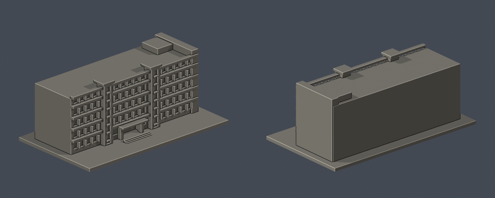

# H棟 學生活動中心

公開外觀近似模型。別名／去重：第一宿舍（同棟用途）。

## 觀察與近似
五層橫向長條、五排開窗、兩條凸出樓梯玻璃带、高低屋頂端牆、中央凹入口。

地圖I棟食品加工廠／自主學習中心在後側鄰接；此件只建H，接界與進深仍待精測。背側不杜撰窗格。前方機車棚與景觀省略。

[官方校園圖與用途](https://www.hwai.edu.tw/p/405-1000-35523%2Cc93.php?Lang=zh-tw) · [官方校史](https://www.hwai.edu.tw/p/16-1000-35517.php?Lang=zh-tw) · [官方外觀照片](https://www.hwai.edu.tw/var/file/0/1000/img/14.jpg)。2026-10-13查核；外觀照片無拍攝日期。原照片不随模型重製公開。

## 尺寸與檔案
- 含底板 150.0 × 86.0 × 58.0 mm，最長150mm；每棟獨立目估比例，無測繪尺寸。
- [STL](model.stl) · [Blender場景](scene.blend) · [Python重建](build_model.py) · [來源](sources.json)
- Python：安裝 requirements.txt，執行 build_model.py；Blender 4.3.2+ 執行 blender -b -P render_preview.py。

## 驗證與列印限制
- [原STL與重建驗證](validation.json)：原法向、兩面邊、頂點link單圈、正體積、單一連通外表面、無獨立封閉內腔、重建SHA及Blender幾何一致均通過。
- [0.2mm水平截面](valid-sections.json)：290層每個閉環及合成Polygon均有效；遇invalid會assert，未使用buffer修補。
- [0.8mm XY幾何薄篩](thin-feature-check.json)：58層；超過1%開口損失層數0，最大0.193%。微量損失位於凹窗直角、簷口及轉角，非獨立薄柱。最薄新增附牆格條約1.1mm；非全面壁厚證明。
- 遮簷、陽臺與柱廊上方可能需要支撐；支撐不能補償低於噴嘴解析度的細節。未作列印切片器驗證或實體試印。
- 背面素面是證據不足的簡化，並非實際建物没有窗。模型供展示／研究，不適合作施工、結構或室內用途。
