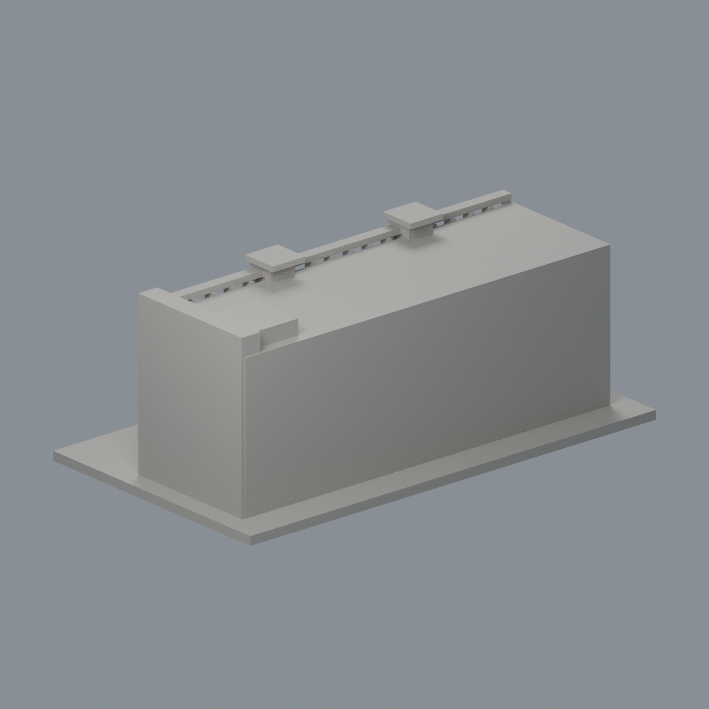
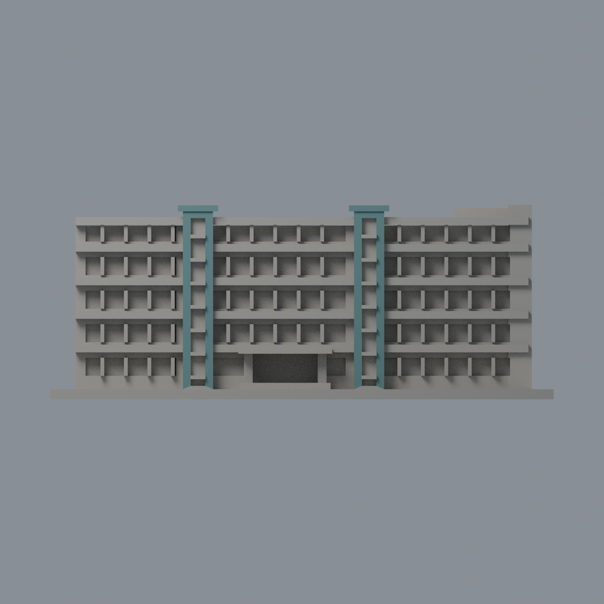
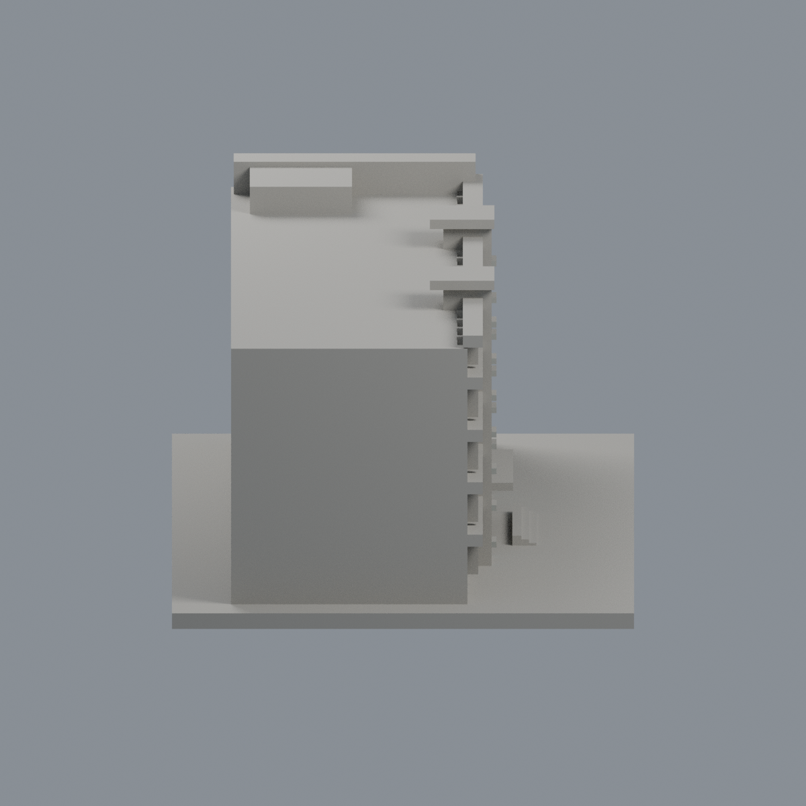
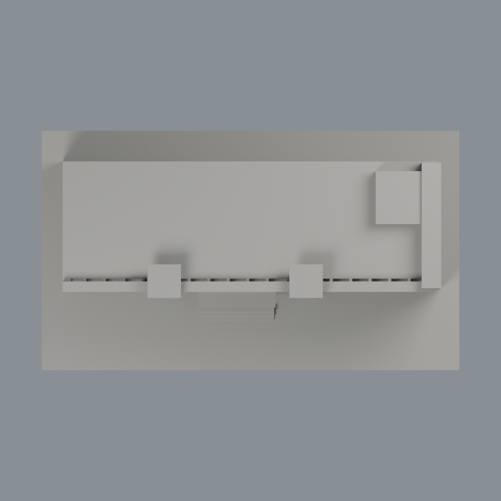

# 中華醫事科技大學 H棟學生活動中心｜樓梯塔前框限域配色

同一既有模型的外觀附加層，不新增建築套數。H兼第一宿舍用途，不另計；後接I棟不納入。含底板150 × 86 × 58 mm；1620頂點、3308三角面，原STL bytes、逐面座標、面序與拓撲不變。

[表面色3MF](hwai-activity-h-appearance.3mf) · [可編輯Blender](scene.blend) · [色表](palette.json) · [逐面指派](face-materials.json) · [來源](SOURCES.md)

## 只改可辨識完整面
兩樓梯塔實心前框與小頂蓋前垂直面，共128面採藍綠 #638A8B 未校準展示代理。每塔前框62面、頂蓋前面2面。全部三頂點在指定原平面與單一實心框條界內、外法向朝前才選取，不切面、不用重心跨界染色。

其餘3180面中性：玻璃槽後壁、槽側、外露橫檔、側頰、雙色水平大帶、主牆、右高端牆、入口招牌、窗群、樹遮部分、屋面、背面、左右側、底板。水平帶原面沒有白/藍綠分界，因此不整片染色。中性不是實景還原。保留原目估簡化幾何，不聲稱全棟精準彩色。

## 五個真實網格視角
相機名稱不是地理方位。由交付3MF同座標與逐面材質建立，非AI效果圖。

| 正面斜視 | 背面斜視 | 正立面 |
|---|---|---|
|  |  |  |

| 左側 | 頂視 |
|---|---|
|  |  |

## 重建
原model.stl置於appearance上層；依賴見source/requirements.txt；Blender 4.3.2。
```
python appearance/source/build_appearance.py
python appearance/source/verify_material_boundaries.py
python appearance/source/verify_exchange.py
blender -b -t 2 --python-exit-code 1 -P appearance/source/render_appearance.py
blender -b -t 2 --python-exit-code 1 -P appearance/source/verify_scene.py
```
原STL SHA256：6e1960bf13afe0f05ead516f8994e5fc83d220cd010d304b524a4a9231d020ee

QA核對精確座標與面序、有向水密、連通、頂點鏈、正體積、無重複/退化面。lib3mf strict零警告，材質實編存回讀保持其餘顏色與指派；SDK暫存回存小數誤差另列，不作交付。Blend材質同樣實編存回讀。乾淨重建比較3MF、色表、face-map和五PNG bytes；Blend僅主張語義一致。

## 原模型與列印限制
原README、歷史來源及QA保留，本次不重跑製造檢查、不把歷史篩查當全面壁厚保證。3MF是單網格表面色，不是各色封閉體、切片專案、噴頭映射或G-code。FFF GUI、多材料路徑、支撐可移除性及實體列印未測，不保證可印或免支撐。無室內/結構/測繪用途；照片日期未知，非2026完整現況。

[逐檔雜湊](SHA256SUMS) · [權利說明](LICENSE-NOTICE.md)
