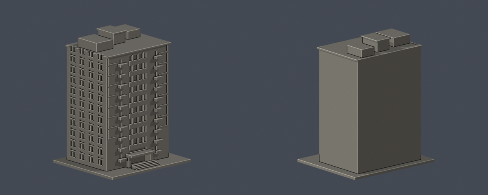

# M棟 第二宿舍

| 模型預覽 | 模型預覽 | 模型預覽 |
| :---: | :---: | :---: |
|  |  |  |

依[學校2019簡報第42頁](https://virtual.lchs.kh.edu.tw/guide/108-0306a/108hwai.pdf)公開實景重建，並用[現行官方校圖](https://www.hwai.edu.tw/p/405-1000-35523%2Cc93.php?Lang=zh-tw)及[校史](https://www.hwai.edu.tw/p/16-1000-35517.php?Lang=zh-tw)核對十層M棟。H第一宿舍为另一棟，未重複計入。模型保留寬中央玻璃帶、兩側小陽臺、左側成對窗、階梯屋頂與凹入口。

2019簡報不代表2026即時現況；原圖拼貼遮住部分側面，背側和進深採近似包絡，沒有推造背窗。無測繪或精確縮尺。原PDF/照片不隨模型重製公開。

## 檔案與尺寸
- [STL](model.stl) · [Blender](scene.blend) · [Python重建](build_model.py) · [來源明細](sources.json)
- 含底板 117.03 × 99.73 × 150.00 mm。本件長邊為高度150mm；每棟獨立比例。
- 安裝 requirements.txt 後執行 build_model.py；Blender 4.3.2+執行 blender -b -P render_preview.py。

## 檢查與限制
[原STL驗證](validation.json)通過法向、邊/頂點流形、單一外表面、無分離內腔、正體積、重建SHA及Blender一致。[0.2mm截面](valid-sections.json)共750層，每個閉環與組合Polygon有效，沒有invalid吞錯或修補。[0.8mm XY薄篩](thin-feature-check.json)最大開口損失0.031%，超過1%層數0；零星損失在附牆刻線與凹窗轉角，非獨立細柱。最薄新增附牆條約1.1mm（縮放前），不是完整壁厚保證。

窗和格條為凹刻與厚實浮雕；陽臺/雨棚/屋簷可能需支撐。支撐不能代替噴嘴解析度。未做切片器验证或實體試印，不作建築施工用途。

## 中央正面限域外觀層

[三材質3MF、可編輯Blend與五視角預覽](appearance/README.md)：僅120面綠色不透明實腹與23面暗窗背，其餘5495面中性。綠實腹非透明玻璃；原粗略窗格、包絡及製造限制未修復，不是全樓全彩或2026現況復原。
