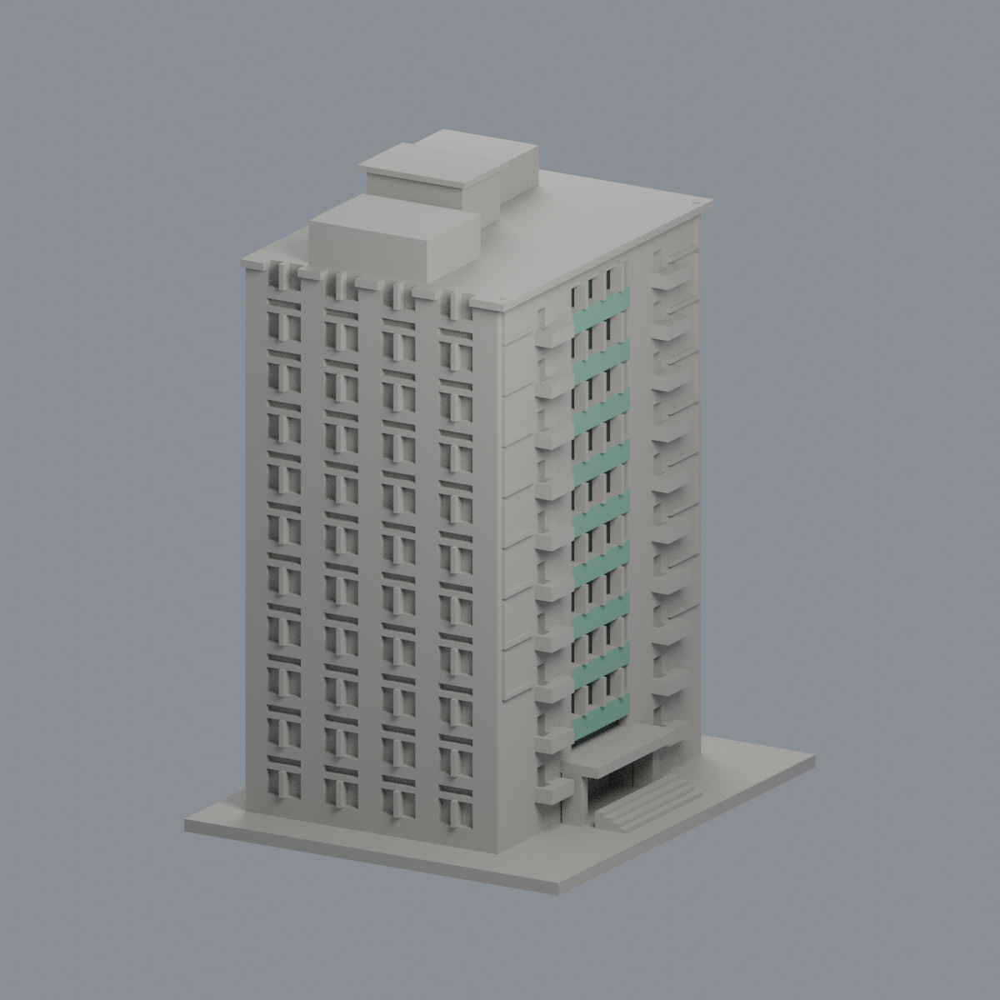
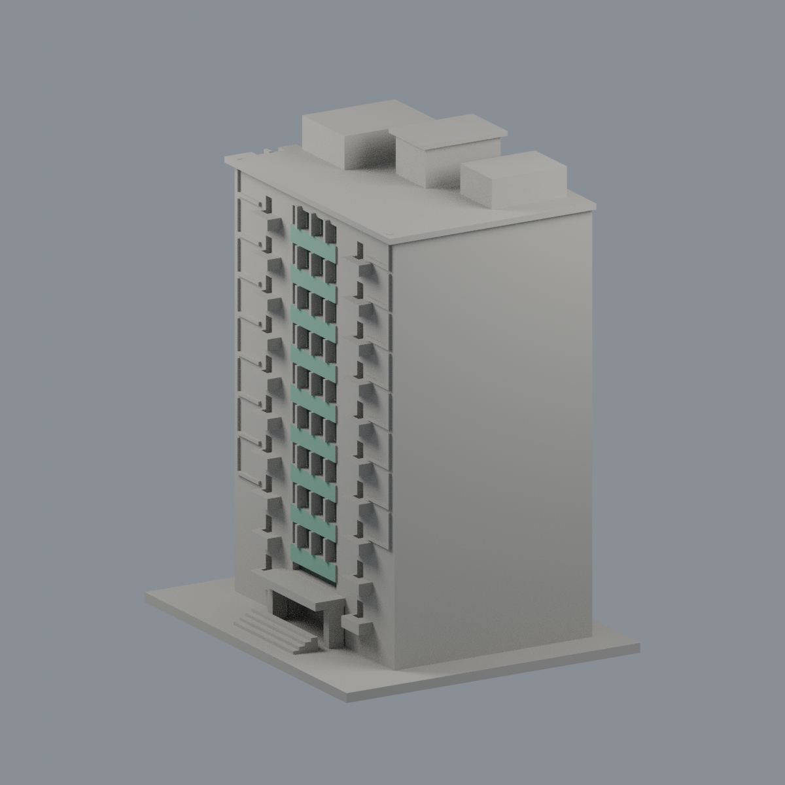
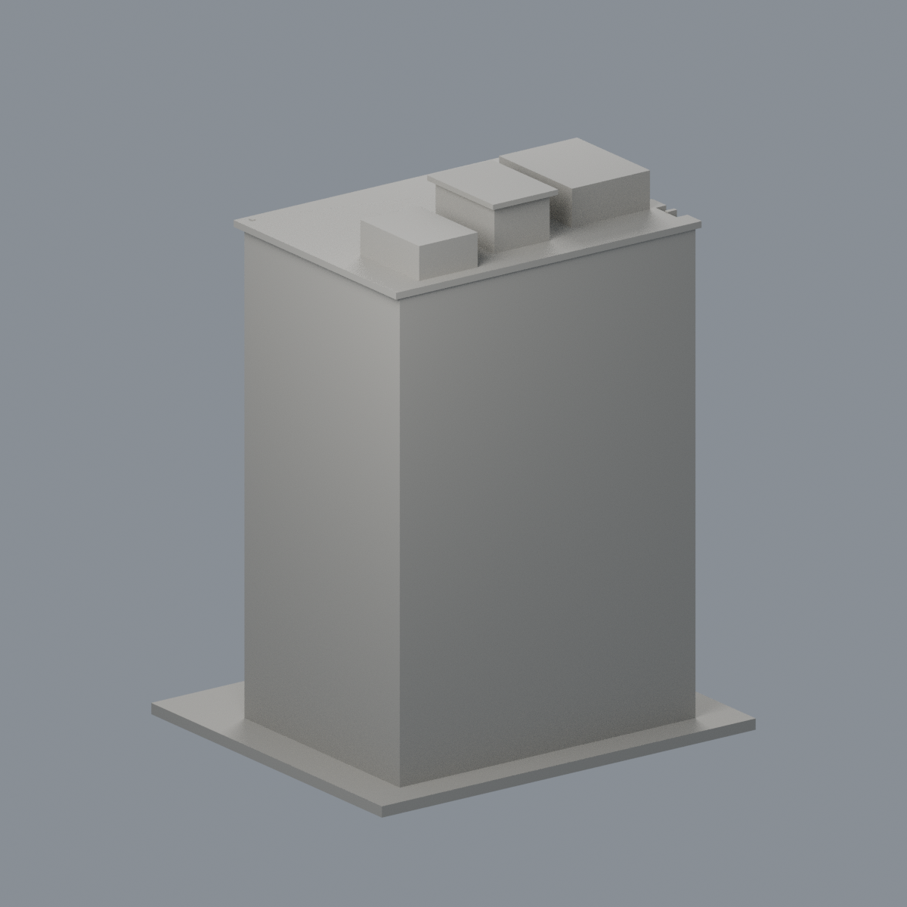
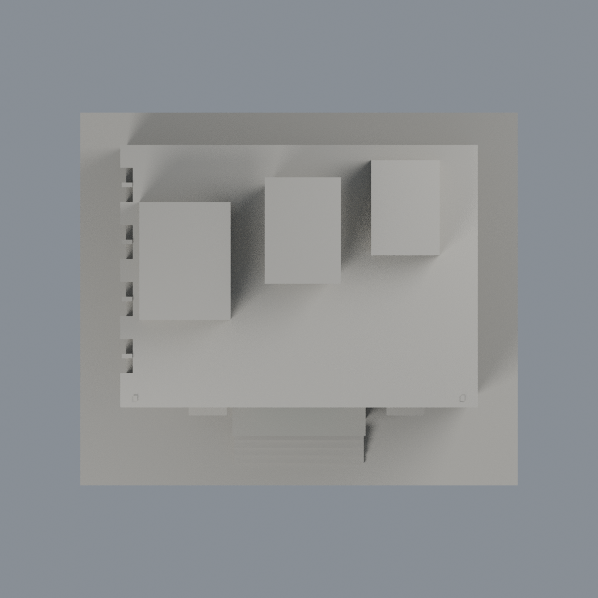

# 中華醫事科技大學 M第二宿舍：中央正面限域外觀層

既有模型的局部材質改善，新增模型套數為零，不修改原幾何；不是整樓全彩復原，也不是2026現況調查。

- [三材質3MF](hwai-dormitory-m-appearance.3mf) · [可編輯Blender](scene.blend) · [材質表](palette.json) · [逐面對照](face-materials.json)
- [正面](previews/front.png) · [左面](previews/left.png) · [右面](previews/right.png) · [背面](previews/rear.png) · [頂面](previews/top.png)
- [來源與年代](SOURCES.md) · [授權說明](LICENSE-NOTICE.md) · [重建原始碼包](rebuild-source.zip)

| 模型預覽 | 模型預覽 | 模型預覽 |
| :---: | :---: | :---: |
| 正面  | 左面  | 右面  |
| 背面  | 頂面  |  |

5638個原三角面保留座標與面序，原STL bytes完全不動。僅官方照片支持的中央正面9組綠色不透明實腹120面（1235.871886平方毫米）及10組暗色窗背23面（1636.231700平方毫米）換材質；合計143面／2872.103586平方毫米，其餘5495面維持中性。全部三頂點須落在同一有限平面矩形，且實際叉積法向為 -Y；逐組驗證原canonical面序。不以中心點選取、切面、重三角化或新增玻璃。

綠實腹不是透明玻璃；暗窗背也使用不透明展示代理，不宣稱真實光學透明度。中央原有粗略窗格、上端分段與厚實浮雕完全不動，不是逐層精準復原。紅磚底層、窗框／豎梃、凹口側壁、相鄰牆、兩側小窗與陽臺、長側面窗、背面、右側、屋頂及底座皆中性；不把日照黃色當成牆漆色，不把前景另一棟樓混入。色彩未校色，不代表精確RGB或廠商色號。

## 原始包絡與製造限制
原模型依拼貼照片建立；原簡報遮住部分側面，深度／後側仍是近似包絡，未推造背窗。本輪雖看到抽出的完整照片，不擴大幾何或解除歷史限制。十層／地下一層依官方身份來源，不是測繪或完工證明。

原 validation.json、valid-sections.json、thin-feature-check.json 原樣保留：歷史拓撲／重建檢查通過，0.2mm共750有效截面；1mm取樣150層薄特徵篩查，超過1%開口損失層數為0，最大比例0.00031389285940666917。這些是歷史報告，不是本輪重新做製造QA，也不是完整壁厚或自交保證。陽臺、雨棚與屋簷可能需支撐；支撐不能取代噴嘴解析度。本輪交換材質與拓撲檢核不等於切片器、免支撐或實體試印驗證，不作建築施工用途。

## 重建
在appearance上層保留原model.stl，安裝source/requirements.txt；執行 `python source/build_appearance.py`、`python source/verify_exchange.py`，再用 Blender 執行 `source/render_appearance.py` 與 `source/verify_scene.py`。固定Cycles CPU／種子生成五圖，PNG移除時間metadata；乾淨重建比較3MF、map、palette與五圖bytes，Blend比較真正頂點／材質語義，不宣稱Blend二進位一致。兩格式皆實際編輯材質存讀，Blend另實際編輯頂點存讀並從交付檔reopen render核對。
