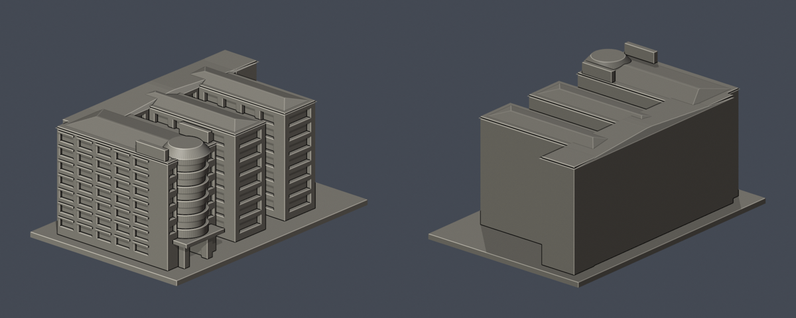
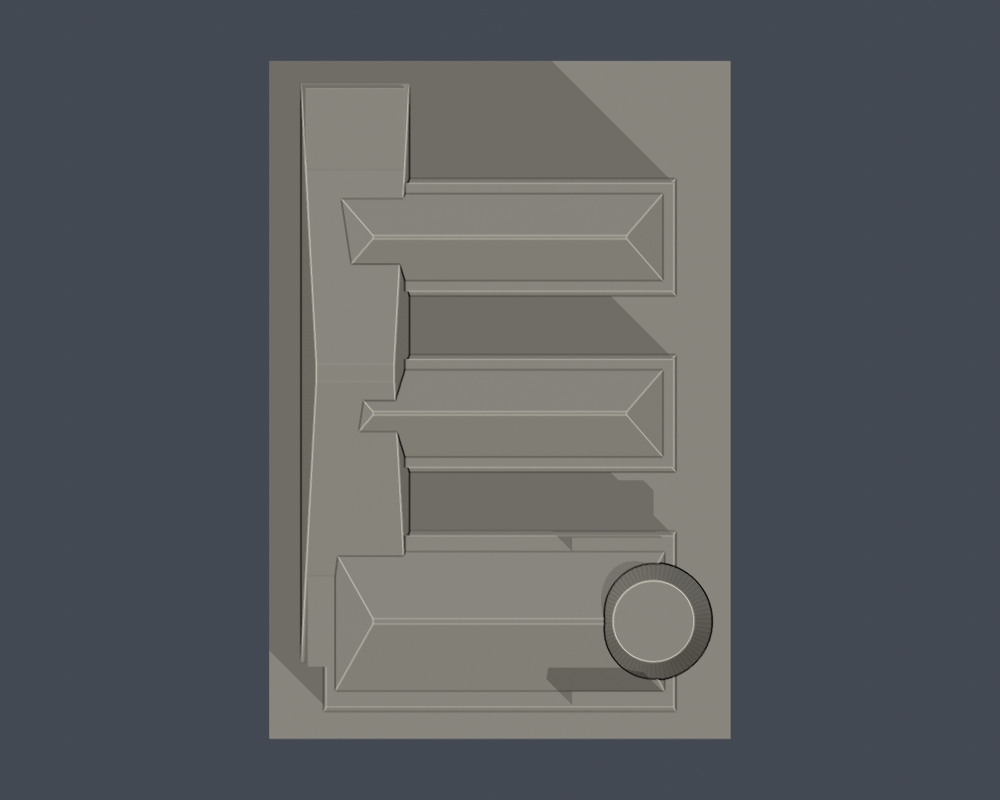

# F圖書館與F1–F4系館連體群

## 東端瓦帽歷史限域配色（2026-10-22）

[五視角、來源與限制](appearance/README.md) · [表面色3MF](appearance/hwai-library-f-appearance.3mf) · [可編輯Blender](appearance/scene.blend)

| 東側歷史限域配色 | 未確認後側保持中性 |
|---|---|
|  |  |

僅東端截錐瓦帽朝東斜面76個完整三角面紅褐配色；頂平面、西半、白肩、其他坡頂及5026面中性，五道玻璃因缺細框分面HOLD不塗。半頂色界是保守證據範圍，不是實景接縫。原STL bytes、5102面與歷史QA不變，不增套數，F/F1–F4仍為一個連體群，G排除。

個別正面Flickr平台標示拍攝2005-05-18、上傳2013-07-24；相機時鐘未獨立校驗。此補充釐清下方舊紀錄的個別照片日期，非2026現況；2024補強後完工與改色仍未知。3MF為單網格表面色，非分色封閉體或切片/G-code；未實體試印。第三方照片不分發。

一件群組模型涵蓋F、F1、F2、F3、F4五個官方代碼，不是五棟各自完整模型。圖書館與系館共用西側連體脊；G食營系館排除。未來若細分五代碼，不可與本件重複計數。F2網頁仍名生科系館，現行圖片標製藥系館，視為同碼別名。

## 外觀與尺度
保留東端圓弧玻璃帶、截錐簷頂、雙柱挑空入口、連體西脊、兩短翼、兩處開放院落與可見凹廊。含底板102×150×70mm，最長150mm，獨立目估比例，非測繪。

[官方校圖](https://www.hwai.edu.tw/p/405-1000-35523%2Cc93.php?Lang=zh-tw)決定群組範圍與院落；[正面照片](https://www.flickr.com/photos/techexpo/9355046855/)、[全景](https://www.flickr.com/photos/techexpo/9357820500/)、[夜景](https://www.flickr.com/photos/techexpo/9357820174/)與[校史門口實景](https://www.hwai.edu.tw/var/file/0/1000/img/462539535.jpg)補外觀。原圖/PDF均不在模型包公開重製。

## 年代及證據缺口
相冊為2013上傳，部分照片內印2004日期，個別拍攝日不明。[2024官方補強規劃評選](https://affair.hwai.edu.tw/p/404-1015-64270.php?Lang=zh-tw)顯示本群正進行耐震補強規劃；未確認2026施工完成與外觀變動，不能宣稱2026現況精密模型。

院落寬度、後翼長度、進深與屋頂坡簷目估；西/北外牆及屋頂設備不清，以簡化無窗包絡表達，不仿製其他正面的窗。模型保留已見空間，不含室內房間或結構資料。

## 檔案与驗證
[STL](model.stl) · [Blender](scene.blend) · [Python重建](build_model.py) · [來源](sources.json)

安裝requirements.txt後執行build_model.py，Blender 4.3.2+執行blender -b -P render_preview.py。

[原STL驗證](validation.json)的法向、邊/頂點流形、單外表面、無分離內腔、正體積、重建SHA/Blender一致通過。[0.2mm截面](valid-sections.json)共350層每個閉環/組合Polygon有效，invalid直接assert不修補。[0.8mm XY薄篩](thin-feature-check.json)最大損失0.230%，超過1%層數0；小量損失位於附牆條/凹窗角/坡頂邊，沒有孤立細柱。浮雕最小1.0mm，雙柱截面4mm以上；非全面壁厚證明。

坡簷、入口及凹廊可能需支撐，支撐不解決解析度。未執行切片器或實體試印，不作建築施工依據。
