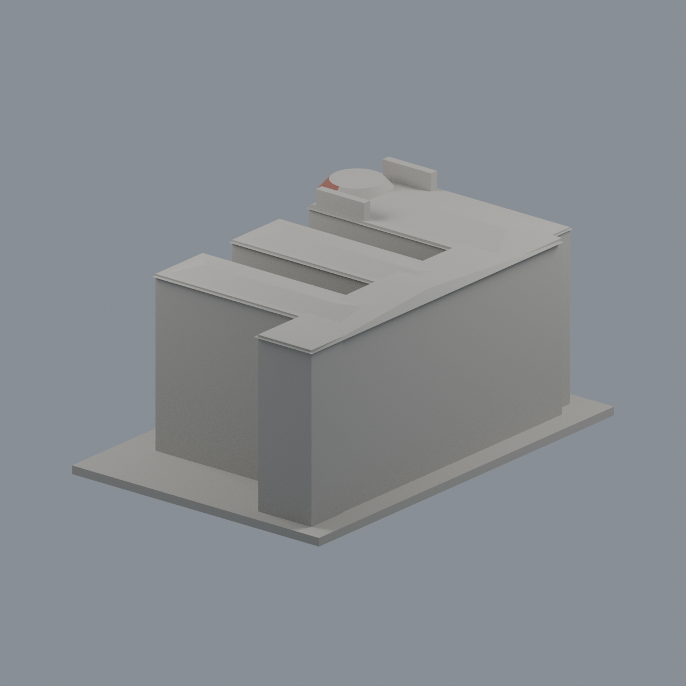
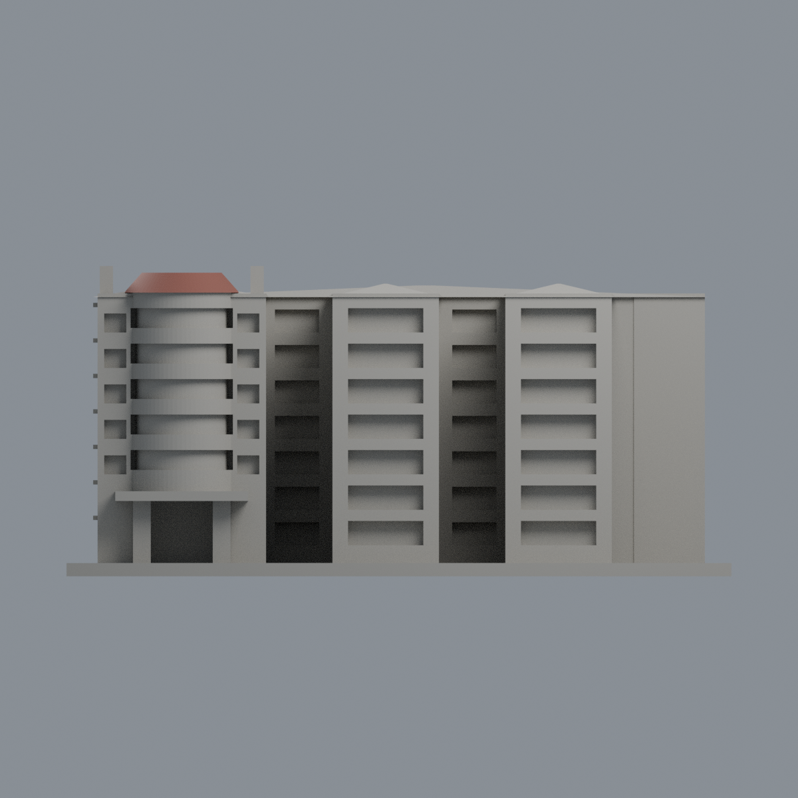
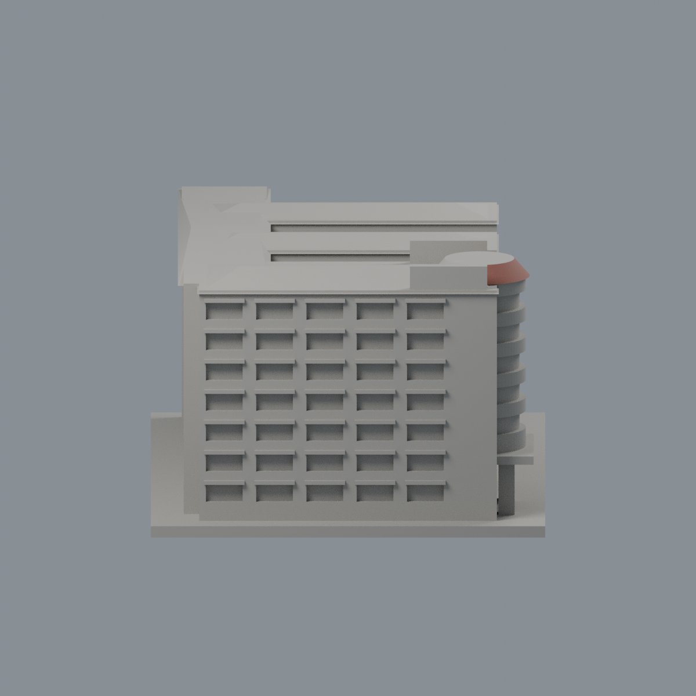
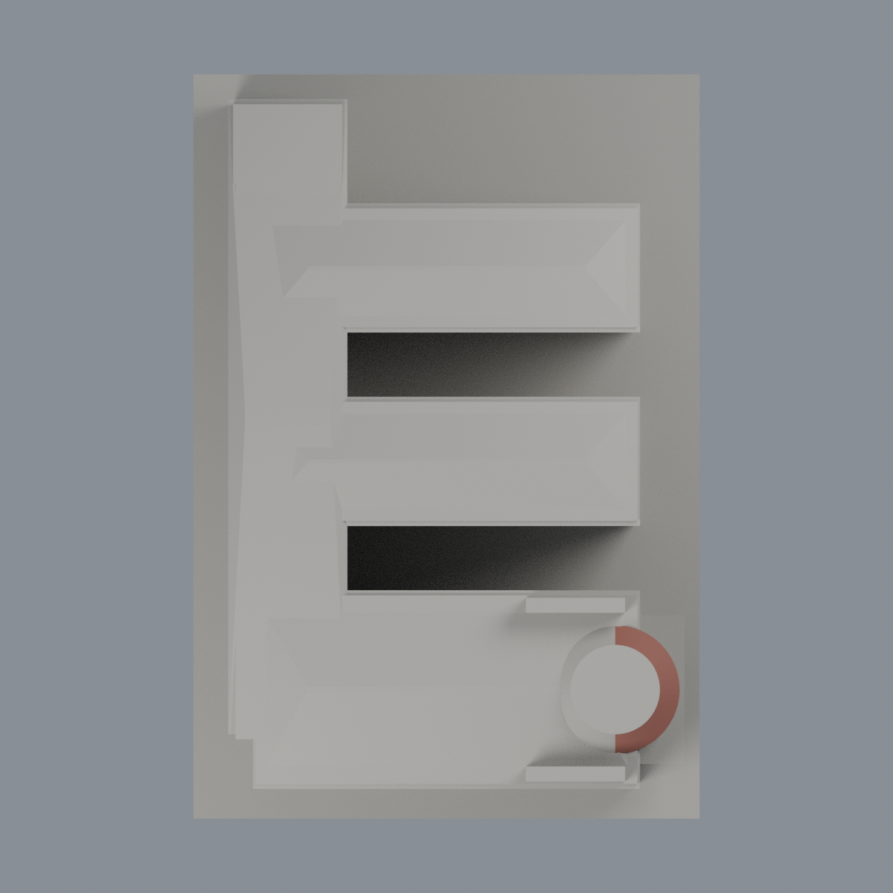

# 華醫 F 圖書館與 F1–F4 系館連體群：東端瓦帽歷史限域配色

本件仍是一件連體群，不是五件；G 食營系館排除。僅原 STL 東端截錐瓦帽朝東斜面 76 個完整三角面採紅褐色代理 #925A4E，其餘 5026 面維持中性 #AAA79F。不是全棟彩色復原，也不是 2026 現況。

| 模型預覽 | 模型預覽 | 模型預覽 |
| :---: | :---: | :---: |
|  |  |  |

[背面](previews/rear.png) · [東向立面](previews/elevation.png) · [南側](previews/side.png) · [俯視](previews/top.png)

| 模型預覽 | 模型預覽 | 模型預覽 |
| :---: | :---: | :---: |
| 背面  | 東向立面  | 南側  |
| 俯視  |  |  |

## 年代與限域
正面 Flickr 平台標示拍攝 2005-05-18 10:06:00，上傳 2013-07-24 08:25:56 UTC；相機時鐘未獨立校驗，不能把上傳日當拍攝日，亦不把同冊其他照片印日期套入。2024 官方耐震補強規劃後的完工與改色狀態未知，原模型之歷史缺口仍成立。本補充僅釐清該張正面照片的個別平台日期，不改寫原歷史 QA。

原截錐 center=(34,-49)，z=64..68.5，底半徑13、頂半徑9、72邊。每個完整三角面的三頂點須落同一原始有限斜 facet 且 x>=34；排除頂水平面、底面、西半面、白肩及其他坡頂，不切面、不按重心染色。五道深藍玻璃有細框與混合反射，而原模型未分出框，因此本次 HOLD、不塗。柱身、腰帶、門廊混合牆材、後翼/西脊/南坡均不擴張推色。中性代表未定，不是聲稱實景灰色。

照片為未校色色彩；無測色色票、瓦紋或照片貼圖。原截錐比例與實景不完全相同，保留原目估幾何，不宣稱精密復原。

## 檔案與重建
[彩色3MF](hwai-library-f-appearance.3mf) · [可編輯Blender](scene.blend) · [面材質表](face-materials.json) · [色盤](palette.json) · [來源](SOURCES.md) · [授權說明](LICENSE-NOTICE.md) · [完整重建來源ZIP](rebuild-source.zip) · [校驗碼](SHA256SUMS)

保留原 STL 全部座標、三角面順序、拓撲與尺寸102×150×70mm。`rebuild-source.zip`包含原 STL 與本配色程式；解壓後依 `appearance/source/requirements.txt` 安裝 Python 依賴，執行 build_appearance.py、verify_exchange.py、verify_material_boundaries.py，再以 Blender 4.3.2+ 執行 render_appearance.py 與 verify_scene.py。相對目錄為 model.stl 與 appearance/source/。

交換檢驗含 lib3mf strict 零警告、實際單材質修改/存檔/重開、原始座標面序精確比對；Blender 亦真修改材質存檔重開，檢查其他材質與幾何未變。乾淨目錄重建3MF/maps/五PNG須逐byte一致，Blend作語義比對而非binary決定性宣稱。原製造檢測未重算；未做切片器、FFF、多色列印或實體試印。本模型不供施工。
