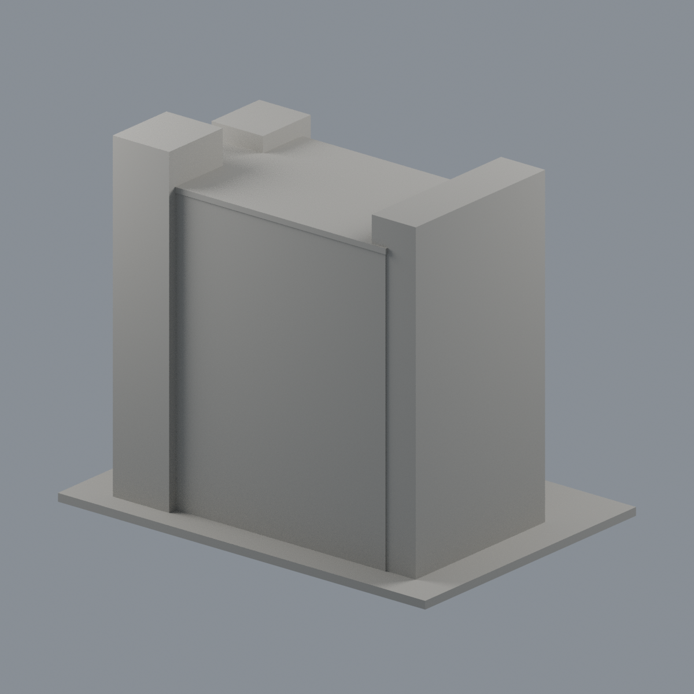
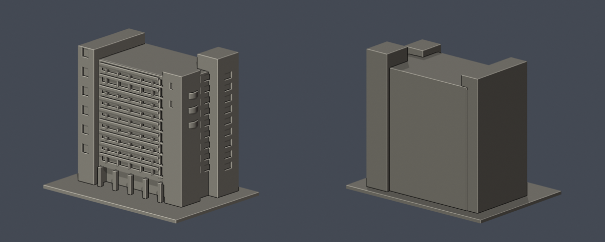

# K棟 民生大樓

## 模型預覽

| 模型預覽 | 模型預覽 | 模型預覽 |
| :---: | :---: | :---: |
| 正面限域配色  | 未確認後側保持中性  |  |

## 三層綠弧陽臺外欄板限域配色（2026-10-22）

[配色五視角、來源與限制](appearance/README.md) · [表面色3MF](appearance/hwai-minsheng-k-appearance.3mf) · [可編輯Blender](appearance/scene.blend)

僅三層弧形陽臺外側垂直欄板108個完整facet面（每層36面）綠色配色；內弧、上沿、底面、側封口、平台非欄板區、玻璃、混材牆、屋面、後側與底板維持中性，不是整棟精準彩色。原STL bytes、3004三角面、幾何及歷史QA不變，不增套數。3MF為單網格表面色，非分色封閉體、切片或G-code；原薄處與支撐限制保留，未實體試印。照片日期未知，不代表完整2026現況；第三方照片不分發。

公開外觀近似模型。別名／去重：民生科技大樓。

| 模型預覽 | 模型預覽 | 模型預覽 |
| :---: | :---: | :---: |
|  |  |  |

## 觀察與近似
雙側不等高方塔、寬窄交替橫帶、偏右大面招牌牆、右側三段弧形陽臺、底層凹入口。

右側部分被H棟遮挡，陽臺與背側進深目估；未建空調、招牌文字、屋頂天線。陽臺欄杆以加厚實體矮牆表達，非原實體厚度。

[官方校園圖與用途](https://www.hwai.edu.tw/p/405-1000-35523%2Cc93.php?Lang=zh-tw) · [官方校史](https://www.hwai.edu.tw/p/16-1000-35517.php?Lang=zh-tw) · [官方外觀照片](https://www.hwai.edu.tw/var/file/0/1000/img/14.jpg)。2026-10-13查核；外觀照片無拍攝日期。原照片不随模型重製公開。

## 尺寸與檔案
- 含底板 150.0 × 106.0 × 125.8 mm，最長150mm；每棟獨立目估比例，無測繪尺寸。
- [STL](model.stl) · [Blender場景](scene.blend) · [Python重建](build_model.py) · [來源](sources.json)
- Python：安裝 requirements.txt，執行 build_model.py；Blender 4.3.2+ 執行 blender -b -P render_preview.py。

## 驗證與列印限制
- [原STL與重建驗證](validation.json)：原法向、兩面邊、頂點link單圈、正體積、單一連通外表面、無獨立封閉內腔、重建SHA及Blender幾何一致均通過。
- [0.2mm水平截面](valid-sections.json)：629層每個閉環及合成Polygon均有效；遇invalid會assert，未使用buffer修補。
- [0.8mm XY幾何薄篩](thin-feature-check.json)：126層；超過1%開口損失層數0，最大0.023%。微量損失位於凹窗直角、簷口及轉角，非獨立薄柱。最薄新增附牆格條約1.1mm；非全面壁厚證明。
- 遮簷、陽臺與柱廊上方可能需要支撐；支撐不能補償低於噴嘴解析度的細節。未作列印切片器驗證或實體試印。
- 背面素面是證據不足的簡化，並非實際建物没有窗。模型供展示／研究，不適合作施工、結構或室內用途。
