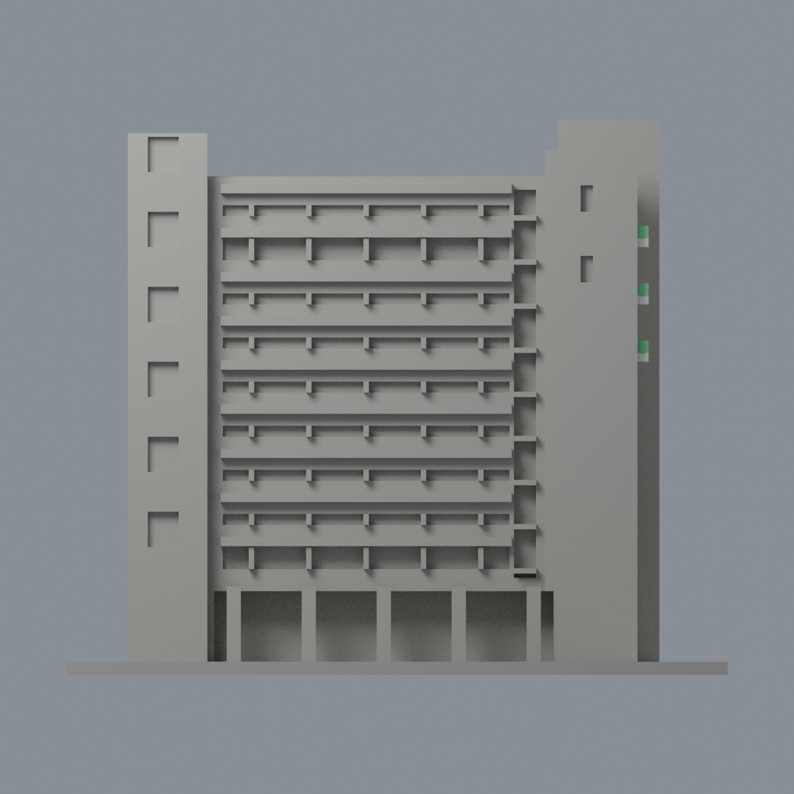
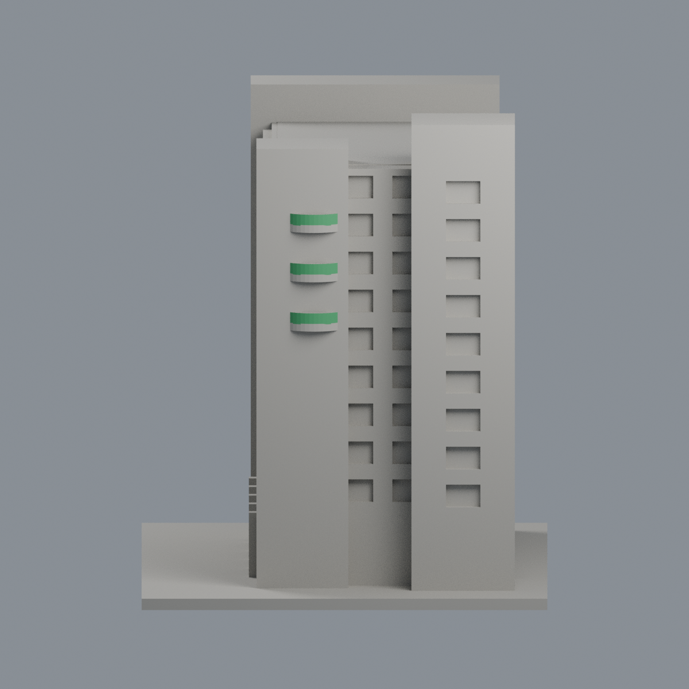
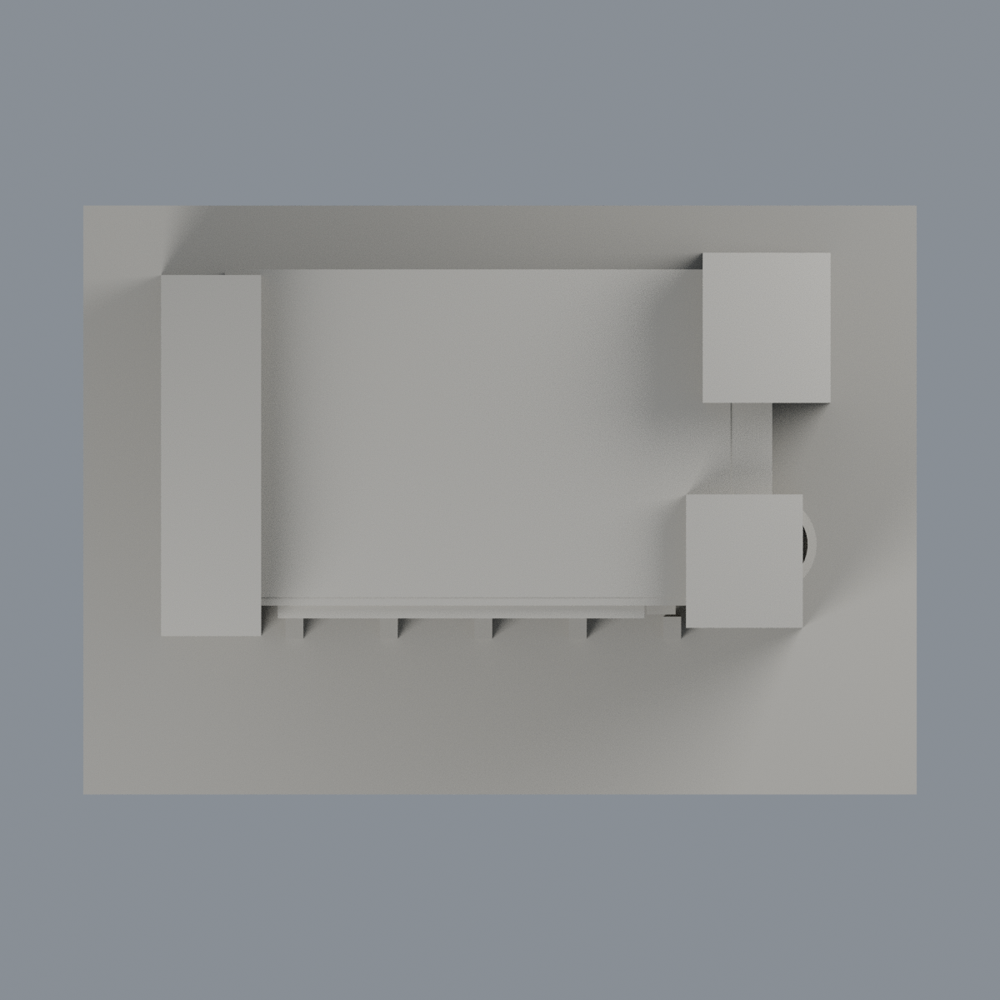

# 中華醫事科技大學 K棟民生大樓｜三層綠弧陽臺外欄板限域配色

同一既有模型的外觀附加層，不新增建築套數。別名民生科技大樓，不是H學生活動中心或J護理大樓。含底板150 × 106 × 125.8 mm；1504頂點、3004三角面。原STL bytes、逐面座標、面序與拓撲不變。

[表面色3MF](hwai-minsheng-k-appearance.3mf) · [可編輯Blender](scene.blend) · [色表](palette.json) · [逐面指派](face-materials.json) · [來源](SOURCES.md)

## 只改可辨識完整面
三層弧形陽臺外側垂直欄板，共108完整面（每層36）採綠色 #3C9860 未校準不透明展示代理。全部三頂點必須同時位於原48邊外圓某一有限facet平面及單層高度範圍；法向朝外。不切面、不使用重心跨界染色。

初步徑向候選表為105面；終核另發現2640、2758、2876三個微小完整外facet面，原float32法向z誤差使初篩漏選。獨立驗證以48邊端點、有限邊投影、支持平面距離和單位外法向確認108面。保留逐面終核記錄，不拿徑向容差當最後依據。

其餘2896面中性：內弧、欄板上沿下底及側封口、平台非欄板區、玻璃/門窗、寬招牌混材牆、左塔、橫帶、低層遮擋、背面、屋頂和底板。中性不是實景還原。上方細黑欄杆未另建；原陽臺尺寸、深度和加厚矮牆屬目估簡化，不因配色而成為精密實測模型。

## 五個真實網格視角
相機名稱不是地理方位。由交付3MF同座標與逐面材質建立，非AI效果圖。

| 正面右斜視 | 背面斜視 | 正立面 |
|---|---|---|
|  |  |  |

| 右側 | 頂視 |
|---|---|
|  |  |

## 重建與驗證
原model.stl置於appearance上層；依賴見source/requirements.txt；Blender 4.3.2。
```
python appearance/source/build_appearance.py
python appearance/source/verify_material_boundaries.py
python appearance/source/verify_exchange.py
blender -b -t 2 --python-exit-code 1 -P appearance/source/render_appearance.py
blender -b -t 2 --python-exit-code 1 -P appearance/source/verify_scene.py
```
原STL SHA256：1bf4de701702dbf94212b744219425d4bc813d5bcd156fefcc5d02076ff75662

QA核對精確座標與面序、有向水密、連通、頂點鏈、正體積、無重複/退化面。lib3mf strict零警告，材質實編存回讀保持其餘顏色與指派；SDK暫存回存小數誤差另列，不作交付。Blend材質同樣實編存回讀。乾淨重建比較3MF、色表、face-map和五PNG bytes；Blend僅主張語義一致。

## 原模型與列印限制
保留原README、歷史來源及QA。本次未重跑製造檢查，不把歷史篩查當全面壁厚保證。3MF是單網格表面色，不是各色封閉體、切片專案、噴頭映射或G-code。FFF GUI、多材料路徑、支撐可移除性及實體列印未測，不保證可印或免支撐。無室內/結構/測繪用途。照片日期未知，非2026完整現況。

[逐檔雜湊](SHA256SUMS) · [權利說明](LICENSE-NOTICE.md)
