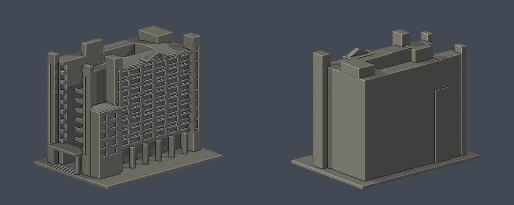
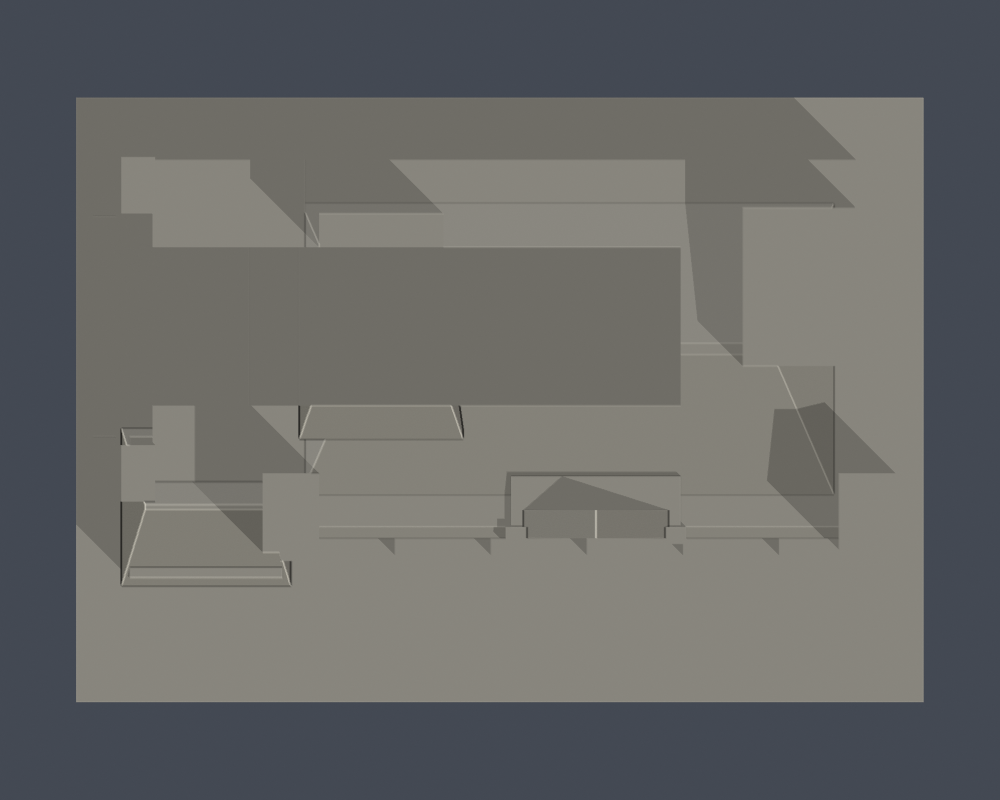
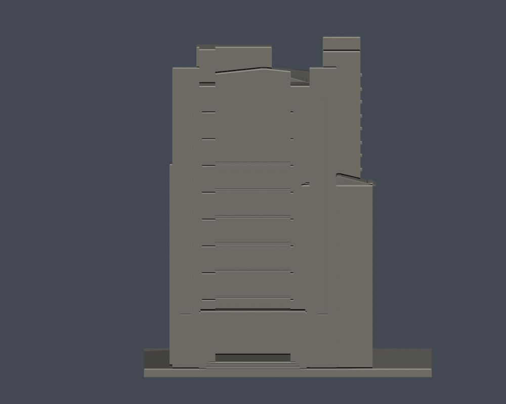

# J棟 護理大樓

公開外觀近似模型。別名／去重：科技教學大樓；體育一館為地下樓層用途，不另計棟。

## 觀察與近似
十層主塔、分段高低翼、兩層入口柱廊、側面深凹水平帶、綠玻璃樓梯豎帶、折線／弧線混合山牆及低翼坡簷。

底層被樹遮擋，柱距與挑空深度目估；照片右側與後側翼部不可完整辨讀，背側採簡化包絡。坡簷縮成可列印厚度，窗片、冷氣與文字省略。

[官方校園圖與用途](https://www.hwai.edu.tw/p/405-1000-35523%2Cc93.php?Lang=zh-tw) · [官方校史](https://www.hwai.edu.tw/p/16-1000-35517.php?Lang=zh-tw) · [官方外觀照片](https://www.hwai.edu.tw/var/file/0/1000/img/14.jpg)。2026-10-13查核；外觀照片無拍攝日期。原照片不随模型重製公開。

## V2：新增已識別深庭證據
[可讀「科技教學大樓」的入口照](https://www.flickr.com/photos/techexpo/9355047531/)與[2004-11-17入口全景](https://www.flickr.com/photos/techexpo/9357821208/)確認為J棟舊名；[跨層橋廊照片](https://www.flickr.com/photos/techexpo/9355047873/)顯示開頂深庭。本版保留向西敞開的院落、六層橋廊及入口柱棚，修正V1未見該面時的實心包絡。庭院深度、橋距為近似；歷史照片不代表逐處2026現況。

## 尺寸與檔案
- 含底板 150.0 × 107.0 × 120.0 mm，最長150mm；每棟獨立目估比例，無測繪尺寸。
- [STL](model.stl) · [Blender場景](scene.blend) · [Python重建](build_model.py) · [來源](sources.json)
- Python：安裝 requirements.txt，執行 build_model.py；Blender 4.3.2+ 執行 blender -b -P render_preview.py。

## 驗證與列印限制
- [原STL與重建驗證](validation.json)：原法向、兩面邊、頂點link單圈、正體積、單一連通外表面、無獨立封閉內腔、重建SHA及Blender幾何一致均通過。
- [0.2mm水平截面](valid-sections.json)：600層每個閉環及合成Polygon均有效；遇invalid會assert，未使用buffer修補。
- [0.8mm XY幾何薄篩](thin-feature-check.json)：120層；超過1%開口損失層數0，最大0.105%。微量損失位於凹窗直角、簷口及轉角，非獨立薄柱。最薄新增附牆格條約1.1mm；非全面壁厚證明。
- 遮簷、陽臺與柱廊上方可能需要支撐；支撐不能補償低於噴嘴解析度的細節。未作列印切片器驗證或實體試印。
- 背面素面是證據不足的簡化，並非實際建物没有窗。模型供展示／研究，不適合作施工、結構或室內用途。
