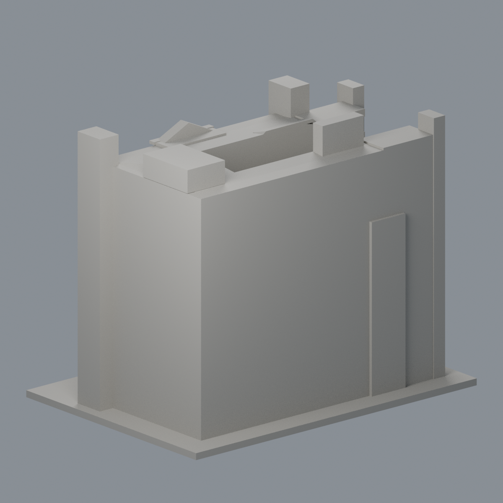
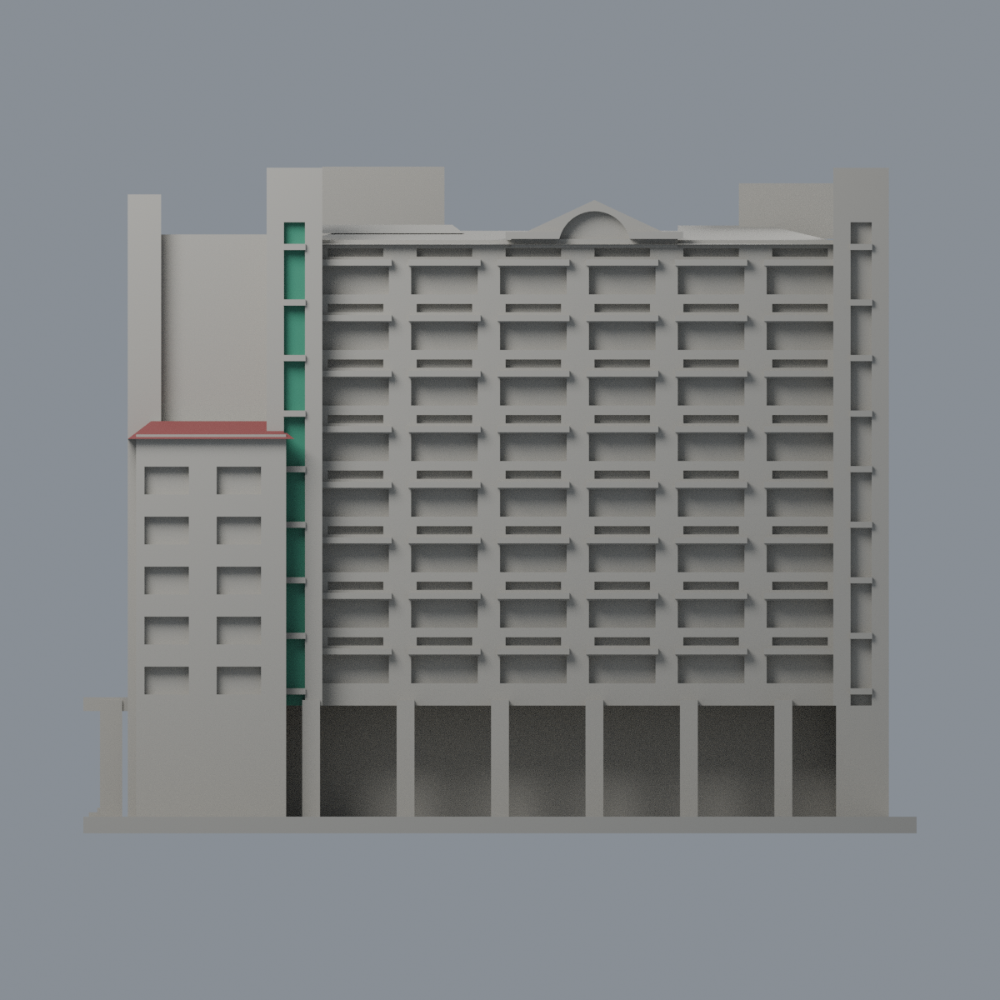
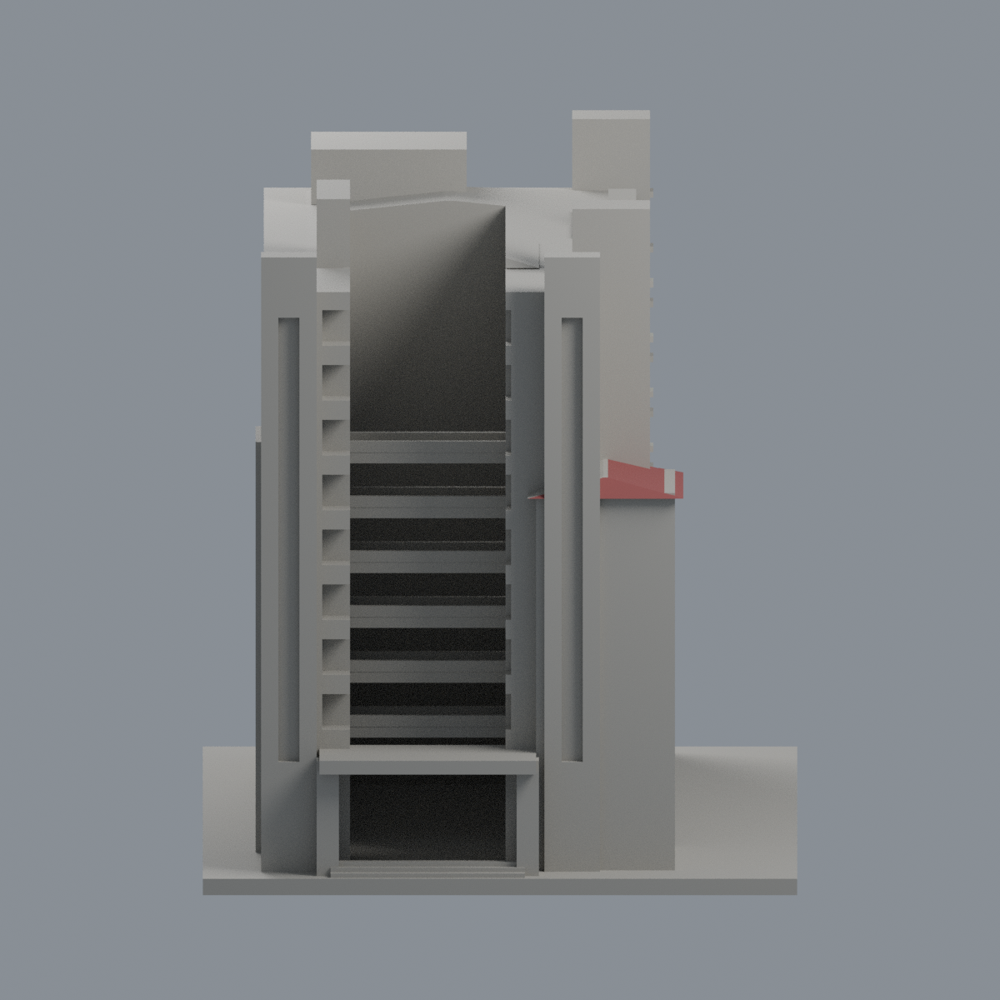
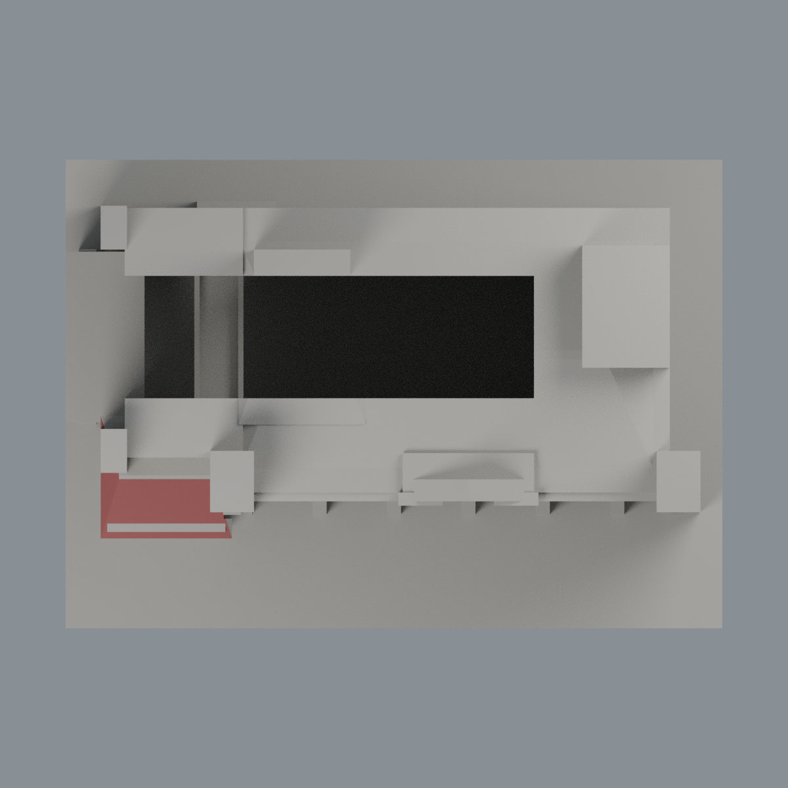

# 中華醫事科技大學 J棟護理大樓｜限域配色

同一既有模型的外觀附加層，不新增建築套數。含底板150 × 107 × 120 mm；2230頂點、4516三角面，原STL bytes、逐面座標、面序與拓撲不變。

[表面色3MF](hwai-nursing-j-appearance.3mf) · [可編輯Blender](scene.blend) · [色表](palette.json) · [逐面指派](face-materials.json) · [來源](SOURCES.md)

## 只改可辨識、可分界的完整面
- 左前低翼瓦帽：僅原hip(-52,-19,71,30,28,3.2)朝前、朝左斜面，共16面，暗紅褐展示代理。
- 左前高柱單一綠玻璃豎帶：僅原凹槽後壁y=-25.5、x=-38.9..-35.1、z=23..110，共22面。既有橫檔、槽側壁不染綠；不透明代理不是光學玻璃。
- 其餘4478面維持中性：混材主牆、柱、山牆、橫窗組、背面、庭院、右後翼、不可見屋坡、底面及底板。中性不是實景顏色還原。
- 全三頂點在原斜平面/後壁與指定界限內才選取，不切三角面、不用重心跨界染色；未擴大到主塔屋帽或其他豎槽。原幾何簡化與目估比例保留。

## 五個真實網格視角
相機名稱不是地理方位。影像由交付3MF相同座標與逐面材質建立，非AI效果圖。

| 正面斜視 | 背面斜視 | 正立面 |
|---|---|---|
|  |  |  |

| 模型預覽 | 模型預覽 | 模型預覽 |
| :---: | :---: | :---: |
| 左側<br> | 頂視<br> |  |

## 重建與驗證
原model.stl置於appearance上層。Python依賴見source/requirements.txt；Blender 4.3.2。

```
python appearance/source/build_appearance.py
python appearance/source/verify_exchange.py
blender -b -t 2 --python-exit-code 1 -P appearance/source/render_appearance.py
blender -b -t 2 --python-exit-code 1 -P appearance/source/verify_scene.py
```

原STL SHA256：6a529f825d294ee1066af11a9202e2f55214a43a5c91959407cbfc0f9c24b290

交換QA核對精確座標與面序、有向水密、連通、頂點鏈、正體積、無重複/退化面。lib3mf strict零警告，實際材質編輯回存重讀保持其餘顏色與指派；SDK回存小數誤差另列，該暫存檔不交付。Blend同樣執行材質實編存回讀。乾淨重建比較3MF、色表、face-map及五PNG bytes；Blend僅主張語義一致，不主張binary一致。

## 列印與原模型限制
原歷史QA與原README保持不變，本次未重跑製造檢查。原0.2mm截面600層有效、0.8mm XY薄篩120層僅為歷史幾何篩查，並非全面壁厚保證。原簷口、陽臺、柱廊上方可能需支撐；綠玻璃薄槽與橫檔仍是原簡化幾何。

3MF是單網格表面色，不是各色封閉體、切片專案、噴頭映射或G-code。FFF GUI、多材料路徑、支撐可移除性及實體列印未測，不保證可印或免支撐。無室內/結構/測繪用途；照片日期未知，非2026完整現況。

[逐檔雜湊](SHA256SUMS) · [權利說明](LICENSE-NOTICE.md)
