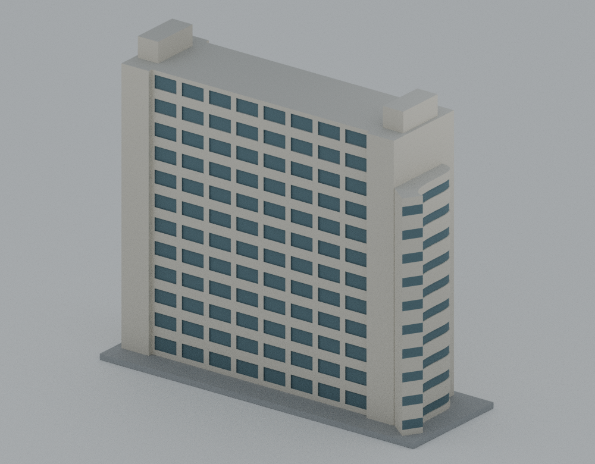
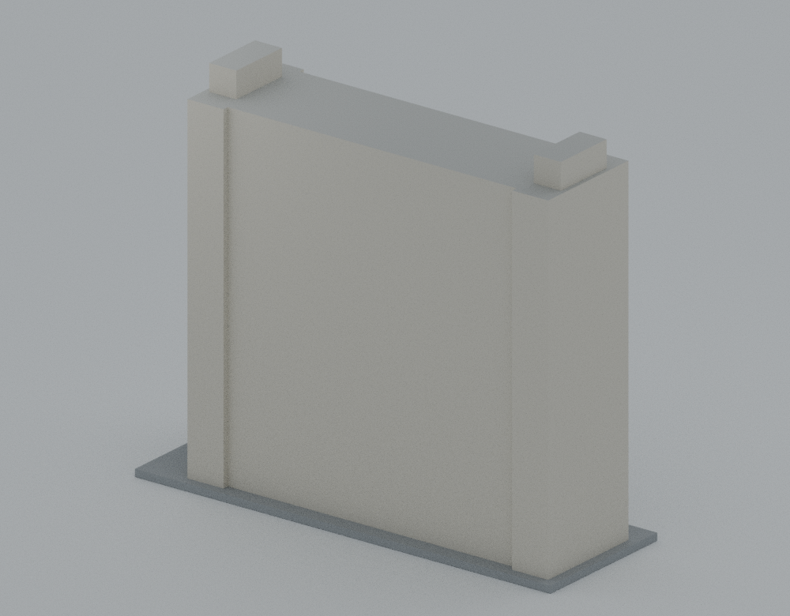
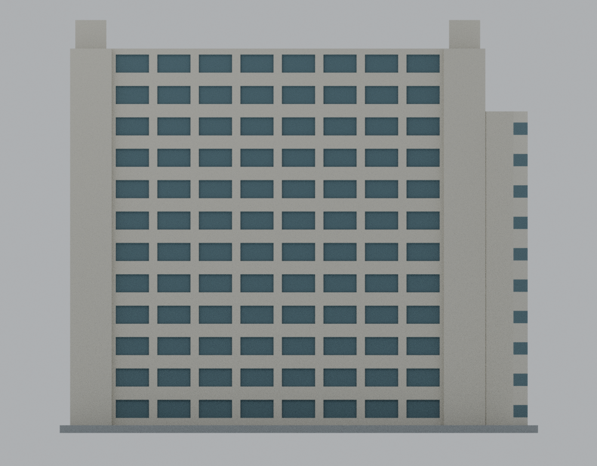
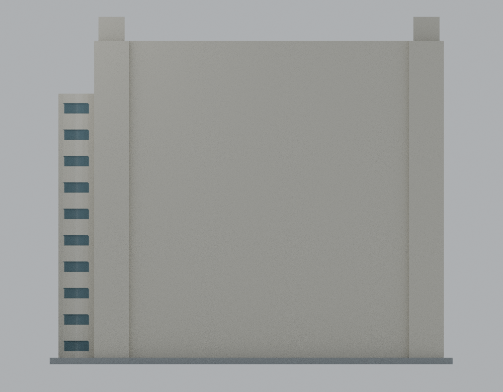
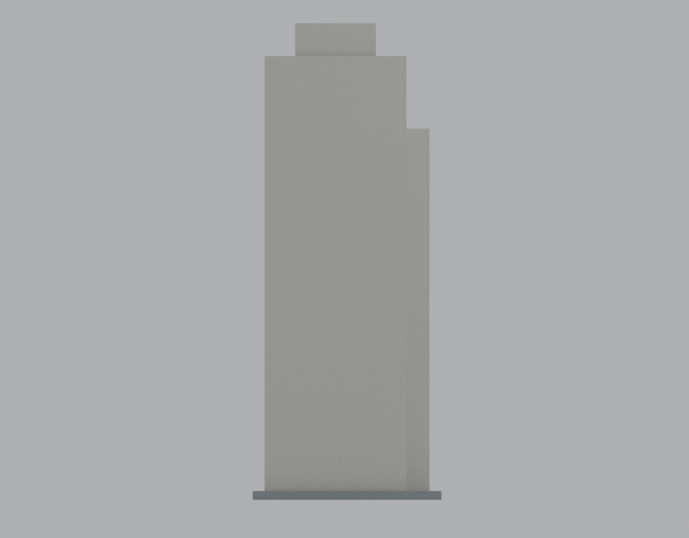
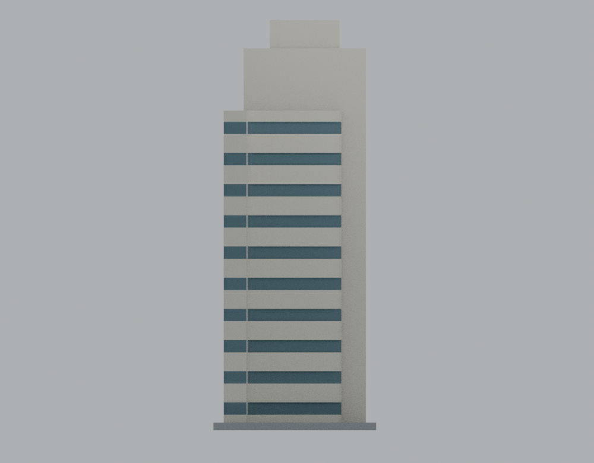
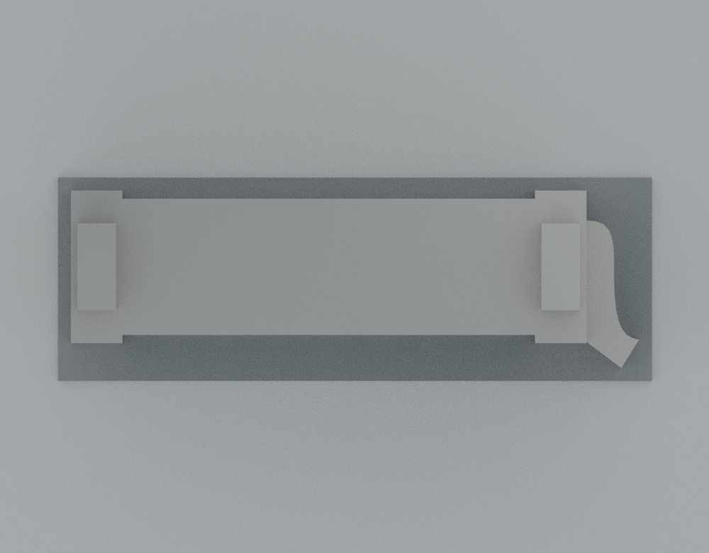
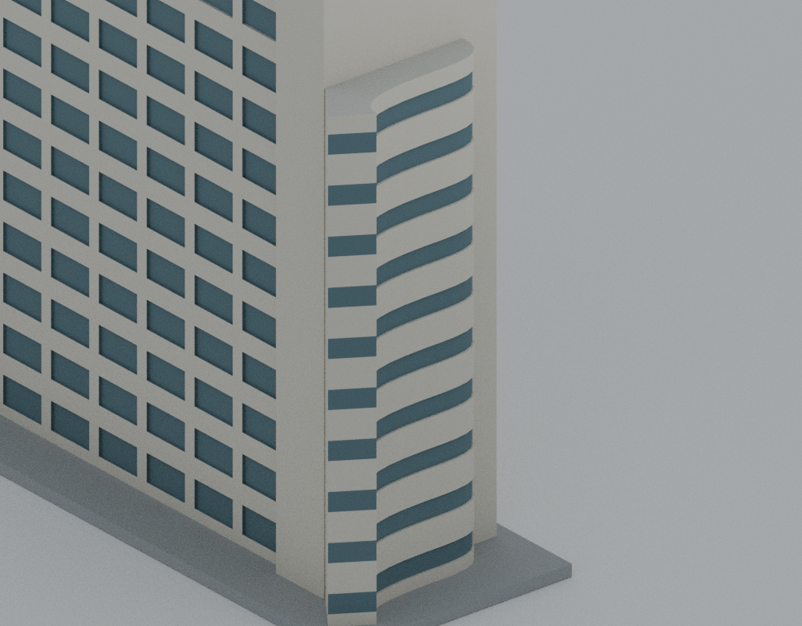

# 亞東科技大學誠勤大樓｜約 2021 年外觀代表模型

**狀態：獨立覆核 GO 的發布模型。** 亞東目前收錄有庠與誠勤 2 套；不代表完整校園。模型以約 2021 年 1 月的可見外觀為範圍，包含 12 層細長直板主體、兩端淺突出核心、兩個端部屋頂箱體，以及接向元智的短曲面連接段。曲面段在元智交界明確截斷，沒有元智本體；不代表完整連棟或現況測繪。

所有模型數值均為供展示與列印使用的毫米。官方 4F 圖只提供相對輪廓約束，沒有精確公尺標註；本包沒有建築實測尺寸或 1:N 比例承諾。主要長邊、端部核心與曲面段的平面關係依圖面簡化，主體外高及屋頂箱體深度則依照片估算。

## 檔案與重建

| 檔案 | 用途 |
| --- | --- |
| [parameters.json](parameters.json) | 幾何參數、來源年代及簡化政策 |
| [source/build_model.py](source/build_model.py) | 原始生成器；以 trimesh／manifold 布林及封閉環形曲面建立實體 |
| [models/v1/model.stl](models/v1/model.stl) | 列印幾何，含 3 mm 整合底板 |
| [models/v1/build-report.json](models/v1/build-report.json) | 輸出識別雜湊、版本及基本拓樸紀錄 |
| [models/v1/scene.blend](models/v1/scene.blend) | 由同一 STL 建立的可編輯檢視場景 |
| [source/render_preview.py](source/render_preview.py) | 場景與八個固定檢視角度的產生方式 |
| [REPRODUCE.md](REPRODUCE.md) | 重建、篩查與場景驗證命令 |
| [requirements.txt](requirements.txt) | 釘選依賴版本 |
| [SOURCE-CREDITS.md](SOURCE-CREDITS.md)／[public-sources.json](public-sources.json) | 來源、日期、雜湊與用途；不附原始圖片或網頁 |
| [ESTIMATES-AND-SIMPLIFICATIONS.md](ESTIMATES-AND-SIMPLIFICATIONS.md) | 估算與省略範圍 |
| [PRINTING-LIMITS.md](PRINTING-LIMITS.md) | 尺寸、方向與數位篩查限制 |
| [qa/README.md](qa/README.md) | QA 方法、原始結果、失敗及修正記錄、補證與重建紀錄的入口 |

在本模型包目錄，使用相容的 Python 環境及 [requirements.txt](requirements.txt) 中的依賴：

```text
python -m pip install -r requirements.txt
python -B source/build_model.py --output-dir qa/local-rebuild
```

`qa/local-rebuild` 應為新的輸出目錄；生成器遇到既有 `model.stl` 會拒絕覆寫。重建只讀取程式及參數，不需要下載來源影像。應由 [qa/README.md](qa/README.md) 查看實際重建環境與比較紀錄，不能只憑生成器執行成功推定幾何完全相同。

已有固定版本 STL 後，可在裝有 Blender Python 模組的環境執行 `python -B source/render_preview.py`，或以 Blender 背景模式執行 `blender -b --python source/render_preview.py`。此步會重新產生固定路徑的場景與預覽。場景中的地面、燈光、相機及展示材質不是額外列印幾何；STL 不含顏色。

## 八面檢視

座標為模型局部座標：X 沿主樓長邊，照片可見主立面為 −Y，+X 朝曲面連接段。此座標不宣稱地理方位。八張預覽對應同一 STL，檢視識別雜湊見 [render-manifest.json](previews/v1/render-manifest.json)。

| 前側斜視 | 後側斜視 |
| --- | --- |
|  |  |
| −Y 長邊 | +Y 長邊（中性牆面） |
|  |  |
| −X 端部 | +X 端部／連接段截斷 |
|  |  |
| 屋頂 | 曲面段細節 |
|  |  |

## 審查與列印界線

−Y 主立面使用 12 行、每行 8 組的簡化窗凹槽，並非實測窗數；未見的 +Y 門窗不鏡射主立面。曲面段有 10 個簡化窗帶，其高度採主體的 10/12，屬照片估算，不能據此宣稱實際連接段確定有 10 層。兩端屋頂箱體深度也屬估算，且完全限制在各端核心的平面範圍。

本體為實心外觀模型，沒有室內、結構或地下室模型。3 mm 底板是列印用途，不是建築外露地下裙房。招牌、細欄杆、窗框與小設備已省略；未加入未知雨棚、後翼、元智本體或樸慎大樓。

數位 QA、切片檢視與實際列印是不同階段。實際數位檢查、原始浮點判定與補證範圍統一見 [qa/README.md](qa/README.md)，不能概括為所有方法全面通過或形式化全網格證明。原作者浮點自交檢查仍為 exit 1／20 旗標；獨立嚴格支撐檢查也保留 exit 1／36 旗標，後者逐面量化為名義 45° 倒角的 binary32 微差，最大額外超伸 1/131072 mm，非阻擋判讀與原結果分開記錄。尚無切片軟體／G-code 驗證或實體試印，不能保證免支撐。159 mm 高體仍有黏床、翹曲、擺動和連接尖端風險。


## 發布覆核與資料清理

[獨立覆核與公開證據](qa/release-review/README.md)對固定候選 `4116148c135d8a67a444ce8bf33fb64aba3e06a3` 作 GO：獨立完整配對檢查未發現共享拓樸外接觸，1,796 個有限切層核心穩定；原 20 自交旗標與獨立 36 嚴格支撐旗標都保留。人為放行不代表嚴格支撐 gate 通過、形式化全幾何證明或實際可印保證。

STL、生成器與幾何參數保持固定候選 bytes。發布前僅清理 PNG 的 File 文字欄及 Blender 檔案瀏覽器目錄，八圖 IDAT／像素、其餘解壓後場景 bytes 均相同，並匿名化日誌內的本機路徑。詳見 [metadata 清理證據](qa/publication-metadata.json)及[發布綁定](qa/RELEASE-BINDING.json)。沒有重新渲染或調整模型來消除數值旗標。

`parameters.json` 的候選狀態欄、`qa/CANDIDATE-*.json` 及原始診斷是建模／審查凍結時的歷史紀錄；最新狀態以本頁、發布綁定及獨立審查說明為準。獨立僅重渲染前視一張，解碼像素完全一致，未聲稱八圖全重渲染。
