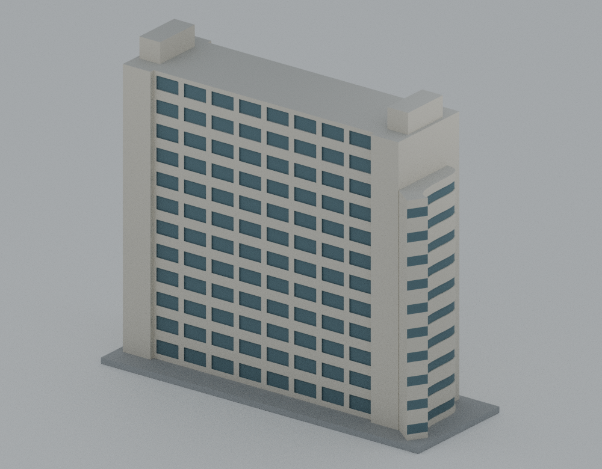

# 誠勤大樓獨立覆核：公開證據節錄

本目錄供安裝於模型包的 `qa/release-review/`。它整理 2026-10-18 已完成的獨立覆核，不是新增一輪幾何檢查或渲染。審查決定為 **GO，無必修阻擋事項**，限約 2021 年外觀的低細節代表模型及原報告已揭露的估算。GO 與下列原始失敗、量化分析及未驗證事項須一起閱讀。

原審查固定候選為 `4116148c135d8a67a444ce8bf33fb64aba3e06a3`，基準為 `56c252c0207bc8af202cc8b5b9e66da1c08a028b`；固定 STL SHA-256 為 `4e73e7094c83de47c19bcc6121fee575c1360b285d597773d983a873f46b7f5a`。提交識別與原 79 檔雜湊是當時的審查綁定，不能當成公開衍生版已再次完整重現的證明，也不承諾原私有候選提交可從公開 Git 歷史取得。

## 原始失敗與人工決定分列

| 方法 | 保留的原始結果 | 補充證據及判讀 |
| --- | --- | --- |
| 作者 generic 浮點檢查 | **exit 1；20 個自交／接觸旗標；兩個 gate 仍為 false** | 原報告原 bytes 收錄於 [author-reference/qa-report.json](author-reference/qa-report.json)。獨立逐對 binary32／Fraction 分析得到 10 對只共享邊、10 對只共享頂點，沒有藉 GO 改寫原報告。 |
| 全模型獨立檢查 | **exit 1；`digital_geometry_go=false`；36 個嚴格支撐截層旗標** | 原始 [independent-stl-results.json](geometry-review/independent-stl-results.json) 保留；門檻 `1e-5 mm²` 未放寬。全配對精確儲存座標演算法另得到零超出共享拓樸的接觸，不能因此稱整個 strict gate 通過。 |
| 逐面列印風險補充 | 與 strict gate 分開的人工非阻擋判讀 | 全部 462 個非底面向下面中，80 個前窗倒角面嚴格超過 45°；最大 `45.000336256650876°`，跨完整倒角的最大超伸為 **`1/131072 mm = 0.00000762939453125 mm`**。這是附著主板的名義 45° 斜面 binary32 量化偏差，原數值失敗不會被回填成通過。 |

獨立全模型面對演算法枚舉 4,308,580 對，精確 AABB 後檢查 31,375 對候選；這是儲存座標的演算法檢查，不是經機器驗證的形式化全網格數學證明。1,796 個獨立截層與 0.8 mm 組件核心篩查仍屬有限截面；不能當成連續 Z 或逐點最小壁厚證明。

## 主要證據

- [完整獨立覆核報告](CHENGQIN-INDEPENDENT-REVIEW.md)、[決策摘要](decision.json)及[原 79 檔來源綁定](provenance/results.json)。這些是歷史固定候選的結果，原文中的未發布／未推送敘述也是當時狀態。
- [交付整理首次欄位錯誤](delivery-initial-check-failure.json)保留原 `false` 值與更正說明；這是整理程式讀錯巢狀欄位，沒有修改候選或測試結果。
- [幾何與列印風險報告](geometry-review/GEOMETRY-REVIEW.md)、[完整數值](geometry-review/independent-stl-results.json)、[逐面量化分析](geometry-review/print-risk-analysis.json)、[連接尖端](geometry-review/connector-tip-review.json)、[截層控制](geometry-review/section-controls.json)。
- [20 旗標覆核](flag-audit/FLAG-AUDIT.md)、[逐對獨立結果](flag-audit/flag-audit-results.json)、[共享索引核對](flag-audit/shared-index-results.json)、[診斷重跑](flag-audit/rerun-diagnosis.json)、[控制重跑](flag-audit/rerun-controls.json)。首次審查者誤讀欄位的[失敗結果](flag-audit/initial-auditor-wrong-field-results.json)及六種非法 pair 的拒絕結果亦保留。
- [重建與場景檢查](scene-evidence/rebuild-scene.json)、[保存場景狀態](scene-evidence/saved-scene-state.json)、[由原碼建立的場景狀態](scene-evidence/source-scene-state.json)、[前視像素比較](scene-evidence/independent-front-pixel-comparison.json)。重建使用作者生成器，只證明可重建，沒有冒充另一套獨立建模。
- [來源／八圖視覺覆核](visual-review/VISUAL-REVIEW.md)、[視覺結果](visual-review/visual-review.json)及[模型預覽接觸表](visual-review/eight-preview-contact-sheet.jpg)。第三方來源原圖與 HTML 不在本目錄。

本次獨立覆核只重渲染一次保存場景的前視，沒有重渲染全部八圖。原比較記錄為 1000 × 780 的 780,000 個解碼 RGBA 像素全部一致，差異像素 0，最大通道差 0。



## 公開衍生與雜湊

[REDACTION-REPORT.json](REDACTION-REPORT.json) 逐檔記錄原 SHA-256、公開 SHA-256、大小、改動位置及路徑類型。沒有公布私人路徑原值、憑證、執行環境樹、Git 物件、整份 repo、第三方原圖或網頁。可原樣公開的數值 JSON 保持原 bytes；需要去識別的 JSON 只替換路徑字串，並比較所有 key、結構、非字串數值及布林結果不變。

公開前視 PNG **只移除一個 `tEXt:File` chunk**。所有其他 chunk 與 IDAT bytes 原樣保留，並以原圖解碼 RGBA SHA 與歷史像素比較報告交叉核對。這不是重新渲染或修改模型。原報告中的 PNG SHA 仍指向清理前圖檔；原 scene SHA `5cf2b50f83e9f897ba2aaf4e61c806f4bf3ab7b90c9174c20c6c83a160fd1b25` 仍指當時受審場景。公開模型包若另做明示 metadata 清理，應以包內清理對照驗證，不能冒稱本歷史報告檢查了清理後的新 bytes。

Python 衍生腳本只調整候選／套件路徑設定與必要的標準函式庫 import，以 `CHENGQIN_PACKAGE` 指定輸入並使用已安裝依賴；沒有改變幾何、控制、閾值、面索引或演算法結果。原報告的 auditor/source/script SHA 是原執行版本的識別，不是衍生腳本的新 SHA。本次只做 Python 語法解析與公開樹整理，**沒有重跑任何幾何、控制、重建或渲染**。

[PUBLIC-FILE-MANIFEST.json](PUBLIC-FILE-MANIFEST.json) 列出本公開樹除 manifest 自身外的所有檔案長度與 SHA-256。這是必要證據節錄，不含完整原始 CLI 工作樹；六份重複大型 guard input、部分冗餘 stdout／stderr、重建 STL 副本、prepare 腳本與依賴私有完整副本的 provenance orchestrator 已省略，不能宣稱包含完整原封存。

## 如何另行重現

以下是未在本次公開整理中執行的重現方式。先把本 tree 複製到**模型包以外的新工作目錄**，保留原證據；腳本會在該新副本寫入結果。`CHENGQIN_PACKAGE` 指向待比對的模型包，不可指向正在寫入報告的工作目錄。報告的固定原 SHA 綁定及公開衍生版的 SHA 差異需分開判讀。

使用 Python 3.13.9；原紀錄依賴 Shapely 2.1.2、NumPy 2.5.4、trimesh 4.12.2、manifold3d 3.3.2、bpy 5.2.2；像素比較另需 Pillow。私人 runtime 不隨本包附送。PowerShell 範例：

```powershell
$env:CHENGQIN_PACKAGE = '模型包的絕對路徑'
python -B geometry-review/check_chengqin_independent.py "$env:CHENGQIN_PACKAGE/models/v1/model.stl" --out geometry-review/independent-stl-results.json
python -B geometry-review/run_independent_section_controls.py
python -B geometry-review/analyze_print_risks.py
python -B geometry-review/check_connector_tips.py
python -B flag-audit/audit_flags.py
python -B flag-audit/verify_shared_indices.py
```

第一個命令在原固定 STL 的既定嚴格門檻下原本就是 exit 1；不可將它壓成 exit 0 或省略失敗報告。`audit_flags.py` 也會實際呼叫包內作者診斷／控制並產生新的輸入及輸出；它的獨立逐對證明與作者 CLI 重跑分開記錄。公開版有額外檔案／去識別後雜湊時，不應期待重現原 79 檔完整指紋或歷史 auditor SHA。

若另行需要場景與一次前視的重建檢查，可在上述新的外部工作副本執行 `python -B audit_rebuild_scene.py`，再執行 `python -B compare_preview_pixels.py`。這會使用 bpy 並實際重建與渲染一次，並非只讀查看本報告；目前公開整理沒有執行它。

## 列印仍需確認

**沒有切片器刀路、G-code、材料／機台設定或實體試印驗證。** 總高 159 mm、3 mm 大底板及約 184.3 × 63.08 mm 底面仍涉及黏床、翹曲、高體擺動與 brim／skirt／機台邊界餘量。曲面段截斷的附著凸角含局部尖端，噴嘴可能將其圓化或捨去；核心篩查沒有證明每一點厚於 0.8 mm。0.6／0.65 mm 是填實主體表面凹深，縮放、噴嘴及層高仍可能抹去細節。

模型的年代、屋頂箱體深度、曲面段高度與 10 個簡化窗帶仍是已揭露的估算；未知後立面維持中性，未加入元智本體。來源與列印限制另見模型包的 [SOURCE-CREDITS.md](../../SOURCE-CREDITS.md) 及 [PRINTING-LIMITS.md](../../PRINTING-LIMITS.md)。
