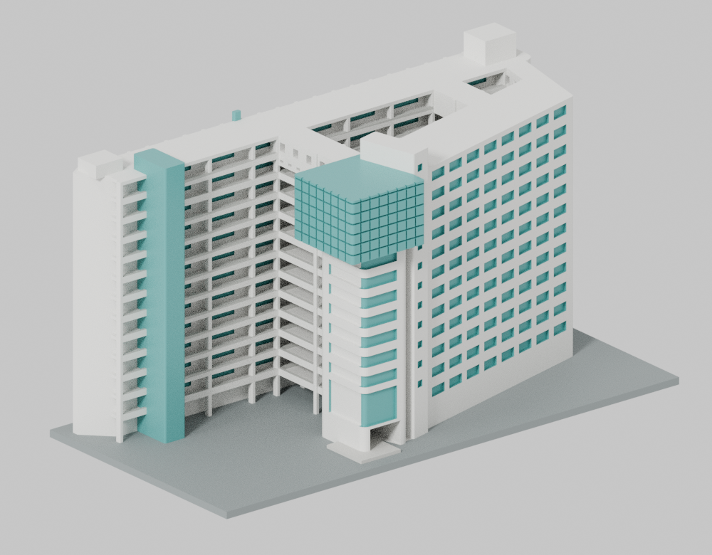
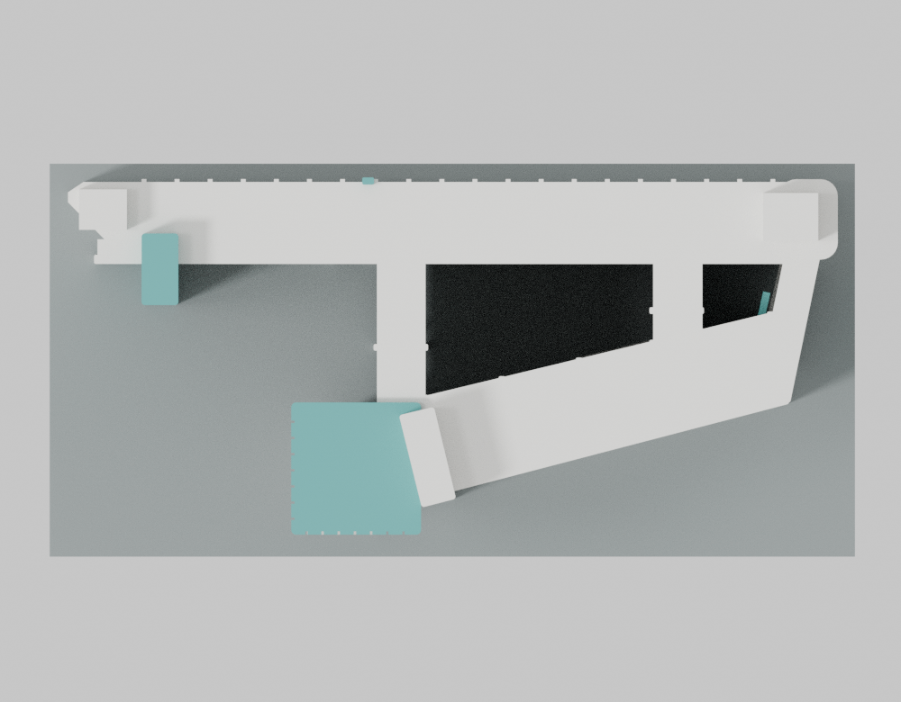
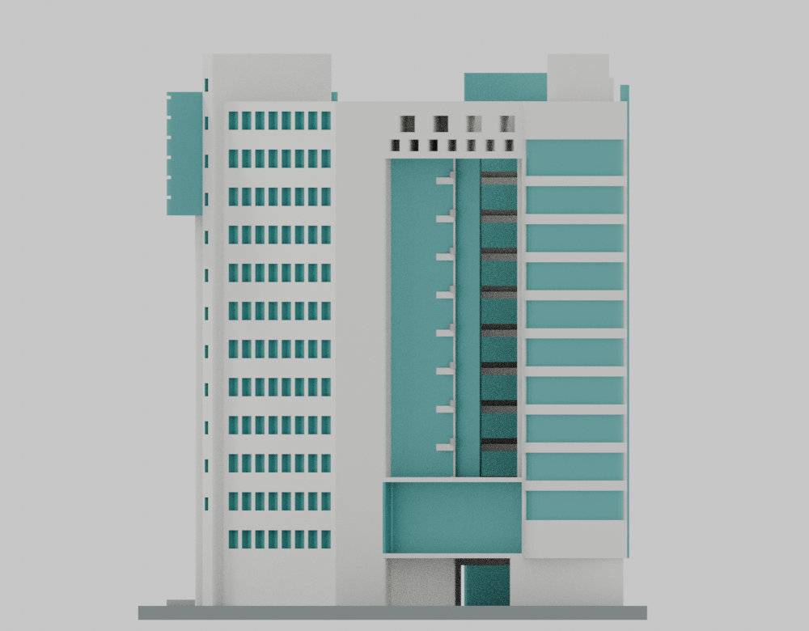
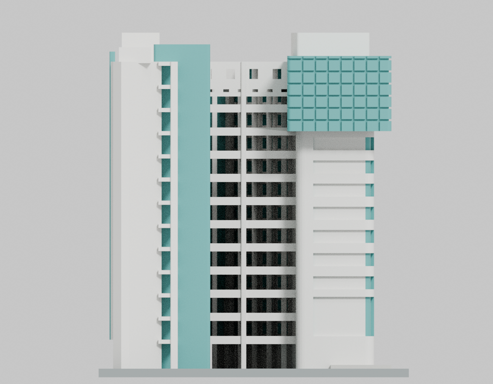
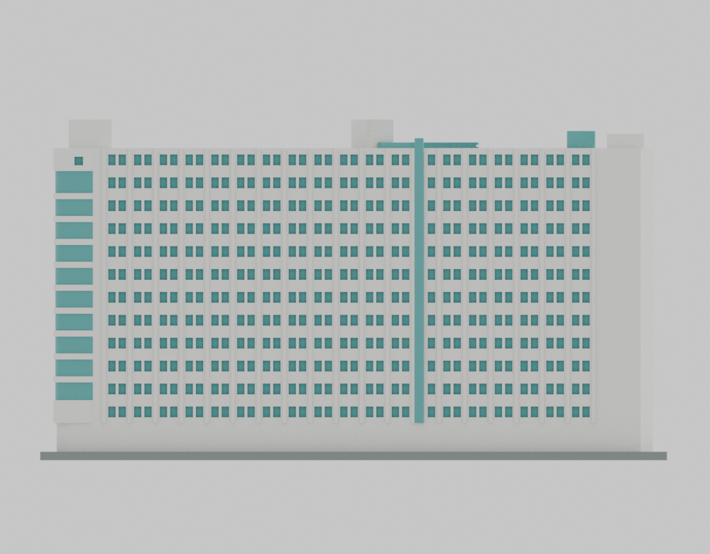
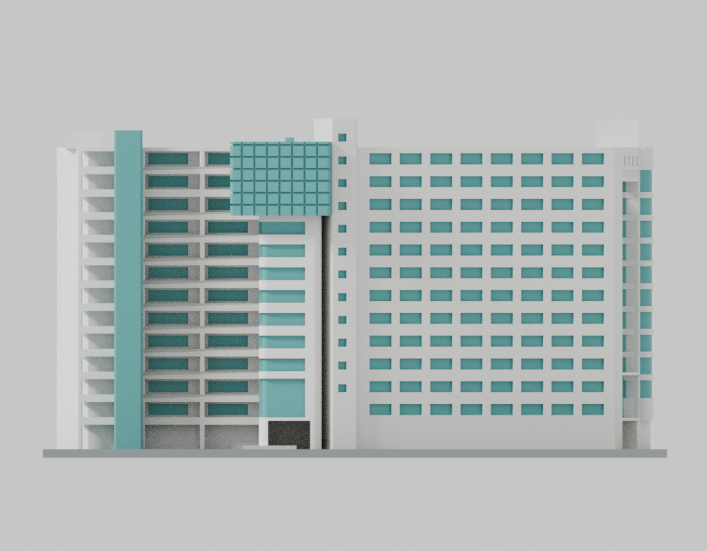
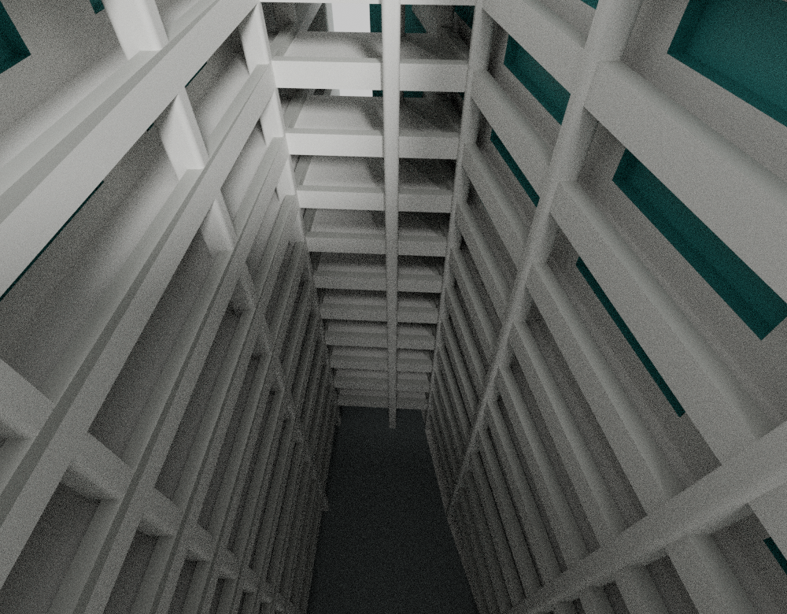
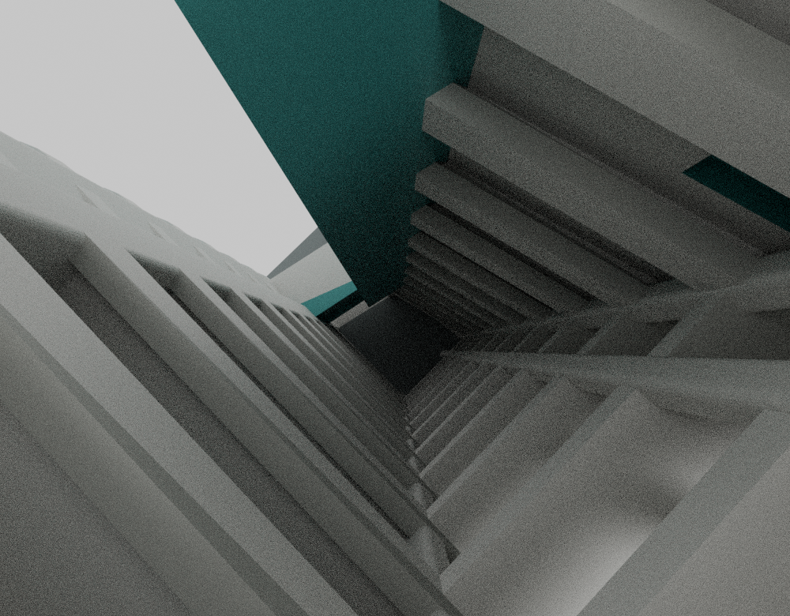

# 亞東科技大學 有庠科技大樓

MOE1084。以2007／2008年校園側照片為主的竣工初期外觀代表模型，搭配已於2010年刊出的街側承包商照片及後期樓層配置圖理解量體。

- 原創參數化 CSG，STL、Python 原碼、Blender 場景及九視圖可追溯。
- 模型尺寸為219×107×119毫米，整合3毫米底座。真實長、寬、高未獲實測或正式尺寸佐證，沒有1:N比例主張。
- 保留不平行雙翼、兩個分離天井、E／F跨接、街側巨框真洞、兩處不同圓角端部與校園懸挑玻璃盒。
- 鄰棟誠勤樓不包含在內；未見短端與屋頂採保守簡化，沒有鏡像補窗，也不混入2022年改造。
- 尚未實體試印。大跨度、天井內支撐移除及懸挑盒需要切片與設備條件評估。

## 範圍

這是早期外觀代表模型，不是精準2007年全側竣工復原、實測模型或當前校況。街側照片的精確拍攝日期未知，2010年是已刊出時間。9–12樓後期配置圖只用於雙翼、跨接及天井的相對平面關係，沒有當作低層／屋頂的完整竣工圖。實樓樓地板總面積未用來推算尺寸。

照片可辨的窗帶分段保留為可列印代表：D校園端七條一般窗帶、較高的低層玻璃體及上部懸挑盒；C街角十條綠色圓角窗帶、上下白體及一個可辨上白體小窗。街框內既有B端退縮面只以原創青綠材質表示玻璃，未以新平面填塞開口。所有幾何細節、間距和製造簡化仍為相對估計。

## 檔案與狀態

本發布版本為v15。指定原件的獨立normal／-O全量、同run actual-hex精確有界補證、原Blend唯一九圖CPU64重播與逐圖來源／外觀審核已完成。這是有限數位與精確補證的bounded GO：原始generic strict=false、各26個flags及實際exit1全部保留，沒有改稱原strict全通，也沒有實體試印。最新結論見[STATUS.md](STATUS.md)及[完整QA](qa/README.md)。來源、尺寸／簡化與列印限制分別見[SOURCE-CREDITS.md](SOURCE-CREDITS.md)、[ESTIMATES-AND-SIMPLIFICATIONS.md](ESTIMATES-AND-SIMPLIFICATIONS.md)、[PRINTING-LIMITS.md](PRINTING-LIMITS.md)，重建見[REPRODUCE.md](REPRODUCE.md)。

任何數位通過都僅適用所列雜湊的原件、指定採樣與本模型尺寸；不等於全域最薄壁、結構強度、支撐可移除或實體列印成功保證。

## 九視圖實際模型預覽

前兩張為正反並排。方向檔名沿用模型局部座標，不代表經測繪確認的東西南北。全部來自同一凍結原創場景；只移除允許的非視覺metadata，原像素、IDAT與存留chunks不變。

| 正反與俯視 | 正反與俯視 | 正反與俯視 |
| :---: | :---: | :---: |
|  街側／正面 |  校園側／背面 |  俯視 |
|  局部+X |  局部−X |  局部+Y |
|  局部−Y |  天井廊道 |  小天井／跨接 |

## 下載與重建

- [原始STL](models/v15/model.stl) · [Blender場景](models/v15/scene.blend)
- [參數化建模原碼](source/build_model.py) · [渲染原碼](source/render_preview.py) · [模型參數](parameters.json)
- [完整數位QA與控制安全重播](qa/README.md) · [公開來源記錄](public-sources.json)
- [來源外觀覆核](qa/source-review/final-v15/PUBLIC-SOURCE-REVIEW.md) · [來源外觀GO](qa/source-review/final-v15/SOURCE-APPEARANCE-GO.json)

STL SHA256：46649566e965a049e6e333e9d82b075407c8e926e55c9034f11fbe3dbdf15a5d。47,770個原三角面；各模式1,785截層、22,364原Polygon、477,700原射線零短線及851,184閉AABB原面候選零不合法接觸。26個原數值flags用同次實際lossless hex精確分類；有限採樣和原strict=false的界線不可省略。原第一次sum語意失敗、reader修正與控制證據保留。

## 保存範圍註記

一份舊版進度metadata WORK-STATE.json（3,814 bytes，SHA256 6e3f0b0e1e31a2e0385ecf3b66bad84158d4d1afaa0a231e60096740f8f17faf）原bytes已不可還原。它不屬模型科學證據或必需發布依賴；3,690項原科學freeze、原數值失敗及完整指定原資料仍保留。此處不宣稱全部歷史metadata均可恢復；詳見[精確歷史缺口註記](qa/independent/publication-chain/metadata-gap-acknowledgment-result.json)。
