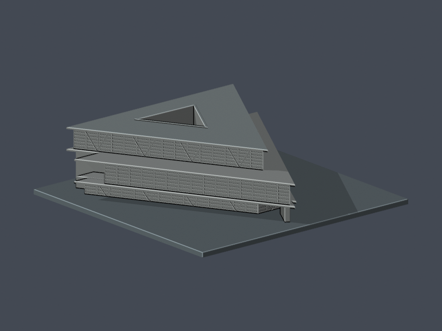

# 亞洲大學

[霧峰校本部](霧峰校本部/)｜本批僅一棟現代美術館；不是全校所有建築模型。

| 本批建物 | 其他建物 | 其他建物 |
|---|---|---|
|     [亞洲大學附屬現代美術館](霧峰校本部/buildings/asia-modern-museum/) | 尚未納入 | 尚未納入 |

自建、來源比例近似；尺寸與未見角有推定，並非竣工測繪。請先讀每件的來源、列印警示及QA。原始第三方照片/圖說不隨包散布。本封裝外觀已覆核，仍待獨立幾何審核後發布。
