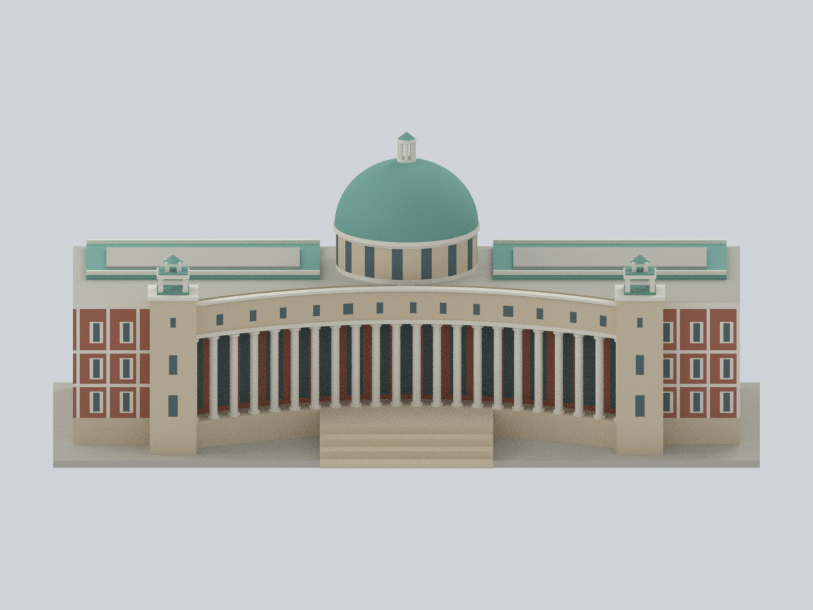
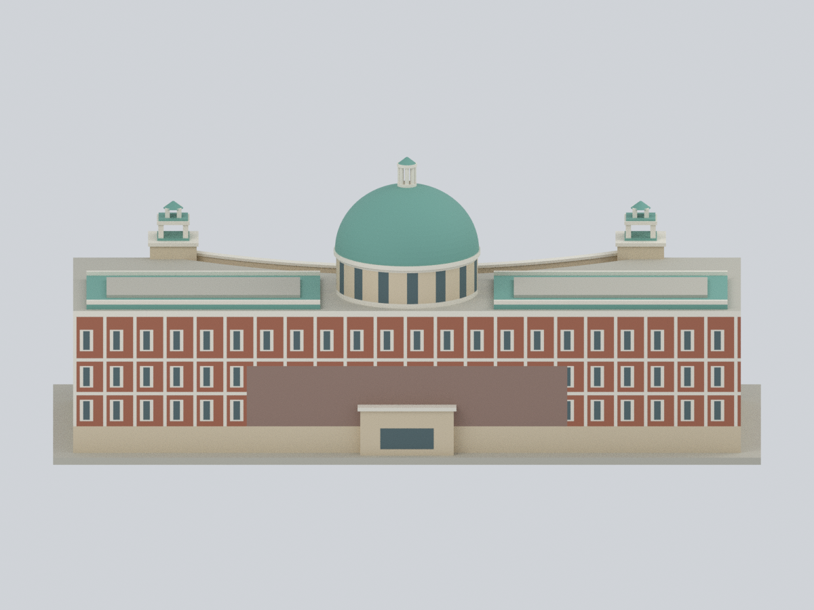
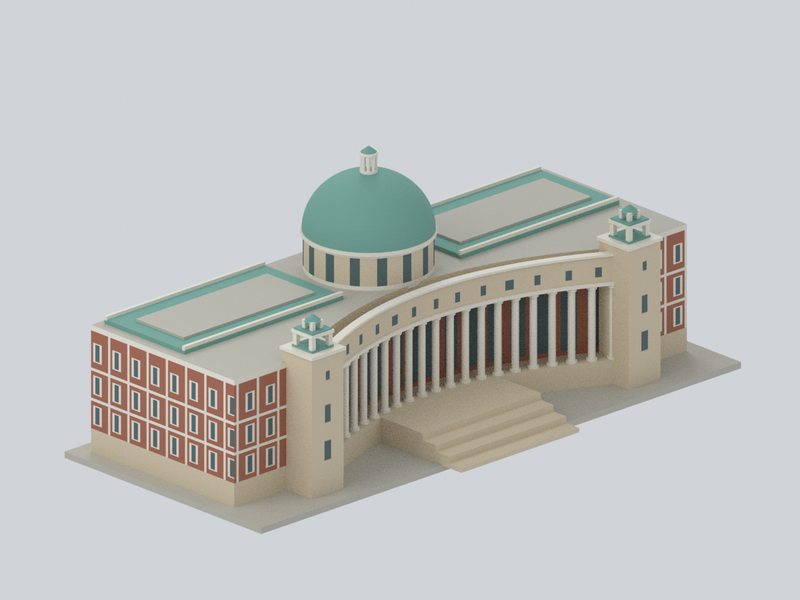
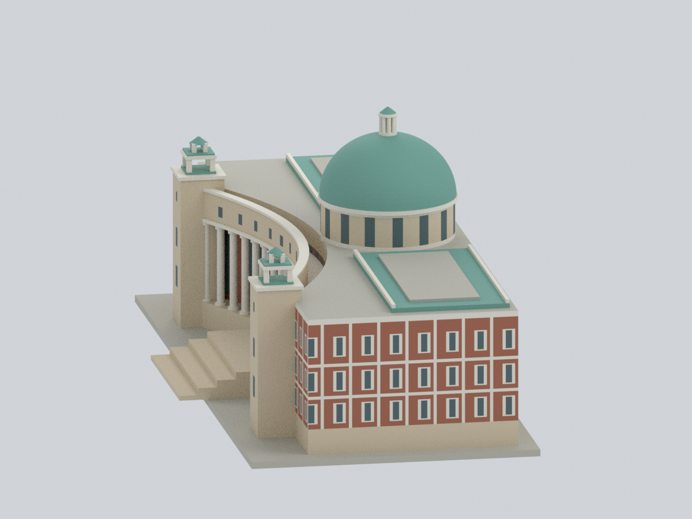
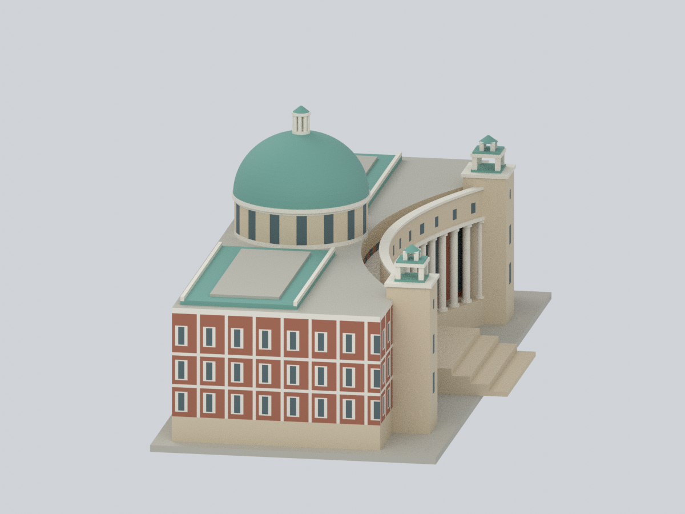
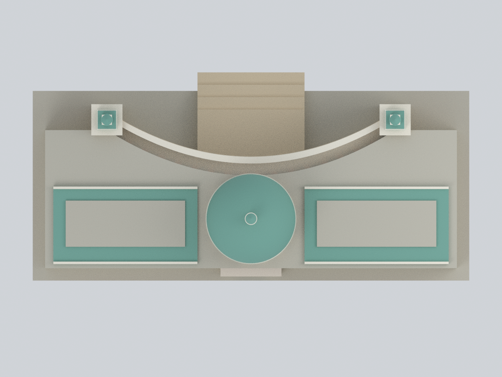
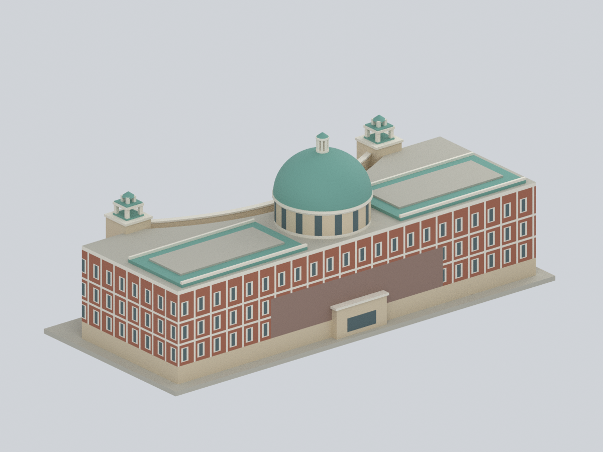
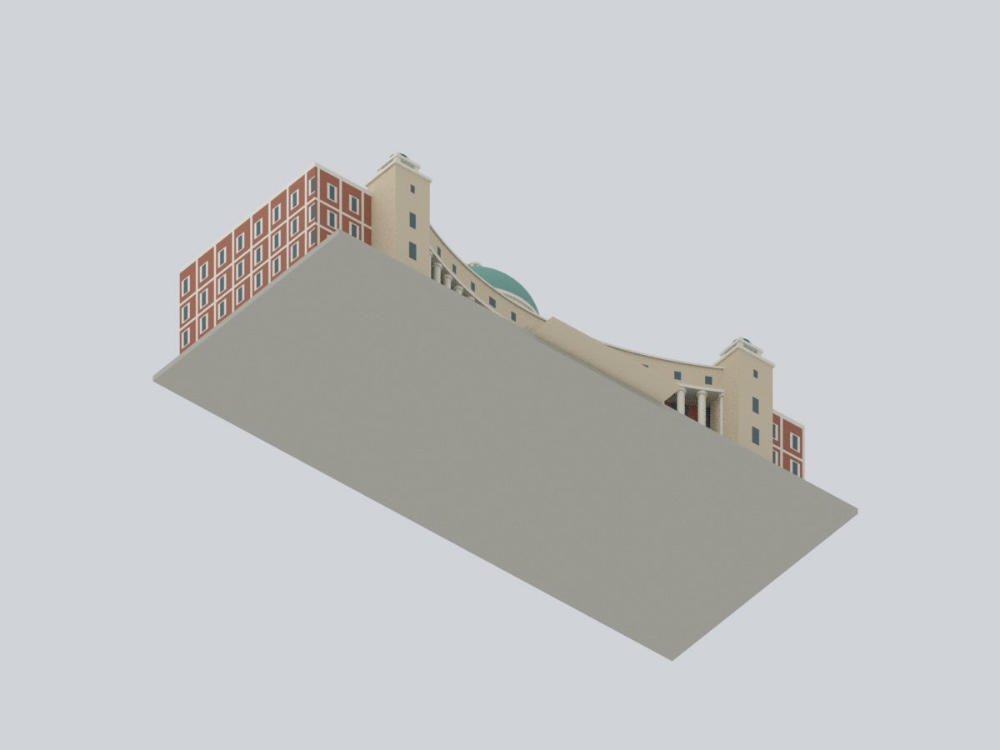
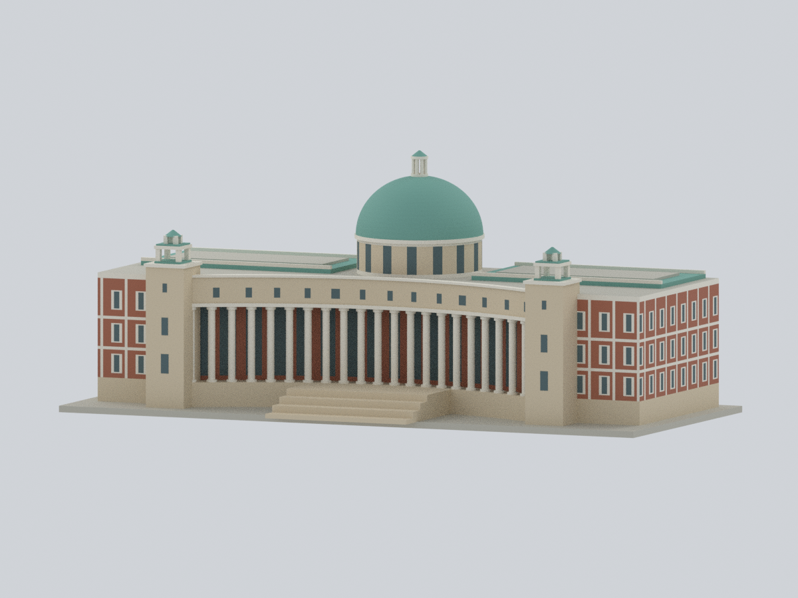

# 亞洲大學｜行政大樓暨圖書館

**自建歷史資料綜合外觀近似版**，含主要全棟量體、凹弧柱廊、中央鼓座與穹頂、兩端小塔及塔外紅磚翼部。不是竣工測繪、室內模型或 2026 現況紀錄；也不是旁邊的現代美術館。

依 2008–2011 年官方照片、年代未明空拍及單側圖書館導覽平面綜合推定。**所有尺寸、重複數量、行政側對應量體與未見接合均有簡化／推定**，不宣稱相同比例或單一年度的完整復原。

## 模型預覽

以下全部直接渲染本包同一份網格；非來源照片、非示意生成圖。正背面並列於第一列；相機方向為模型局部座標，並非測量方位。

| 正面 | 背面 | 前方斜視 |
|---|---|---|
|  |  |  |
| 左側 | 右側 | 俯視 |
|  |  |  |
| 後方斜視 | 底面／製造封閉 | 低角度柱廊 |
|  |  |  |

## 檔案

- [單一連通 STL](model.stl)：無色、封閉實體外觀，159 × 75.75 × 65.7 mm 為**顯示／列印尺寸**，不是建築實測縮尺。
- [可編輯 Blend](asia-administration-library.blend)：真實網格、7 個可編輯材質與逐面來源規則；沒有貼圖或隱藏補件。
- [逐面材質 3MF](asia-administration-library.3mf)：同一三角形與真實基礎材質指派；不是將 STL 改副檔名。
- [參數](parameters.json)、[色盤](palette.json)、[來源](sources.json)、[面材質對照](face-materials.csv)、[觀測／推定規則](mapping-rules.json)、[重建程式](source/rebuild.py)。

## 來源與可知範圍

| 資料 | 實際支持 | 不可推出 |
|---|---|---|
| [官方校園景觀](https://web.asia.edu.tw/en/life/scenery)，S01／S02：後方 2008、前斜 2011 照片 | 後方紅磚與米白格構；前方凹弧柱廊、塔與穹頂 | EXIF 非獨立年代鑑定；樹後窗格、精確構造及維修年代未知 |
| [視傳系校園照片](https://vcd.asia.edu.tw/zh_tw/environmet/environmet_1)，S03 | 2008 前廊與台階配置 | 低解析度不支持精細裝飾尺寸 |
| [臺中影視協拍](https://filmtaichung.org.tw/scenesContent/153)，S04 | 建築深度、塔外仍有大翼部、屋頂區塊 | 原拍攝年未明；不可把屋頂矩形當成中庭洞口 |
| [圖書館樓層導覽](https://library2.asia.edu.tw/zh_tw/Aboutbuilding/Floorguide)，S05／S05b／S05c | **單側圖書館翼**輪廓、弧形前廊、中央圓廳接界 | 不是全棟／行政側平面，沒有尺寸；2025／2018 檔案日期不是改建年 |
| [國教院《三視圖》學生手冊](https://www.naer.edu.tw/upload/1/16/doc/864/%E4%B8%89%E8%A6%96%E7%94%9F.pdf)，S06 | 2017 出版資料中舊屋頂影像的粗略配置 | 不是新航照或測量；內嵌地圖另有權利 |
| [L 棟 B1 路線圖](https://ot.asia.edu.tw/uploads/asset/data/607541c6905fc3ab74000072/598885225.pdf)，S07 | 建築身分補充 | **完全不作尺度／輪廓依據** |

原始照片、圖說、PDF 頁面及像素貼圖不隨包散布。來源色調以程序色盤概括，非採樣、色度量測或材料規格。未確認本棟建築師與維修沿革；不套用現代美術館的建築師署名。

## 觀測與推定

- **保留觀測關係：**前廊中央後退、兩小塔位於柱廊端部而非全棟最外緣；兩深翼連接中央圓廳。後面是直紅磚／米白立面，不複製前方柱廊。
- **明示推定：**行政側粗略對應量體、未見中央後接合、樹遮蔽下層後牆採無窗的低彩磚色 N01；屋頂矩形採淺的封閉 N00 中性色板。這些不是證明現場為實牆、天井或相同屋頂材料。
- **製造簡化：**22 根柱、窗格和鼓座分段是建模慣例，不是來源確認的總數；四級粗階與厚化燈亭柱、平底、實心內部均為展示／列印選擇。省略細柱頭、欄杆、肋縫、植栽、校徽、標牌、人物、設備及地下室。
- 玻璃為不透明色面；窗口不鑽穿實體。面材質表與 Blend 的 `evidence_rule_index` 可追蹤每個面屬於哪一項規則。

## 數位 QA 與列印限制

STL 重新讀取檢查邊及頂點流形、封閉性、面朝向、重複／退化面、連通性；0.2 mm 情境逐層交線檢查不是實際切片器工具路徑，更不是實體試印。3MF 執行 strict 讀取、重存、實際改色再讀取，並驗證座標與面材質；Blend 實際改頂點／材質、存檔再開。另用只有程式、參數與色盤的全新輸出目錄重建，逐像素比較九張圖。

[網格與切層報告](qa/geometry-validation.json) · [3MF 報告](qa/3mf-validation.json) · [Blend 報告](qa/blend-validation.json) · [全新重建比對](qa/rebuild-validation.json) · [固定路徑緩衝區檢查](qa/path-buffer-audit.json) · [來源外觀比對](qa/visual-review.json)

**尚未實體列印。**長曲廊頂、塔亭橫樑及中央燈亭頂需要支撐評估；完整模型柱徑約 1.86 mm，小燈亭柱約 0.9–1.05 mm。縮小可能折斷，拆支撐亦有風險；建議先測試局部或放大。細色帶不保證 0.4 mm 噴嘴能保留；3MF 色彩支援因切片器而異。沒有承載、結構、抗震、疏散或施工用途。

## 從程式重建

使用 [環境版本表](source/requirements-model.txt) 的 Python／Blender 工具鏈。幾何與 3MF 可用不同既有 Python 環境：

```sh
python source/rebuild.py --out NEW_OUTPUT --geometry-python GEOMETRY_PYTHON --three-mf-python LIB3MF_PYTHON --blender blender --threads 4
```

僅需 `source/*.py`、`parameters.json`、`palette.json`；不需要來源照片或現有 STL、NPZ、Blend、3MF、預覽。建議使用全新目錄；可另用 [重建比對器](source/compare_rebuild.py) 比較權威陣列、STL 位元組與預覽像素。輸出的模型不以 Blend／ZIP 封裝的日期位元組相等作判準。
