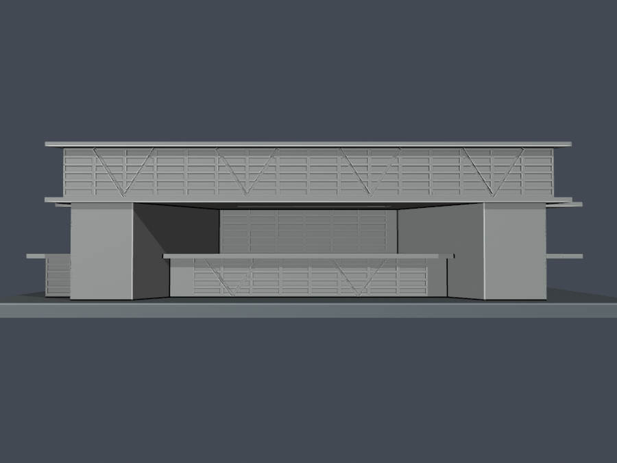

# 亞洲大學附屬現代美術館

## 模型預覽

| 模型預覽 | 模型預覽 | 模型預覽 |
| :---: | :---: | :---: |
| 正面／角面（實際STL）  | 背面（實際STL）  |  |

2013–2014落成時期主要外觀的自建「來源比例近似版」，不是竣工測繪，也不表示亞洲大學全校建物完成。已在GitHub公開（[歷史提交](https://github.com/root50643/taiwan-buildings-3d/commit/6002ac2bc30d8f17a593b1aa398cc2e0f2920e1d)）；既有作者數位QA與程式重建比對報告通過，具日期及範圍的完整獨立放行紀錄未確認，並非判定審查失敗。公開狀態不代表所有QA或列印驗證均已完成。

[頂視](previews/top.png) · [低視角正面](previews/source-front.png) · [模型STL](model.stl) · [可編輯Blend](scene.blend)

| 模型預覽 | 模型預覽 | 模型預覽 |
| :---: | :---: | :---: |
| 頂視  | 低視角正面  |  |

## 範圍與比例
- 保存同向錯位的三角樓層、尖薄屋簷、正面高架3F、沿三角邊內收的兩側厚牆、深退2F、不同方向出挑及中央三角凹庭。較低2F外伸角另有一層高厚支承及1F局部退縮，與前面兩層高牆分開。
- 最高屋頂邊約55–58m、可見下層簷邊約60–63m；地面牆基未測量。國土測繪可見L1只是邊段終點，不是完整三角角。未見角以館訊/拆層模型的三角拓撲與照片共同估計。
- 屋頂名義高17m（有界16–19m），樓板名義4.9/11m；依照片比例估計，非官方尺寸、非三層等高。屋頂亮框外邊約20m不等於淨開口。不同高度航照有傾移與視差，不能直接當垂直剖面。
- 模型毫米，XYZ同尺度2.15mm／估計實際米（約1:465）；底座150×148×3mm，含底座總高約39.87mm。底座尺寸是模型設計，不是基地範圍。

## 天井與簡化
天井實拍可見3F內側混凝土壁、局部橋板，以及下方連續的2F玻璃。模型因此保留2F展廳／前玻璃，不把整個屋頂三角孔一路挖穿2F或1F；凹庭底與橋板高度為有界近似。三點原STL垂直ray證明庭院底上方約12.84mm自由空間，另核入口上方約11.98mm挑空，詳[開放空間驗證](open-space-check.json)。

玻璃用淺凹面表意，不是透明玻璃實體。玻璃後斜支承以稀疏、壁後意象的內凹刻線表達；正面四組只是簡化，不是精確柱數，也不是外露裝飾骨架。照片中反射及前後斜件重疊，不能把每一玻璃跨當柱跨。北側低支承與L2的對應是跨照片影像推定；1F局部尖角退距沒有實測，不將另一張R1咖啡角照片誤拼到這裡。低支承下另以ray核約9.50mm自由高度。2F與3F各自下緣薄板與較低層頂簷疊合，未拿三塊同尺寸板硬堆。

內部樓梯在館訊有符號，但外觀證據未支持新增外露入口梯，故不建不可見室內梯；室內展牆、展品、細扶手、機電、庭園與雕塑省略。

屋簷約1.01mm厚、凹庭亮框平面寬約1.18mm，為小比例可解析性調整。窗框背後保留連續實體；沒有分離細柱或浮空細框。刻線不代表全方向最小壁厚測量。

## 列印提醒
底座朝下，單位為mm。巨大懸挑、入口挑空、尖角簷板與庭院局部需在實際切片軟體檢查支撐、橋接及接觸位置；勿宣稱免支撐。0.8mm opening只是幾何篩檢，並非噴嘴路徑或全方向最小壁厚。未做實體試印，未承諾任何特定機器可無條件列印。

## 重建與QA
Python依[requirements.txt](requirements.txt)，Blender 4.3.2或相容版本。依序執行build_model.py、Blender背景執行render_preview.py，再執行run_all_checks.py。STL來自原創參數CSG，不擷取第三方3D mesh。來源CSG以0.0001mm公差輸出，避免float32極小交線誤差；驗證器不修補交付STL。

- [原始網格與獨立重建](validation.json)：原始normal/winding、每邊二面、vertex-link單環、單一連通表面、無封閉內腔殼、150mm尺寸、重建STL SHA、Blend幾何及重建actual PNG。
- [逐0.2mm原Polygon](layer-component-check.json)：canonical degree2閉合、個別／合成Polygon有效，逐原Polygon erosion及opening不消失、不分裂；invalid直接非零退出。
- [canonical 0.8mm篩檢](thin-feature-check.json)、[細件連接說明](thin-feature-review.json)、[總檢](qa-summary.json)。
- [來源與估計](sources.json)、[保留描點與推定座標](source-coordinates.json)、[SHA清單](SHA256SUMS)。原始照片、館訊掃圖與設計圖不在公開封裝。
