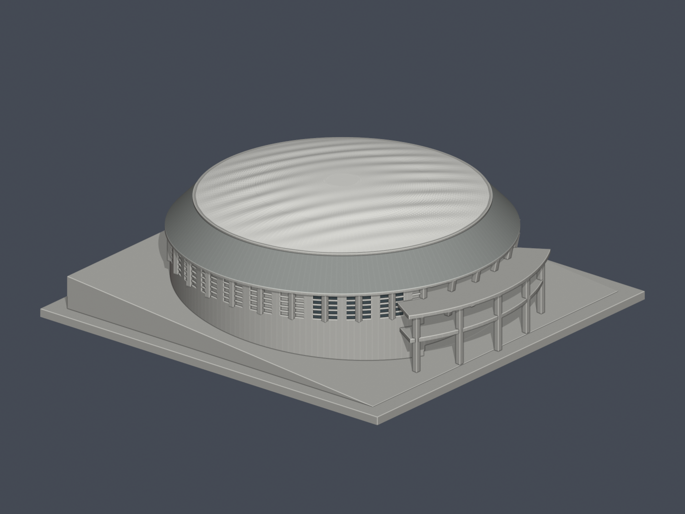
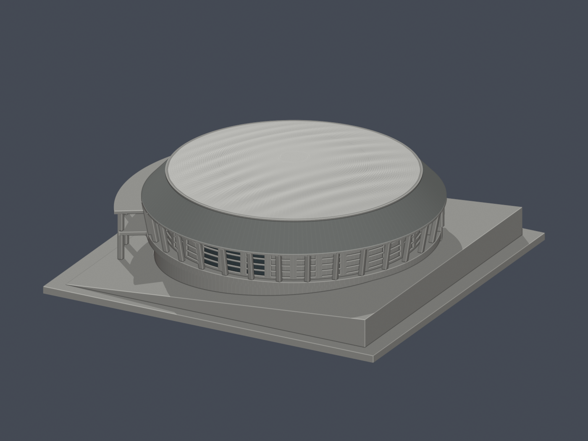
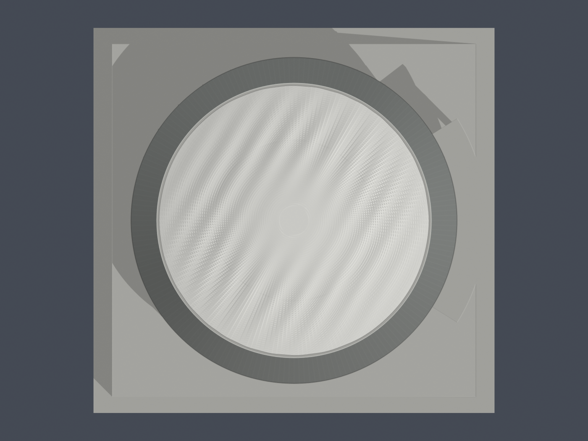
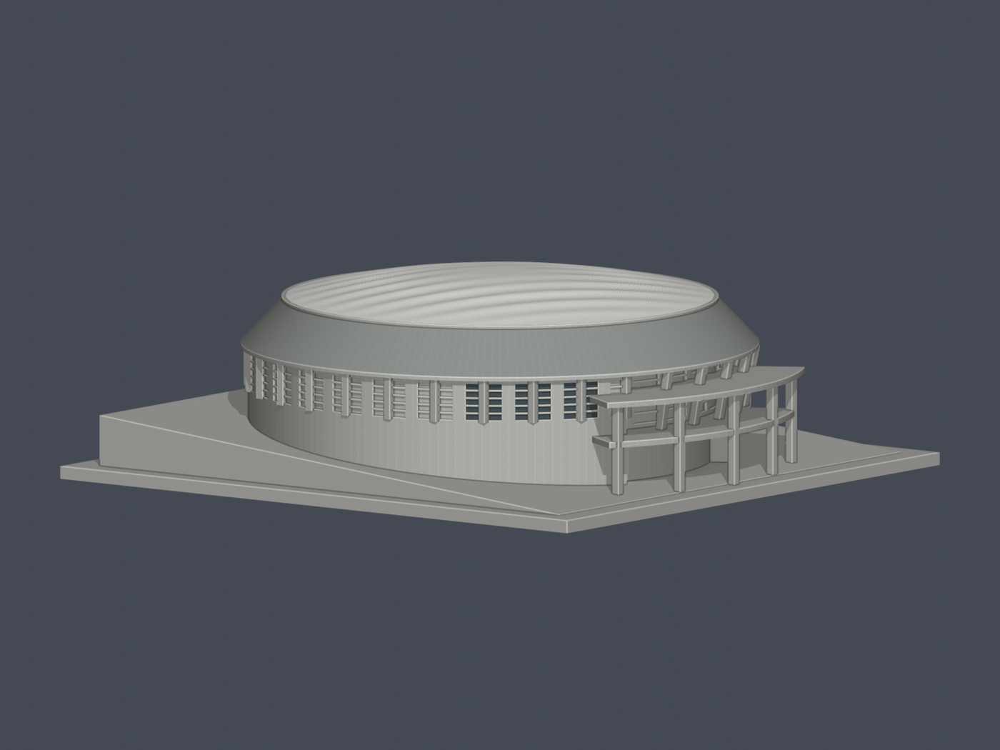
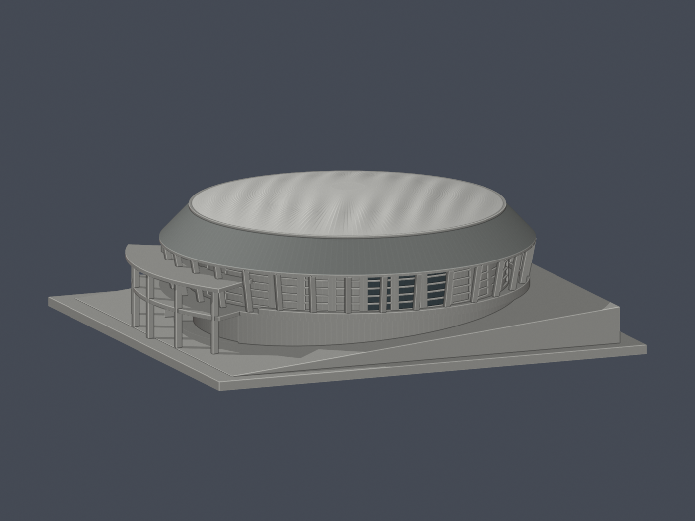
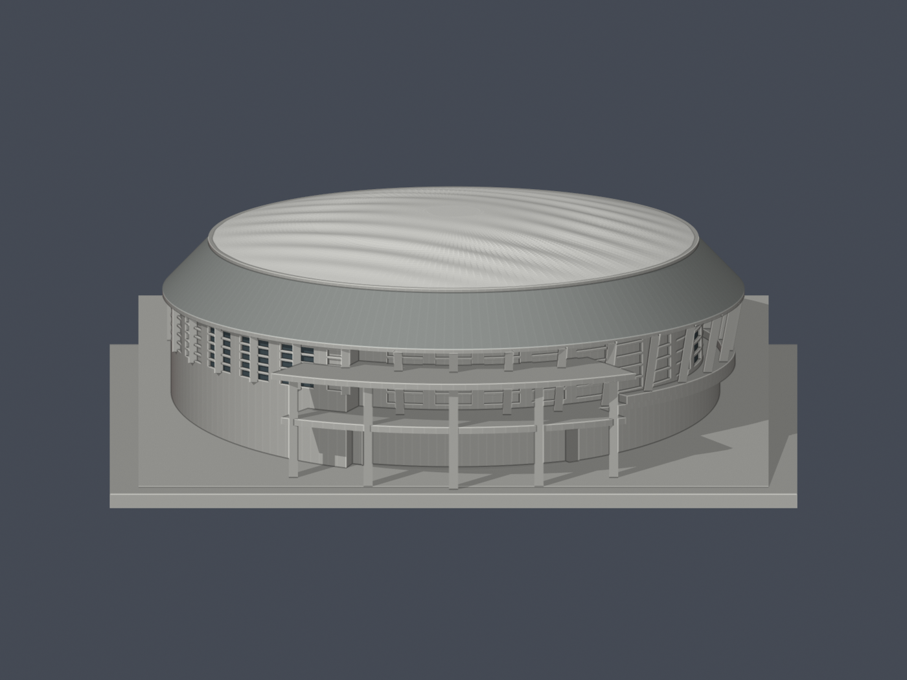
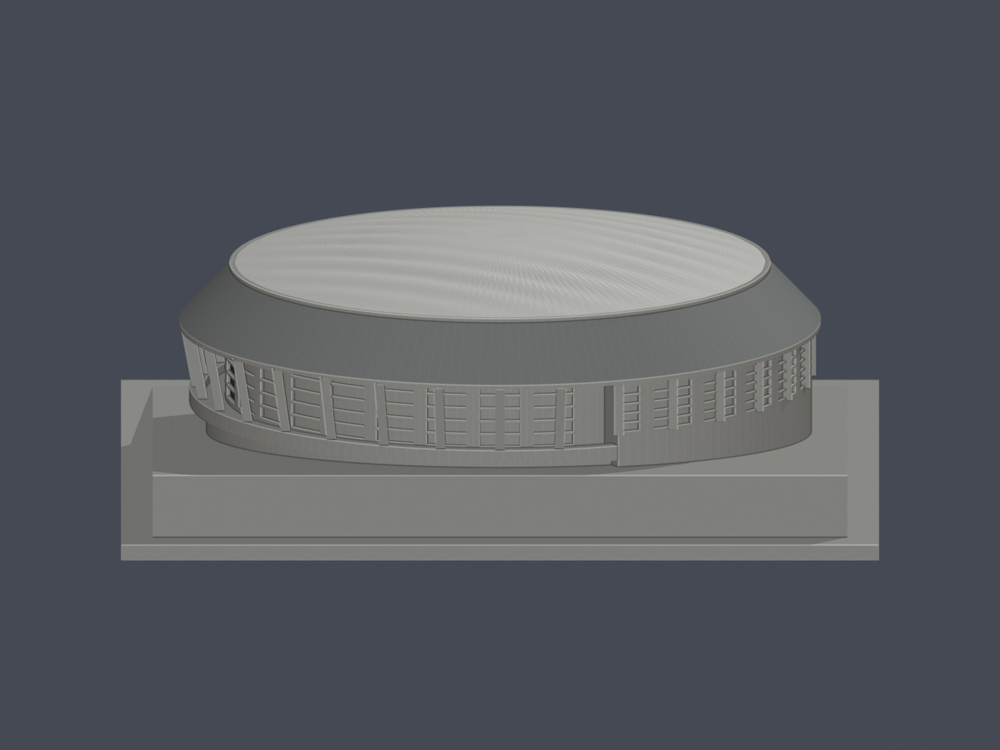
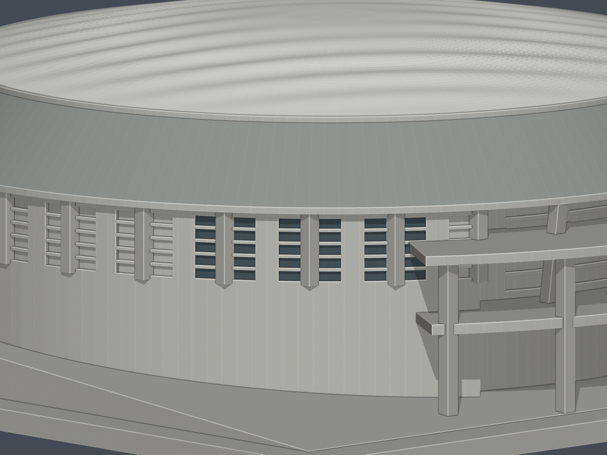
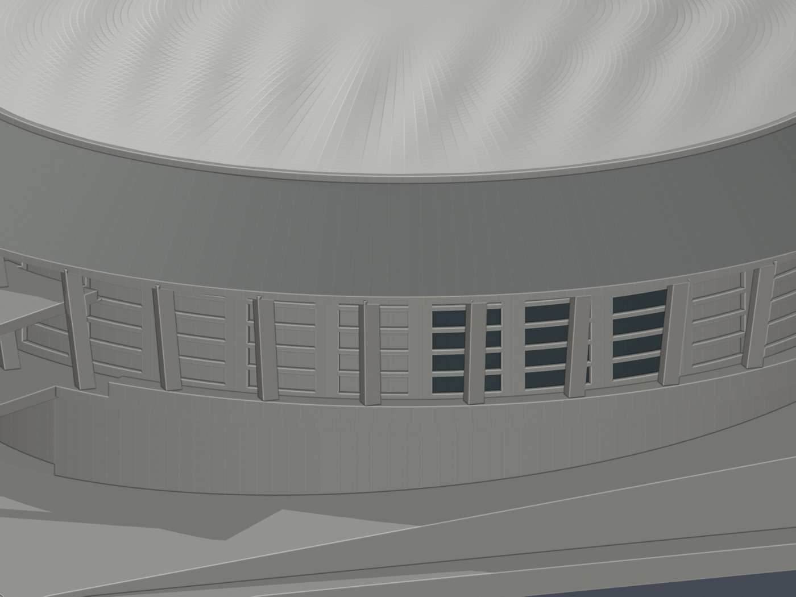

# 懷恩館｜原網格限定配色

本版在既有的佛光大學懷恩館外觀近似上，加入有來源約束的**面材質**；不是重建幾何、實測復原或完整實景塗裝。

## 可下載與編修

- [scene.blend](scene.blend)：可編修的原三角面與 4 個材質槽；每面保留 `original_stl_face_id`。
- [fgu-huaien-hall-materials.3mf](fgu-huaien-hall-materials.3mf)：真正的逐面 base-material 指派，不是只有縮圖或物件名稱。
- [原 model.stl](../model.stl)：仍為原檔，不承載顏色，SHA256 `95974eb366614bb7caffeba43a5e0ae52cdb971668c51a385de9cc5f46be13e9`。
- 尺寸仍為 **150 × 144 × 47.60 mm**，約 1:500；36,870 個原三角面，座標、面順序、繞向與幾何保持不變。

## 這些顏色代表什麼

| 材質 | 顯示近似色 | 原面數 | 範圍 |
|---|---|---:|---|
| 白色膜帽 | `#E8E8E3` | 22,216 | 符合原帽頂輪廓的朝外上表面；不含環頂小平臺 |
| 灰色屋面環 | `#919592` | 384 | 灰色直立鎖邊金屬斜環；不含垂直簷口、底面、內填或頂環 |
| 反射玻璃的暗藍灰外觀 | `#46545A` | 240 | 僅 6 個已對位窗組、每組 5 列的原凹槽背面 |
| 未確認／中性占位 | `#B9B9B4` | 14,030 | 其餘全部原面；**不是認定現場牆、柱或地面為此色** |

只選入口左側 3 個清楚窗組與另一側環廊 3 個清楚窗組。樹葉遮擋、邊界未明及其他未對位窗組不作對稱外推。窗框、斜柱、凹槽側壁、入口背牆、全部牆面、地形底座及未見底面均保留未知中性。[逐面清單](face-materials.json)、[來源／窗組對位](source-registration.json)可查每一組的來源、角度、列範圍及原面編號。

這是既有縮尺近似模型上的有界對位，不是相機標定或逐扇門窗測繪；原模型的 32 分格與 5 列分格均未修改。灰環資料由施工商技術頁與完成屋面照片相互支持；膜帽以白天完工影像為準。D010／D011 的露桁架施工影像不作完工顏色依據；夜間燈光及活動平面圖的標示色也不作建材顏色。

## 來源與限制

[來源網址與年代口徑](sources.json)涵蓋校方地面照片、2010／2021 分割歷史對照、施工商 D012、校方介紹 PDF 白天空拍與無障礙 PDF 橫幅。色碼只是未校色的顏色家族近似，不能當成材料規格、玻璃透光率、膜材化學成分、反射率或 2026 現況。

不附第三方照片、PDF 或貼圖；沒有新增接縫、告示、燈光、窗片、地景或幾何。帽形、輪廓、柱位、簡化欄杆與地形的既有限制仍見[原模型說明](../README.md)。屋面細密陰影來自原始三角化／起伏與預覽照明，不是新增材質紋理。

## 預覽

| 東南側 | 背面 | 頂視 |
|---|---|---|
|  |  |  |
| 正面低視角 | 背面低視角 | 東側 |
|  |  |  |
| 西側 | 前窗細節 | 環廊窗細節 |
|  |  |  |

9 張圖均繪製交付的同一份原網格與面材質；Workbench 中性工作室照明，並非照片級或色彩校正的現場再現。

## 重建與檢查

所需：Python 3、NumPy、lib3mf 2.5.0、Blender 4.3.2。從建築資料夾執行：

```sh
python appearance/source/build_appearance.py
python appearance/source/export_3mf.py
blender -b -t 4 --factory-startup --python appearance/source/render_appearance.py -- --render
python appearance/source/strip_png_metadata.py appearance/previews
blender -b appearance/scene.blend --python appearance/source/verify_scene.py
python appearance/source/verify_package.py
```

各主要腳本接受 `--out NEW_DIRECTORY`，會建立輸出目錄；建立面材質時可用 `--stl model.stl` 指定原檔。其餘腳本讀取同一輸出目錄。所有輸入均須是上述固定 SHA256 的原 STL，不能以其他網格冒充。

[原網格一致性](qa/original-mesh-identity.json)、[3MF 嚴格讀回與材質編修](qa/3mf-strict-roundtrip.json)、[Blend 編修／儲存／重開](qa/blend-edit-reopen.json)、[包與拓撲檢查](qa/package-verification.json)、[乾淨重建](qa/rebuild-verification.json)、[目視核對](qa/visual-review.json)可供覆核。

交付 3MF XML 使用原 float32 座標的精確十進位表示。lib3mf 預設寫出再讀回的獨立測試有最高 **0.00000763 mm** 格式化差異，面順序與材質完全一致；這不隱藏為逐位元一致。原 STL、交付 Blend 與交付 3MF 幾何仍精確一致。

本次只驗證原幾何保留、封閉邊、材質與檔案可編修性。**未作實際切片、支撐／工具路徑檢查或實體試印**；原懸挑、簷板、門廊與縮尺薄件風險不因上色消失。不同軟體、印表機或耗材未必支援或保留 3MF 面顏色。
