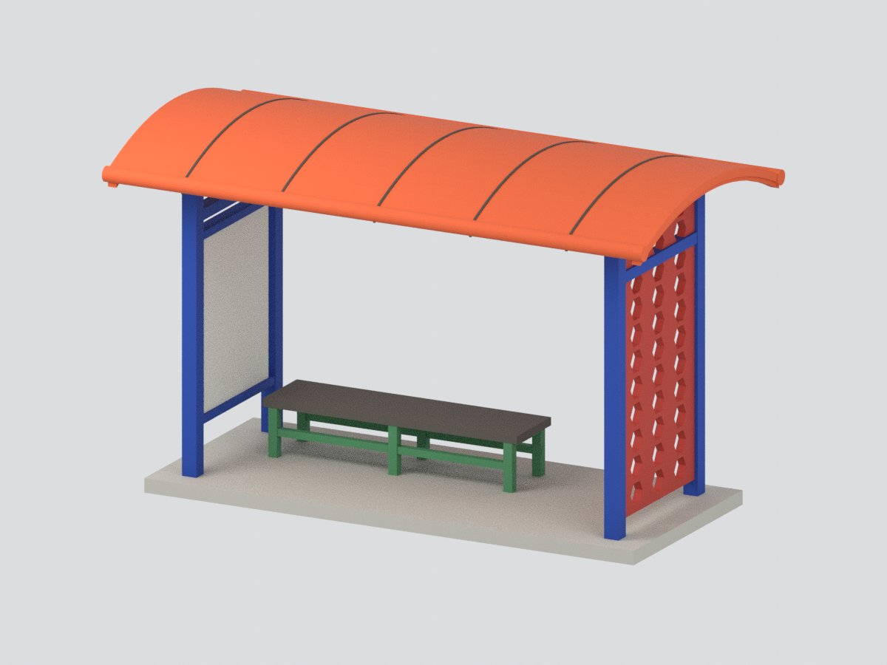

# 修平科技大學｜校本部建築外觀研究模型

現行收錄 **1 套模型包**；套件數不等於完整建築棟數，亦非全校／校區完成。未實體試印，來源年代、估計尺寸與未知範圍請閱各模型頁。

### 既有批次來源與列印限制（原批數量非現行總數）

## 原批完整模型圖鑑

原批收錄 **1 套**；套件不等於整棟建築，亦非全校／校區完成。

| 建築模型 | 建築模型 | 建築模型 |
| :---: | :---: | :---: |
|  **[修平科技大學 校門候車亭｜主要亭體彩色模型](buildings/hust-campus-bus-shelter/README.md)** |  |  |

## 既有說明與更新紀錄

未完成全校／校區，未實體試印。

[回上層圖鑑](../README.md)
