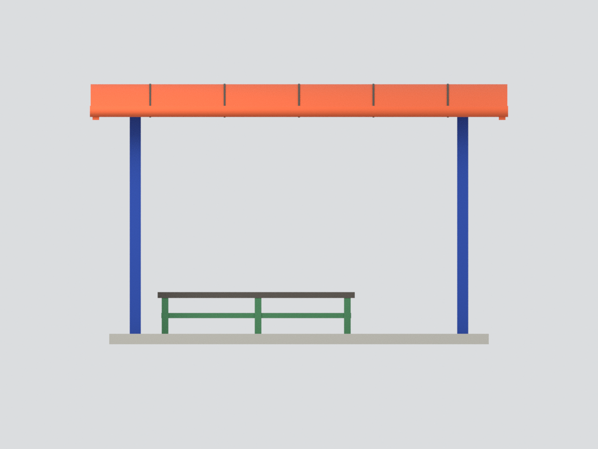
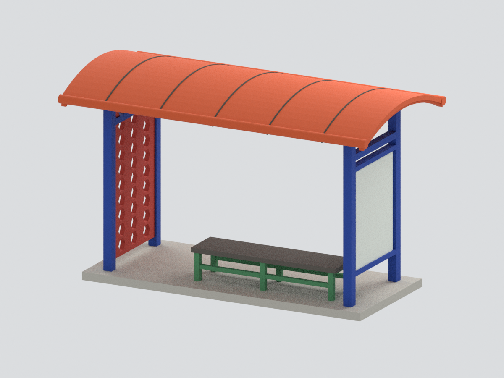
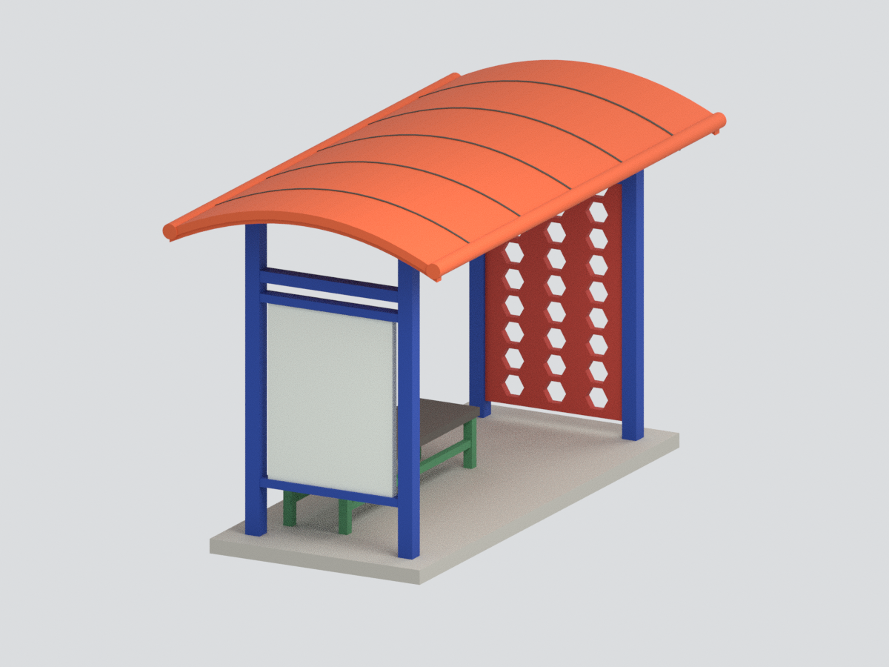
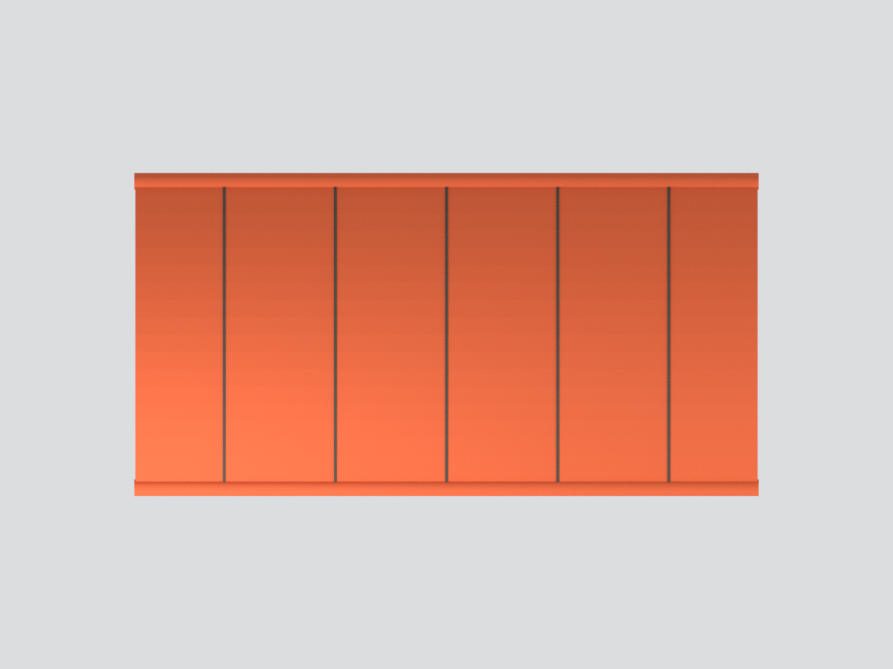
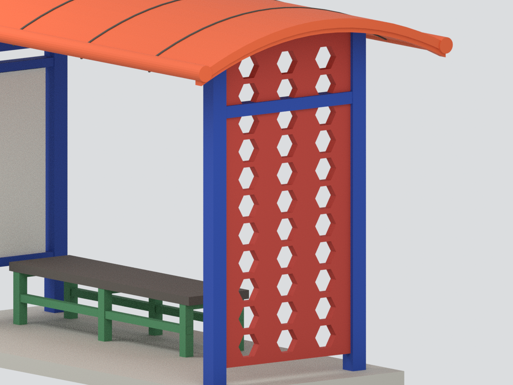

# 修平科技大學 校門候車亭｜主要亭體彩色模型

依修平官方校園相簿正面及近斜面實景照建模：橘色短向淺弧頂、四藍柱、左側無字資訊板、右側紅色六角穿孔板、綠架深色長凳及簡化頂燈。

## 明確範圍
- 完整主要亭體，不含獨立外燈、公車站牌、校門牆、植栽及道路排水設施。
- **右側孔內未知填料省略，並非現況全空孔。** 六角辨識保留，孔數、孔徑及間距為名義簡化，不是逐孔測繪。
- 橘色頂板用不透明有厚度實體代替實照半透明覆材；淺弧、黑分縫和包邊近似，非材料/施工復原。左板及燈不造文字。
- 支撐底盤為連通與展示用，非精確地坪。相片拍攝日期未查證；不宣稱目前樣貌完全未變。尺寸、顏色按照片近似，非測量與色彩校準。

## 檔案與驗證
`model.stl`、8色 `model.3mf`、含隱藏可編輯原始元件的 `scene.blend`、可重建網格的 `build_model.py`。約 157.36 × 81.48 × 97.94 mm。

14項幾何/格式檢查、全新目錄精確重建、Blend等值、五全景一局部構圖及渲染雜湊檢查，各有QA紀錄；不構成實際試印保證。

## 六視圖

[來源與限制](SOURCES.md)。包內不含原始照片或人物影像。
