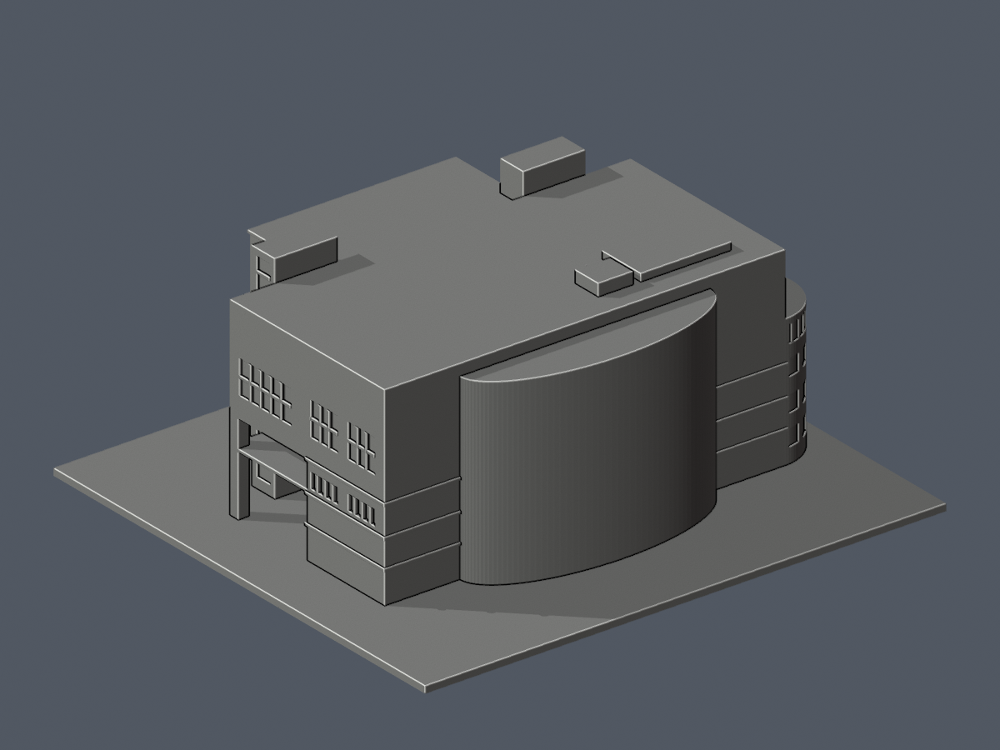

# 健行科技大學校本部

| 圖書館正面 actual STL | 同件背面 actual STL |
| --- | --- |
|  |  |

[圖書館模型與完整限制](buildings/uch-library/README.md)。1990 使用執照主體／2002 整建，外觀參照 2020–2024，150mm含底，有界近似。校本部是本包整理層級名稱。來源私圖未納包。

特定例外已獨立核驗及核可：693 方柱角損、作者76／獨審加密311近角短首弦仍保留嚴格 false；未實體試印，需支撐及拆除風險評估，勿任意縮小。名義高度非官方測量，北窗及地景有未知，正射拍攝年未確認。
