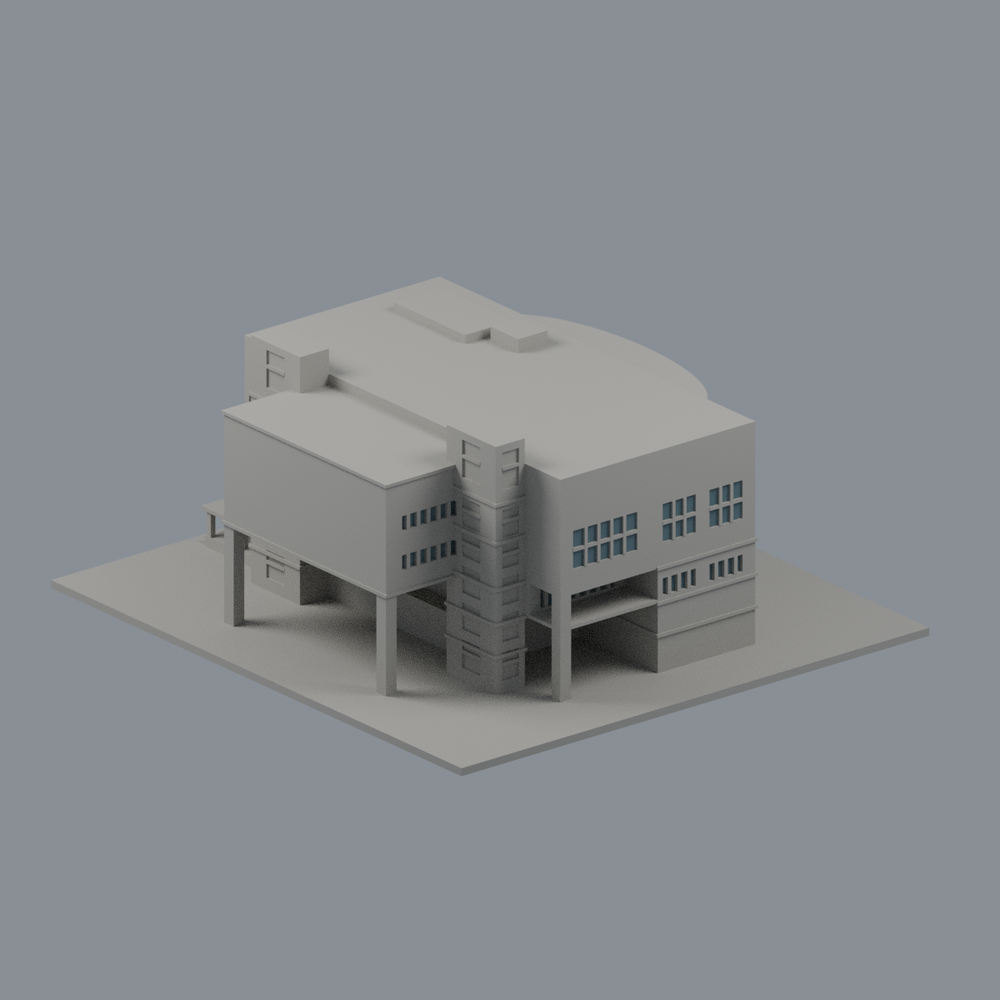
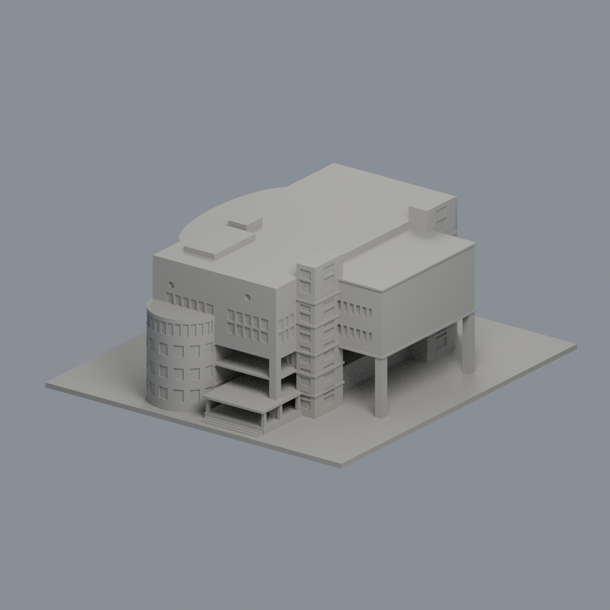
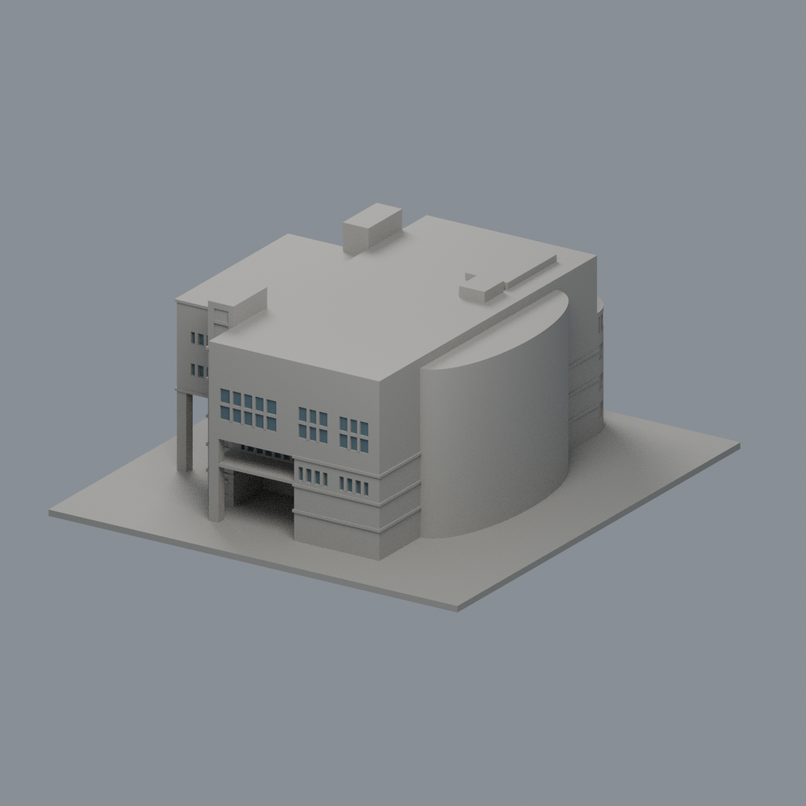
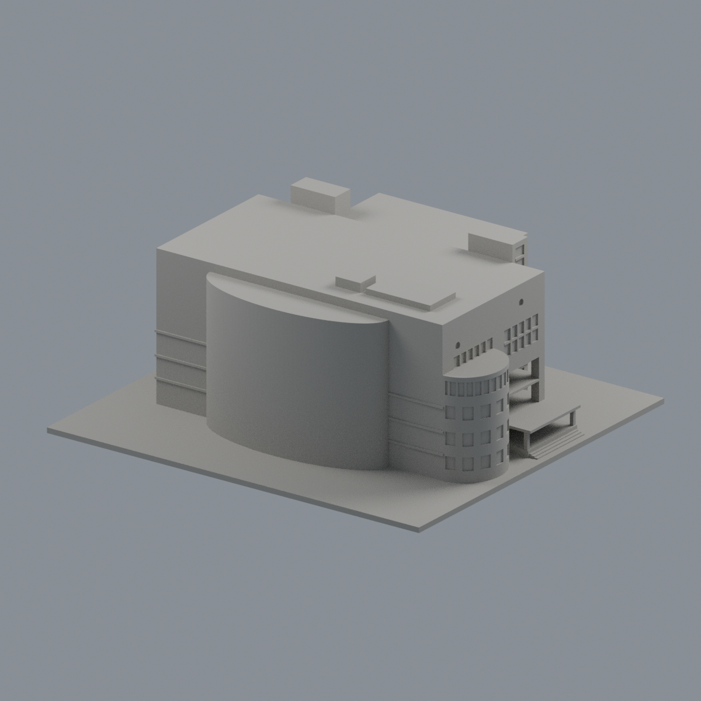
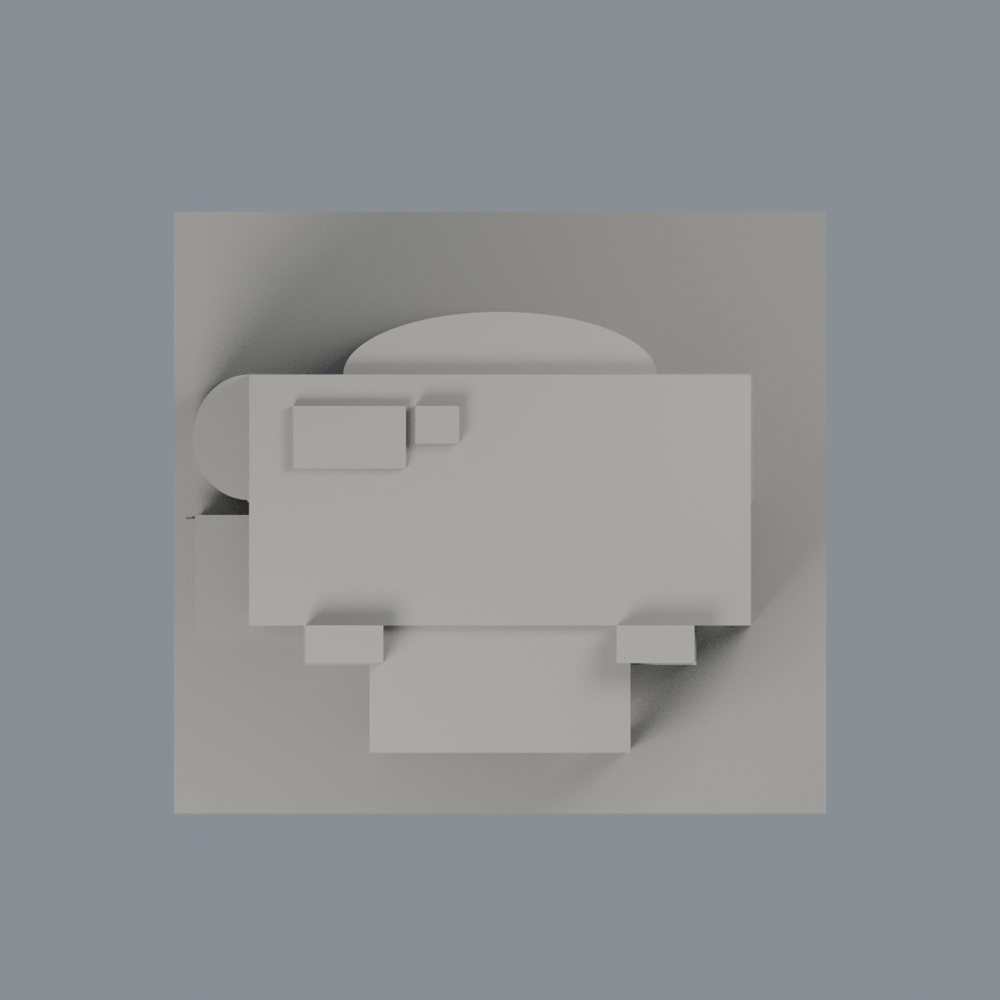

# 健行科技大學圖書館：有界外觀近似模型

## 模型預覽

| 新版模型預覽 | 新版模型預覽 | 新版模型預覽 |
| :---: | :---: | :---: |
|  |  |  |
|  |  |  |

1990 年使用執照主體、2002 年整建；外觀參照官方 2020 年防災資料及 2024 年 8 月西南街景。地上 5 層、地下 2 層；沒有把地下層全部露出或把七層等高堆疊。本模型為原創參數化外觀近似，非測繪、施工圖、官方授權精準復原或實體試印成品。

## 範圍與尺度
150 × 138.46154 × 63.44231 mm，含 2 mm 底板。模型平面比例名義為 150 mm 對應 52 m；主橫翼約 40 × 20 m。主頂 19.125 m、南翼頂約 18.200 m、梯核 21.30 m、北弧核 18 m、西半圓 12.975 m 均為多面照片試配候選，非官方高程。程式歷史名義 z 會乘 0.75；上列是最終實際候選值。初期 22–30 m 高度範圍已被照片比例否定，不當作有效下限。

保留 T 形高部、南中翼架空、大凹廊、四根主方柱、西半圓、兩梯核、五層北弧服務核、西入口棚與台階。相鄰商店、宿舍及行政大樓不在本件。北面和南突出翼端面無完整來源的窗列保守省略。入口台地與地景標高示意；北弧頂高仍有界，不能稱只有兩三層附翼。

## 列印化簡與風險
玻璃為實背接淺凹及細框，不是真玻璃穿孔；柱、框、簷與線腳為列印加厚近似。半圓窗以乾淨徑向槽代替相切布林碎楔，梯核線腳完整接回，棚柱腳下台地有加寬，皆非建築實測細節。保留來源可見方柱，未為機械降低角損任意圓角化。

此件有大架空、棚底、凹廊與水平挑出部位。需自行選擇朝向與支撐，尤其拆支撐時保護棚柱及玻璃細框；勿任意縮小。未實體試印，QA 不是切片器模擬或全方位最小壁厚保證。

**特定例外已獨立核驗並由專案審核者核可；原嚴格 QA 仍非全通過。** 317 層、1147 個原 Polygon 無 split/disappear；其中 693 個方柱截面 opening loss >1%，分大柱 476 與棚柱 217。棚柱最窄約 1.384613 mm、最大損失 7.206104%；大柱最窄 3.173077 mm、最大損失 1.374044%。損失限真角 0.41 mm 鄰域，細節見 [QA](QA.md)。另 76 個半圓窗近邊原法向首弦不足 0.8 mm，最小 0.126243 mm，嚴格報告保留 false，不能用深背牆掩蓋原短首弦。

## 檔案與重現
- [原創 Python](build_model.py)、[實際 STL](model.stl)、[Blender 場景](scene.blend)
- [來源與限制](sources.md)、[參數與描點](source-controls.json)、[QA](QA.md)
- 北上頂圖（歷史檔案留存，不作本頁預覽）、東側配景（歷史檔案留存，不作本頁預覽）、西南配景（歷史檔案留存，不作本頁預覽）

底座朝下為初始列印方向，仍須自行切片及評估支撐。

Python 依賴 numpy、trimesh、manifold3d、shapely、Pillow、rtree，Blender 4.3.2。執行 build_model.py 重建原 STL；render_preview.py 由 Blender 執行，render_top_edges.py 以原 STL 可見銳邊補頂圖線。所有檢查腳本只讀交付原 mesh，不 repair；嚴格檢查失敗保留 exit 1。

獨立加密至50260個原面點，發現311個近角短首弦，最小0.0631215666mm；與作者28720點／76筆分列。表面向內0.00001mm起沿實際鄰面角平分線連續實體至少18.1300099mm，1244內點控制通過；不是跨過空氣才找背牆。大柱真角鄰域外存在極小原邊界碎差，不能稱絕對零，精確值見QA。

## 限域外觀層

[雙材質3MF、可編輯Blend與五視角預覽](appearance/README.md)：僅東面八組完整窗背104面，其餘7076面中性；原strict幾何QA仍false，693角損與作者76／獨審311短弦未修復；非整樓全彩復原。

