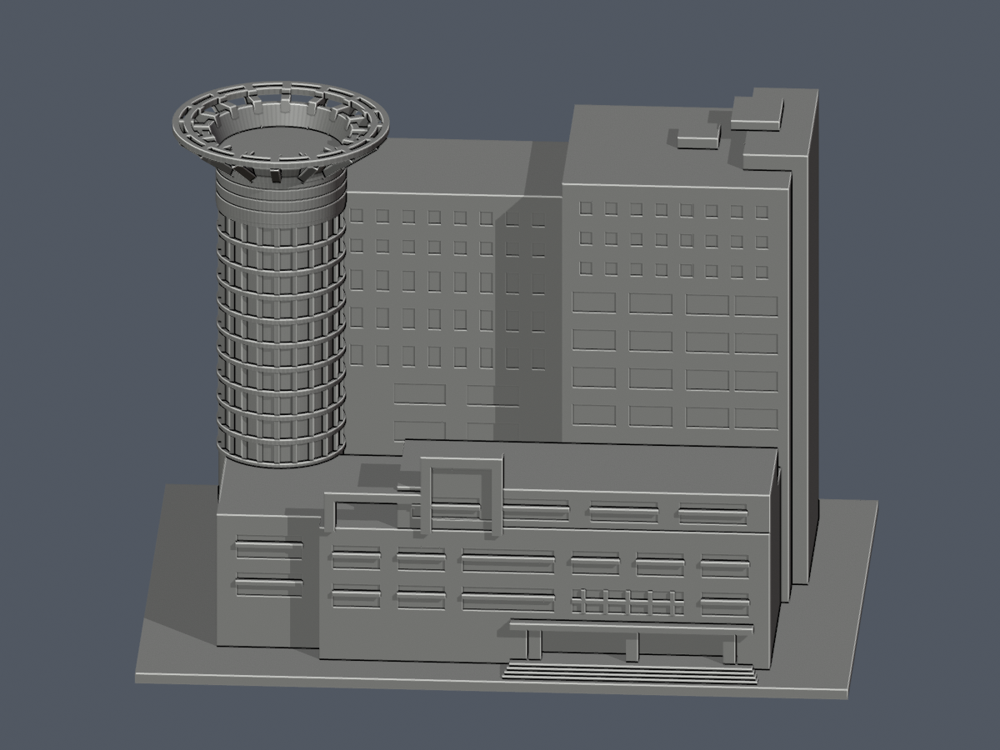
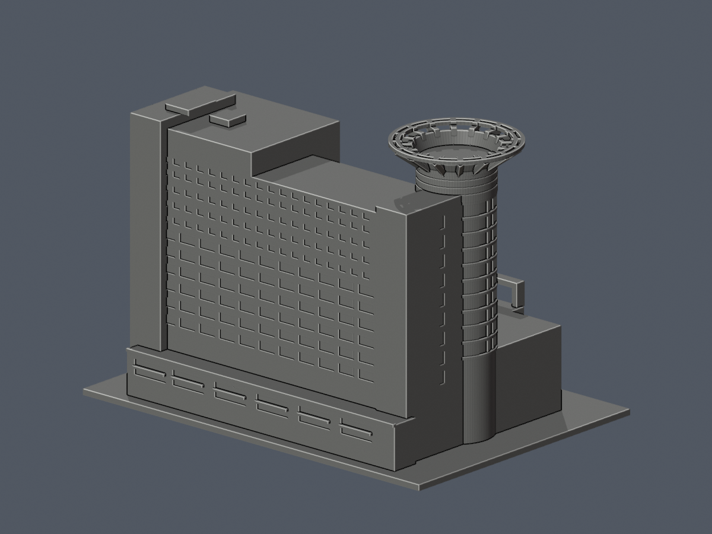
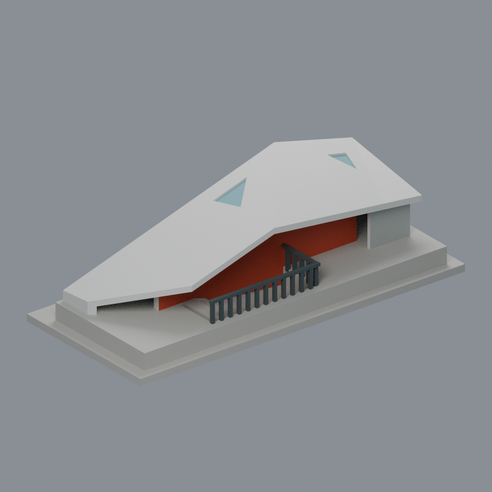

# 校本部 校園模型

既有一件：[圖資大樓](buildings/ocu-library-information/README.md)。2007 年完工主體的公開影像有界近似；只完成本棟，不代表全校。

| 圖資大樓正面 | 同件背面 |
|---|---|
|  |  |

含底最長 150 mm，毫米；名義高度、未知立面與冠梁列印補強限制見模型 README。尚未實體試印，需支撐檢查。嚴格短弦與 opening 警告保留，已獨立裁定並接受限定例外。

## 新增：多功能休閒運動中心折板入口棚

本校目前 **2 套**，套件數不等於整棟建築數，非全校完成；此棚與既有圖資大樓為不同物件；不是全運動中心。

建築師 e0/e3 相反方向實景登錄的同一座地上折板入口棚，非全運動中心或旅館；含明確裁切地下鄰接，任意照片展示尺度，非實測。保留不對稱折板、大小三角凹天窗、跑道側長實牆與步道側紅橘凹入面/欄杆；6材質3MF/Blend/STL。未知短端採中性灰閉合，不推定玻璃；4階僅示意。原始單殼拓樸與215層輪廓有效，但2個嚴格0.8mm侵蝕失敗層及局部細節損失如實保留，需支撐評估，未實印。

[模型、來源與 QA](buildings/ocu-sports-folded-stair-pavilion/README.md)
