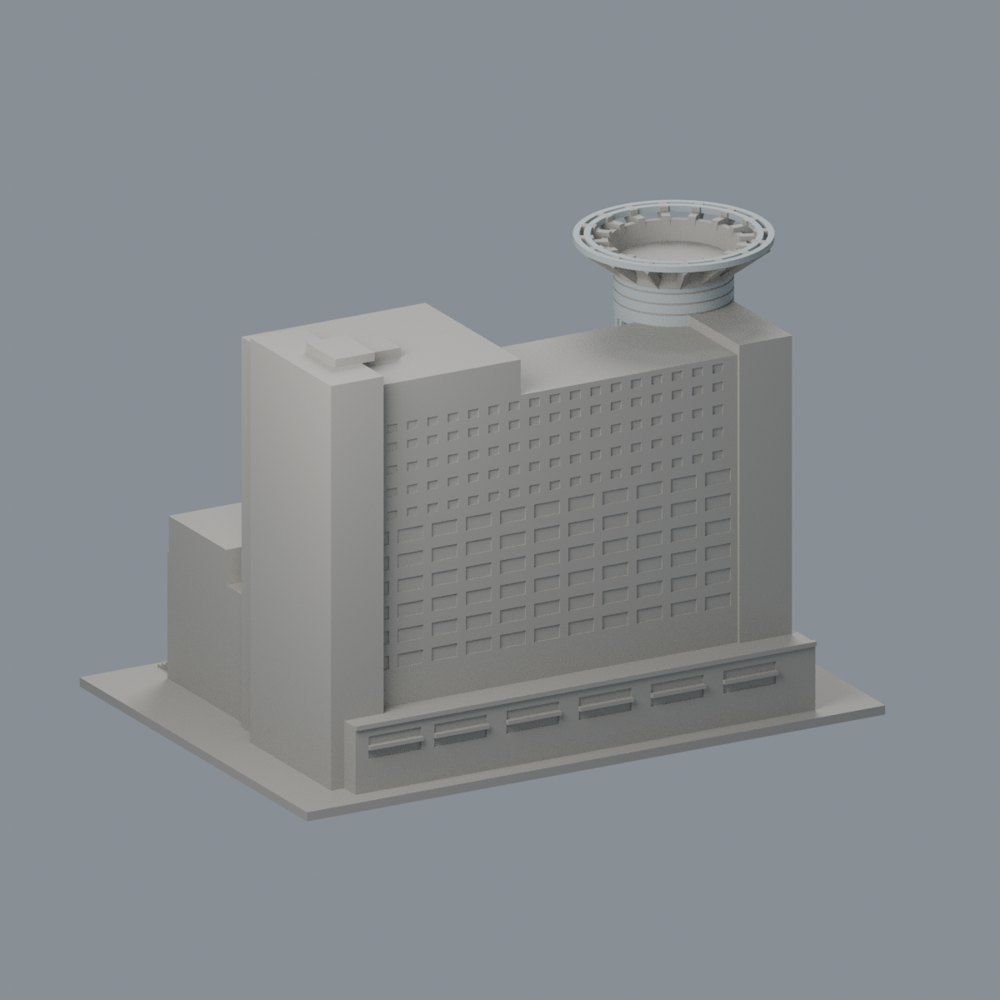

# 校本部 校園模型

本校目前 **2 套**，套件數不等於整棟建築數，非全校完成；此棚與既有圖資大樓為不同物件；不是全運動中心。

既有一件：[圖資大樓](buildings/ocu-library-information/README.md)。2007 年完工主體的公開影像有界近似；只完成本棟，不代表全校。

| 建築模型 | 建築模型 | 建築模型 |
| :---: | :---: | :---: |
| 圖資大樓正面  同件背面  |  **[僑光科技大學多功能休閒運動中心折板入口棚](buildings/ocu-sports-folded-stair-pavilion/README.md)** |  |

含底最長 150 mm，毫米；名義高度、未知立面與冠梁列印補強限制見模型 README。尚未實體試印，需支撐檢查。嚴格短弦與 opening 警告保留，已獨立裁定並接受限定例外。
